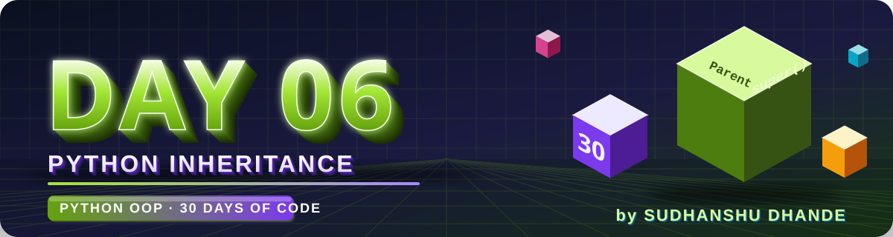
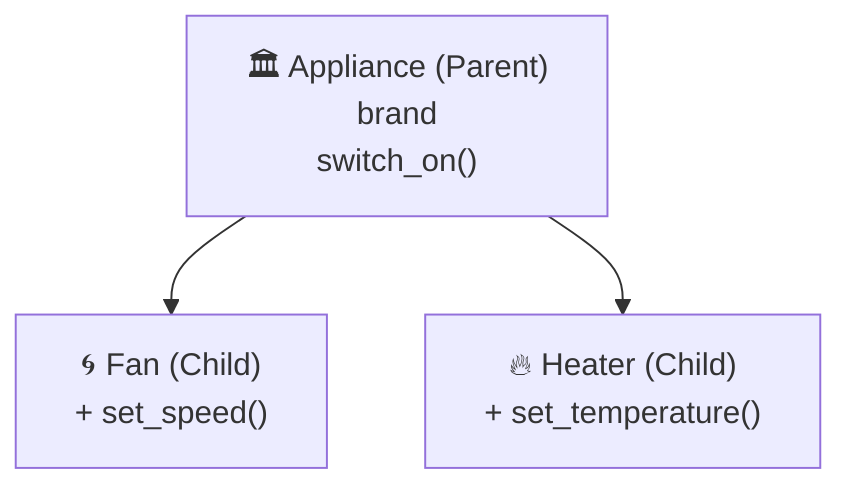
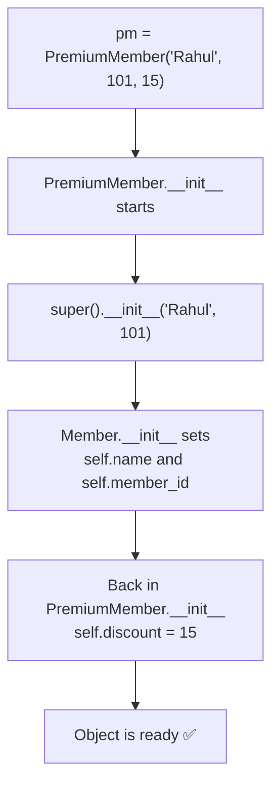

<p align="center">
  
</p>

<p align="center">
  
  
  
  
</p>

# 🟢 Day 06 — Python Inheritance

## 🎯 Learning Objectives

Today I will learn:

- What is inheritance in Python?
- Why do we use inheritance?
- What are parent and child classes?
- How can a child class reuse parent-class methods?
- How can a child class have its own attributes and methods?
- How to initialize child objects using `__init__()`
- How to use `super()` to call parent-class methods
- What is method overriding?
- How inheritance improves code reusability
- How to implement inheritance in real-world projects

---

# 📖 Day 06 Concepts — Read & Understand First

> Read this section slowly **before** solving the problems. Type every example yourself in VS Code and run it.

## 1️⃣ The Problem: Repeating Code

Suppose we want classes for a **Fan** and a **Heater**. Both have a `brand` and can be switched on:

```python
class Fan:
    def __init__(self, brand):
        self.brand = brand

    def switch_on(self):
        print(f"{self.brand} is ON")

class Heater:
    def __init__(self, brand):          # ❌ same code again
        self.brand = brand

    def switch_on(self):                # ❌ same code again
        print(f"{self.brand} is ON")
```

> 😕 The same code is written twice. With 10 appliances, it would be written 10 times — and fixing a bug means changing **10 places**.
> **Inheritance** solves this: write the common code **once**, and let other classes **reuse** it.

---

## 2️⃣ What is Inheritance?

**Inheritance** is a feature of OOP where a **child class automatically gets the attributes and methods of a parent class**.

> 👨‍👩‍👧 **Analogy:** A child inherits features from their parents (eye colour, surname) and can also have their **own** features. In the same way, a child class inherits the parent's code and can add its **own** code.

| Term                 | Other names                   | Meaning                                    |
| -------------------- | ----------------------------- | ------------------------------------------ |
| **Parent class**     | Base class, Super class       | The class whose features are inherited     |
| **Child class**      | Derived class, Sub class      | The class that inherits from the parent    |
| **Inheritance**      | —                             | Child gets parent's attributes and methods |
| **Code reusability** | —                             | Write once, use in many classes            |

---

## 3️⃣ Syntax of Inheritance

Write the **parent's name in brackets** after the child's name:

```python
class Parent:
    ...

class Child(Parent):       # Child inherits from Parent
    ...
```

**Example:**

```python
class Appliance:                                    # PARENT
    def __init__(self, brand):
        self.brand = brand

    def switch_on(self):
        print(f"{self.brand} is ON")

class Fan(Appliance):                               # CHILD
    def set_speed(self, speed):
        print(f"{self.brand} fan speed set to {speed}")

class Heater(Appliance):                            # CHILD
    def set_temperature(self, temp):
        print(f"{self.brand} heater set to {temp} degrees")

f = Fan("Havells")
f.switch_on()           # Havells is ON            ← inherited from Appliance
f.set_speed(3)          # Havells fan speed set to 3   ← Fan's own method

h = Heater("Bajaj")
h.switch_on()           # Bajaj is ON              ← inherited from Appliance
h.set_temperature(60)   # Bajaj heater set to 60 degrees
```



📌 Notice:

* `Fan` has **no** `__init__` and **no** `switch_on()`, yet `Fan("Havells")` and `f.switch_on()` work — they were **inherited**.
* The code for `brand` and `switch_on()` is written **only once**, in `Appliance`.

---

## 4️⃣ The "is-a" Test — When to Use Inheritance

Use inheritance only when the child **is a** special type of the parent.

| Pair                  | Sentence to test             | Use inheritance? |
| --------------------- | ---------------------------- | :--------------: |
| `Fan` → `Appliance`   | A Fan **is an** Appliance    |        ✅         |
| `Student` → `Person`  | A Student **is a** Person    |        ✅         |
| `Car` → `Engine`      | A Car **is an** Engine ❌     |        ❌         |

> A Car **has an** Engine (that is a different idea called *composition*, which we will learn later). Don't use inheritance just to copy code.

---

## 5️⃣ Child Has Its Own Features — But Parent Doesn't Get Them

Inheritance works in **one direction only**: **parent → child**.

```python
a = Appliance("Generic")
a.set_speed(2)
```

```text
AttributeError: 'Appliance' object has no attribute 'set_speed'
```

* A **child** object can use **parent's** methods ✅
* A **parent** object **cannot** use **child's** methods ❌

---

## 6️⃣ Constructors in Inheritance

### a) Child has **no** `__init__` → the parent's `__init__` is used

That is what happened in the `Fan("Havells")` example above.

### b) Child has **its own** `__init__` → the parent's `__init__` is **NOT** called automatically

```python
class Member:
    def __init__(self, name, member_id):
        self.name = name
        self.member_id = member_id

    def show(self):
        print(f"Name: {self.name}, ID: {self.member_id}")

class PremiumMember(Member):
    def __init__(self, discount):        # ❌ replaces the parent's __init__
        self.discount = discount

pm = PremiumMember(10)
pm.show()
```

```text
AttributeError: 'PremiumMember' object has no attribute 'name'
```

> 😕 `name` and `member_id` were never set, because `Member.__init__` never ran.

---

## 7️⃣ `super()` — Calling the Parent

`super()` gives access to the **parent class**. The most common use is to **run the parent's constructor** from the child's constructor:

```python
class Member:
    def __init__(self, name, member_id):
        self.name = name
        self.member_id = member_id

    def show(self):
        print(f"Name: {self.name}, ID: {self.member_id}")

class PremiumMember(Member):
    def __init__(self, name, member_id, discount):
        super().__init__(name, member_id)     # parent sets name and member_id
        self.discount = discount              # child sets its own attribute

pm = PremiumMember("Rahul", 101, 15)
pm.show()               # Name: Rahul, ID: 101
print(pm.discount)      # 15
```

**What happens step by step?**



📌 **Important rules for `super().__init__()`**

* Write `super().__init__(name, member_id)` — **do not pass `self`** (Python passes it automatically).
* Pass the values the **parent's** `__init__` expects.
* Call it **first**, then set the child's own attributes.

```python
super().__init__(self, name, member_id)   # ❌ extra self → TypeError
```

> There is also an older way: `Member.__init__(self, name, member_id)`. It works, but `super()` is the recommended way.

---

## 8️⃣ Method Overriding

If a child class defines a method with the **same name** as the parent's method, the **child's version is used** for child objects. This is called **method overriding**.

```python
class Creature:
    def __init__(self, name):
        self.name = name

    def move(self):
        print(f"{self.name} moves")

class Bird(Creature):
    def move(self):                       # overrides the parent's move()
        print(f"{self.name} flies")

class Fish(Creature):
    def move(self):                       # overrides the parent's move()
        print(f"{self.name} swims")

class Snail(Creature):
    pass                                  # no override → uses the parent's move()

for c in [Bird("Parrot"), Fish("Shark"), Snail("Snail")]:
    c.move()
```

**Output:**

```text
Parrot flies
Shark swims
Snail moves
```

> 💡 **How Python finds a method:** it looks in the **child class first**. If the method is not there, it looks in the **parent class**.

### Extending (not fully replacing) a parent method with `super()`

Sometimes you want to **run the parent's version and then add more**:

```python
class Member:
    ...
    def show(self):
        print(f"Name: {self.name}, ID: {self.member_id}")

class PremiumMember(Member):
    def __init__(self, name, member_id, discount):
        super().__init__(name, member_id)
        self.discount = discount

    def show(self):
        super().show()                          # parent's version first
        print(f"Discount: {self.discount}%")    # then extra info

PremiumMember("Rahul", 101, 15).show()
```

```text
Name: Rahul, ID: 101
Discount: 15%
```

---

## 9️⃣ Useful Checks: `isinstance()` and `issubclass()`

```python
b = Bird("Parrot")

print(isinstance(b, Bird))          # True   (b is a Bird)
print(isinstance(b, Creature))      # True   (a Bird is also a Creature)
print(isinstance(b, Fish))          # False
print(issubclass(Bird, Creature))   # True
```

> 💡 You can use these to **test your own programs**.

---

## 🔟 Why Inheritance Is Useful

| Benefit                     | Meaning                                                           |
| --------------------------- | ----------------------------------------------------------------- |
| ✅ **Code reusability**      | Write common code once in the parent                              |
| ✅ **Less duplication**      | No copy-pasting the same attributes and methods                   |
| ✅ **Easy maintenance**      | Fix a bug in the parent → all children get the fix                |
| ✅ **Natural structure**     | Models real-world relationships (Person → Student, Person → Teacher) |
| ✅ **Easy extension**        | Add a new child class without touching the existing ones          |

**Inheritance vs separate classes:**

| Separate classes                                  | Inheritance                                   |
| ------------------------------------------------- | --------------------------------------------- |
| Common code is **repeated** in every class        | Common code is written **once** in the parent |
| Changes must be made in **every** class           | Change the parent **once**                    |
| No relationship between classes                   | Clear "is-a" relationship                     |

---

## 1️⃣1️⃣ Types of Inheritance (Preview)

| Type               | Shape                              | When we learn it |
| ------------------ | ---------------------------------- | ---------------- |
| **Single**         | One parent → one child             | **Today**        |
| **Hierarchical**   | One parent → many children         | Today (used in Q11–Q15) |
| **Multilevel**     | Grandparent → Parent → Child       | Day 25           |
| **Multiple**       | Many parents → one child           | Day 24           |
| **Hybrid**         | Mixture of the above               | Day 26           |

---

## 1️⃣2️⃣ Common Mistakes (Avoid These!)

| ❌ Mistake                                                       | ✅ Fix                                                               |
| --------------------------------------------------------------- | ------------------------------------------------------------------- |
| Forgetting the parent in brackets: `class Dog:`                  | `class Dog(Animal):`                                                |
| Child has `__init__` but forgets `super().__init__(...)`         | Call `super().__init__(...)` with the parent's required values      |
| Passing `self` to `super().__init__(self, ...)`                  | `super().__init__(...)` — no `self`                                 |
| Passing too few / too many values to the parent's constructor    | Match the parent's `__init__` parameters exactly                    |
| Using child attributes before setting them                       | Set parent attributes via `super()`, then the child's own           |
| Calling a child's method on a parent object                      | Only child objects can use child methods                            |
| Overriding with a different method name                          | Use the **exact same name** to override                             |
| Using inheritance when it is not an "is-a" relationship          | Ask: "Is the child **a** type of the parent?"                       |
| Repeating the parent's attributes in the child                   | Let the parent handle them (through `super()`)                      |

> The exact wording of a `TypeError` for wrong arguments differs between Python versions, but it always mentions the number of arguments.

---

## 📌 Day 06 in One Look

```text
Inheritance   →  Child class gets parent's attributes and methods    →  class Child(Parent):
Parent class  →  The class being inherited from (base / super class)
Child class   →  The class that inherits (derived / sub class)
super()       →  Access to the parent class                          →  super().__init__(...)
Overriding    →  Child redefines a parent's method (same name)
Lookup order  →  Child first, then parent
is-a test     →  Use inheritance only if "Child is a Parent"
Direction     →  Parent → Child only (never Child → Parent)
```

**Template to remember:**

```python
class Parent:
    def __init__(self, a, b):
        self.a = a
        self.b = b

    def show(self):
        print(self.a, self.b)

class Child(Parent):
    def __init__(self, a, b, c):
        super().__init__(a, b)      # parent's part
        self.c = c                  # child's own part

    def show(self):                 # optional: override
        super().show()
        print(self.c)
```

---

## 📚 Theory Checklist

Before solving the problems, I should be able to answer:

1. What is inheritance?
2. Why do we use inheritance?
3. What is a parent class?
4. What is a child class?
5. What is code reusability?
6. How does a child class inherit a parent class?
7. Can a child class have its own methods?
8. Can a child class access inherited methods?
9. What happens when both parent and child classes have an `__init__()` method?
10. What is the purpose of `super()`?
11. What is method overriding?
12. What is the difference between inheritance and creating separate classes?

---

## 🧩 Day 06 Practice — 15 Problems

### 🟢 Level 1 — Basic Inheritance

#### Q1. Animal and Dog

Create a parent class `Animal` with a method:

`eat()`

Create a child class `Dog` that inherits from `Animal`.

Add a method `bark()` to `Dog`.

Create a `Dog` object and call both methods.

#### Q2. Person and Student

Create a parent class `Person` with:

- `name`
- `age`
- `display_person()`

Create a child class `Student` with:

- `roll_number`
- `display_student()`

Display the person's and student's details.

#### Q3. Vehicle and Car

Create a parent class `Vehicle` with:

- `brand`
- `speed`
- `display_vehicle()`

Create a child class `Car` with:

- `model`
- `display_car()`

Create a car object and display all details.

#### Q4. Employee and Manager

Create a parent class `Employee` with:

- `name`
- `salary`
- `display_details()`

Create a child class `Manager` with:

- `team_size`
- `display_team()`

Display the manager's employee details and team size.

#### Q5. Shape and Rectangle

Create a parent class `Shape` with a method `description()` that prints `"This is a shape"`.

Create a child class `Rectangle` with:

- `length`
- `width`
- `area()`

Display the description and calculate the rectangle's area.

---

### 🟡 Level 2 — Constructors and `super()`

#### Q6. Person and Teacher

Create a parent class `Person` with a constructor accepting:

- `name`
- `age`

Create a child class `Teacher` with:

- `subject`
- `salary`

Requirements:

- Initialize the parent attributes.
- Initialize the child attributes.
- Use `super()` to call the parent constructor.
- Display all details.

#### Q7. User and Admin

Create a parent class `User` with:

- `username`
- `email`
- `login()`

Create a child class `Admin` with:

- `access_level`
- `manage_users()`

Create an admin object and call all applicable methods.

#### Q8. Bank Account and Savings Account

Create a parent class `BankAccount` with:

- `account_holder`
- `balance`
- `deposit(amount)`
- `display_balance()`

Create a child class `SavingsAccount` with:

- `interest_rate`
- `calculate_interest()`

Formula:

`Interest = balance × interest_rate / 100`

Use `super()` in the child constructor. Test the account with different balances.

#### Q9. Product and Electronic Product

Create a parent class `Product` with:

- `name`
- `price`
- `display_product()`

Create a child class `ElectronicProduct` with:

- `brand`
- `warranty_years`

Display all product information.

#### Q10. Library Item and Book

Create a parent class `LibraryItem` with:

- `title`
- `item_id`
- `display_item()`

Create a child class `Book` with:

- `author`
- `pages`

Use `super()` to initialize parent attributes and display all details.

---

### 🔴 Level 3 — Logic Building

#### Q11. Method Overriding

Create a parent class `Animal` with a method `sound()` that prints `"Animal makes a sound"`.

Create child classes:

- `Dog`
- `Cat`
- `Cow`

Override the `sound()` method in each child class.

Create one object of each class and call `sound()`.

#### Q12. Employee Salary System

Create a parent class `Employee` with:

- `name`
- `basic_salary`
- `annual_salary()`

Create two child classes:

- `Manager`
- `Developer`

Requirements:

- A manager receives a 20% annual bonus.
- A developer receives a 10% annual bonus.
- Use separate methods to calculate each employee's final annual salary.

Assume the bonus is calculated from 12 months of basic salary.

#### Q13. Payment System

Create a parent class `Payment` with a method `process_payment()`.

Create child classes:

- `CreditCardPayment`
- `UPIPayment`
- `CashPayment`

Override `process_payment()` in each child class with a different message.

Create objects and demonstrate the different payment methods.

#### Q14. School Management

Create a parent class `Person` with:

- `name`
- `age`

Create child classes:

- `Student`, with `roll_number` and `marks`
- `Teacher`, with `subject` and `salary`

Use constructors and `super()` appropriately.

Create at least two students and two teachers, then display their details.

#### Q15. Transport Fare Calculator

Create a parent class `Transport` with:

- `distance`
- `calculate_fare()`

Create child classes:

- `Bus`
- `Taxi`
- `Train`

Fare rules:

- Bus: ₹5 per kilometre
- Taxi: ₹15 per kilometre
- Train: ₹2 per kilometre

Override `calculate_fare()` in each child class.

Calculate the fare for a distance of 20 km and compare the results.

---

## ⭐ Day 06 Challenge — College Management System

Build a small college management system using inheritance.

### Parent Class: `Person`

Attributes:

- `name`
- `age`
- `city`

Method:

- `display_person()`

### Child Class 1: `Student`

Additional attributes:

- `roll_number`
- `branch`
- `marks`

Methods:

- `display_student()`
- `calculate_percentage()`
- `check_result()`

### Child Class 2: `Teacher`

Additional attributes:

- `employee_id`
- `subject`
- `salary`

Methods:

- `display_teacher()`
- `annual_salary()`

### Requirements

1. Use `Person` as the parent class.
2. Use `Student` and `Teacher` as child classes.
3. Use `__init__()` constructors.
4. Use `super()` to initialize the common person attributes.
5. Create at least three student objects and two teacher objects.
6. Display all details.
7. Calculate each student's percentage.
8. Assume the student passes when the percentage is at least 40%.
9. Calculate each teacher's annual salary.
10. Keep your code organized and avoid unnecessary repetition.

**Bonus:** Add a method called `introduce()` to `Person` and override it in both child classes.

---

## 🧠 Concept Challenge

Explain these concepts in your own words:

1. What is inheritance, and why do we need it?
2. What is the difference between a parent class and a child class?
3. What does `super()` do?
4. What is method overriding?
5. How does inheritance reduce code duplication?
6. Can a child class have its own attributes and methods?

Write your answers in this README.

---

## 📁 Day 06 Folder Structure

```text
Day06_Inheritance/
│
├── banner.svg
├── README.md
├── Q01.py
├── Q02.py
├── ...
├── Q15.py
├── Q16_Challenge.py          # or college_management.py
```

Write each solution in its own file, with a comment at the top such as `# Q1`, `# Q2`, and so on.

For the challenge, you may create a separate file named `college_management.py`.

> Use two-digit file names (`Q01`, `Q02`, … `Q15`) so GitHub shows them in the correct order.

---

## 📊 Day 06 Target

| Task | Target |
|---|---:|
| Theory questions | 12 |
| Basic problems | 5 |
| Constructor and `super()` problems | 5 |
| Logic-building problems | 5 |
| Main challenge | 1 |
| Total practice problems | 15 + 1 challenge |

---

## 🚫 Rules

- Do not copy solutions.
- Try each question yourself first.
- Understand parent and child classes before using `super()`.
- Use inheritance only when the child class represents a suitable specialized version of the parent class.
- Test constructors and inherited methods.
- Practise method overriding separately.
- Do not move to Day 7 until you can create a basic parent and child class independently.

---

## ✅ Completion Checklist

- [ ] Understood inheritance
- [ ] Understood parent and child classes
- [ ] Practised inherited methods
- [ ] Practised constructors with inheritance
- [ ] Understood `super()`
- [ ] Practised method overriding
- [ ] Solved Q1–Q5
- [ ] Solved Q6–Q10
- [ ] Solved Q11–Q15
- [ ] Completed the College Management System
- [ ] Tested all programs
- [ ] Updated README
- [ ] Pushed code to GitHub

---

## 🚀 GitHub Commit

```bash
git add .
git status
git commit -m "Day 06: Python inheritance practice"
git push
```

**Day 06 Goal:** Build a strong understanding of inheritance, constructors, `super()`, and method overriding before moving to the next OOP topic.

---

<p align="center">
  
</p>

<h3 align="center"><b>Sudhanshu Dhande</b> </h3>
<p align="center"><i>B.Tech(AI &amp; ML) · BATU, Lonere · Python OOP Journey</i></p>
