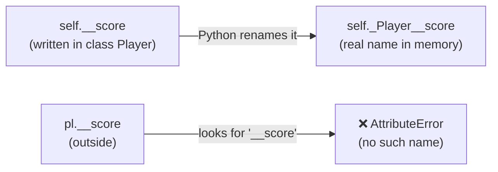

<p align="center">
  
</p>

<p align="center">
  
  
  
  
</p>

# 🟢 Day 07 — Access Specifiers in Python

## 🎯 Learning Objectives

Today I will learn:

- What are access specifiers?
- What are public, protected, and private attributes?
- How to create public attributes and methods
- What does a single underscore `_` indicate?
- What does a double underscore `__` do?
- What is name mangling?
- How to access attributes from outside a class
- How child classes interact with inherited attributes
- How to use methods and properties to control access to data
- Why Python's access conventions matter in real-world projects

---

# 📖 Day 07 Concepts — Read & Understand First

> Read this section slowly **before** solving the problems. Type every example yourself in VS Code and run it. Today builds on **Day 05 (Getters & Setters)** and **Day 06 (Inheritance)**.

## 1️⃣ What are Access Specifiers?

**Access specifiers** (also called *access modifiers*) decide **who is allowed to use** the attributes and methods of a class.

> 🏠 **Analogy:** A house.
> 🛋️ **Living room** → anyone can enter (**public**)
> 🛏️ **Family bedroom** → meant for family members only (**protected**)
> 🔐 **Safe locker** → only the owner, from the inside (**private**)

Why do we need them?

* ✅ **Protect data** from accidental changes
* ✅ **Hide internal details** — users of the class need to know *what* it does, not *how*
* ✅ **Safer code** — important values (balance, password, marks) change only through checked methods

This idea is part of **encapsulation**, which we started on Day 05.

---

## 2️⃣ Python's Special Approach

In languages like Java or C++, there are keywords `public`, `protected`, and `private` that **block** access.

**Python has no such keywords.** Instead, Python uses **naming conventions** — the way you write the name tells everyone how it should be used:

| Type          | How to write | Example      | Meaning                                  |
| ------------- | ------------ | ------------ | ---------------------------------------- |
| **Public**    | No underscore | `name`      | Free to use from anywhere                |
| **Protected** | **One** underscore `_` | `_name` | "Internal use — for this class and its child classes" |
| **Private**   | **Two** underscores `__` | `__name` | "Only for this class itself" (Python renames it) |

> 💬 Python's philosophy: *"We are all consenting adults here."* Python trusts programmers to follow the conventions instead of locking everything.

---

## 3️⃣ Public Members

Anything **without an underscore** is public. It can be read and changed from **anywhere**.

```python
class Pen:
    def __init__(self, brand, colour):
        self.brand = brand          # public attribute
        self.colour = colour        # public attribute

    def describe(self):             # public method
        print(f"{self.colour} pen by {self.brand}")

p = Pen("Reynolds", "Blue")
print(p.brand)          # Reynolds     ← read from outside
p.colour = "Black"      #              ← changed from outside
p.describe()            # Black pen by Reynolds
```

📌 **Everything we wrote on Day 01–04 was public.** Simple and easy, but **nothing stops wrong values** (like a negative price).

---

## 4️⃣ Protected Members (Single Underscore `_`)

A name starting with **one underscore** is a **hint**: *"This is internal. Please don't touch it from outside; only this class and its child classes should use it."*

```python
class Gadget:
    def __init__(self, name, battery):
        self.name = name
        self._battery = battery            # protected (by convention)

    def show_battery(self):
        print(f"{self.name}: {self._battery}%")

class Phone(Gadget):                       # child class
    def charge(self):
        self._battery = 100                # ✅ child classes use protected members
        print(f"{self.name} fully charged")

g = Gadget("Watch", 40)
g.show_battery()        # Watch: 40%

print(g._battery)       # 40    ← Python does NOT stop us!
g._battery = 10         #       ← this also works
g.show_battery()        # Watch: 10%

ph = Phone("Pixel", 20)
ph.charge()             # Pixel fully charged
ph.show_battery()       # Pixel: 100%
```

> ⚠️ **Important:** `_battery` is **still accessible** outside the class. The single underscore is **only a convention / warning** — not a real lock. Code editors (like VS Code) may show a hint, but Python itself allows it.

**Use protected (`_`) when:** the attribute is internal, but **child classes** may need it.

---

## 5️⃣ Private Members (Double Underscore `__`)

A name starting with **two underscores** (and not ending with two) is **private**.

```python
class Player:
    def __init__(self, name):
        self.name = name
        self.__score = 0                 # private attribute

    def add_points(self, pts):           # controlled way to change it
        if pts > 0:
            self.__score += pts
        else:
            print("Points must be positive")

    def get_score(self):                 # controlled way to read it
        return self.__score

pl = Player("Asha")
pl.add_points(10)
pl.add_points(-5)         # Points must be positive
print(pl.get_score())     # 10

print(pl.__score)         # ❌ AttributeError
```

```text
AttributeError: 'Player' object has no attribute '__score'
```

* **Inside** the class, `self.__score` works normally.
* **Outside** the class, `pl.__score` fails.
* To use it from outside, go through **methods** (`add_points`, `get_score`) — which can also **validate** the data.

---

## 6️⃣ What is Name Mangling?

Python doesn't truly hide `__score`. It **renames** it behind the scenes:

```text
__score   →   _ClassName__score      (here:  _Player__score)
```

This renaming is called **name mangling**. You can see it:

```python
print(pl.__dict__)
# {'name': 'Asha', '_Player__score': 10}

print([a for a in dir(pl) if "score" in a])
# ['_Player__score', 'get_score']
```

And the mangled name **still works**:

```python
print(pl._Player__score)     # 10   ← works!
pl._Player__score = 999      # works too
print(pl.get_score())        # 999
```



> 🔑 **Key point:** Name mangling is **not a security feature**. It only **prevents accidental access** and **name clashes** between parent and child classes.
> ⚠️ Accessing `_Player__score` directly is **not recommended** — it breaks the idea of hiding internal details, and the code breaks if the class name changes. Always use the class's public methods or properties.

---

## 7️⃣ Private Members and Child Classes

A child class **cannot** directly use the parent's private attribute by its original name:

```python
class Parent:
    def __init__(self):
        self.__secret = "parent-secret"

    def reveal(self):
        return self.__secret

class Child(Parent):
    def try_direct(self):
        return self.__secret         # Python looks for _Child__secret

c = Child()
print(c.reveal())                    # parent-secret   ← works (through parent's method)

c.try_direct()                       # ❌ AttributeError
```

```text
AttributeError: 'Child' object has no attribute '_Child__secret'
```

Why? Inside `Child`, `__secret` is mangled to `_Child__secret`, but the data is stored as `_Parent__secret`.

| Member type   | Used directly in child class? |
| ------------- | :---------------------------: |
| Public `x`    |               ✅               |
| Protected `_x`|               ✅               |
| Private `__x` |  ❌ (use a **method** of the parent) |

> 💡 That is why parent classes that want children to use data should keep it **protected (`_x`)**, or give **public/protected methods** to access the private data.

---

## 8️⃣ Private Methods

Methods can be private too. They are meant for **internal helper work**:

```python
class Cafe:
    def __prepare(self):                 # private helper method
        print("Preparing...")

    def order(self):                     # public method
        self.__prepare()
        print("Order ready")

cf = Cafe()
cf.order()          # Preparing...
                    # Order ready

cf.__prepare()      # ❌ AttributeError: 'Cafe' object has no attribute '__prepare'
```

---

## 9️⃣ Special "Dunder" Names Are NOT Mangled

Names that **start and end** with double underscores (like `__init__`, `__str__`) are **special methods** of Python. They are **not** private and are **not** mangled.

```python
class D:
    def __init__(self):
        self.__x__ = 5

d = D()
print(d.__x__)       # 5   ← works; names ending with __ are not mangled
```

> ✅ Private = starts with `__` and does **not** end with `__`.

---

## 🔟 Controlled Access: Methods and Properties

The correct way to work with private data is through **getters/setters or `@property`** (Day 05):

```python
class Player:
    def __init__(self):
        self.__score = 0

    def add(self, n):
        self.__score += n

    @property
    def score(self):                     # read-only access
        return self.__score

p = Player()
p.add(7)
print(p.score)          # 7     ← looks like an attribute, no brackets

p.score = 1             # ❌ AttributeError: property 'score' of 'Player' object has no setter
```

* Private data + **validation methods** = safe, controlled class.
* Never print or return sensitive data (like a stored password) directly.

---

## 1️⃣1️⃣ Public vs Protected vs Private — Comparison

| Point                        | Public `x`        | Protected `_x`            | Private `__x`                   |
| ---------------------------- | ----------------- | ------------------------- | ------------------------------- |
| How to write                 | `self.x`          | `self._x`                 | `self.__x`                      |
| Use inside the class         | ✅                 | ✅                         | ✅                               |
| Use in a child class         | ✅                 | ✅ (intended)              | ❌ (name is mangled)             |
| Use outside the class        | ✅                 | ⚠️ Works, but discouraged  | ❌ Fails by its original name    |
| Does Python enforce it?      | —                 | ❌ No (only a convention)  | ⚠️ Partly (renames the name)     |
| Truly secure?                | ❌                 | ❌                         | ❌ (`_Class__x` still works)      |
| Best used for                | Simple, open data | Internal data for children | Data that needs strict control  |

---

## 1️⃣2️⃣ Which One Should I Use?

```text
Anyone can safely read / change it?       →  public       (name)
Internal, but child classes may need it?  →  protected    (_name)
Must be controlled, never touched freely? →  private      (__name) + methods / property
```

> ✅ In real projects, the **single underscore `_name`** is used much more often than `__name`. Use `__name` only when you really need strict control or want to avoid name clashes with child classes.

---

## 1️⃣3️⃣ Common Mistakes (Avoid These!)

| ❌ Mistake                                                        | ✅ Fix                                                              |
| ---------------------------------------------------------------- | ------------------------------------------------------------------ |
| Thinking `_name` blocks access                                    | It is only a **convention**; Python still allows access            |
| Thinking `__name` makes data completely secure                    | It only **renames** the attribute (`_Class__name`)                 |
| Accessing `obj._Class__name` in normal code                       | Use getter / setter methods or a property                          |
| Using `obj.__name` outside the class                              | Fails with `AttributeError` — use a public method                  |
| Using the parent's `self.__x` inside a child class                | Make it protected (`_x`) or use a parent method                    |
| Using `__x__` (ends with `__`) and expecting it to be private     | Names ending with `__` are **not** mangled                         |
| Making everything private                                         | Keep simple data public; protect only what needs it                |
| Setting a private attribute directly from outside                 | Creates a **new** attribute instead of changing the private one    |
| Printing sensitive data (passwords)                               | Never expose it; use a `check_password()` style method             |

**⚠️ A sneaky bug — setting a private name from outside:**

```python
pl.__score = 500           # does NOT change the private score!
print(pl.get_score())      # still the old value
print(pl.__score)          # 500  ← this is a brand-new separate attribute
```

(That works because outside a class, `__score` is not mangled, so Python just creates a new attribute named `__score`.)

---

## 📌 Day 07 in One Look

```text
Public       →  name      →  Open to everyone
Protected    →  _name     →  Internal use; a CONVENTION only (still accessible)
Private      →  __name    →  Renamed to _ClassName__name (name mangling)
Name mangling→  Prevents accidental access; NOT a security feature
Child class  →  Can use public and protected; cannot use parent's __private by name
Dunder names →  __init__, __str__ ... are special, not private
Best practice→  Private/protected data + methods or @property for controlled access
```

---

## 📚 Theory Checklist

Before solving the problems, I should be able to answer:

1. What are access specifiers?
2. What is a public attribute?
3. What is a protected attribute in Python?
4. What is a private attribute in Python?
5. What is the difference between `_name` and `__name`?
6. Can a public attribute be accessed outside its class?
7. Can a protected attribute still be accessed outside its class?
8. What is name mangling?
9. Why is a double underscore used before an attribute name?
10. Can a child class directly access a parent's private attribute by its original name?
11. How can methods provide controlled access to private data?
12. Are Python's protected and private attributes completely inaccessible from outside the class?

---

## 🧩 Day 07 Practice — 15 Problems

### 🟢 Level 1 — Public Attributes

#### Q1. Student Details

Create a `Student` class with public attributes:

- `name`
- `age`
- `branch`

Create an object, display its details, and update the student's age outside the class.

#### Q2. Employee Information

Create an `Employee` class with public attributes:

- `name`
- `salary`

Create a method `display_details()`.

Create two employee objects and display their information.

#### Q3. Car Information

Create a `Car` class with public attributes:

- `brand`
- `model`
- `price`

Access and update the price outside the class. Display the updated details.

#### Q4. Product Inventory

Create a `Product` class with public attributes:

- `name`
- `price`
- `quantity`

Create a method `total_price()` that calculates the total cost.

Access the attributes and call the method using an object.

#### Q5. Public Methods

Create a `BankAccount` class with:

- Public attribute `account_holder`
- Public attribute `balance`
- Public method `display_balance()`

Create an object and access its public members from outside the class.

---

### 🟡 Level 2 — Protected Attributes

#### Q6. Student Marks

Create a `Student` class with a protected attribute `_marks`.

Create a method `display_marks()`.

Display the marks using the method, then access `_marks` directly outside the class and observe what happens.

**Goal:** Understand that a single underscore is a convention, not strict access protection.

#### Q7. Employee Salary

Create an `Employee` class with:

- `name` as a public attribute
- `_salary` as a protected-by-convention attribute

Create a method `display_salary()`.

Display the employee's name and salary.

#### Q8. Parent and Child Classes

Create a parent class `Person` with:

- `name`
- `_age`

Create a child class `Student` that inherits from `Person`.

Create a method `display_student()` that displays the name and age.

#### Q9. Protected Account Information

Create a parent class `BankAccount` with:

- `account_holder`
- `_balance`

Create a child class `SavingsAccount`.

Add a method `display_account()` that displays the account holder and balance.

#### Q10. Protected Vehicle Data

Create a parent class `Vehicle` with:

- `brand`
- `_speed`

Create a child class `Car`.

Add a method `display_vehicle()` that displays the brand and speed.

---

### 🔴 Level 3 — Private Attributes

#### Q11. Private Student Marks

Create a `Student` class with a private attribute `__marks`.

Requirements:

- Create a method `get_marks()` to return the marks.
- Create a method `set_marks(marks)` to update marks.
- Accept only marks between 0 and 100.
- Test valid and invalid values.

#### Q12. Private Bank Balance

Create a `BankAccount` class with:

- `account_holder`
- `__balance`

Create methods:

- `deposit(amount)`
- `withdraw(amount)`
- `get_balance()`

Rules:

- Deposit must be positive.
- Withdrawal must be positive.
- Withdrawal cannot exceed the balance.

Test different transactions.

#### Q13. Private Employee Salary

Create an `Employee` class with:

- `name`
- `__salary`

Create methods:

- `get_salary()`
- `set_salary(salary)`
- `display_details()`

Reject negative salary values.

#### Q14. Private Password

Create a `User` class with:

- `username`
- `__password`

Requirements:

- Create a method `set_password(password)`.
- Accept passwords containing at least 8 characters.
- Create a method `check_password(password)` that compares the supplied password with the stored password.
- Never print the stored password.

Test correct and incorrect passwords.

#### Q15. Name Mangling

Create a class `Demo` with:

- A public attribute `name`
- A protected-by-convention attribute `_age`
- A private attribute `__salary`

Create an object and try to access all three attributes.

Observe the results.

Then, research what name mangling does to `__salary` and explain why accessing a mangled name is not the recommended way to design a class's public interface.

---

## ⭐ Day 07 Challenge — Secure Bank Account

Create a `BankAccount` class with:

### Attributes

- `account_holder` — public
- `__account_number` — private
- `__balance` — private

### Methods

- `display_account()`
- `deposit(amount)`
- `withdraw(amount)`
- `get_balance()`
- `verify_account(account_number)`

### Requirements

1. Initialize the account using `__init__()`.
2. Keep the account number and balance private.
3. Allow deposits only when the amount is positive.
4. Allow withdrawals only when the amount is positive and does not exceed the available balance.
5. Display the account holder and balance without exposing the private account number.
6. Use `verify_account()` to check whether a supplied account number matches the stored number.
7. Test at least three accounts with different balances.
8. Display suitable messages for invalid transactions.

**Bonus:** Use `@property` for read-only access to the balance instead of a normal getter method.

---

## 🧠 Concept Challenge

Answer these questions in your own words:

1. What is the difference between public, protected, and private attributes?
2. Why is `_marks` still accessible outside the class?
3. What is name mangling?
4. Why should we avoid accessing private attributes through mangled names?
5. How can getter and setter methods control updates to private data?
6. Are double-underscore attributes a complete security mechanism?

Write your answers in this README.

---

## 📁 Day 07 Folder Structure

```text
Day07_Access_Specifiers/
│
├── banner.svg
├── README.md
├── Q01.py
├── Q02.py
├── ...
├── Q15.py
└── Q16_Challenge.py          # or bank_account_challenge.py
```

Write each solution in its own file, with a comment at the top such as `# Q1`, `# Q2`, and so on.

You may create a separate file named `bank_account_challenge.py` for the main challenge.

> Use two-digit file names (`Q01`, `Q02`, … `Q15`) so GitHub shows them in the correct order.

---

## 📊 Day 07 Target

| Task | Target |
|---|---:|
| Theory questions | 12 |
| Public attribute problems | 5 |
| Protected attribute problems | 5 |
| Private attribute problems | 5 |
| Main challenge | 1 |
| Total practice problems | 15 + 1 challenge |

---

## 🚫 Rules

- Do not copy solutions.
- Try each problem independently.
- Remember: one underscore indicates a convention; it does not block access.
- Remember: double underscores trigger name mangling; they do not make data absolutely secure.
- Use methods or properties when you need validation.
- Test valid and invalid inputs.
- Do not move to Day 8 until you can explain the difference between `_attribute` and `__attribute`.

---

## ✅ Completion Checklist

- [ ] Understood public attributes
- [ ] Understood protected-by-convention attributes
- [ ] Understood private attributes
- [ ] Understood name mangling
- [ ] Practised inheritance with protected attributes
- [ ] Practised methods for accessing private data
- [ ] Solved Q1–Q5
- [ ] Solved Q6–Q10
- [ ] Solved Q11–Q15
- [ ] Completed the Secure Bank Account Challenge
- [ ] Tested all programs
- [ ] Updated README
- [ ] Pushed code to GitHub

---

## 🚀 GitHub Commit

```bash
git add .
git status
git commit -m "Day 07: Access specifiers practice"
git push
```

**Day 07 Goal:** Understand how public, protected, and private naming conventions work in Python and how to design classes with controlled access to data.

---

<p align="center">
  
</p>

<h3 align="center"><b>Sudhanshu Dhande</b></h3>
<p align="center"><i>B.Tech(AI &amp; ML) · BATU, Lonere · Python OOP Journey</i></p>