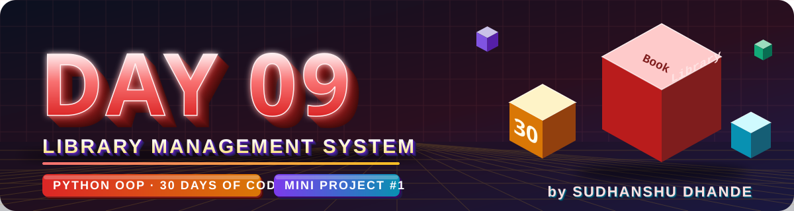
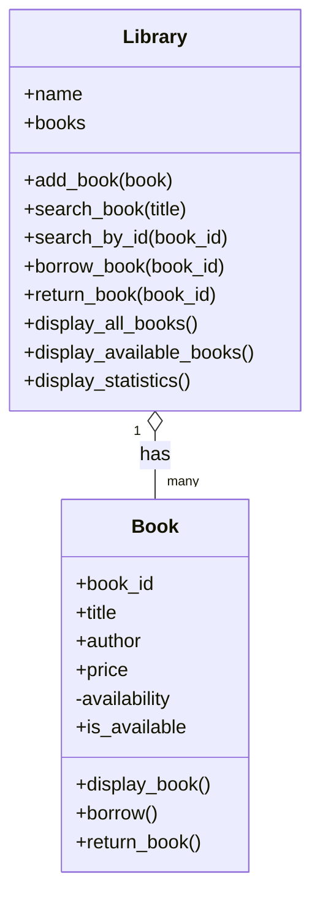
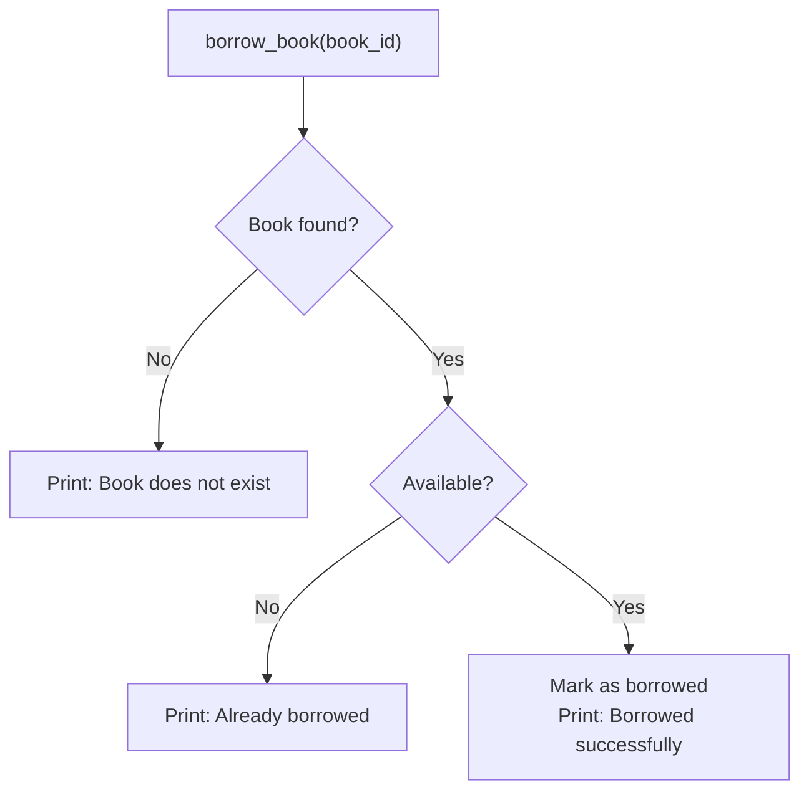

<p align="center">
  
</p>

<p align="center">
  
  
  
  
</p>

# 🟢 Day 09 — Library Management System Using Python OOP

## 🎯 Learning Objectives

Today I will learn how to:

- Design a real-world project using OOP.
- Create classes and objects.
- Use `__init__()` to initialize objects.
- Store and manage book details.
- Add new books to a library.
- Search for books by title or ID.
- Borrow and return books.
- Track book availability.
- Validate user input.
- Use private attributes and properties where appropriate.
- Organize Python code into reusable methods.
- Test a complete mini-project.

---

# 📖 Day 09 Concepts — Read & Understand First

> Today is a **project day**. There is almost no new syntax. Instead, we learn **how to design and build a complete program** by combining everything from **Day 01–08**. Read this section slowly, type the example yourself, and then start the questions in order.

## 1️⃣ What is a Library Management System?

A **Library Management System (LMS)** is a program that helps a library **manage its books** instead of using paper registers.

| Task a librarian does       | Feature in our program                   |
| --------------------------- | ---------------------------------------- |
| Adds a new book to the shelf | `add_book()`                             |
| Finds a book                | `search_book()` / `search_by_id()`       |
| Lends a book to a reader    | `borrow_book()`                          |
| Takes a book back           | `return_book()`                          |
| Checks which books are free | `display_available_books()`              |
| Counts books                | `display_statistics()`                   |

> 🏫 This project looks simple, but the same design is used in real software: **a manager class that holds many item objects**. Shopping carts, playlists, hospitals and banks all work the same way.

---

## 2️⃣ How to Start a Project: Find the Classes

Use the trick from **Day 03**: **Nouns → Classes & Attributes**, **Verbs → Methods**.

> *"A library has many books. Each book has an ID, title, author and price, and it can be borrowed or returned. The library can add, search, borrow, return and display books."*

| Noun (thing)  | Becomes             | Attributes (data)                             |
| ------------- | ------------------- | --------------------------------------------- |
| **Book**      | class `Book`        | `book_id`, `title`, `author`, `price`, availability |
| **Library**   | class `Library`     | `name`, `books` (a list of book objects)      |

| Verb (action)          | Belongs to           |
| ---------------------- | -------------------- |
| display, borrow, return | `Book` (about **one** book)  |
| add, search, borrow by ID, return by ID, display all, statistics | `Library` (about **many** books) |

> ✅ **Golden rule — one class, one job:**
> `Book` knows about **itself** (its data and its status).
> `Library` **manages the collection** of books.

---

## 3️⃣ Class Design (Blueprint)



> 📝 In the code, the private attribute is written as `__is_available` (double underscore, Day 07), and `is_available` is a **read-only property** (Day 05) that returns it.

---

## 4️⃣ "Has-a" Relationship (Objects Inside Objects)

On Day 06 we used inheritance ("is-a"). Here we use a different relationship: **"has-a"**.

| Relationship | Question                       | Example                            | How in code                      |
| ------------ | ------------------------------ | ---------------------------------- | -------------------------------- |
| **is-a**     | Is a Student **a** Person?     | `class Student(Person)`            | Inheritance                      |
| **has-a**    | Does a Library **have** Books? | Library holds a list of `Book` objects | Store objects in an attribute (a list) |

> ✅ `Library` is **not** a kind of `Book`, so we do **not** use inheritance. The library **has** books, so it stores **Book objects in a list**: `self.books = []`.

---

## 5️⃣ Which OOP Concepts Are Used Where?

| Concept (Day)                       | Where we use it in this project                         |
| ----------------------------------- | ------------------------------------------------------- |
| Class & object (Day 01)             | `Book`, `Library`, and many book objects                |
| `__init__` (Day 02)                 | Set book details; create the empty `books` list         |
| Methods using `self` (Day 03)       | `display_book()`, `add_book()`…                          |
| Validation & decisions (Day 03, 05) | Reject bad price, duplicate ID, double borrowing        |
| `@property` (Day 05)                | Read-only `is_available`                                |
| Private attribute (Day 07)          | `__is_available` can't be changed directly              |
| Class attribute (Day 08)            | `book_count` (Q5)                                       |
| Encapsulation (Day 07, 08)          | Status changes only through `borrow()` / `return_book()` |

---

## 6️⃣ Storing Objects in a List — Quick Recap

```python
books = []                         # empty list

books.append(book1)                # add an object
books.append(book2)

print(len(books))                  # 2   → how many objects

for book in books:                 # visit every object, one by one
    print(book.title)

if not books:                      # empty list is "falsy"
    print("No books available")
```

| What you need            | Tool                         |
| ------------------------ | ---------------------------- |
| Add an item              | `list.append(item)`          |
| Visit every item         | `for item in list:`          |
| Count items              | `len(list)`                  |
| Check if the list is empty | `if not list:` (or `len(list) == 0`) |

---

## 7️⃣ A Worked Example in a Different Domain: Playlist

To learn the **pattern** without giving away the solution, here is a mini project in a **different domain**: a **Playlist** (holds many **Song** objects). Notice how it matches the Library project.

| Library project  | Playlist example |
| ---------------- | ---------------- |
| `Book`           | `Song`           |
| `Library`        | `Playlist`       |
| `book_id`        | `song_id`        |
| borrow / return  | like / unlike    |
| `__is_available` | `__is_liked`     |

```python
class Song:
    def __init__(self, song_id, title, artist):
        self.song_id = song_id
        self.title = title
        self.artist = artist
        self.__is_liked = False               # private status

    @property
    def is_liked(self):                       # read-only property
        return self.__is_liked

    def like(self):
        if self.__is_liked:                   # already liked → refuse
            print(f"'{self.title}' is already liked")
            return False
        self.__is_liked = True
        return True

    def display_song(self):
        status = "Liked" if self.__is_liked else "Not liked"
        print(f"{self.song_id:<5}{self.title:<20}{self.artist:<15}{status}")


class Playlist:
    def __init__(self, name):
        self.name = name
        self.songs = []                       # the list that holds Song objects

    def add_song(self, song):
        if self.search_by_id(song.song_id) is not None:      # duplicate check
            print(f"Song ID {song.song_id} already exists")
            return
        self.songs.append(song)
        print(f"'{song.title}' added")

    def search_by_id(self, song_id):
        for song in self.songs:
            if song.song_id == song_id:
                return song                   # found → return the object
        return None                           # not found → None

    def search_song(self, title):
        found = False
        for song in self.songs:
            if title.lower() in song.title.lower():          # case-insensitive, partial match
                song.display_song()
                found = True
        if not found:
            print("No song found")

    def like_song(self, song_id):
        song = self.search_by_id(song_id)
        if song is None:                      # case 1: does not exist
            print("Song does not exist")
        elif song.like():                     # case 2/3: liked now, or already liked
            print("Liked successfully")

    def count_liked(self):
        count = 0
        for song in self.songs:
            if song.is_liked:
                count += 1
        return count


p = Playlist("Road Trip")
p.add_song(Song(1, "Sunrise", "Aman"))
p.add_song(Song(2, "Night Drive", "Neha"))
p.add_song(Song(1, "Duplicate", "X"))         # same ID → rejected
p.search_song("sun")                          # partial, ignores capital letters
p.search_song("zzz")
p.like_song(1)
p.like_song(1)                                # already liked
p.like_song(9)                                # does not exist
print(p.count_liked())
```

**Output:**

```text
'Sunrise' added
'Night Drive' added
Song ID 1 already exists
1    Sunrise             Aman           Not liked
No song found
Liked successfully
'Sunrise' is already liked
Song does not exist
1
```

> 🎯 **Your task:** do **not** copy this. Understand the **pattern**, then build the `Book` / `Library` version yourself with the names, rules and methods in the questions below.

---

## 8️⃣ The Important Patterns (Explained)

### a) Search by ID → return the object or `None`

```python
def search_by_id(self, song_id):
    for song in self.songs:
        if song.song_id == song_id:
            return song          # stop immediately and give the object
    return None                  # the loop ended → nothing matched
```

* **IDs are unique**, so there is at most **one** match → `return` it.
* Returning the **object** lets other methods (borrow, return, duplicate check) **reuse** this method. ♻️ No repeated code.

### b) Search by title → show matches, or a "not found" message

* Use a flag such as `found = False`, set it to `True` when you find a match, and check it **after** the loop.
* Compare in **lowercase** (`.lower()`) so `"python"` matches `"Python"`.
* `"py" in "python basics"` is `True` → this gives a **partial match** (optional but user-friendly).

### c) Prevent duplicate IDs

```python
if self.search_by_id(song.song_id) is not None:
    print("Duplicate ID")
    return
```

Reuse the search method. If it finds something, the ID already exists → **reject**.

> 💡 Another way: `any(s.song_id == new_id for s in self.songs)` returns `True` if any item matches.

### d) The "three cases" for borrow and return



`return_book(book_id)` works the same way, but the check is reversed: it is allowed only when the book is **currently borrowed**.

> ✅ **Always check in this order:** 1) Does it exist? 2) Is the state correct? 3) Only then change the state.

### e) Counting (statistics)

```python
count = 0
for song in self.songs:
    if song.is_liked:       # condition
        count += 1
return count
```

* **Total** = `len(self.songs)`
* **Available** = count where the status is `True`
* **Borrowed** = **Total − Available** (or count where it is `False`)

### f) Neat display with f-string widths

```python
print(f"{'ID':<5}{'Title':<20}{'Author':<15}{'Status'}")      # header row
print(f"{self.song_id:<5}{self.title:<20}{self.artist:<15}Liked")
```

`<5` means "left-align in 5 characters", which keeps columns straight.

### g) Handle the empty library

```python
if not self.songs:
    print("No songs in the playlist")
    return
```

---

## 9️⃣ Protecting Availability (Encapsulation)

Book availability is the most important data. It must **not** be changed freely.

```python
self.__is_available = True      # private (Day 07)

@property
def is_available(self):         # read-only property (Day 05)
    return self.__is_available
```

```python
book.is_available = True        # ❌ AttributeError: property has no setter
book.borrow()                   # ✅ the only way to change it, and it checks the rules
```

* **Outside code can read** the status (`book.is_available`) but **cannot set it**.
* Only `borrow()` and `return_book()` change it, and they **refuse invalid actions** (borrowing an already-borrowed book).

> 🧠 **Design tip:** let `borrow()` / `return_book()` **return `True` or `False`** (as `like()` does above). Then `Library` can decide what to print.

---

## 🔟 Class Attribute for Counting Objects (Q5)

```python
class Counter:
    total = 0                      # class attribute (shared)

    def __init__(self):
        Counter.total += 1         # ✅ update through the class name

Counter(); Counter(); Counter()
print(Counter.total)               # 3
```

⚠️ Don't write `self.total += 1`; it creates a separate attribute per object and the class count stays `0`.

---

## 1️⃣1️⃣ Menu-Driven Program (Bonus) — The Loop Pattern

> **First** finish and test the classes. **Then** add the menu.

```python
while True:                                  # repeat until we choose Exit
    print("\n===== MENU =====")
    print("1. Say hello")
    print("2. Exit")

    choice = input("Enter your choice: ")    # input() always gives a STRING

    if choice == "1":
        print("Hello!")
    elif choice == "2":
        print("Goodbye!")
        break                                # leave the loop
    else:
        print("Invalid choice, try again")
```

* `input()` returns **text**. If the book ID is a number, convert it: `int(input("Enter book ID: "))`.
* If the user types letters, `int()` fails. A small preview of the fix (optional for today):

```python
try:
    book_id = int(input("Enter book ID: "))
except ValueError:
    print("Please enter a number")
```

* Keep the **ID type consistent** everywhere (always `int` or always `str`), otherwise `1 == "1"` is `False` and searches will fail.

---

## 1️⃣2️⃣ Splitting the Project Into Files

If one big file feels difficult, **first make everything work in `practice.py`**, then split:

```text
book.py      →  class Book
library.py   →  class Library
main.py      →  creates objects, runs and tests the program
```

```python
# main.py
from book import Book            # file name (without .py) → class name
from library import Library

if __name__ == "__main__":       # runs only when this file is executed directly
    lib = Library("City Library")
    lib.add_book(Book(1, "Python Basics", "A. Sharma", 450))
    lib.display_all_books()
```

* All three files must be in the **same folder**.
* Run with: `python main.py`

---

## 1️⃣3️⃣ Testing Checklist

Test **every** method with valid, invalid and boundary cases:

| Method              | Test these cases                                                      |
| ------------------- | --------------------------------------------------------------------- |
| `Book(...)`         | Normal book · price `0` · negative price                              |
| `add_book()`        | New ID · duplicate ID · first book in an empty library                |
| `search_by_id()`    | Existing ID · non-existing ID · `None` returned                       |
| `search_book()`     | Exact title · capital letters mixed · title that doesn't exist        |
| `borrow_book()`     | Available book · already-borrowed book · non-existing ID              |
| `return_book()`     | Borrowed book · already-available book · non-existing ID              |
| `display_all_books()` | Empty library · library with books · after some are borrowed        |
| `display_available_books()` | All free · some borrowed · all borrowed                       |
| Statistics          | Before and after borrowing and returning (numbers must add up)        |

> ✅ After every operation, check: **Total = Available + Borrowed**.

---

## 1️⃣4️⃣ Common Mistakes (Avoid These!)

| ❌ Mistake                                                          | ✅ Fix                                                            |
| ------------------------------------------------------------------ | ---------------------------------------------------------------- |
| Creating `self.books = []` inside `add_book()`                      | Create it **once** in `__init__()` (otherwise it resets every time) |
| Using one shared list as a class attribute for all libraries        | Use `self.books` (instance attribute)                            |
| Returning `None` inside the loop for "not found"                    | Return `None` **after** the loop ends                            |
| Printing "not found" inside the loop (prints for every book)        | Use a `found` flag and check it after the loop                   |
| Comparing `"1"` (text) with `1` (number)                            | Keep the ID type consistent                                      |
| Changing `__is_available` from `Library` directly                   | Call `book.borrow()` / `book.return_book()`                      |
| Not checking if the book exists before using it                     | `if book is None:` first                                         |
| Copy-pasting the search loop in many methods                        | Write `search_by_id()` once and **reuse** it                     |
| Forgetting `self.` before `books` or other methods                  | `self.books`, `self.search_by_id(...)`                           |
| Building the menu before the classes work                           | Test the classes with manual objects first                       |
| Writing everything in one huge method                               | Small methods, one job each                                      |

---

## 1️⃣5️⃣ Step-by-Step Build Plan

```text
Step 1  →  Q1–Q5   Book class: attributes, display, price validation, count
Step 2  →  Q6      Library class with an empty list and add_book()
Step 3  →  Q7–Q8   search_book() and search_by_id()
Step 4  →  Q9–Q10  borrow_book() and return_book()  (reuse search_by_id!)
Step 5  →  Q11–Q12 Display all / display available
Step 6  →  Q13     Duplicate ID check in add_book()
Step 7  →  Q14     Statistics
Step 8  →  Q15     Make availability private + read-only property
Step 9  →  Main challenge: bring Book + Library together and test everything
Step 10 →  Bonus: menu-driven program
Step 11 →  Split into book.py / library.py / main.py
```

---

## 📌 Day 09 in One Look

```text
Project idea  →  A manager class (Library) that HAS many item objects (Book)
One class, one job  →  Book = about one book · Library = manages the collection
Has-a         →  Library stores Book objects in a list (not inheritance)
search_by_id  →  Return the object, or None  → reuse everywhere
Borrow/Return →  Check: exists? → correct state? → then change it
Availability  →  Private __is_available + read-only property + borrow()/return_book()
Menu          →  while True + input() + break   (after classes work!)
Files         →  book.py · library.py · main.py
```

---

## 📚 Part 1 — Theory Questions

Answer these questions before starting the project.

1. What is a Library Management System?
2. Why is OOP useful for this project?
3. What is the difference between a class and an object?
4. Why do we use `__init__()`?
5. What is the purpose of `self`?
6. Why should book details be stored as object attributes?
7. What is the difference between a method and an attribute?
8. Why do we need a unique book ID?
9. What is data validation?
10. Why should we check whether a book is available before borrowing it?
11. How can we prevent a book from being borrowed twice?
12. What is encapsulation, and how can it help manage book availability?

---

## 🧩 Part 2 — Practice Problems (15 Questions)

### 🟢 Level 1 — Book Class Basics

#### Q1. Create a Book Class

Create a `Book` class with these attributes:

- `book_id`
- `title`
- `author`
- `price`

Requirements:

- Initialize all attributes using `__init__()`.
- Create a method `display_book()`.
- Create three book objects and display their details.

#### Q2. Book Availability

Create a `Book` class with:

- `title`
- `is_available`

Requirements:

- Set `is_available` to `True` initially.
- Create a method `display_status()`.
- Display whether the book is available.

#### Q3. Update Book Price

Create a `Book` class with:

- `title`
- `price`

Requirements:

- Create a method `update_price(new_price)`.
- Reject zero or negative prices.
- Display the updated price.

#### Q4. Book Information

Create a `Book` class with:

- `title`
- `author`
- `publication_year`

Create a method `display_info()`.

Create at least three books and display their information.

#### Q5. Count Book Objects

Create a `Book` class with a class attribute `book_count`.

Requirements:

- Increase the count whenever a new book object is created.
- Create five book objects.
- Display the total number of created book objects.

Hint: Use a class attribute and update it inside `__init__()`.

---

### 🟡 Level 2 — Library Operations

#### Q6. Add a Book

Create a `Library` class that stores books in a list.

Requirements:

- Create an empty list in `__init__()`.
- Create a method `add_book(book)`.
- Add at least five `Book` objects to the library.
- Display all books.

#### Q7. Search by Title

Extend your `Library` class.

Create a method `search_book(title)` that:

- Searches for a book by title.
- Displays the matching book's details.
- Displays a suitable message if no book is found.

Test both existing and non-existing titles.

#### Q8. Search by Book ID

Create a method `search_by_id(book_id)`.

Requirements:

- Search for a book using its unique ID.
- Return the matching book object if found.
- Return `None` if no book is found.

Test with valid and invalid IDs.

#### Q9. Borrow a Book

Create a method `borrow_book(book_id)`.

Requirements:

- Find the book by ID.
- Check whether it is available.
- If available, mark it as unavailable.
- If already borrowed, display a suitable message.
- If the book does not exist, display a suitable message.

Test all three cases.

#### Q10. Return a Book

Create a method `return_book(book_id)`.

Requirements:

- Find the book by ID.
- If the book is currently borrowed, mark it as available.
- If it is already available, display a suitable message.
- If it does not exist, display a suitable message.

Test all cases.

---

### 🔴 Level 3 — Logic Building

#### Q11. Display All Books

Create a method `display_all_books()`.

Requirements:

- Display every book stored in the library.
- Display the ID, title, author, and availability status.
- If the library is empty, display an appropriate message.

#### Q12. Display Available Books

Create a method `display_available_books()`.

Requirements:

- Display only books whose availability status is `True`.
- Do not display borrowed books in this list.
- Display a message if no books are available.

#### Q13. Prevent Duplicate Book IDs

Update `add_book(book)`.

Requirements:

- Every book must have a unique ID.
- Before adding a book, check whether its ID already exists.
- Reject duplicate IDs.
- Test adding two books with the same ID.

#### Q14. Track Borrowing Statistics

Create methods to calculate:

- Total number of books.
- Number of available books.
- Number of borrowed books.

Test the statistics before and after borrowing and returning books.

#### Q15. Encapsulation and Validation

Improve your `Book` class.

Requirements:

- Use a private attribute `__is_available`.
- Create a read-only property named `is_available`.
- Create controlled methods to borrow and return the book.
- Prevent borrowing an already borrowed book.
- Prevent returning a book that is already available.

Test all valid and invalid operations.

---

## ⭐ Day 09 Main Challenge — Complete Library Management System

Build a working mini-project using the `Book` and `Library` classes.

### Class 1: `Book`

#### Attributes

- `book_id`
- `title`
- `author`
- `price`
- `__is_available`

#### Methods

- `display_book()`
- `borrow()`
- `return_book()`

#### Requirements

1. Initialize the book using `__init__()`.
2. Store the book's ID, title, author, and price.
3. Keep the availability status private.
4. Create a read-only property `is_available`.
5. Allow borrowing only when the book is available.
6. Allow returning only when the book is borrowed.
7. Reject invalid prices.
8. Display all relevant book details without exposing internal implementation details.

### Class 2: `Library`

#### Attributes

- `name`
- `books` — a list of `Book` objects

#### Methods

- `add_book(book)`
- `search_book(title)`
- `search_by_id(book_id)`
- `borrow_book(book_id)`
- `return_book(book_id)`
- `display_all_books()`
- `display_available_books()`
- `display_statistics()`

#### Requirements

1. Create a library with a name.
2. Add at least five different books.
3. Prevent duplicate book IDs.
4. Search for books by title and ID.
5. Borrow and return books using their IDs.
6. Display all books and available books separately.
7. Display total, available, and borrowed book counts.
8. Handle invalid book IDs gracefully.
9. Test repeated borrowing and returning.
10. Keep the code organized using methods instead of repeating the same logic.

### Bonus Challenge

Create a menu-driven program that allows the user to choose:

```text
===== LIBRARY MANAGEMENT SYSTEM =====

1. Add Book
2. Display All Books
3. Search Book
4. Borrow Book
5. Return Book
6. Display Available Books
7. Display Statistics
8. Exit
```

Use a loop to keep the menu running until the user chooses Exit.

**Important:** First complete the classes and test them with manually created objects. Add the menu only after the main functionality works.

---

## 🧠 Part 3 — Interview Questions (with Short Answers)

> Try to answer each question yourself first, then compare with the short answer. Each answer is kept **simple and short** so it is easy to remember. 🧠 = memory trick.

### 1. Why did you create separate `Book` and `Library` classes?

**Answer:** Each class should have **one job**. `Book` stores the data and status of **one book**. `Library` **manages many books**. This keeps the code clean, easy to test, and easy to change.

🧠 *One class, one job*

---

### 2. Why does the library store a list of book objects?

**Answer:** A library has **many books**, so a **list keeps them together**. We can loop through the list to search, display and count. Each book object keeps its **own data and status**.

🧠 *Library HAS-A list of books*

---

### 3. What is the difference between `search_book()` and `search_by_id()`?

**Answer:**

| `search_book(title)`                       | `search_by_id(book_id)`                          |
| ------------------------------------------ | ------------------------------------------------ |
| Searches by **title**                      | Searches by **unique ID**                        |
| Titles can **repeat** (more than one match) | ID gives **exactly one** match                  |
| Usually **displays** the result            | **Returns** the book object (or `None`)          |

`search_by_id()` is used inside `borrow_book()`, `return_book()` and the duplicate check.

🧠 *Title may repeat · ID is unique*

---

### 4. How do you prevent duplicate book IDs?

**Answer:** Before adding a book, **check whether its ID already exists** (loop through the books, or reuse `search_by_id()`). If it exists, **reject it with a message**; otherwise `append` it.

🧠 *Check first, add later*

---

### 5. Why is book availability stored as a Boolean?

**Answer:** A book has only **two states**: available or borrowed. A Boolean (`True` / `False`) is **simple** and easy to check: `if book.is_available:`.

🧠 *Two states = True / False*

---

### 6. Why might a read-only property be useful?

**Answer:** Others can **read** the status (`book.is_available`) but **cannot change it directly**. It changes only through `borrow()` and `return_book()`, which **follow the rules**. This keeps the data **safe and correct**.

🧠 *Read freely, change carefully*

---

### 7. How do you handle borrowing a book that is already borrowed?

**Answer:** **Check availability first.** If the book is already borrowed, **show a message** ("already borrowed") and **do not change anything**. This prevents double borrowing.

🧠 *Exists? → Available? → Then borrow*

---

### 8. How could you store library data permanently after the program closes?

**Answer:** **Save the data to a file** (text, CSV or JSON) when the program ends and **load it again** when it starts. For bigger projects, use a **database** (like SQLite).

🧠 *File first, database later*

---

### 9. How would you modify the system to track which student borrowed each book?

**Answer:** Add a **`Student` class** (or student ID). Give `Book` an attribute like **`borrowed_by`**. Set it in `borrow(student)` and **clear it** in `return_book()`. Or keep a **borrow record** (book ID + student ID + date) in the library.

🧠 *Book remembers who has it*

---

### 10. What improvements would you make if this were a real library application?

**Answer:**

- Save data in a **file or database**
- Add **students / members** and login
- Add **due dates and fines**
- **Remove / update** books and search by **author**
- Handle **multiple copies** of a book
- Better **input validation** and error handling
- Add **tests**, and later a **GUI or web app**

🧠 *Save · Users · Dates · Edit · Copies · Validate · Test*

---

### ⚡ 10-Second Revision

```text
1. Book vs Library   → One class, one job
2. List of books     → Library HAS-A list
3. Two searches      → Title may repeat · ID is unique (returns object / None)
4. Duplicate ID      → Check first, add later
5. Boolean           → Two states: available / borrowed
6. Read-only property→ Read freely, change carefully
7. Already borrowed  → Check availability, show message, change nothing
8. Permanent storage → File (JSON/CSV) first, database later
9. Track student     → Student class + borrowed_by
10. Improvements     → Save · Users · Dates · Edit · Copies · Validate · Test
```

---

## 📁 Day 09 Folder Structure

```text
Day09_Library_Management_System/
│
├── banner.svg
├── README.md
└── practice.py
```

### File responsibilities

- `practice.py` — contains solutions to Q1–Q15.
- `README.md` — documents the project, features, and learning outcomes.

**Beginner tip:** If splitting the project into multiple files feels difficult, first implement everything in `practice.py`. Refactor it into separate files after it works.

---

## 📊 Day 09 Target

| Task                    | Target |
| ----------------------- | -----: |
| Theory questions        |     12 |
| Basic practice problems |      5 |
| Library operations      |      5 |
| Logic-building problems |      5 |
| Main project            |      1 |
| Interview questions     |     10 |

---

## 🚫 Rules

- Do not copy a complete solution from the internet.
- Write the logic in simple steps before coding.
- Use meaningful variable, class, and method names.
- Test valid and invalid inputs.
- Avoid duplicate code.
- Keep the `Book` and `Library` responsibilities separate.
- Do not add a database or GUI at the beginning.
- Complete the basic version before attempting the bonus menu.

---

## ✅ Completion Checklist

- [ ] Created the `Book` class
- [ ] Created the `Library` class
- [ ] Used constructors and objects
- [ ] Added and displayed books
- [ ] Implemented searching by title and ID
- [ ] Implemented borrowing and returning
- [ ] Prevented duplicate book IDs
- [ ] Added availability validation
- [ ] Implemented book statistics
- [ ] Completed the main challenge
- [ ] Tested invalid operations
- [ ] Created the project files
- [ ] Updated the README
- [ ] Pushed the project to GitHub

---

## 🚀 GitHub Commit

```bash
git add .
git status
git commit -m "Day 09: Library management system using OOP"
git push
```

**Day 09 Goal:** Build a working Library Management System and apply Python OOP concepts to a real-world problem.

---

<p align="center">
  
</p>

<h3 align="center"><b>Sudhanshu Dhande</b> </h3>
<p align="center"><i>B.Tech(AI &amp; ML) · BATU, Lonere · Python OOP Journey</i></p>