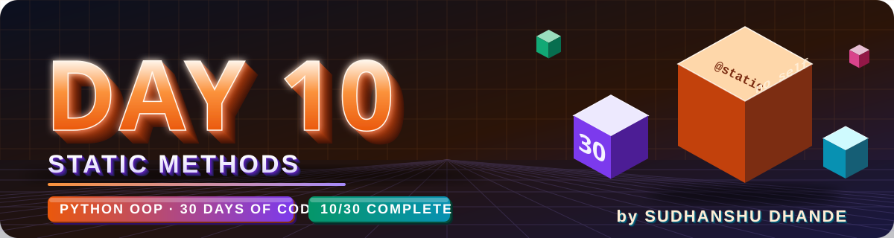
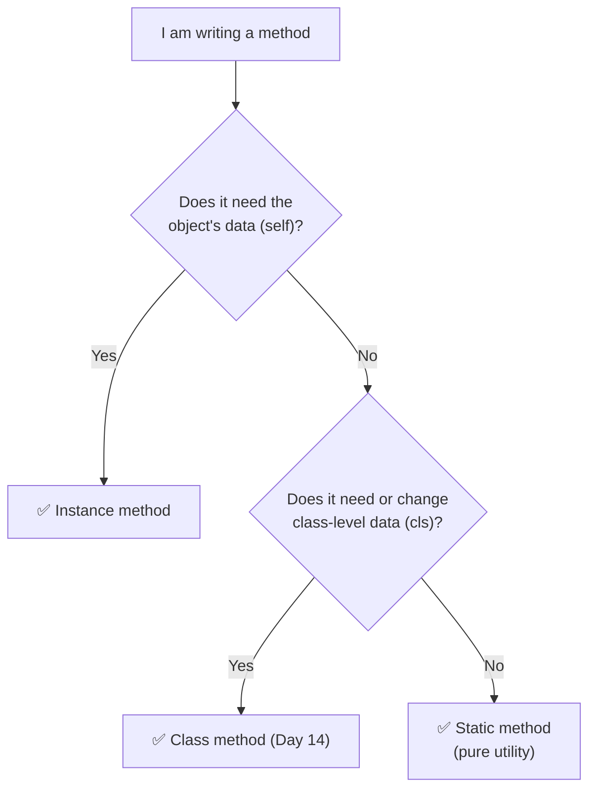

<p align="center">
  
</p>

<p align="center">
  
  
  
  
  
</p>

# 🟢 Day 10 — Static Methods in Python OOP

## 🎯 Learning Objectives

Today I will learn:

- What is a static method?
- Why do we use `@staticmethod`?
- How to define a static method inside a class.
- How to call a static method using a class and an object.
- The difference between instance methods, class methods, and static methods.
- How static methods help organize utility functions.
- How to use static methods in real-world projects.
- When to use a static method and when to avoid it.

---

# 📖 Day 10 Concepts — Read & Understand First

> Read this section slowly **before** solving the problems. Type every example yourself in VS Code and run it. Today builds on **Day 04 (Decorators)** — `@staticmethod` is a built-in decorator — and on the method types we met on **Day 08**.

## 1️⃣ Recap: Three Kinds of Methods

| Method type       | First parameter       | Can use object data? | Can use class data? | Decorator       | When we learn it |
| ----------------- | --------------------- | :------------------: | :-----------------: | --------------- | ---------------- |
| **Instance method** | `self` (the object) |          ✅           |          ✅          | none            | Day 01–03        |
| **Class method**    | `cls` (the class)   |          ❌           |          ✅          | `@classmethod`  | Day 14           |
| **Static method**   | **nothing extra**   |          ❌           |   Only by class name | `@staticmethod` | **Today**        |

> 💡 **Easy way to remember:** `self` → "this **object**" · `cls` → "this **class**" · **static** → "just a normal function that lives inside the class".

---

## 2️⃣ What is a Static Method?

A **static method** is a method inside a class that **does not use `self` or `cls`**. It does **not need any object or class data** — it just takes some inputs and gives a result.

> 🧮 **Analogy:** A **calculator kept on a shop counter**. It belongs to the shop (the class), but it doesn't depend on any particular customer (object). Anyone can walk up and use it directly.

---

## 3️⃣ Syntax of a Static Method

```python
class ClassName:
    @staticmethod
    def method_name(parameter1, parameter2):     # ← no self, no cls
        return parameter1 + parameter2
```

**Example:**

```python
class Currency:
    @staticmethod
    def rupees_to_dollars(rupees, rate):
        return rupees / rate

# 1) Call using the CLASS name (no object needed) ✅ recommended
print(Currency.rupees_to_dollars(8300, 83))     # 100.0

# 2) Call using an OBJECT ✅ also works
c = Currency()
print(c.rupees_to_dollars(1660, 83))            # 20.0
```

📌 **Rules to remember**

* Write `@staticmethod` **just above** the `def` line.
* **Do not** write `self` or `cls` in the brackets.
* You can call it **with the class name** — **no object is required**.
* It works through an object too, but calling it through the **class name** is clearer, because it shows the method doesn't use the object.

---

## 4️⃣ Instance Method vs Static Method (Side by Side)

```python
class Wallet:
    def __init__(self, rupees):
        self.rupees = rupees

    def show(self):                          # INSTANCE method → uses self
        print(f"Balance: Rs {self.rupees}")

    @staticmethod
    def rupees_to_paise(rupees):             # STATIC method → uses only its own input
        return rupees * 100

w = Wallet(250)
w.show()                                     # Balance: Rs 250   (needs an object)
print(Wallet.rupees_to_paise(5))             # 500               (no object needed)
```

| Point                        | Instance method                      | Static method                         |
| ---------------------------- | ------------------------------------ | ------------------------------------- |
| Decorator                    | None                                 | `@staticmethod`                       |
| First parameter              | `self`                               | **None** (only your own parameters)   |
| Needs an object to call?     | ✅ Yes                                | ❌ No (call with the class name)       |
| Can use `self.attribute`?    | ✅ Yes                                | ❌ No                                  |
| Works on                     | **One object's data**                | **Only the values you pass in**       |
| Typical use                  | `deposit()`, `display_details()`     | `is_valid_email()`, `celsius_to_fahrenheit()` |

---

## 5️⃣ Why Do We Use Static Methods?

* ✅ **Organization** — related helper functions stay **inside the class they belong to** (all converters in `Converter`, all checks in `Validator`).
* ✅ **No object needed** — you don't have to create an object just to run a calculation.
* ✅ **Clear names** — `Currency.rupees_to_dollars(...)` tells you exactly where the function belongs.
* ✅ **Clean code** — the `@staticmethod` label tells the reader: *"this method does not touch any object or class data."*

**Static method vs a normal function outside the class:**

| Normal function (outside)                           | Static method (inside a class)                      |
| --------------------------------------------------- | --------------------------------------------------- |
| Lives alone in the file                             | Grouped with related functions in a class           |
| Good for **general-purpose** helpers                | Good for helpers that **logically belong to a class** |
| `rupees_to_dollars(100, 83)`                        | `Currency.rupees_to_dollars(100, 83)`               |

---

## 6️⃣ What a Static Method Can and Cannot Do

| Question                                         | Answer                                                    |
| ------------------------------------------------ | --------------------------------------------------------- |
| Can it use its own parameters?                   | ✅ Yes                                                     |
| Can it use `self.attribute`?                     | ❌ No — there is no `self`                                 |
| Can it use a class attribute?                    | ✅ Only through the **class name** (`Shop.tax_rate`)       |
| Can it call another static method?               | ✅ Yes, through the **class name**                         |
| Can it be called with the class name?            | ✅ Yes                                                     |
| Can it be called with an object?                 | ✅ Yes                                                     |

**❌ Trying to use `self` inside a static method:**

```python
class Bad:
    def __init__(self):
        self.name = "x"

    @staticmethod
    def show():
        return self.name         # ❌ there is no self here

Bad.show()
```

```text
NameError: name 'self' is not defined
```

**✅ Using a class attribute through the class name:**

```python
class Shop:
    tax_rate = 5                                   # class attribute

    @staticmethod
    def add_tax(price):
        return price + price * Shop.tax_rate / 100

print(Shop.add_tax(200))                           # 210.0
```

> 🔑 **Key point:** A static method knows **nothing** about any object. If you need an object's data (like `self.salary`), use an **instance method**, or **pass the value in as an argument**.

---

## 7️⃣ Calling a Static Method From an Instance Method

Instance methods can use static methods as **helpers**:

```python
class Order:
    def __init__(self, amount):
        self.amount = amount

    @staticmethod
    def calculate_tax(amount):                     # helper (static)
        return amount * 0.18

    def total(self):                               # instance method
        return self.amount + self.calculate_tax(self.amount)
        # same as:  Order.calculate_tax(self.amount)

o = Order(1000)
print(o.total())                                   # 1180.0
```

Both `self.calculate_tax(...)` and `Order.calculate_tax(...)` work inside an instance method.

---

## 8️⃣ A Static Method Calling Another Static Method

Inside a static method there is no `self`, so use the **class name**:

```python
class MathTools:
    @staticmethod
    def cube(x):
        return x * x * x

    @staticmethod
    def cube_sum(a, b):
        return MathTools.cube(a) + MathTools.cube(b)    # ✅ use the class name

print(MathTools.cube(3))           # 27
print(MathTools.cube_sum(2, 3))    # 35
```

⚠️ Writing just `cube(a)` (without `MathTools.`) gives `NameError: name 'cube' is not defined`.

---

## 9️⃣ Static Methods for Validation (Very Common Use)

Validation methods usually return `True` / `False` and don't need object data, so they are perfect static methods. We can use them **before** creating the object's data:

```python
class Ticket:
    @staticmethod
    def is_valid_seat(seat):                       # validator (static)
        return 1 <= seat <= 50

    def __init__(self, name, seat):
        self.name = name
        if not Ticket.is_valid_seat(seat):         # check first
            print("Invalid seat number")
            self.seat = None
        else:
            self.seat = seat

print(Ticket("A", 10).seat)       # 10
print(Ticket("B", 99).seat)       # Invalid seat number  → None
```

---

## 🔟 Return Values vs Printing in Utility Methods

Utility methods should usually **`return` the result** (like Day 03), so other code can reuse it. For invalid input, show a message and return `None`:

```python
class PriceTool:
    @staticmethod
    def with_gst(price):
        if price < 0:
            print("Price cannot be negative")
            return None                      # nothing valid to return
        return price * 1.18

print(PriceTool.with_gst(100))     # 118.0
print(PriceTool.with_gst(-5))      # Price cannot be negative  →  None
```

| Kind of static method          | Returns                      |
| ------------------------------ | ---------------------------- |
| Validator (`is_valid_...`)     | `True` / `False`             |
| Calculator (`calculate_...`)   | The calculated number        |
| Converter (`..._to_...`)       | The converted value          |
| Invalid input                  | Message + `None` (or `False` for validators) |

---

## 1️⃣1️⃣ Static Methods and Inheritance

A child class **inherits** static methods, and can also **override** them:

```python
class Parent:
    @staticmethod
    def info():
        return "parent info"

class Child(Parent):
    pass                                    # inherits info()

class Child2(Parent):
    @staticmethod
    def info():                             # overriding
        return "child2 info"

print(Child.info())      # parent info
print(Child2.info())     # child2 info
```

---

## 1️⃣2️⃣ Which Method Type Should I Use?



**Use a static method for:** calculators, converters, validators, formatters, small helpers that logically belong to a class.

**Avoid a static method when:**

* ❌ The method needs `self.something` → use an **instance method**
* ❌ The method needs to change class data or create objects → use a **class method**
* ❌ The function has **no connection** to any class → keep it as a **normal function**

---

## 1️⃣3️⃣ Real-World Examples

| Class name            | Static methods                                           |
| --------------------- | -------------------------------------------------------- |
| `TemperatureConverter` | `celsius_to_fahrenheit()`, `fahrenheit_to_celsius()`    |
| `Validator`           | `is_valid_email()`, `is_valid_password()`                |
| `Calculator`          | `add()`, `subtract()`, `multiply()`, `divide()`          |
| `DateUtility`         | `is_leap_year()`, `days_in_month()`                      |
| `PriceUtility`        | `calculate_discount()`, `add_gst()`                      |

---

## 1️⃣4️⃣ Common Mistakes (Avoid These!)

| ❌ Mistake                                                       | ✅ Fix                                                              |
| --------------------------------------------------------------- | ------------------------------------------------------------------ |
| Forgetting `@staticmethod`                                       | Add the decorator above the method (see below)                     |
| Writing `self` in a static method: `def add(self, a, b)`         | `def add(a, b)` — no `self`                                        |
| Using `self.attribute` inside a static method                    | Pass the value as an argument, or use an instance method           |
| Calling another static method without the class name: `cube(a)` | `MathTools.cube(a)`                                                |
| Printing inside every utility method                             | `return` the result and print outside                              |
| Making everything static                                         | Use instance methods when you need object data                     |
| Calling a static method without the class name: `add(2, 3)`      | `Calculator.add(2, 3)`                                             |
| Not testing invalid / boundary values                            | Test normal, boundary (e.g. exactly `18`, `0`) and invalid inputs  |

**⚠️ The sneaky bug — forgetting `@staticmethod`:**

```python
class Plain:
    def hello():                 # no @staticmethod, no self
        print("hi")

Plain.hello()                    # hi        ← works through the class
Plain().hello()                  # ❌ TypeError
```

```text
TypeError: Plain.hello() takes 0 positional arguments but 1 was given
```

Through an object, Python automatically passes `self`, but the method has no place to receive it. `@staticmethod` tells Python **not** to pass it.

---

## 📌 Day 10 in One Look

```text
Static method →  A method that needs no self and no cls        →  @staticmethod
Call it       →  ClassName.method(args)   (no object needed)
Can't use     →  self.attribute  (NameError)
Class data    →  Only through the class name  →  ClassName.attr
Other static  →  Call with the class name  →  ClassName.other()
Use for       →  Calculators · Converters · Validators · Helpers
Rule          →  self = object · cls = class · static = nothing
```

**Template to remember:**

```python
class Utility:
    @staticmethod
    def method_name(a, b):          # no self, no cls
        # logic using only a and b
        return result

result = Utility.method_name(5, 3)  # call through the class name
```

---

## 📚 Part 1 — Theory Questions

Answer these questions in your own words.

1. What is a static method in Python?
2. What is the purpose of the `@staticmethod` decorator?
3. Why do we use static methods?
4. Does a static method receive `self` automatically?
5. Does a static method receive `cls` automatically?
6. Can we call a static method using the class name?
7. Can we call a static method using an object?
8. What is the difference between an instance method and a static method?
9. What is the difference between a class method and a static method?
10. Can a static method access instance attributes directly?
11. Can a static method access class attributes if they are referenced through the class name?
12. When should we use a static method instead of a normal function?

---

## 🧩 Part 2 — Practice Problems (15 Questions)

### 🟢 Level 1 — Static Method Basics

#### Q1. Even or Odd

Create a `NumberChecker` class.

Create a static method `is_even(number)` that returns `True` if the number is even and `False` otherwise.

Test at least five numbers.

#### Q2. Positive or Negative

Create a `NumberChecker` class with a static method `check_number(number)`.

Return whether the number is positive, negative, or zero.

#### Q3. Square Calculator

Create a `Calculator` class with a static method `square(number)`.

Return the square of a number.

Test positive, negative, and zero values.

#### Q4. Maximum of Two Numbers

Create a `NumberUtility` class with a static method `maximum(a, b)`.

Return the larger number without using Python's built-in `max()` function.

#### Q5. Leap Year Checker

Create a `DateUtility` class with a static method `is_leap_year(year)`.

Return `True` if the year is a leap year and `False` otherwise.

Test years such as 2024, 2025, 2000, and 1900.

---

### 🟡 Level 2 — Logic Building

#### Q6. Simple Calculator

Create a `Calculator` class with these static methods:

- `add(a, b)`
- `subtract(a, b)`
- `multiply(a, b)`
- `divide(a, b)`

Requirements:

- Each method returns its result.
- Handle division by zero.
- Call the methods using the class name.

#### Q7. Password Validator

Create a `UserValidator` class with a static method `is_valid_password(password)`.

Requirements:

- Password must contain at least 8 characters.
- Return `True` if it satisfies the length requirement.
- Otherwise, return `False`.

#### Q8. Email Validator

Create an `EmailValidator` class with a static method `is_valid_email(email)`.

For this beginner exercise, check whether the email contains `@` and a `.` after the `@`.

**Note:** This is a basic practice check, not complete email validation.

#### Q9. Discount Calculator

Create a `PriceUtility` class with a static method `calculate_discount(price, percent)`.

Requirements:

- Calculate the discount amount.
- Reject negative prices.
- Accept a discount percentage between 0 and 100.
- Return the final price after discount.

#### Q10. Temperature Converter

Create a `TemperatureConverter` class with these static methods:

- `celsius_to_fahrenheit(celsius)`
- `fahrenheit_to_celsius(fahrenheit)`

Formulas:

- Fahrenheit = (Celsius × 9/5) + 32
- Celsius = (Fahrenheit − 32) × 5/9

Test both conversions.

---

### 🔴 Level 3 — Real-World Applications

#### Q11. Student Result Utility

Create a `StudentUtility` class with static methods:

- `calculate_total(maths, science, english)`
- `calculate_percentage(maths, science, english)`
- `is_pass(maths, science, english)`

Requirements:

- Each subject is out of 100.
- Validate that marks are between 0 and 100.
- The student passes only if every subject mark is at least 35.
- Test at least three students.

#### Q12. Product Price Utility

Create a `ProductUtility` class with static methods:

- `calculate_total(price, quantity)`
- `apply_discount(price, percent)`

Requirements:

- Reject negative prices and quantities.
- Calculate the total cost.
- Apply a valid discount percentage.
- Test different products.

#### Q13. Bank Transaction Validator

Create a `BankUtility` class with a static method `is_valid_amount(amount)`.

Requirements:

- Return `True` only when the amount is greater than zero.
- Test zero, negative, and positive amounts.

#### Q14. Age Eligibility Checker

Create an `EligibilityChecker` class with a static method `is_adult(age)`.

Requirements:

- Return `True` if age is 18 or older.
- Reject negative ages.
- Test ages below 18, equal to 18, and above 18.

#### Q15. Employee Bonus Calculator

Create an `EmployeeUtility` class with a static method `calculate_bonus(salary, bonus_percent)`.

Requirements:

- Reject negative salary.
- Accept a bonus percentage between 0 and 100.
- Return the calculated bonus amount.
- Test at least three employees.

---

## ⭐ Day 10 Main Challenge — Utility Management System

Build a mini-project that uses static methods to perform common calculations and validations.

### Class 1: `Calculator`

Create these static methods:

- `add(a, b)`
- `subtract(a, b)`
- `multiply(a, b)`
- `divide(a, b)`

Requirements:

1. Return results instead of printing them inside every method.
2. Handle division by zero appropriately.
3. Test every operation.

### Class 2: `StudentUtility`

Create these static methods:

- `calculate_total(marks)`
- `calculate_percentage(marks)`
- `check_result(marks)`

Requirements:

1. Accept a list of three subject marks.
2. Validate that every mark is between 0 and 100.
3. Calculate total marks.
4. Calculate percentage, assuming each subject is out of 100.
5. A student passes only if every subject mark is at least 35.
6. Test at least three students.

### Class 3: `PriceUtility`

Create these static methods:

- `calculate_discount(price, percent)`
- `calculate_final_price(price, percent)`

Requirements:

1. Reject negative prices.
2. Accept percentages from 0 to 100.
3. Calculate the discount amount.
4. Calculate the final price after discount.
5. Test multiple products.

### Final Program Requirements

- Call static methods using their class names.
- Display clear results.
- Test valid and invalid inputs.
- Keep calculation logic inside the appropriate methods.
- Do not use `self` or `cls` when they are not needed.

**Bonus:** Create a menu-driven program that lets the user select calculator operations, student result calculations, or product discounts.

---

## 🧠 Part 3 — Interview Questions (with Short Answers)

> Try to answer each question yourself first, then compare with the short answer. Each answer is kept **simple and short** so it is easy to remember. 🧠 = memory trick.

### 1. What is a static method in Python?

**Answer:** A method inside a class that **does not use `self` or `cls`**. It is created with `@staticmethod` and works like a **normal function placed inside a class**.

```python
class Calculator:
    @staticmethod
    def add(a, b):
        return a + b
```

🧠 *A function that lives in a class*

---

### 2. Why do we use `@staticmethod`?

**Answer:** It tells Python: *"don't pass `self` or `cls` automatically."* It also tells readers that the method is a **utility** that needs **no object or class data**. Without it, calling the method through an object gives a `TypeError`.

🧠 *"Don't send self"*

---

### 3. Does a static method receive `self` automatically?

**Answer:** **No.** It receives **only the arguments you pass**. It does not get `self` and it does not get `cls`.

🧠 *Static gets nothing extra*

---

### 4. What is the difference between a static method and an instance method?

**Answer:**

| Instance method                      | Static method                         |
| ------------------------------------ | ------------------------------------- |
| First parameter is **`self`**        | **No** `self`, no `cls`               |
| Needs an **object** to be called     | Called with the **class name**        |
| Can use the object's data            | **Cannot** use object data            |
| No decorator                         | `@staticmethod`                       |

🧠 *Instance = uses object · Static = uses only inputs*

---

### 5. What is the difference between a static method and a class method?

**Answer:**

| Class method                              | Static method                          |
| ----------------------------------------- | -------------------------------------- |
| `@classmethod`                            | `@staticmethod`                        |
| Receives **`cls`** (the class)            | Receives **nothing extra**             |
| Can use or change **class data**, create objects | Can't use class data automatically |

🧠 *self = object · cls = class · static = nothing*

---

### 6. Can a static method be called without creating an object?

**Answer:** **Yes.** Use the class name: `ClassName.method()`. That is the main advantage of a static method.

```python
Calculator.add(2, 3)      # no object needed
```

---

### 7. Can we call a static method through an object?

**Answer:** **Yes**, it works the same way (`obj.method()`). But calling it through the **class name** is better, because it shows that the method doesn't use the object.

---

### 8. Give two real-world examples of static methods.

**Answer:**

- `TemperatureConverter.celsius_to_fahrenheit(c)` — converts a value
- `Validator.is_valid_email(email)` — checks an input

Others: `Calculator.add()`, `DateUtility.is_leap_year()`, `PriceUtility.calculate_discount()`.

🧠 *Convert · Validate · Calculate*

---

### 9. When should you use a normal function instead of a static method?

**Answer:** When the function has **no logical connection to any class** — a general-purpose helper used all over the project. Use a static method when the function **belongs to a class's topic** and you want to keep it grouped with it.

🧠 *Belongs to a class → static · Belongs to nobody → normal function*

---

### 10. Can a static method access instance attributes without receiving an object?

**Answer:** **No.** There is no `self`, so `self.name` gives `NameError`. To use an object's data, **pass the value as an argument** or use an **instance method**.

🧠 *No self = no object data*

---

### ⚡ 10-Second Revision

```text
1. Static method    → Function that lives in a class (@staticmethod)
2. @staticmethod    → "Don't send self"
3. Receives self?   → No, nothing extra
4. vs Instance      → Instance uses object · Static uses only inputs
5. vs Class method  → self = object · cls = class · static = nothing
6. Without object?  → Yes, ClassName.method()
7. Through object?  → Yes, but prefer the class name
8. Examples         → Convert · Validate · Calculate
9. Normal function  → When it belongs to no class
10. Instance data?  → No (no self) → pass it in
```

---

## 📁 Day 10 Folder Structure

```text
Day10_Static_Methods/
│
├── banner.svg
├── README.md
├── practice.py
├── Q16_challege
    ├── calculator.py
    ├── student_utility.py
    ├── price_utility.py

```

### File Responsibilities

- `practice.py` — solutions to Q1–Q15.
- `calculator.py` — `Calculator` class.
- `student_utility.py` — `StudentUtility` class.
- `price_utility.py` — `PriceUtility` class.
- `main.py` — tests and runs the main challenge.
- `README.md` — theory answers, project explanation, and learning outcomes.

**Beginner tip:** First write all your code in `practice.py`. Once it works, separate the classes into different files.

> In `main.py`, import the classes like this (all files in the same folder):
>
> ```python
> from calculator import Calculator
> from student_utility import StudentUtility
> from price_utility import PriceUtility
>
> print(Calculator.add(2, 3))
> ```

---

## 📊 Day 10 Target

| Task | Target |
|---|---:|
| Theory questions | 12 |
| Basic practice problems | 5 |
| Logic-building problems | 5 |
| Real-world problems | 5 |
| Main challenge | 1 |
| Interview questions | 10 |

---

## 🚫 Rules

- Try every question independently.
- Do not copy complete solutions.
- Use `@staticmethod` where the method does not need instance or class data.
- Remember that a static method does not automatically receive `self` or `cls`.
- Return calculated values where appropriate.
- Test normal, boundary, and invalid inputs.
- Use meaningful class and method names.
- Write the logic in simple steps before coding.

---

## ✅ Completion Checklist

- [ ] Understood the `@staticmethod` decorator
- [ ] Practised calling static methods through a class
- [ ] Practised calling static methods through an object
- [ ] Solved Q1–Q5
- [ ] Solved Q6–Q10
- [ ] Solved Q11–Q15
- [ ] Completed the Utility Management System
- [ ] Answered interview questions
- [ ] Tested valid and invalid inputs
- [ ] Organized the project files
- [ ] Updated the README
- [ ] Pushed code to GitHub

---

## 🚀 GitHub Commit

```bash
git add .
git status
git commit -m "Day 10: Static methods practice"
git push
```

**Day 10 Goal:** Learn to organize reusable calculations and validation logic using Python static methods.

---

<p align="center">
  
</p>

<h3 align="center"><b>Sudhanshu Dhande</b></h3>
<p align="center"><i>B.Tech(AI &amp; ML) · BATU, Lonere · Python OOP Journey</i></p>