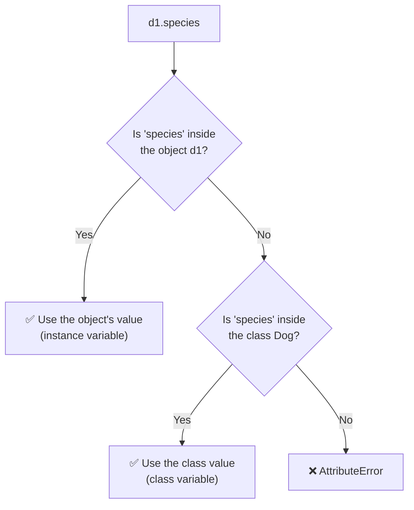
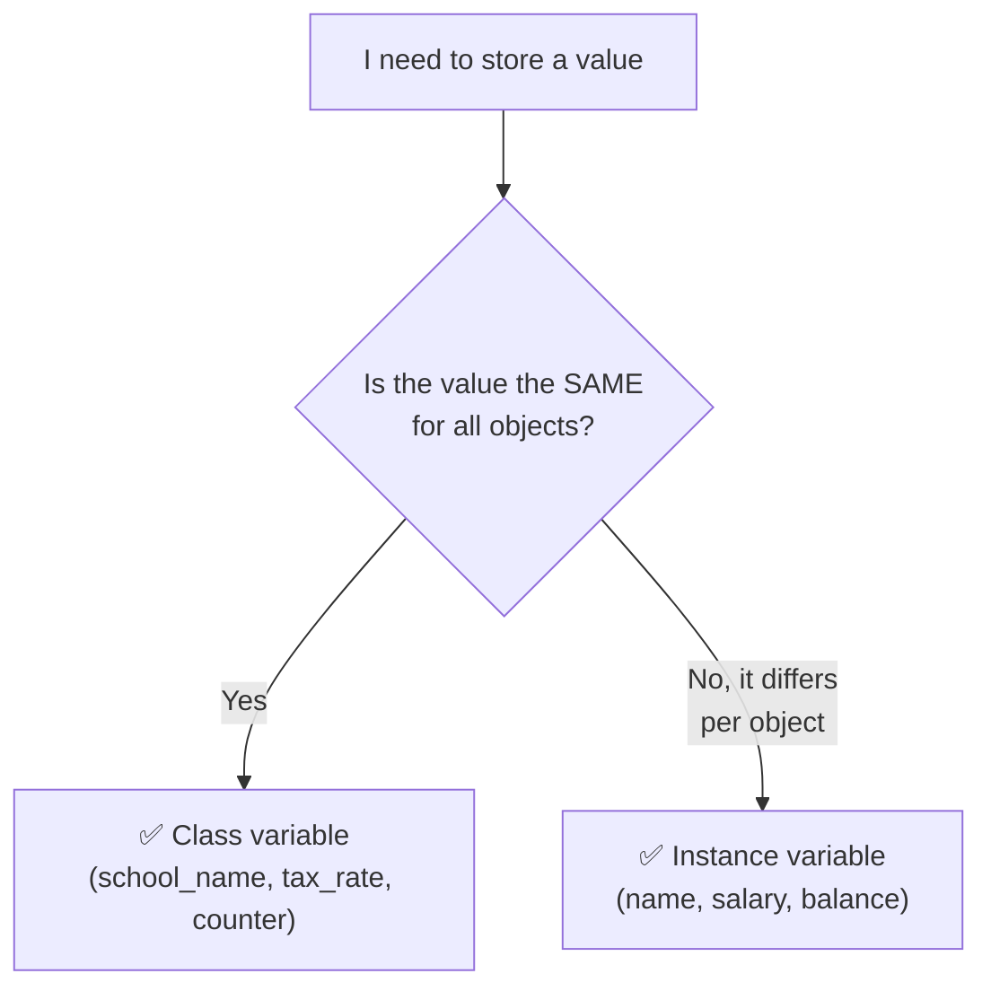

<p align="center">
  
</p>

<p align="center">
  
  
  
  
  
</p>

# 🟢 Day 11 — Class Variables and Instance Variables in Python OOP

## 🎯 Learning Objectives

Today I will learn:

- What are class variables?
- What are instance variables?
- What is the difference between class and instance variables?
- How to access class variables using a class and an object.
- How to access instance variables using objects.
- How to update class variables.
- How to override a class variable for a specific object.
- How to use `self` and `ClassName` to access variables.
- How class and instance variables are used in real-world projects.

---

# 📖 Day 11 Concepts — Read & Understand First

> Read this section slowly **before** solving the problems. Type every example yourself in VS Code and run it. We met a small preview of this topic on **Day 08**; today we go deep, because this is a **very important interview topic**.

## 1️⃣ The Big Question: Where Does Data Live?

An object's data can live in **two places**:

| Place               | Name                  | Meaning                                         |
| ------------------- | --------------------- | ----------------------------------------------- |
| Inside **each object** | **Instance variable** | Every object has its **own separate copy**      |
| Inside the **class**   | **Class variable**    | **One copy**, shared by **all** objects         |

> 🏫 **Analogy:** A school.
> Every student has their **own** name, roll number and marks → **instance variables**.
> The **school name** is the same for every student, written once on the school's notice board → **class variable**.

---

## 2️⃣ Instance Variables

An **instance variable** belongs to **one object**. It is usually created inside `__init__()` using `self.`

```python
class Dog:
    def __init__(self, name, age):
        self.name = name          # instance variable
        self.age = age            # instance variable

d1 = Dog("Tommy", 3)
d2 = Dog("Bruno", 5)

print(d1.name, d2.name)           # Tommy Bruno   ← different values
d1.age = 4                        # changes ONLY d1
print(d1.age, d2.age)             # 4 5
```

📌 **Remember**

* Created with `self.variable = value` (usually in `__init__`).
* Each object has its **own copy**.
* Changing one object's value **does not** affect the others.

---

## 3️⃣ Class Variables

A **class variable** is written **directly inside the class**, **outside all methods**. It is **shared** by every object of that class.

```python
class Dog:
    species = "Canis familiaris"       # class variable (shared)

    def __init__(self, name, age):
        self.name = name               # instance variable
        self.age = age                 # instance variable

d1 = Dog("Tommy", 3)
d2 = Dog("Bruno", 5)
d3 = Dog("Max", 2)

print(d1.species, d2.species, d3.species)   # Canis familiaris  Canis familiaris  Canis familiaris
print(Dog.species)                           # Canis familiaris   ← through the class name
```

📌 **Remember**

* Written **in the class body**, with **no** `self.`
* **One copy** in memory, shared by all objects.
* Used for data that is the **same for everyone** (company name, tax rate, number of wheels, interest rate, counters).

---

## 4️⃣ Class Variable vs Instance Variable

| Point                  | Instance variable                       | Class variable                              |
| ---------------------- | --------------------------------------- | ------------------------------------------- |
| Where is it written?   | Inside a method with `self.` (usually `__init__`) | **In the class body**, outside methods |
| Belongs to             | **One object**                          | **The class** (shared by all objects)       |
| Number of copies       | One **per object**                      | **Only one**                                |
| Example                | `self.name = name`                      | `species = "Canis familiaris"`              |
| Access with the object | ✅ `d1.name`                             | ✅ `d1.species`                              |
| Access with class name | ❌ `Dog.name` → `AttributeError`         | ✅ `Dog.species`                             |
| Use it for             | Data that **differs** per object        | Data that is the **same** for all objects   |

```text
AttributeError: type object 'Dog' has no attribute 'name'
```

> `Dog.name` fails because the class itself has no `name`; only the objects have it.

---

## 5️⃣ How Python Finds a Variable (Lookup Order)

When you write `d1.species`, Python searches in this order:



> 🔑 **Object first, class second.**

You can **see** where each variable lives using `__dict__` (or `vars()`):

```python
print(d1.__dict__)                              # {'name': 'Tommy', 'age': 3}
print("species" in Dog.__dict__)                # True   → species lives in the CLASS
print("species" in d1.__dict__)                 # False  → not inside the object
print(vars(d1))                                 # {'name': 'Tommy', 'age': 3}   (same as __dict__)
```

* `obj.__dict__` shows the object's **instance variables**.
* `ClassName.__dict__` shows the class's variables (and methods).
* `"x" in obj.__dict__` → `True` means `x` is an **instance variable**.

---

## 6️⃣ Updating a Class Variable

### ✅ Through the class name → changes it for everyone

```python
Dog.species = "Wolf-like"
print(d1.species, d2.species, d3.species)      # Wolf-like  Wolf-like  Wolf-like
```

### ⚠️ Through an object → creates a NEW instance variable only for that object

```python
d2.species = "Special"
print(d1.species, d2.species, d3.species)      # Wolf-like  Special  Wolf-like
print(d2.__dict__)                              # {'name': 'Bruno', 'age': 5, 'species': 'Special'}
```

Now `d2` has its **own** `species` that **hides** the class one. The class variable itself is **not** changed.

### Later class changes don't reach the overridden object

```python
Dog.species = "Domestic dog"
print(d1.species, d2.species, d3.species)      # Domestic dog  Special  Domestic dog
```

### Removing the override brings the class value back

```python
del d2.species
print(d2.species)                               # Domestic dog
print(d2.__dict__)                              # {'name': 'Bruno', 'age': 5}
```

| What I write                  | What happens                                                        |
| ----------------------------- | ------------------------------------------------------------------- |
| `ClassName.variable = value`  | ✅ Updates the **class variable** → all (non-overridden) objects see it |
| `obj.variable = value`        | ⚠️ Creates / changes an **instance variable** only for that object   |

---

## 7️⃣ `self.variable` vs `ClassName.variable` Inside Methods

| Code inside a method          | Reading it                              | Writing it                                  |
| ----------------------------- | --------------------------------------- | ------------------------------------------- |
| `self.variable`               | Finds the instance variable first, else the class variable | **Creates an instance variable** |
| `ClassName.variable`          | Reads the class variable                | **Updates the class variable** (shared)     |

### ⚠️ The most common trap: `self.count += 1`

```python
class Bad:
    count = 0
    def __init__(self):
        self.count += 1        # reads class count (0), then creates an INSTANCE variable = 1

a, b = Bad(), Bad()
print(Bad.count)               # 0   ← class counter never changed!
print(a.count, b.count)        # 1 1
print(a.__dict__)              # {'count': 1}
```

### ✅ The correct way: use the class name

```python
class Good:
    count = 0
    def __init__(self):
        Good.count += 1        # updates the shared class variable

Good(); Good(); Good()
print(Good.count)              # 3
```

---

## 8️⃣ Pattern: Counting Objects & Generating IDs

A class variable is perfect for **counting** objects and giving each one a **unique number**:

```python
class Token:
    next_number = 1                       # class variable (shared counter)

    def __init__(self, customer):
        self.customer = customer          # instance variable
        self.number = Token.next_number   # this object's own number
        Token.next_number += 1            # move the shared counter forward

t1 = Token("A")
t2 = Token("B")
t3 = Token("C")

print(t1.number, t2.number, t3.number)    # 1 2 3
print(Token.next_number)                  # 4
```

> 💡 The **shared** counter lives in the class; each object copies the current value into its **own** instance variable.

---

## 9️⃣ ⚠️ Danger: Mutable Class Variables (Lists, Dictionaries)

If you create a **list** as a class variable, **all objects share the same list**:

```python
class BadCart:
    items = []                          # ❌ class variable → ONE list for everyone

    def add(self, item):
        self.items.append(item)

c1 = BadCart()
c2 = BadCart()
c1.add("pen")
c2.add("book")

print(c1.items)                         # ['pen', 'book']   ← c1 sees c2's item!
print(c2.items)                         # ['pen', 'book']
print(c1.items is c2.items)             # True   (the very same list)
```

**✅ Fix: create the list inside `__init__()` so every object gets its own list:**

```python
class GoodCart:
    def __init__(self):
        self.items = []                 # ✅ instance variable → separate list per object

    def add(self, item):
        self.items.append(item)

g1 = GoodCart()
g2 = GoodCart()
g1.add("pen")
g2.add("book")

print(g1.items)                         # ['pen']
print(g2.items)                         # ['book']
```

> 🔑 **Rule:** if each object needs its **own** list/dictionary, create it with `self.` inside `__init__()`.

---

## 🔟 Same Name in Instance and Class

If both exist, the **instance variable wins** (object first, class second):

```python
class Shop:
    name = "Class Shop"                  # class variable

    def __init__(self):
        self.name = "Instance Shop"      # instance variable (same name)

s = Shop()
print(s.name)                            # Instance Shop   ← object's value
print(Shop.name)                         # Class Shop      ← class's value
```

---

## 1️⃣1️⃣ Class Variables and Inheritance (Quick Note)

A child class **inherits** the parent's class variables. But assigning through the **child** class creates a **new** class variable on the child — the parent is not changed:

```python
class Parent:
    rate = 10

class Child(Parent):
    pass

print(Child.rate)                        # 10   (inherited)

Child.rate = 20                          # new variable on Child only
print(Parent.rate, Child.rate)           # 10 20

Parent.rate = 99
print(Parent.rate, Child.rate)           # 99 20   (Child has its own now)
```

---

## 1️⃣2️⃣ Which One Should I Use?



| Class variable (shared)             | Instance variable (per object)        |
| ----------------------------------- | ------------------------------------- |
| `company_name = "Tech Solutions"`   | `self.name`, `self.salary`            |
| `bonus_rate = 10`                   | `self.balance`                        |
| `wheels = 4`                        | `self.brand`, `self.model`            |
| `total_accounts = 0` (counter)      | `self.account_holder`                 |
| `tax_rate = 18`                     | `self.items` (own list)               |

---

## 1️⃣3️⃣ Common Mistakes (Avoid These!)

| ❌ Mistake                                                         | ✅ Fix                                                                  |
| ----------------------------------------------------------------- | ---------------------------------------------------------------------- |
| Updating a shared counter with `self.count += 1`                   | `ClassName.count += 1`                                                 |
| Changing a class variable through an object: `d1.species = "X"`    | Use `Dog.species = "X"` to change it for everyone                      |
| Writing a class variable with `self.` in the class body            | Class variables have **no** `self.` and are outside methods            |
| Defining a **list** as a class variable for per-object data        | Create it in `__init__()`: `self.items = []`                           |
| Accessing an instance variable through the class: `Dog.name`       | Use an object: `d1.name`                                               |
| Forgetting that an object override hides the class value           | Check `obj.__dict__`, or `del obj.variable` to remove the override     |
| Using a class variable for data that should differ per object      | Use an instance variable                                               |
| Expecting a child's `Child.rate = 20` to change the parent         | It only creates a new variable on the child                            |
| Using the counter value directly as the ID without storing it      | Copy it to `self.id` **before** increasing the counter                 |

---

## 📌 Day 11 in One Look

```text
Instance variable →  self.name = name  (inside __init__)       →  one copy PER OBJECT
Class variable    →  written in the class body, no self        →  ONE copy SHARED by all
Access            →  obj.var  (both)   ·   ClassName.var  (class variable only)
Lookup order      →  Object first, then class
Update for all    →  ClassName.var = value
obj.var = value   →  Creates an instance variable only for that object (hides the class one)
Counter           →  ClassName.count += 1   (NOT self.count += 1)
Lists             →  self.items = [] inside __init__  (NOT in the class body)
Inspect           →  obj.__dict__ / vars(obj)  ·  ClassName.__dict__
```

**Template to remember:**

```python
class ClassName:
    shared_value = 0                    # class variable

    def __init__(self, name):
        self.name = name                # instance variable
        self.items = []                 # own list per object
        ClassName.shared_value += 1     # update the shared class variable
```

---

## 📚 Part 1 — Theory Questions

Answer these questions in your own words.

1. What is a class variable in Python?
2. What is an instance variable?
3. What is the difference between class and instance variables?
4. Where do we usually define a class variable?
5. Where do we usually define instance variables?
6. Can multiple objects share the same class variable?
7. Can different objects have different instance variables?
8. How can we access a class variable using the class name?
9. How can we access an instance variable?
10. What happens when we assign a new value to a class variable using the class name?
11. What happens when we assign a class variable through an object?
12. Why is `self.name = name` generally used for instance variables?
13. What is the difference between `self.school_name` and `Student.school_name`?
14. What happens if an instance variable has the same name as a class variable?
15. Why should we avoid using a mutable class variable for data that belongs separately to each object?

---

## 🧩 Part 2 — Practice Problems (15 Questions)

### 🟢 Level 1 — Basic Concepts

#### Q1. Student School Name

Create a `Student` class with the class variable:

`school_name = "BATU"`

Create three student objects with different names.

Requirements:

- Display the school name using all three objects.
- Display the school name using the class name.
- Observe that the school name is shared.

#### Q2. Employee Company Name

Create an `Employee` class with:

- Class variable: `company_name = "Tech Solutions"`
- Instance variables: `name`, `salary`

Create three employees and display their names, salaries, and company name.

#### Q3. Car Brand

Create a `Car` class with:

- Class variable: `wheels = 4`
- Instance variables: `brand`, `model`

Create three cars with different brands and models.

Display the wheels and other details for each car.

#### Q4. School Student Count

Create a `Student` class with a class variable `student_count = 0`.

Requirements:

- Increase `student_count` whenever a new student object is created.
- Create five student objects.
- Display the total number of students created.

Hint: Update the class variable through `Student.student_count` inside `__init__()`.

#### Q5. Product Category

Create a `Product` class with:

- Class variable: `category = "Electronics"`
- Instance variables: `name`, `price`

Create three products and display their details along with the common category.

---

### 🟡 Level 2 — Updating Variables

#### Q6. Update School Name

Create a `Student` class with:

`school_name = "BATU"`

Requirements:

- Create three student objects.
- Change the class variable using `Student.school_name`.
- Display the school name for all three objects.
- Observe the effect of the change.

#### Q7. Override for One Object

Create a `Student` class with:

`school_name = "BATU"`

Requirements:

- Create three student objects.
- Assign a different `school_name` to only the first object.
- Display the school name for all three objects.
- Explain why the other two objects still show the original class value.

#### Q8. Employee Salary Update

Create an `Employee` class with instance variables `name` and `salary`.

Requirements:

- Create three employees.
- Update the salary of one employee.
- Display all employees.
- Ensure that updating one employee's salary does not change the others.

#### Q9. Company Bonus Rate

Create an `Employee` class with:

- Class variable: `bonus_rate = 10`
- Instance variables: `name`, `salary`

Create a method `calculate_bonus()` that calculates the bonus using the employee's salary and the class bonus rate.

Requirements:

- Create three employees.
- Calculate their bonuses.
- Update the bonus rate using the class name.
- Calculate the bonuses again.

#### Q10. Library Information

Create a `Library` class with:

- Class variable: `library_name = "City Library"`
- Instance variables: `book_name`, `author`

Create three book objects and display their details with the library name.

Change the library name using the class name and observe the results.

---

### 🔴 Level 3 — Logic Building

#### Q11. Bank Account Counter

Create a `BankAccount` class with a class variable `total_accounts = 0`.

Requirements:

- Each object should have `account_holder` and `balance`.
- Increase the total account count whenever an account is created.
- Create at least four accounts.
- Display the total number of accounts.

#### Q12. Employee ID Generator

Create an `Employee` class with a class variable `employee_count = 0`.

Requirements:

- Increase the count whenever an employee is created.
- Assign a unique employee ID to each object.
- Create five employees.
- Display their IDs and names.

Hint: Use the class counter to generate the next ID.

#### Q13. Shopping Cart Items

Create a `ShoppingCart` class.

Requirements:

- Each object should have its own `items` list.
- Create two shopping cart objects.
- Add different items to each cart.
- Display both carts and ensure that their items remain separate.

**Important:** Create the list inside `__init__()` so each object has its own list.

#### Q14. Website Visitor Counter

Create a `Website` class with a class variable `visitor_count = 0`.

Requirements:

- Increase the visitor count whenever a new visitor object is created.
- Create five visitor objects.
- Display the total visitors.

For this exercise, count created visitor objects; do not count repeated visits by the same person.

#### Q15. Department and Employee

Create a `Department` class with:

- Class variable: `organization_name = "ABC Corporation"`
- Instance variables: `department_name`, `employee_name`

Create at least three objects for different departments.

Requirements:

- Display the organization and department details.
- Update the organization name using the class name.
- Override the organization name for one object only.
- Explain the output.

---

## ⭐ Day 11 Main Challenge — Employee Management System

Build a mini-project using class and instance variables.

### Class: `Employee`

#### Class Variables

- `company_name = "Tech Solutions"`
- `employee_count = 0`
- `bonus_rate = 10`

#### Instance Variables

- `employee_id`
- `name`
- `department`
- `salary`

#### Methods

- `display_details()`
- `calculate_bonus()`
- `calculate_annual_salary()`

### Requirements

1. Initialize the employee's name, department, and monthly salary using `__init__()`.
2. Increase `employee_count` whenever a new employee is created.
3. Generate a unique employee ID for every employee.
4. Store each employee's details as instance variables.
5. Store the company name and bonus rate as class variables.
6. Calculate the bonus using the current class bonus rate.
7. Calculate annual salary using monthly salary multiplied by 12.
8. Create at least five employees.
9. Display each employee's details, bonus, and annual salary.
10. Update `bonus_rate` using the class name and recalculate the bonuses.
11. Override `company_name` for one employee object and observe the output.
12. Explain why changing one employee's salary does not affect the others.

**Bonus:** Add a class method `change_company_name(cls, new_name)` that updates the company name for the class.

---

## 🧠 Part 3 — Interview Questions (with Short Answers)

> Try to answer each question yourself first, then compare with the short answer. Each answer is kept **simple and short** so it is easy to remember. 🧠 = memory trick.

### 1. What is a class variable?

**Answer:** A variable defined **inside the class, outside all methods**. It is **shared by all objects** — there is only **one copy**.

```python
class Student:
    school_name = "BATU"      # class variable
```

🧠 *One copy, shared by all*

---

### 2. What is an instance variable?

**Answer:** A variable that **belongs to one object**. It is created with `self.` (usually in `__init__`), and **every object has its own copy**.

```python
self.name = name              # instance variable
```

🧠 *Each object's own*

---

### 3. What is the main difference between them?

**Answer:**

| Class variable                  | Instance variable               |
| ------------------------------- | ------------------------------- |
| **Shared** by all objects       | **Separate** for each object    |
| Defined in the **class body**   | Defined with **`self.`**        |
| **One** copy                    | **One copy per object**         |

🧠 *Class = shared · Instance = personal*

---

### 4. Can two objects have different values for the same instance variable?

**Answer:** **Yes.** Each object keeps its own copy, so `s1.name = "Rahul"` and `s2.name = "Priya"` can be different. Changing one does not affect the other.

---

### 5. How do you update a class variable for all objects?

**Answer:** Use the **class name**: `ClassName.variable = new_value`. Every object that has not overridden it will see the new value.

```python
Student.school_name = "XYZ"
```

🧠 *Change it at the class, not the object*

---

### 6. What happens when an object assigns a value to a class variable name?

**Answer:** Python **creates a new instance variable** with the same name **only for that object**. It **hides** the class variable for that object. The class variable and all other objects stay **unchanged**.

```python
s1.school_name = "Special"    # only s1 is affected
```

🧠 *Object assignment = personal copy*

---

### 7. How can you check whether a variable belongs to an object or the class?

**Answer:** Look at `__dict__`:

- `obj.__dict__` (or `vars(obj)`) shows the **instance variables**
- `ClassName.__dict__` shows the **class variables**

```python
"school_name" in s1.__dict__      # True → instance variable (override)
"school_name" in Student.__dict__ # True → class variable
```

🧠 *`__dict__` shows where it lives*

---

### 8. Why should a list usually be initialized inside `__init__()` when each object needs its own list?

**Answer:** A list written in the **class body** is **one list shared by all objects** — adding an item in one object shows up in all. Creating it with `self.items = []` inside `__init__()` gives **each object its own list**.

🧠 *Own list → create it in `__init__`*

---

### 9. How can class variables be used to count objects?

**Answer:** Make a class variable `count = 0` and increase it in `__init__()` **using the class name**.

```python
class Student:
    count = 0
    def __init__(self):
        Student.count += 1     # ✅ not self.count += 1
```

🧠 *Count with `ClassName.count`*

---

### 10. Give two real-world examples of class variables.

**Answer:**

- `Employee.company_name` — same company for every employee
- `Bank.interest_rate` / `Shop.tax_rate` — one rate for all accounts / products

Others: `Car.wheels = 4`, `Student.school_name`, an object counter (`total_accounts`).

🧠 *Same for everyone = class variable*

---

### ⚡ 10-Second Revision

```text
1. Class variable     → In the class body · ONE copy · shared
2. Instance variable  → self.name · own copy per object
3. Difference         → Class = shared · Instance = personal
4. Different values?  → Yes, for instance variables
5. Update for all     → ClassName.variable = value
6. obj.variable = x   → Personal copy only (hides the class one)
7. Where does it live → obj.__dict__ vs ClassName.__dict__
8. List per object    → Create it in __init__ (self.items = [])
9. Count objects      → ClassName.count += 1  (not self.count)
10. Examples          → company_name · interest_rate · wheels · counter
```

---

## 📁 Day 11 Folder Structure

```text
Day11_Class_and_Instance_Variables/
│
├── banner.svg
├── README.md
├── practice.py
├── employee.py
└── main.py
```

### File Responsibilities

- `practice.py` — solutions to Q1–Q15.
- `employee.py` — contains the `Employee` class for the main challenge.
- `main.py` — creates employees and tests the project.
- `README.md` — contains theory answers, project explanation, and learning outcomes.

**Beginner tip:** First write all the practice problems in `practice.py`. After they work, separate the main challenge into different files.

---

## 📊 Day 11 Target

| Task | Target |
|---|---:|
| Theory questions | 15 |
| Basic concept problems | 5 |
| Variable update problems | 5 |
| Logic-building problems | 5 |
| Main challenge | 1 |
| Interview questions | 10 |

---

## 🚫 Rules

- Try each problem independently.
- Do not copy complete solutions.
- Use class variables for values shared by the class.
- Use instance variables for data that belongs to each object.
- Use `ClassName.variable` when intentionally updating a shared class variable.
- Avoid mutable class variables for data that should be separate for each object.
- Test the effect of class-variable updates and object-level overrides.
- Explain the logic before writing code.

---

## ✅ Completion Checklist

- [ ] Understood class variables
- [ ] Understood instance variables
- [ ] Practised accessing variables through objects and class names
- [ ] Practised updating class variables
- [ ] Practised overriding a class variable for one object
- [ ] Solved Q1–Q5
- [ ] Solved Q6–Q10
- [ ] Solved Q11–Q15
- [ ] Completed the Employee Management System
- [ ] Answered interview questions
- [ ] Tested all programs
- [ ] Updated the README
- [ ] Pushed the code to GitHub

---

## 🚀 GitHub Commit

```bash
git add .
git status
git commit -m "Day 11: Class and instance variables practice"
git push
```

**Day 11 Goal:** Understand how class variables store shared information and instance variables store object-specific information in Python OOP.

---

<p align="center">
  
</p>

<h3 align="center"><b>Sudhanshu Dhande</b></h3>
<p align="center"><i>B.Tech(AI &amp; ML) · BATU, Lonere · Python OOP Journey</i></p>