# 📝 Day 12 — Theory Answers (Detailed)

**Name:** Sudhanshu Dhande
**Topic:** Python OOP Revision (Day 01–11)

> Each answer has: **✅ Key points** · **🧾 Syntax / Example** · **🔄 Flowchart** (where useful) · **🧠 Memory trick**.
> Read an answer, close the file, and try to explain it **in your own words** once. That is how it stays in memory.

---

## 📑 Index

| # | Question |
| :-: | -------- |
| 1 | Class and Object |
| 2 | `self` |
| 3 | Constructor and `__init__()` |
| 4 | Class variable vs Instance variable |
| 5 | Instance method vs Static method |
| 6 | Encapsulation |
| 7 | `_variable` vs `__variable` |
| 8 | Getters and Setters |
| 9 | Inheritance |
| 10 | `super()` |
| 11 | Method Overriding |
| 12 | Polymorphism |
| 13 | Static method vs Class method |
| 14 | `@property` decorator |
| 15 | OOP vs Functions |

---

## 1. What is a class, and what is an object?

### ✅ Key points

- **Class** = a **blueprint (template)** that describes what data (attributes) and actions (methods) something will have.
- **Object** = a **real instance** created from the class. It holds actual values.
- One class can create **many objects**, and each object has its **own data**.
- A class by itself does **not** hold object data; objects do.
- Creating an object is also called **instantiation**.

### 🧾 Syntax

```python
class ClassName:                 # define the class
    def __init__(self, ...):
        ...

obj = ClassName(...)             # create an object
```

### 🧾 Example

```python
class Student:
    school = "BATU"

    def __init__(self, name, marks):
        self.name = name
        self.marks = marks

    def display(self):
        print(f"{self.name} - {self.marks} - {Student.school}")

s1 = Student("Rahul", 80)        # object 1
s2 = Student("Priya", 90)        # object 2
s1.display()
s2.display()
```

**Output:**

```text
Rahul - 80 - BATU
Priya - 90 - BATU
```

### 🔄 Flowchart

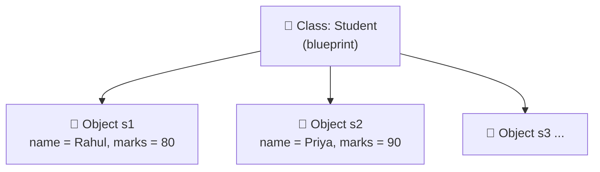

### 📊 Class vs Object

| Point        | Class                         | Object                               |
| ------------ | ----------------------------- | ------------------------------------ |
| Meaning      | Blueprint / template          | Real thing made from the blueprint   |
| Created with | `class` keyword               | `ClassName(...)`                     |
| Count        | Defined **once**              | Can create **many**                  |
| Example      | `Student`                     | `s1`, `s2`                           |

🧠 *House plan = class · Actual house = object*

---

## 2. What is the purpose of `self`?

### ✅ Key points

- `self` refers to the **current object** — the object that is calling the method.
- It lets a method **access that object's own attributes and methods** (`self.name`).
- It must be the **first parameter** of every instance method.
- Python passes it **automatically** — we don't write it while calling.
- `self` is a **convention**, but always use the name `self`.
- Without `self`, the method cannot know **whose data** to use.

### 🧾 Syntax

```python
class ClassName:
    def method(self, other_parameters):
        self.attribute = value        # store in THIS object
        print(self.attribute)         # read from THIS object
```

### 🧾 Example

```python
class S2:
    def __init__(self, name):
        self.name = name

    def show(self):
        print("I am", self.name)

a = S2("Rahul")
b = S2("Priya")

a.show()           # I am Rahul
b.show()           # I am Priya
S2.show(a)         # I am Rahul   ← same as a.show()
```

### 🔄 Flowchart

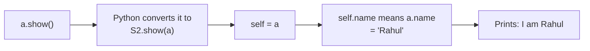

| Call       | `self` refers to | `self.name` gives |
| ---------- | ---------------- | ----------------- |
| `a.show()` | `a`              | `"Rahul"`         |
| `b.show()` | `b`              | `"Priya"`         |

🧠 *self = "this object"*

---

## 3. What is a constructor, and when is `__init__()` called?

### ✅ Key points

- A **constructor** is a **special method that runs automatically** when an object is created.
- In Python it is named **`__init__()`** (read: "dunder init").
- It **initializes** the object's data (sets the starting values).
- It is called **automatically** — we never call it ourselves.
- First parameter is **`self`**; other parameters receive the values we pass while creating the object.
- Parameters can have **default values**.
- It must **not return a value** (it returns `None`).
- If we don't write one, Python uses a default empty constructor.

### 🧾 Syntax

```python
class ClassName:
    def __init__(self, parameter1, parameter2="default"):
        self.attribute1 = parameter1
        self.attribute2 = parameter2

obj = ClassName(value1)          # __init__ runs automatically here
```

### 🧾 Example

```python
class Member:
    def __init__(self, name, plan="Basic"):
        print("Constructor called")
        self.name = name
        self.plan = plan

m1 = Member("Rahul")                 # uses the default plan
m2 = Member("Priya", "Premium")      # overrides the default
print(m1.plan, m2.plan)
```

**Output:**

```text
Constructor called
Constructor called
Basic Premium
```

### 🔄 Flowchart — what happens when an object is created

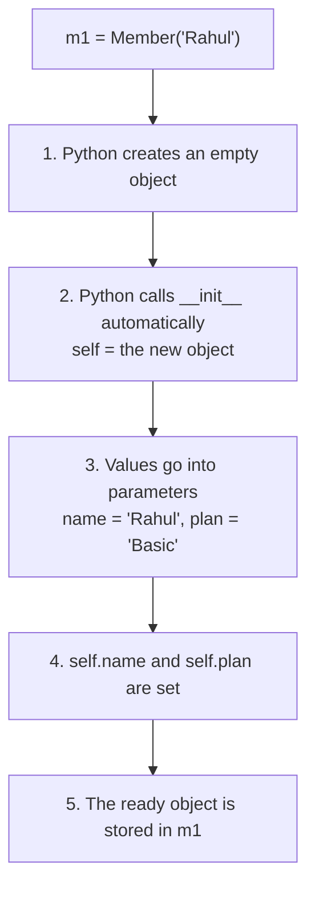

### ⚠️ Returning a value is an error

```python
class Bad:
    def __init__(self):
        return 5

Bad()      # TypeError: __init__() should return None, not 'int'
```

🧠 *`__init__` = automatic set-up when an object is born*

---

## 4. What is the difference between a class variable and an instance variable?

### ✅ Key points

| Point              | Instance variable                     | Class variable                          |
| ------------------ | ------------------------------------- | --------------------------------------- |
| Written            | Inside a method with `self.` (usually `__init__`) | In the **class body**, outside methods |
| Belongs to         | **One object**                        | **The class** (shared by all objects)   |
| Copies             | One **per object**                    | Only **one**                            |
| Access with object | ✅ `s1.name`                           | ✅ `s1.school`                           |
| Access with class  | ❌ `Student.name` → `AttributeError`   | ✅ `Student.school`                      |
| Use for            | Data that **differs** per object      | Data **common** to all objects          |

### 🧾 Syntax

```python
class ClassName:
    shared = "value"                  # class variable

    def __init__(self, name):
        self.name = name              # instance variable
```

### 🧾 Example

```python
class Student:
    school = "ABC School"                 # class variable

    def __init__(self, name):
        self.name = name                  # instance variable

s1, s2, s3 = Student("A"), Student("B"), Student("C")

Student.school = "XYZ School"             # change through the CLASS → everyone
print(s1.school, s2.school, s3.school)    # XYZ School  XYZ School  XYZ School

s2.school = "Special School"              # through an OBJECT → only s2 gets its own copy
print(s1.school, s2.school, s3.school)    # XYZ School  Special School  XYZ School
```

### 🔄 Flowchart — how Python finds a variable

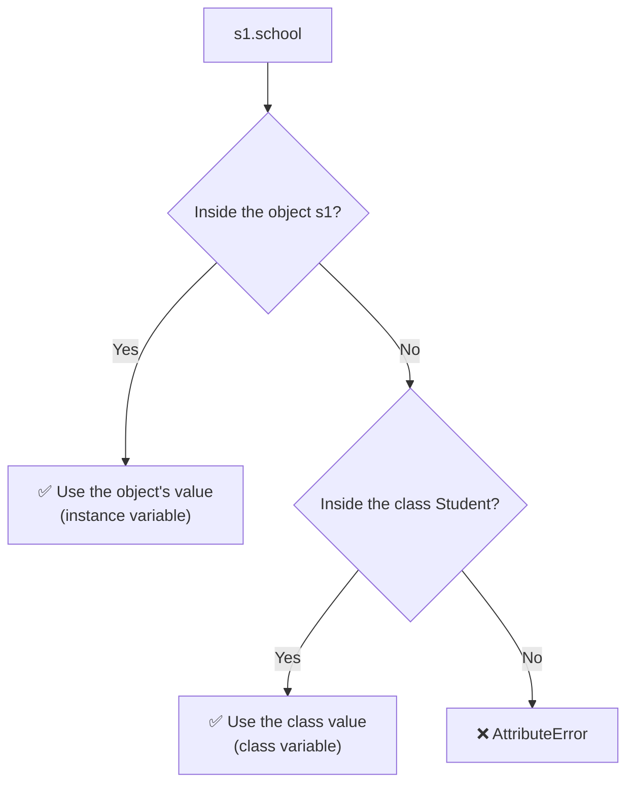

### ⚠️ Important rules

- `ClassName.variable = value` → changes it for **everyone** (except objects that overrode it).
- `obj.variable = value` → creates a **personal copy** only for that object.
- Counter: use `ClassName.count += 1`, **not** `self.count += 1`.
- Own list per object → create it in `__init__` with `self.items = []`.
- See where a variable lives: `obj.__dict__` (instance) · `ClassName.__dict__` (class).

🧠 *Class = shared · Instance = personal*

---

## 5. What is the difference between an instance method and a static method?

### ✅ Key points

| Point                    | Instance method                    | Static method                         |
| ------------------------ | ---------------------------------- | ------------------------------------- |
| Decorator                | None                               | `@staticmethod`                       |
| First parameter          | `self` (the object)                | **None** (no `self`, no `cls`)        |
| Needs an object to call? | ✅ Yes                              | ❌ No (call with the class name)       |
| Can use `self.attribute` | ✅ Yes                              | ❌ No (`NameError: self is not defined`) |
| Works on                 | **One object's data**              | **Only the values passed in**         |
| Typical use              | `deposit()`, `display_details()`   | `is_valid_email()`, converters, calculators |

### 🧾 Syntax

```python
class ClassName:
    def instance_method(self, x):         # needs an object
        ...

    @staticmethod
    def static_method(x, y):              # no self, no cls
        ...

obj = ClassName()
obj.instance_method(5)
ClassName.static_method(2, 3)             # no object needed
```

### 🧾 Example

```python
class Wallet:
    def __init__(self, rupees):
        self.rupees = rupees

    def show(self):                       # INSTANCE → uses self
        print(f"Balance: Rs {self.rupees}")

    @staticmethod
    def rupees_to_paise(rupees):          # STATIC → uses only its input
        return rupees * 100

w = Wallet(250)
w.show()                                  # Balance: Rs 250
print(Wallet.rupees_to_paise(5))          # 500
```

### 🔄 Flowchart

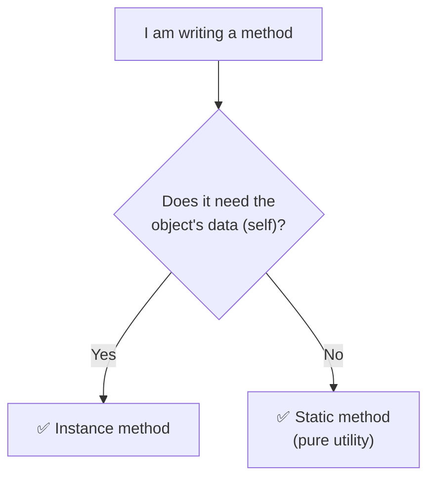

🧠 *Instance = uses the object · Static = uses only its inputs*

---

## 6. What is encapsulation in Python?

### ✅ Key points

- **Encapsulation** = **wrapping data and the methods that work on it inside one class**, and **controlling access** to that data.
- Goal: **protect data from wrong changes** and **hide internal details**.
- How we do it in Python:
  - **Naming conventions** → `name` (public), `_name` (protected), `__name` (private)
  - **Getters / setters** or **`@property`** with **validation**
- Benefits:
  - ✅ Data stays **valid** (no negative balance, no marks above 100)
  - ✅ Internal code can change without breaking outside code
  - ✅ Code is **safer** and easier to maintain

### 🧾 Syntax

```python
class ClassName:
    def __init__(self, value):
        self.__value = 0                 # private data
        self.value = value               # goes through the setter

    @property
    def value(self):                     # controlled reading
        return self.__value

    @value.setter
    def value(self, new_value):          # controlled writing + validation
        if <valid>:
            self.__value = new_value
```

### 🧾 Example

```python
class Account:
    def __init__(self, holder, balance):
        self.holder = holder
        self.__balance = 0
        self.balance = balance

    @property
    def balance(self):
        return self.__balance

    @balance.setter
    def balance(self, value):
        if value >= 0:
            self.__balance = value
        else:
            print("Balance cannot be negative")

acc = Account("Rahul", 500)
print(acc.balance)          # 500
acc.balance = -100          # Balance cannot be negative
print(acc.balance)          # 500   (unchanged)
acc.balance = 900
print(acc.balance)          # 900
print(acc.__balance)        # ❌ AttributeError: 'Account' object has no attribute '__balance'
```

### 🔄 Flowchart

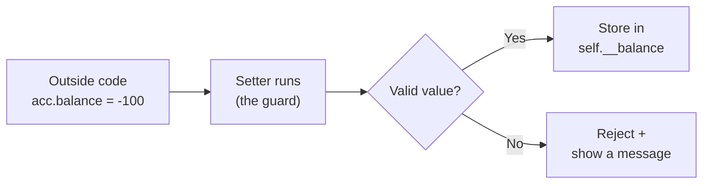

🧠 *Wrap + Protect*

---

## 7. What is the difference between `_variable` and `__variable`?

### ✅ Key points

| Point                    | `_variable` (single underscore)              | `__variable` (double underscore)                    |
| ------------------------ | -------------------------------------------- | --------------------------------------------------- |
| Called                   | **Protected** (by convention)                | **Private**                                         |
| Does Python enforce it?  | ❌ No — only a **hint** to programmers        | ⚠️ Partly — Python **renames** it (**name mangling**) |
| Real name in memory      | `_variable` (unchanged)                      | `_ClassName__variable`                              |
| Access outside the class | ✅ Works (but discouraged)                    | ❌ Fails by its original name (`AttributeError`)     |
| Use in a child class     | ✅ Yes (that is its purpose)                  | ❌ Not by its original name                          |
| Truly secure?            | ❌ No                                         | ❌ No (`obj._ClassName__variable` still works)       |

### 🧾 Syntax

```python
class ClassName:
    def __init__(self):
        self.public = 1          # public
        self._protected = 2      # protected (convention)
        self.__private = 3       # private (name mangled)
```

### 🧾 Example

```python
class Player:
    def __init__(self, name):
        self.name = name
        self.__score = 0                 # private

    def add_points(self, pts):
        if pts > 0:
            self.__score += pts

    def get_score(self):
        return self.__score

p = Player("Asha")
p.add_points(10)

print(p.get_score())          # 10
print(p.__score)              # ❌ AttributeError: no attribute '__score'
print(p._Player__score)       # 10   ← works, but NOT recommended
print(p.__dict__)             # {'name': 'Asha', '_Player__score': 10}
```

### 🔄 Flowchart — name mangling

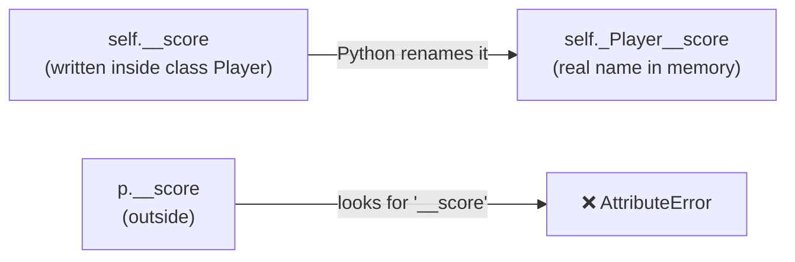

> ⚠️ Names that **start and end** with double underscores (`__init__`, `__str__`) are special methods — they are **not** private and **not** mangled.

🧠 *`_` = "please don't touch" · `__` = mangled, **not** locked*

---

## 8. What are getters and setters?

### ✅ Key points

- **Getter** = a method that **reads (returns)** an attribute's value.
- **Setter** = a method that **updates** an attribute's value, usually after **validation**.
- They give **controlled access** to private/protected data.
- Two ways to write them:
  1. **Traditional** → `get_speed()` / `set_speed()` methods
  2. **Pythonic** → `@property` and `@name.setter` (use `obj.speed` like a normal attribute)
- Store the real value in an **internal variable** (`_speed`), not in `self.speed` (that would cause `RecursionError`).

### 🧾 Syntax

```python
class ClassName:
    def __init__(self, value):
        self._value = 0                    # internal variable
        self.value = value                 # uses the setter (validation runs)

    @property                              # GETTER
    def value(self):
        return self._value

    @value.setter                          # SETTER
    def value(self, new_value):
        if <valid>:
            self._value = new_value
        else:
            print("Invalid value")
```

### 🧾 Example

```python
class Car:
    def __init__(self, brand, speed):
        self.brand = brand
        self._speed = 0
        self.speed = speed

    @property
    def speed(self):
        return self._speed

    @speed.setter
    def speed(self, value):
        if 0 <= value <= 200:
            self._speed = value
        else:
            print("Speed must be between 0 and 200")

car = Car("Tata", 60)
print(car.speed)         # 60      ← getter
car.speed = 120          #         ← setter
print(car.speed)         # 120
car.speed = 500          # Speed must be between 0 and 200
print(car.speed)         # 120     (unchanged)
```

### 🔄 Flowchart

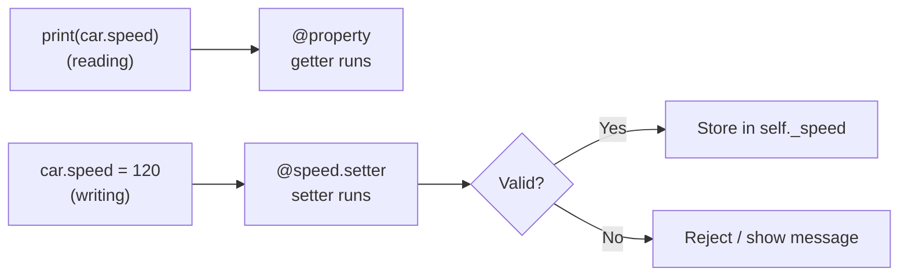

🧠 *Getter = read · Setter = write + check*

---

## 9. What is inheritance, and why do we use it?

### ✅ Key points

- **Inheritance** = a **child class automatically gets the attributes and methods of a parent class**.
- Other names: parent = **base / super class**, child = **derived / sub class**.
- Why we use it:
  - ✅ **Code reusability** — write common code once in the parent
  - ✅ **Less duplication** — no copy-paste
  - ✅ **Easy maintenance** — fix the parent, all children are fixed
  - ✅ **Natural structure** — models real-world relationships
- The child can also add **its own** attributes and methods.
- Direction: **parent → child only** (a parent object cannot use child methods).
- Use it only for an **"is-a"** relationship (a Student **is a** Person).

### 🧾 Syntax

```python
class Parent:
    ...

class Child(Parent):         # Child inherits from Parent
    ...
```

### 🧾 Example

```python
class Person:
    def __init__(self, name, age):
        self.name = name
        self.age = age

    def introduce(self):
        print(f"I am {self.name}, {self.age} years old")

class Student(Person):
    def __init__(self, name, age, roll):
        super().__init__(name, age)
        self.roll = roll

class Teacher(Person):
    def __init__(self, name, age, subject):
        super().__init__(name, age)
        self.subject = subject

Student("Rahul", 20, 101).introduce()     # I am Rahul, 20 years old   ← inherited
t = Teacher("Neha", 35, "Maths")
t.introduce()                              # I am Neha, 35 years old    ← inherited
print(t.subject)                           # Maths                       ← Teacher's own
```

### 🔄 Flowchart

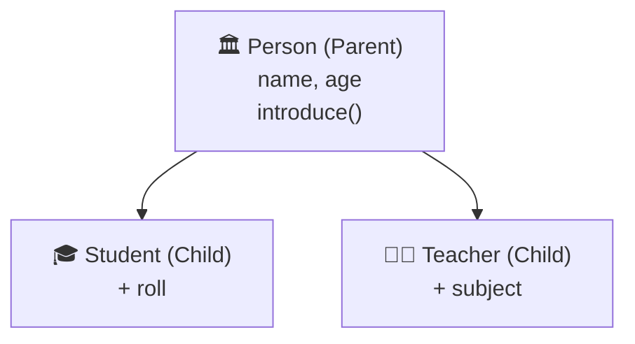

### 📊 Inheritance vs separate classes

| Separate classes                          | Inheritance                              |
| ----------------------------------------- | ---------------------------------------- |
| Common code **repeated** in every class   | Common code written **once** in the parent |
| Change must be made in **every** class    | Change the parent **once**               |
| No relationship between classes           | Clear **"is-a"** relationship            |

🧠 *Reuse · Less repetition · is-a*

---

## 10. What is the purpose of `super()`?

### ✅ Key points

- `super()` gives access to the **parent class** from inside the child class.
- Most common use: **call the parent's constructor** → `super().__init__(...)`.
- Why it is needed: if the child defines its **own** `__init__`, the parent's `__init__` is **not called automatically**, so the parent's attributes would be missing.
- It can also **call a parent's method** to **extend** it (run the parent's version, then add more).
- **Do not pass `self`** inside `super().__init__(...)`.
- Call it **first**, then set the child's own attributes.

### 🧾 Syntax

```python
class Child(Parent):
    def __init__(self, a, b, c):
        super().__init__(a, b)        # parent sets a and b
        self.c = c                    # child's own attribute

    def show(self):
        super().show()                # parent's version first
        print(self.c)                 # then extra
```

### 🧾 Example

```python
class Member:
    def __init__(self, name, member_id):
        self.name = name
        self.member_id = member_id

    def show(self):
        print(f"Name: {self.name}, ID: {self.member_id}")

class PremiumMember(Member):
    def __init__(self, name, member_id, discount):
        super().__init__(name, member_id)
        self.discount = discount

    def show(self):
        super().show()
        print(f"Discount: {self.discount}%")

PremiumMember("Rahul", 101, 15).show()
```

**Output:**

```text
Name: Rahul, ID: 101
Discount: 15%
```

### 🔄 Flowchart

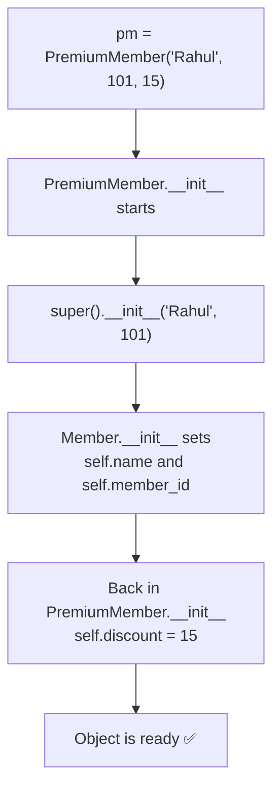

> ❌ `super().__init__(self, name, member_id)` → extra `self` → `TypeError`.

🧠 *super() = "ask the parent"*

---

## 11. What is method overriding?

### ✅ Key points

- **Method overriding** = a **child class defines a method with the same name** as the parent's method.
- For child objects, the **child's version runs** (it replaces the parent's version).
- Name and parameters should be the **same**.
- If the child does **not** override, the **parent's version** is used.
- **Lookup rule:** Python searches the **child class first**, then the parent.
- To run the parent's version as well, call `super().method()`.

### 🧾 Syntax

```python
class Parent:
    def action(self):
        print("Parent action")

class Child(Parent):
    def action(self):                 # same name → overrides
        print("Child action")
```

### 🧾 Example

```python
class Creature:
    def __init__(self, name):
        self.name = name

    def move(self):
        print(f"{self.name} moves")

class Bird(Creature):
    def move(self):                   # overrides
        print(f"{self.name} flies")

class Fish(Creature):
    def move(self):                   # overrides
        print(f"{self.name} swims")

class Snail(Creature):
    pass                              # no override → parent's move()

for c in [Bird("Parrot"), Fish("Shark"), Snail("Snail")]:
    c.move()
```

**Output:**

```text
Parrot flies
Shark swims
Snail moves
```

### 🔄 Flowchart — method lookup

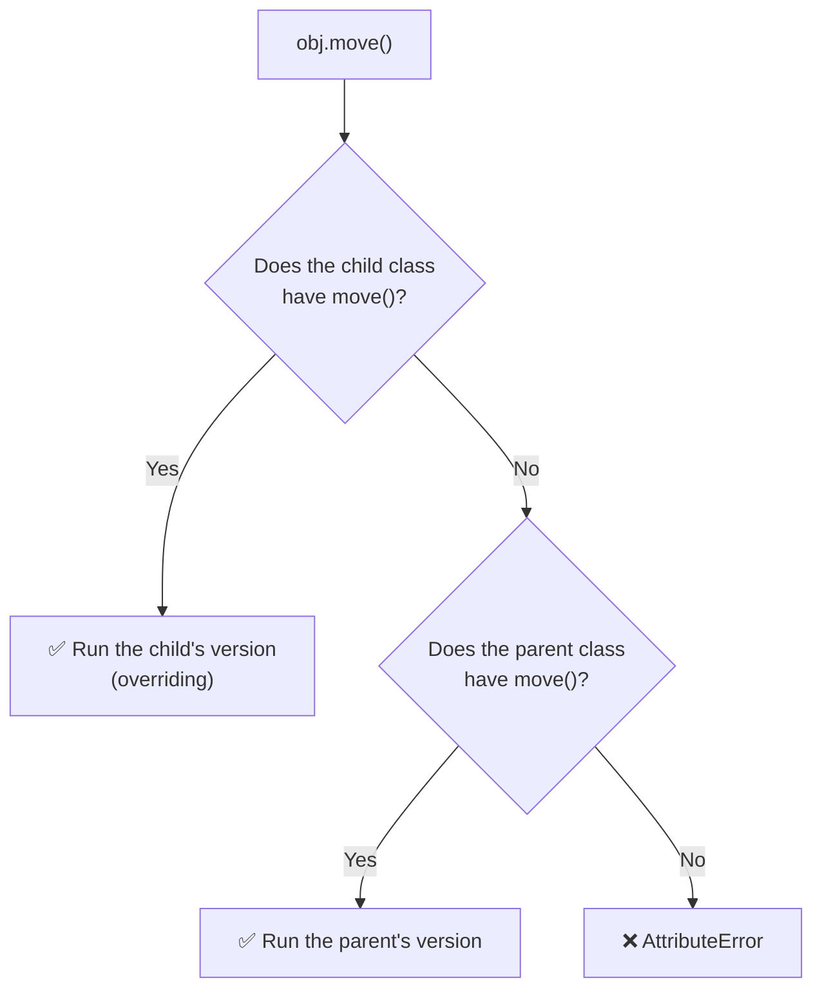

> ⚠️ **Overriding ≠ Overloading.** Overloading (same name, different parameters in one class) is **not supported** in Python — the last definition wins.

🧠 *Same name, child wins*

---

## 12. What is polymorphism?

### ✅ Key points

- **Polymorphism** = **"many forms"** — the **same method name** behaves **differently** for **different objects**.
- Ways it appears in Python:
  1. **Method overriding** (child classes change a parent's method)
  2. **Duck typing** (any object that has the method works — no inheritance needed)
  3. **Built-in functions/operators** (`len()` works on strings, lists, dicts; `+` adds numbers and joins strings)
- Benefit: write **one piece of code** (like one loop) that works with **many types of objects**, without `if` checks.

### 🧾 Syntax

```python
for obj in [Object1(), Object2(), Object3()]:
    obj.same_method()          # same call, different behaviour
```

### 🧾 Example 1 — Overriding

```python
class Animal:
    def sound(self):
        print("Some sound")

class Dog(Animal):
    def sound(self):
        print("Woof")

class Cat(Animal):
    def sound(self):
        print("Meow")

for a in [Dog(), Cat(), Animal()]:
    a.sound()
```

```text
Woof
Meow
Some sound
```

### 🧾 Example 2 — Duck typing

```python
class Duck:
    def speak(self):
        print("Quack")

class Robot:
    def speak(self):
        print("Beep")

for x in [Duck(), Robot()]:      # unrelated classes
    x.speak()                    # Quack  Beep
```

### 🧾 Example 3 — Built-in

```python
print(len("hello"), len([1, 2, 3]), len({"a": 1}))    # 5 3 1
print(2 + 3, "a" + "b", [1] + [2])                    # 5  ab  [1, 2]
```

### 🔄 Flowchart

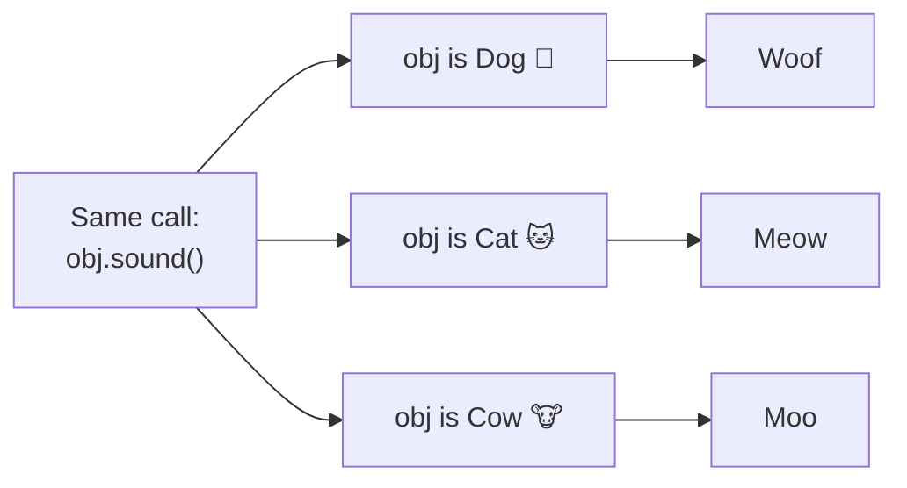

### 📊 Inheritance vs Overriding vs Polymorphism

| Term             | Meaning                                                        |
| ---------------- | -------------------------------------------------------------- |
| **Inheritance**  | Child **gets** the parent's code (reuse)                       |
| **Overriding**   | Child **changes** a parent's method (same name)                |
| **Polymorphism** | **Same method name, different behaviour** for different objects |

🧠 *Overriding is the tool · Polymorphism is the result*

---

## 13. What is the difference between a static method and a class method?

### ✅ Key points

| Point                    | `@classmethod`                              | `@staticmethod`                          |
| ------------------------ | ------------------------------------------- | ---------------------------------------- |
| First parameter          | **`cls`** (the class)                       | **None**                                 |
| Can use class variables? | ✅ Yes (`cls.variable`)                      | Only through the class name              |
| Can create objects?      | ✅ Yes (`cls(...)`) — alternative constructors | Not automatically                      |
| Can use object data?     | ❌ No                                        | ❌ No                                     |
| Called with              | Class or object                             | Class or object                          |
| Typical use              | Change **class-level** data, alternative constructors | **Utility** (calculate, validate, convert) |

### 🧾 Syntax

```python
class ClassName:
    shared = 0

    @classmethod
    def class_method(cls, x):            # gets the class
        cls.shared = x

    @staticmethod
    def static_method(a, b):             # gets nothing extra
        return a + b
```

### 🧾 Example

```python
class Bank:
    interest_rate = 5

    def __init__(self, holder):
        self.holder = holder

    @classmethod
    def change_rate(cls, new_rate):          # class method
        cls.interest_rate = new_rate

    @classmethod
    def from_string(cls, text):              # alternative constructor
        return cls(text.strip())

    @staticmethod
    def is_valid_amount(amount):             # static method
        return amount > 0

b1 = Bank("Asha")
b2 = Bank("Ravi")
Bank.change_rate(7)
print(b1.interest_rate, b2.interest_rate)    # 7 7   ← changed for everyone
b3 = Bank.from_string("  Meena ")
print(b3.holder)                             # Meena
print(Bank.is_valid_amount(500))             # True
```

### 🔄 Flowchart

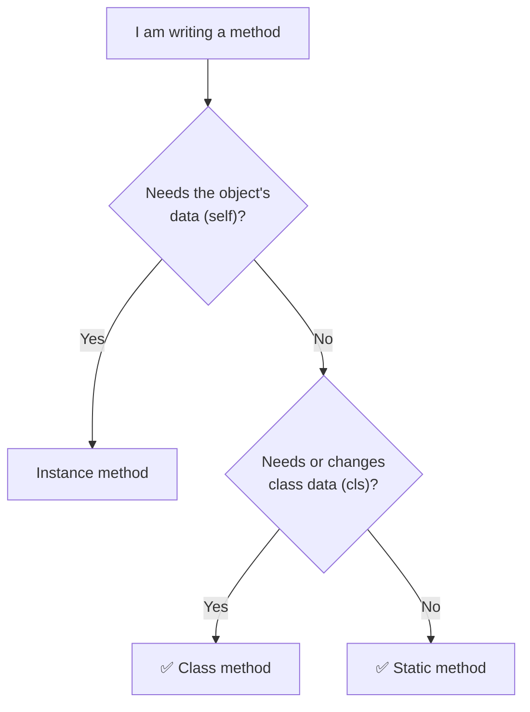

🧠 *self = object · cls = class · static = nothing*

---

## 14. What is the purpose of the `@property` decorator?

### ✅ Key points

- `@property` turns a **method into an attribute-like value** — we use `obj.age` **without brackets**.
- It defines the **getter**; a matching **`@name.setter`** defines the **setter**.
- Purposes:
  - ✅ **Validation** when a value is changed
  - ✅ **Read-only** attributes (getter only, no setter)
  - ✅ **Calculated values** (area, percentage, Fahrenheit) that are always up-to-date
  - ✅ Change the internal code later **without changing** how outside code uses it
- Store the real value in `_name` / `__name` (not `self.name`).
- Assigning to a property with **no setter** → `AttributeError`.

### 🧾 Syntax

```python
class ClassName:
    @property
    def name(self):                 # getter
        return self._name

    @name.setter
    def name(self, value):          # setter (optional)
        self._name = value

    @property
    def calculated(self):           # read-only property
        return self._a * 2
```

### 🧾 Example — read-only (calculated) property

```python
class Rectangle:
    def __init__(self, length, width):
        self.length = length
        self.width = width

    @property
    def perimeter(self):                  # no setter → read-only
        return 2 * (self.length + self.width)

r = Rectangle(4, 3)
print(r.perimeter)        # 14
r.length = 10
print(r.perimeter)        # 26    ← always up-to-date
r.perimeter = 5           # ❌ AttributeError: property 'perimeter' ... has no setter
```

### 🔄 Flowchart

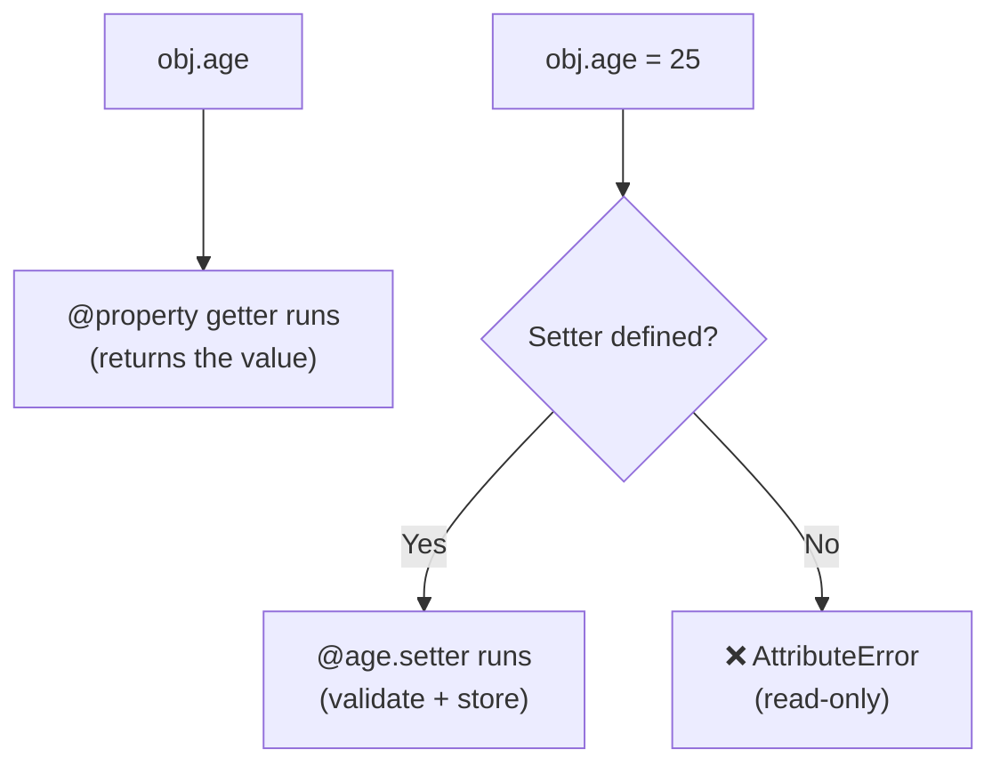

### 📊 Property vs normal method vs public attribute

| Point                 | Public attribute | Property           | Normal method `get_age()` |
| --------------------- | :--------------: | :----------------: | :-----------------------: |
| Brackets needed?      | No               | **No**             | Yes                       |
| Validation?           | ❌                | ✅                  | ✅                         |
| Read-only possible?   | ❌                | ✅                  | ✅                         |
| Calculated value?     | ❌                | ✅                  | ✅                         |

🧠 *Looks like an attribute, works like a method*

---

## 15. When should we use OOP instead of writing all the code as separate functions?

### ✅ Key points

Use **OOP** when:

- Data and the actions on it **belong together** (a bank account has a balance **and** deposit/withdraw).
- You have **many similar things** (many students, accounts, products).
- Each thing has its **own state** that changes over time.
- You want to **reuse and extend** code (inheritance).
- You want to **protect data** (encapsulation).
- The project is **big** and needs a clear structure.

Use **functions** when:

- The task is **small and one-off**.
- It is just a **calculation** and no data needs to be remembered.

### 🧾 Same problem, two styles

**With functions only** (data and functions are separate):

```python
def deposit_f(balance, amount):
    return balance + amount

b1 = 1000
b1 = deposit_f(b1, 500)       # we must manage the balance ourselves
print(b1)                      # 1500
```

**With OOP** (data and actions together, many accounts easily):

```python
class AccountC:
    def __init__(self, balance):
        self.balance = balance

    def deposit(self, amount):
        self.balance += amount

c1 = AccountC(1000)
c2 = AccountC(5000)
c1.deposit(500)
c2.deposit(200)
print(c1.balance, c2.balance)     # 1500 5200
```

### 🔄 Flowchart — Should I use OOP?

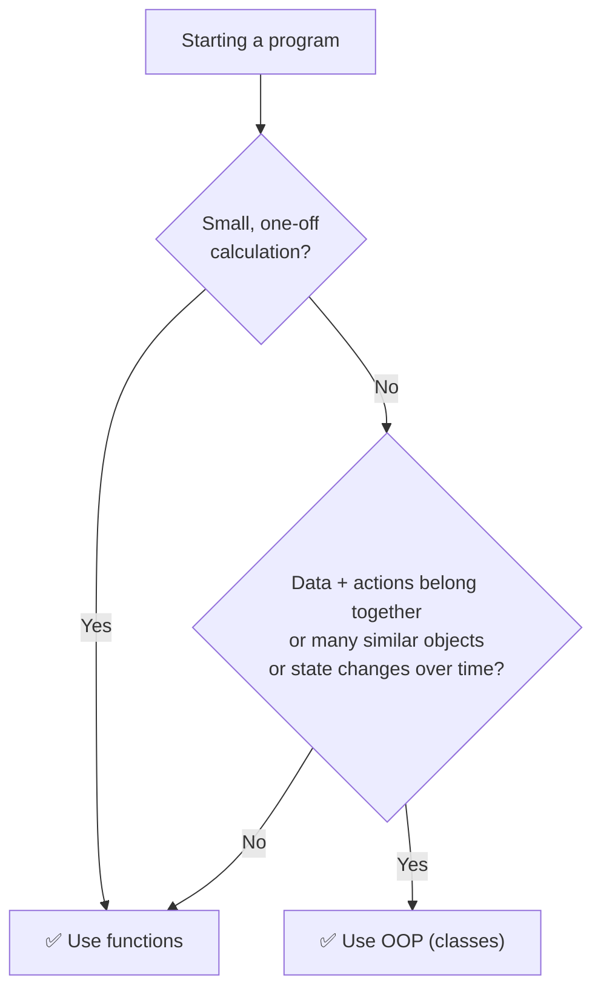

### 📊 Quick comparison

| Functions only                         | OOP                                          |
| -------------------------------------- | -------------------------------------------- |
| Data and functions are separate        | Data + methods in one class                  |
| Harder to manage many similar things   | Create as many objects as needed             |
| No built-in data protection            | Encapsulation (private, properties)          |
| Less reuse in big projects             | Inheritance and polymorphism                 |

🧠 *Data + actions together → OOP*

---

## ⚡ 15-Line Super Revision

```text
1.  Class / Object     → Blueprint / real thing
2.  self               → This object
3.  __init__           → Automatic set-up when the object is created
4.  Class vs Instance  → Shared / personal   (ClassName.var vs self.var)
5.  Instance vs Static → Uses self / uses only inputs
6.  Encapsulation      → Wrap + Protect data
7.  _x vs __x          → Convention / name mangling (_Class__x) — neither is secure
8.  Getter / Setter    → Read / write + validate
9.  Inheritance        → Child reuses parent (is-a)
10. super()            → Ask the parent (super().__init__(...))
11. Overriding         → Same name, child wins
12. Polymorphism       → Same method name, different behaviour
13. Static vs Class    → static = nothing · class = cls
14. @property          → Method used like an attribute
15. OOP vs functions   → Data + actions together → OOP
```

---

## ✅ Self-Check Before Pushing

- [ ] I read every answer and understood the flowcharts
- [ ] I can explain each answer **without looking** at the file
- [ ] I typed at least 5 of the examples in VS Code and ran them
- [ ] I can write the syntax of `__init__`, `@property`, `@staticmethod`, `@classmethod`, `super()` from memory