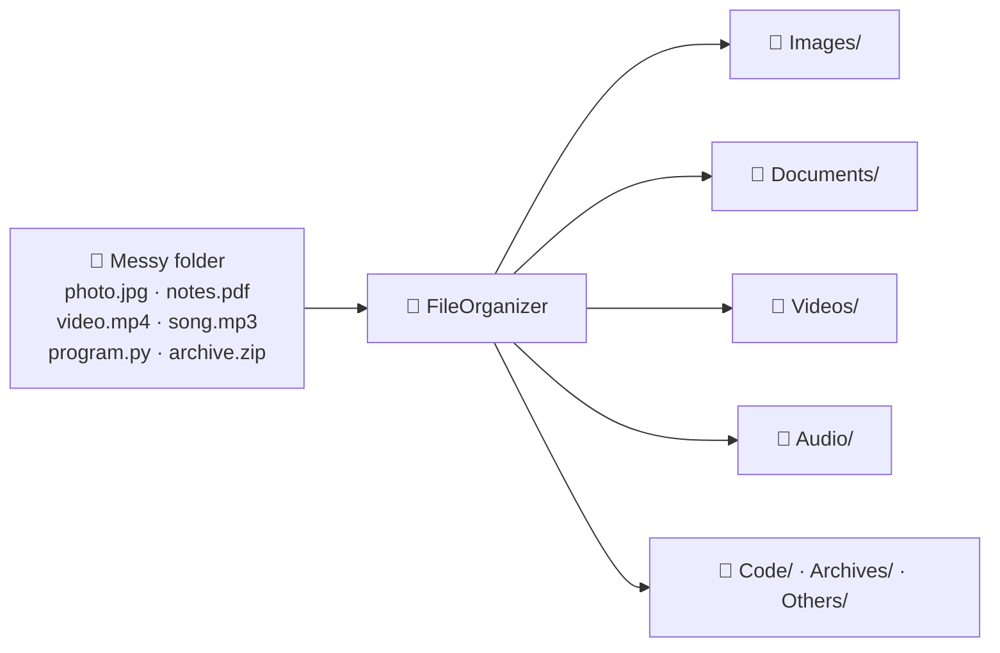
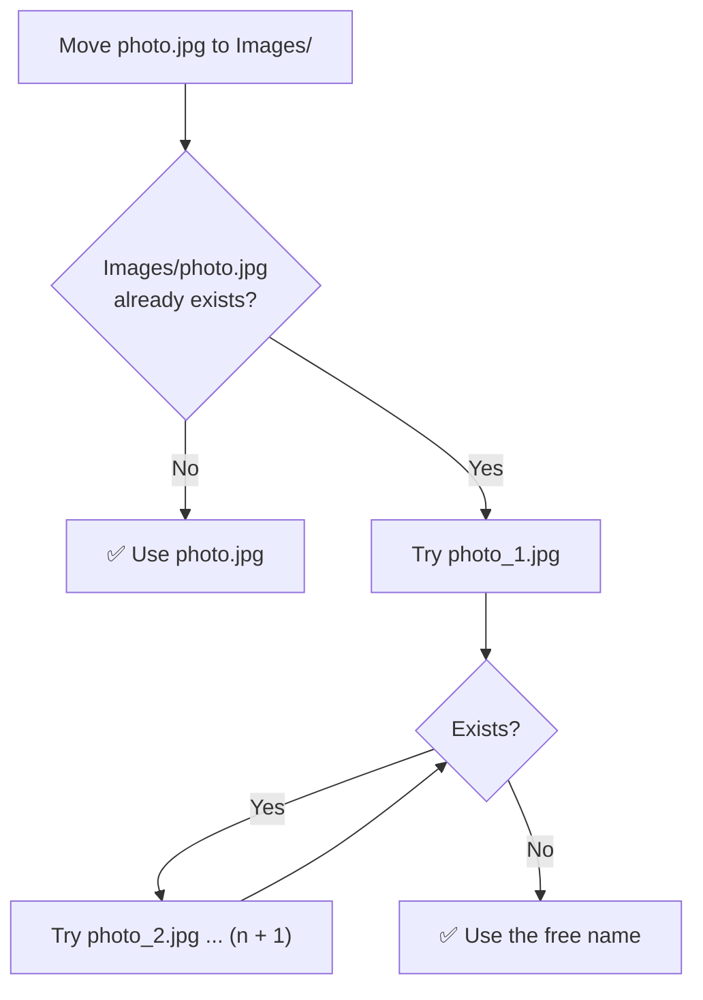
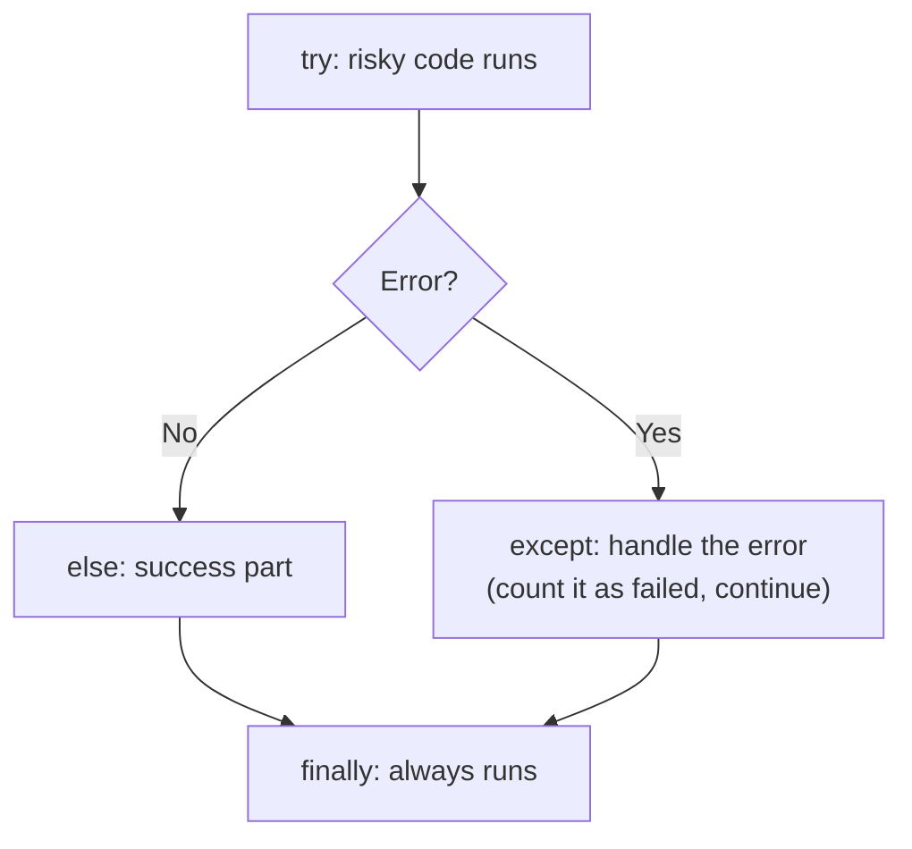
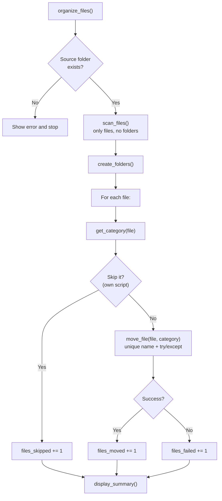

<p align="center">
  
</p>

<p align="center">
  
  
  
  
  
</p>

# 🟢 Day 13 — File Organizer Using Python OOP

## 🎯 Learning Objectives

Today I will learn:

- How to organize files automatically using Python.
- How to use OOP concepts in a real-world project.
- How to work with Python's `os` and `pathlib` modules.
- How to identify files using their extensions.
- How to create folders automatically.
- How to move files into appropriate folders.
- How to handle missing directories and invalid paths.
- How to avoid overwriting files with the same name.
- How to use exception handling.
- How to build a command-line File Organizer application.

---

# 📖 Day 13 Concepts — Read & Understand First

> Today is a **project day** (Mini Project #2). The new part is **file handling** with `pathlib`, `os` and `shutil`. Read this section slowly, type every example yourself, and **always practise on a sample folder, never on your important files.**

## 1️⃣ What Are We Building?

A **File Organizer** looks at a messy folder (like **Downloads**) and **automatically moves each file into the right category folder** based on its extension.



---

## 2️⃣ Safety First ⚠️

This program **moves real files**. A bug can scatter or overwrite your important files. Follow these rules from the very first line of code:

| Rule                                        | Why                                              |
| ------------------------------------------- | ------------------------------------------------ |
| ✅ Create a **`SampleFiles/`** test folder    | Test on fake files only                          |
| ✅ Start with **dry-run mode** (preview only) | See what *would* happen before moving anything   |
| ✅ **Never overwrite** a file silently        | Same-name files would be lost forever            |
| ✅ Don't touch Desktop / Documents / system folders | Use copies first                           |
| ✅ **Skip folders** and the organizer's **own script** | Don't move what you shouldn't              |
| ✅ Handle errors with `try / except`          | One bad file shouldn't crash the whole run       |

---

## 3️⃣ The Three Tools: `pathlib`, `os`, `shutil`

| Module       | What it does                                                | Example                          |
| ------------ | ----------------------------------------------------------- | -------------------------------- |
| **`pathlib`** | Works with paths as **objects** (modern, recommended)      | `Path("a/b.txt").suffix`         |
| **`os`**      | Older, function-based tools for files/folders (strings)    | `os.listdir(path)`               |
| **`shutil`**  | **High-level file operations**: move, copy, delete folders | `shutil.move(src, dst)`          |

### `os` vs `pathlib` (same task, two styles)

| Task                    | `os` style                              | `pathlib` style                          |
| ----------------------- | --------------------------------------- | ---------------------------------------- |
| List a folder           | `os.listdir(path)`                      | `Path(path).iterdir()`                   |
| Join paths              | `os.path.join(folder, name)`            | `Path(folder) / name`                    |
| Does it exist?          | `os.path.exists(p)`                     | `Path(p).exists()`                       |
| Is it a file / folder?  | `os.path.isfile(p)` / `os.path.isdir(p)` | `Path(p).is_file()` / `.is_dir()`        |
| Get the extension       | `os.path.splitext(p)[1]`                | `Path(p).suffix`                         |
| Make a folder           | `os.makedirs(p, exist_ok=True)`         | `Path(p).mkdir(parents=True, exist_ok=True)` |

> ✅ In this project we use **`pathlib`** (cleaner and object-oriented) and **`shutil.move()`** for moving.

---

## 4️⃣ Working With Paths (`pathlib.Path`)

```python
from pathlib import Path

p = Path("SampleFiles/photo.jpg")

print(p.name)        # photo.jpg        ← full file name
print(p.stem)        # photo            ← name without extension
print(p.suffix)      # .jpg             ← extension (with the dot)
print(p.parent)      # SampleFiles      ← the folder containing it
```

**Joining paths with `/`:**

```python
base = Path("SampleFiles")
target = base / "Images" / "photo.jpg"      # SampleFiles/Images/photo.jpg
```

**Checking a path:**

```python
p.exists()      # does it exist?
p.is_file()     # is it a file?
p.is_dir()      # is it a folder?
```

### 🪟 Windows path tip

Windows uses backslashes `\`, and in a normal string `\n` or `\t` become special characters. Use a **raw string** (`r"..."`) or forward slashes:

```python
folder = r"C:\Users\Sudhanshu\Desktop\SampleFiles"      # ✅ raw string
folder = "C:/Users/Sudhanshu/Desktop/SampleFiles"       # ✅ forward slashes
folder = "C:\new_folder\test"                           # ❌ "\n" becomes a new line
```

*(On Windows, printed paths show `\` instead of `/`. That is normal.)*

---

## 5️⃣ File vs Directory, and File Extensions

| Term                 | Meaning                                              |
| -------------------- | ---------------------------------------------------- |
| **File**             | Stores data (`photo.jpg`, `notes.pdf`)               |
| **Directory (folder)** | A container that holds files and other folders     |
| **Extension**        | The part after the last dot; tells the **type** of file |

**Five common extensions:**

| Extension | Type                    |
| --------- | ----------------------- |
| `.jpg`    | Image                   |
| `.pdf`    | Document                |
| `.mp4`    | Video                   |
| `.mp3`    | Audio                   |
| `.py`     | Python code             |

**Extension edge cases** (very important for the organizer):

```python
Path("archive.tar.gz").suffix     # .gz     ← only the LAST part
Path("README").suffix             # ''      ← no extension (empty string)
Path(".gitignore").suffix         # ''      ← hidden file, no extension
Path("PHOTO.JPG").suffix.lower()  # .jpg    ← normalize to lowercase
```

> ✅ Always use **`.suffix.lower()`**, so `.JPG` and `.jpg` are treated the same.

---

## 6️⃣ Listing Files in a Folder

```python
from pathlib import Path

base = Path("SampleFiles")

for item in sorted(base.iterdir()):                  # everything inside
    kind = "FILE" if item.is_file() else "DIR "
    print(kind, item.name)
```

**Output (example):**

```text
DIR  OldFolder
FILE PIC.JPG
FILE README
FILE archive.zip
FILE notes.pdf
FILE photo.jpg
```

**Only files (skip folders):**

```python
files = [f for f in base.iterdir() if f.is_file()]
print(len(files))                                    # count of files only
```

**Pattern search:**

```python
print(sorted(f.name for f in base.glob("*.jpg")))    # files ending with .jpg
```

> 🔑 `iterdir()` lists only the **top level** of the folder. That is exactly what we want — folders already created by the organizer won't be scanned as files.

---

## 7️⃣ Creating Folders

```python
(base / "Images").mkdir(exist_ok=True)       # ✅ no error if it already exists
(base / "Images").mkdir(exist_ok=True)       # ✅ safe to run again

(base / "Images").mkdir()                    # ❌ FileExistsError if it already exists
```

* `exist_ok=True` → "don't complain if it already exists".
* `parents=True` → also create missing parent folders.

---

## 8️⃣ Moving Files With `shutil.move()`

```python
import shutil

shutil.move(str(source_file), str(destination_folder))
```

* If the destination is a **folder**, the file is moved **inside** it.
* It works even across different drives (copy + delete under the hood).
* Returns the new path.

### ⚠️ The overwrite danger

```python
# A file with the same name already exists in the destination folder
shutil.move("SampleFiles/photo.jpg", "SampleFiles/Images")
# shutil.Error: Destination path 'SampleFiles/Images/photo.jpg' already exists
```

But if you pass the **full destination file path** and that file already exists, the result **depends on the operating system**: it may **silently overwrite** the old file (Linux / macOS) or raise an error (Windows). Never rely on this — **always check yourself** before moving.

---

## 9️⃣ Mapping Extensions to Categories (Dictionary)

Instead of many `if / elif`, keep the rules as **data** in a dictionary:

```python
CATEGORIES = {
    "Images":    [".jpg", ".jpeg", ".png", ".gif"],
    "Documents": [".pdf", ".docx", ".txt"],
    "Videos":    [".mp4", ".mkv"],
    "Audio":     [".mp3", ".wav"],
}
```

**Look up a category:**

```python
# build a fast "extension → category" lookup once
ext_to_cat = {ext: cat for cat, exts in CATEGORIES.items() for ext in exts}

def get_category(path):
    return ext_to_cat.get(Path(path).suffix.lower(), "Others")

print(get_category("a.JPG"))      # Images
print(get_category("b.pdf"))      # Documents
print(get_category("c.xyz"))      # Others   ← unknown extension
print(get_category("README"))     # Others   ← no extension
```

> ✅ **Adding a new category = adding a dictionary entry.** No method code needs to change.
> `dict.get(key, default)` returns the default (`"Others"`) when the key is missing.

---

## 🔟 Preventing Duplicate File Names

If `Images/photo.jpg` already exists, don't overwrite it. Create `photo_1.jpg`, then `photo_2.jpg`, and so on.



```python
def unique_path(folder, filename):
    target = folder / filename
    if not target.exists():
        return target
    stem, suffix = Path(filename).stem, Path(filename).suffix
    n = 1
    while True:
        candidate = folder / f"{stem}_{n}{suffix}"
        if not candidate.exists():
            return candidate
        n += 1

# Images/ already has photo.jpg and photo_1.jpg
print(unique_path(images, "photo.jpg").name)     # photo_2.jpg
print(unique_path(images, "new.jpg").name)       # new.jpg
```

* `stem` = name without extension, `suffix` = extension → the number goes **between** them (`photo_1.jpg`, not `photo.jpg_1`).

---

## 1️⃣1️⃣ Exception Handling (`try / except`)

File operations can fail: the folder doesn't exist, the file is open in another program, you have no permission… Without handling, **one bad file crashes the whole program**.

```python
try:
    # code that might fail
    shutil.move(str(src), str(dst))
except PermissionError:
    print("Permission denied")           # specific error first
except FileNotFoundError:
    print("File not found")
except OSError as e:
    print("Other file error:", e)        # general file/OS errors
else:
    print("Moved successfully")          # runs only if NO error happened
finally:
    print("Done")                        # always runs (cleanup)
```



**Common file errors:**

| Error                | Meaning                                          |
| -------------------- | ------------------------------------------------ |
| `FileNotFoundError`  | The file or folder doesn't exist                 |
| `PermissionError`    | You are not allowed to access / the file is locked |
| `FileExistsError`    | A file/folder with that name already exists      |
| `OSError`            | **Parent** of the above — catches any file/OS problem |
| `shutil.Error`       | `shutil` operation failed (e.g. destination exists) |

> 💡 Put **specific** `except` blocks **before** the general `OSError` block, otherwise the general one catches everything first.

**Check before you process (Theory Q10):**

```python
if not Path("NoSuchFolder").exists():
    print("Folder not found")
    return
```

Checking first gives a **clear message** instead of a crash.

---

## 1️⃣2️⃣ Dry-Run Mode (Preview Without Moving)

A **dry run** shows what *would* happen without changing anything. It is the best safety feature.

```python
def move_file(file_path, folder_name, dry_run=True):
    if dry_run:
        print(f"{file_path.name:<14} -> {folder_name}/")      # only preview
        return
    shutil.move(...)                                           # real move
```

**Output example:**

```text
photo.jpg      -> Images/
notes.pdf      -> Documents/
video.mp4      -> Videos/
```

> ✅ Make `dry_run` a parameter (default `True` while testing). Switch to `False` only after the preview looks right.

---

## 1️⃣3️⃣ Other Useful Bits

**File size (Q12):**

```python
size = (base / "notes.pdf").stat().st_size       # size in bytes
```

**Skip the organizer's own script (Q9):**

```python
own_script = Path(__file__).name                 # name of the running .py file
if file_path.name == own_script:
    continue                                      # don't move yourself!
```

**Counting with a dictionary (Q11):**

```python
counts = {}
for f in files:
    ext = f.suffix.lower() or "No Extension"
    counts[ext] = counts.get(ext, 0) + 1
```

---

## 1️⃣4️⃣ Why OOP for the File Organizer?

Without a class you would have many loose functions and variables (`path`, `moved`, `failed`…) that you pass around. A **class groups the data and the actions together**:

| Attribute (data)            | Meaning                                    |
| --------------------------- | ------------------------------------------ |
| `directory_path`            | The folder to organize                     |
| `file_categories`           | Dictionary: category → extensions          |
| `files_moved`               | Counter of successful moves                |
| `files_skipped`             | Counter of skipped files                   |
| `files_failed`              | Counter of failures                        |

| Method                | One job (single responsibility)                       |
| --------------------- | ----------------------------------------------------- |
| `scan_files()`        | Return the list of **files** in the folder            |
| `create_folders()`    | Create the category folders                           |
| `get_category(path)`  | Decide the category from the extension                |
| `move_file(path, category)` | Move one file safely (no overwrite, with errors handled) |
| `organize_files()`    | **Coordinator** — calls the other methods in order    |
| `display_summary()`   | Print moved / skipped / failed counts                 |



> 🔑 The class design is a **blueprint** — each method does **one thing**. This is the "one class, one job" idea from Day 09, now applied to **methods** as well.

---

## 1️⃣5️⃣ A Worked Example in a Different Domain: `LetterSorter`

To learn the **structure** without giving away your solution, here is a class with the **same design** but a **different rule**: it sorts files into folders by the **first letter of the file name** (`apple.txt` → `A/`).

```python
from pathlib import Path
import shutil

class LetterSorter:
    def __init__(self, folder):
        self.folder = Path(folder)
        self.moved = 0
        self.failed = 0

    def is_valid(self):                                   # validate the folder
        return self.folder.is_dir()

    def scan_files(self):                                 # files only
        return [f for f in sorted(self.folder.iterdir()) if f.is_file()]

    def get_folder_name(self, file_path):                 # the "rule"
        return file_path.name[0].upper()

    @staticmethod
    def unique_path(folder, filename):                    # never overwrite
        target = folder / filename
        n = 1
        while target.exists():
            target = folder / f"{Path(filename).stem}_{n}{Path(filename).suffix}"
            n += 1
        return target

    def move_file(self, file_path, folder_name, dry_run=False):
        destination = self.folder / folder_name
        if dry_run:
            print(f"{file_path.name:<14} -> {folder_name}/")
            return
        try:
            destination.mkdir(exist_ok=True)
            shutil.move(str(file_path), str(self.unique_path(destination, file_path.name)))
            self.moved += 1
        except OSError:
            self.failed += 1

    def organize(self, dry_run=False):                    # the coordinator
        if not self.is_valid():
            print("Folder not found")
            return
        for file_path in self.scan_files():
            self.move_file(file_path, self.get_folder_name(file_path), dry_run)

    def display_summary(self):
        print(f"Moved: {self.moved} | Failed: {self.failed}")


sorter = LetterSorter("Docs")
sorter.organize(dry_run=True)      # preview first
sorter.organize()                  # then the real run
sorter.display_summary()
```

**Dry-run output** (folder has `apple.txt`, `Avocado.txt`, `banana.txt`, `cat.txt`, `7days.txt`):

```text
7days.txt      -> 7/
Avocado.txt    -> A/
apple.txt      -> A/
banana.txt     -> B/
cat.txt        -> C/
```

**After the real run:** `Moved: 5 | Failed: 0`. A subfolder inside `Docs/` was **not** moved, and running it a **second time moves nothing** (the files are already inside folders).

| LetterSorter                | Your File Organizer                                    |
| --------------------------- | ------------------------------------------------------ |
| `get_folder_name()` — first letter | `get_category()` — look up the **extension** in a dictionary |
| One rule, no category list  | `file_categories` dictionary + `create_folders()`      |
| `moved`, `failed` counters  | `files_moved`, `files_skipped`, `files_failed`          |

> 🎯 **Your task:** do **not** copy this. Understand the **pattern**, then build the **extension-based** `FileOrganizer` with the attributes, methods and rules given in the main challenge.

---

## 1️⃣6️⃣ Create Your Sample Folder Automatically

Use this small script to create the **fake test files** from the example (empty files are enough):

```python
from pathlib import Path

base = Path("SampleFiles")
base.mkdir(exist_ok=True)

for name in ["photo.jpg", "notes.pdf", "video.mp4", "song.mp3",
             "program.py", "archive.zip", "unknown.xyz",
             "README", "PIC.JPG"]:
    (base / name).touch()                  # creates an empty file

(base / "OldFolder").mkdir(exist_ok=True)  # a folder that must NOT be moved
```

> ✅ `Path.touch()` creates an empty file. Run this again anytime to **reset** your test files.

---

## 1️⃣7️⃣ Testing Checklist

| Test case                                              | What should happen                                  |
| ------------------------------------------------------ | --------------------------------------------------- |
| Folder path **doesn't exist**                          | Clear message, no crash                             |
| **Empty** folder                                       | Nothing moved, summary shows zeros                  |
| File with **uppercase** extension (`PIC.JPG`)           | Goes to `Images`                                    |
| File with **no extension** (`README`)                   | Goes to `Others` (or counted as "No Extension")     |
| **Unknown** extension (`.xyz`)                          | Goes to `Others`                                    |
| **Subfolder** inside the source folder                  | Left alone (not moved as a file)                    |
| **Same file name** already in the destination           | Renamed `name_1.ext`, never overwritten             |
| The organizer's **own script** is in the folder         | Skipped                                             |
| **Dry-run** mode                                        | Prints the plan, changes nothing                    |
| Run the organizer **twice**                             | Second run moves nothing new                        |
| File **locked / permission denied**                     | Counted as failed, program continues                |

---

## 1️⃣8️⃣ Common Mistakes (Avoid These!)

| ❌ Mistake                                                          | ✅ Fix                                                              |
| ------------------------------------------------------------------ | ------------------------------------------------------------------ |
| Testing on Downloads / Desktop first                                | Use `SampleFiles/` (copies only)                                   |
| Moving folders as if they were files                                | Filter with `is_file()`                                            |
| Using `.suffix` without `.lower()`                                  | `.suffix.lower()` so `.JPG` = `.jpg`                               |
| Not handling files with no extension                                | `suffix` is `''` → send to `Others`                                |
| Overwriting a same-name file                                        | Check `exists()` and make a unique name                            |
| `photo.jpg_1` (number after the extension)                          | Use `stem` + `_1` + `suffix` → `photo_1.jpg`                       |
| Windows path `"C:\new\test"`                                        | Use `r"C:\new\test"` or forward slashes                            |
| Forgetting `str(path)` for `shutil.move` in older code              | Newer Python accepts `Path`, but `str(path)` always works          |
| Catching `OSError` **before** specific errors                       | Specific `except` first, general last                              |
| Moving the organizer's own `.py` file                               | Compare with `Path(__file__).name` and skip it                     |
| Writing everything in one huge method                               | One job per method; `organize_files()` only coordinates            |
| Hard-coding the categories inside `if / elif`                       | Keep them in the `file_categories` dictionary                      |
| No dry-run, straight to a real move                                 | Preview first                                                      |

---

## 1️⃣9️⃣ Step-by-Step Build Plan

```text
Step 1  →  Q1–Q3    List files, count files, show extensions (read only — safe)
Step 2  →  Q4–Q5    Create folders (exist_ok=True) and the extension dictionary
Step 3  →  Q6–Q8    Move one category at a time (on SampleFiles only)
Step 4  →  Q9       Unknown extensions → Others; skip folders and your own script
Step 5  →  Q10      Duplicate-name protection (unique_path)
Step 6  →  Q11–Q12  Extension counter and file-size report
Step 7  →  Q13      Dry-run mode
Step 8  →  Q14      Wrap the working logic into the FileOrganizer class
Step 9  →  Q15      Add error handling + moved / skipped / failed summary
Step 10 →  Main challenge: complete FileOrganizer, test with SampleFiles
Step 11 →  Bonus: menu-driven interface (loop pattern from Day 09)
Step 12 →  Split into file_organizer.py + main.py
```

---

## 📌 Day 13 in One Look

```text
Goal         →  Auto-sort files into category folders by extension
Tools        →  pathlib (paths) · shutil (move) · os (older style)
Path parts   →  .name · .stem · .suffix · .parent · .exists() · .is_file() · .is_dir()
Extension    →  p.suffix.lower()  ('' when there is none)
List files   →  [f for f in folder.iterdir() if f.is_file()]
Create folder→  mkdir(exist_ok=True)
Move         →  shutil.move(str(src), str(dst))   (check for duplicates first!)
No overwrite →  photo_1.jpg, photo_2.jpg ... using stem + suffix
Errors       →  try / except PermissionError / OSError (specific first)
Safety       →  SampleFiles · dry-run · skip folders and own script
OOP          →  Class = data (path, categories, counters) + one-job methods
```

---

## 📚 Part 1 — Theory Questions (12 Questions)

Answer these questions in your own words.

1. What is file handling in Python?
2. What is the purpose of the `os` module?
3. What is the `pathlib` module?
4. What is a file extension? Give five examples.
5. What is the difference between a file and a directory?
6. How can Python create a new folder?
7. How can we list files inside a directory?
8. What is the purpose of `shutil`?
9. What is exception handling?
10. Why should we check whether a path exists before processing it?
11. What problems can occur when two files have the same name?
12. Why is OOP useful when building a File Organizer?

---

## 🧩 Part 2 — Practice Problems (15 Questions)

### 🟢 Level 1 — File and Folder Basics

#### Q1. Display Files

Write a program that displays all files and folders inside a specified directory.

Requirements:
- Accept a directory path.
- Display the names of its contents.
- Handle a directory that does not exist.

#### Q2. Count Files

Write a program that counts the files in a directory.

Requirements:
- Count files only, not subdirectories.
- Display the total count.
- Test an empty directory.

#### Q3. Find File Extensions

Write a program that displays the extensions of files in a directory.

Example extensions:
- `.jpg`
- `.pdf`
- `.py`
- `.txt`

Display each filename with its extension.

#### Q4. Create Folders

Write a program that creates these folders inside a specified directory:

- Images
- Documents
- Videos
- Audio
- Others

Requirements:
- Create folders only when needed.
- Do not raise an error if a folder already exists.

#### Q5. Categorize File Extensions

Create a dictionary that maps file extensions to categories.

Example:

- `.jpg`, `.png`, `.jpeg` → Images
- `.pdf`, `.docx`, `.txt` → Documents
- `.mp4`, `.mkv` → Videos
- `.mp3`, `.wav` → Audio

Add at least five more extensions of your choice.

### 🟡 Level 2 — File Operations

#### Q6. Move an Image

Write a program that moves image files into an `Images` folder.

Requirements:
- Support `.jpg`, `.jpeg`, `.png`, and `.gif`.
- Create the destination folder if it does not exist.
- Test with sample files.

#### Q7. Move Documents

Write a program that moves document files into a `Documents` folder.

Requirements:
- Support `.pdf`, `.docx`, `.doc`, `.txt`, and `.xlsx`.
- Ignore files belonging to other categories.

#### Q8. Move Videos and Audio

Write a program that separates video and audio files.

Requirements:
- Move videos into `Videos`.
- Move audio files into `Audio`.
- Support multiple extensions for each category.

#### Q9. Handle Unknown Extensions

Write a program that moves unrecognized file types into an `Others` folder.

Requirements:
- Do not move folders.
- Do not move the organizer's own Python script.
- Keep the program from crashing when a file operation fails.

#### Q10. Prevent Duplicate Filenames

Write a program that handles two files with the same name in a destination folder.

Requirements:
- Never overwrite an existing file.
- Rename the incoming file, for example `photo_1.jpg`.
- Generate another unique name if that name also exists.

### 🔴 Level 3 — Logic Building

#### Q11. File Extension Counter

Write a program that counts how many files belong to each extension.

Example output:

```text
.jpg : 5 files
.pdf : 3 files
.py  : 4 files
.txt : 2 files
```

Requirements:
- Handle uppercase extensions such as `.JPG`.
- Ignore files without extensions or count them under `No Extension`.

#### Q12. File Size Report

Write a program that displays the size of each file in a directory.

Requirements:
- Display sizes in bytes.
- Calculate the total size of all files.
- Handle inaccessible files gracefully.

#### Q13. Dry-Run Mode

Create a program that previews file movements without actually moving any files.

Example:

```text
photo.jpg  -> Images/
report.pdf -> Documents/
movie.mp4  -> Videos/
```

Requirements:
- Display the planned operations.
- Do not modify files in dry-run mode.
- Allow actual movement when dry-run mode is disabled.

#### Q14. File Organizer Class

Create a class named `FileOrganizer`.

Requirements:
- Accept a directory path in the constructor.
- Create a method `scan_files()`.
- Create a method `create_folders()`.
- Create a method `organize_files()`.
- Create a method `display_summary()`.
- Use separate methods for separate responsibilities.

#### Q15. File Organizer with Error Handling

Improve your `FileOrganizer` class.

Requirements:
- Validate the source directory.
- Handle permission errors.
- Handle file movement errors.
- Prevent duplicate filenames from being overwritten.
- Display a summary of successful and failed operations.

---

## ⭐ Part 3 — Main Challenge: Complete File Organizer

Build a command-line application using Python OOP.

### Class: `FileOrganizer`

#### Attributes

- `directory_path`
- `file_categories`
- `files_moved`
- `files_skipped`
- `files_failed`

#### Methods

- `scan_files()`
- `create_folders()`
- `get_category(file_path)`
- `move_file(file_path, category)`
- `organize_files()`
- `display_summary()`

### Category Rules

| Category | Example extensions |
|---|---|
| Images | `.jpg`, `.jpeg`, `.png`, `.gif`, `.webp` |
| Documents | `.pdf`, `.docx`, `.doc`, `.txt`, `.xlsx`, `.pptx` |
| Videos | `.mp4`, `.mkv`, `.mov`, `.avi` |
| Audio | `.mp3`, `.wav`, `.aac`, `.flac` |
| Code | `.py`, `.js`, `.html`, `.css`, `.java`, `.cpp` |
| Archives | `.zip`, `.rar`, `.7z`, `.tar` |
| Others | Any unrecognized extension |

### Requirements

1. Create the `FileOrganizer` class.
2. Initialize the directory path using `__init__()`.
3. Check whether the source directory exists.
4. Scan files without treating subdirectories as ordinary files.
5. Create category folders automatically.
6. Identify file categories using their extensions.
7. Move files into the correct folders.
8. Normalize extensions so uppercase and lowercase extensions are treated equally.
9. Prevent accidental overwriting of existing files.
10. Handle invalid paths and file operation errors.
11. Keep a count of moved, skipped, and failed files.
12. Display a final summary.
13. Test the project using a sample folder.
14. Do not test on important personal folders initially.

### Example Folder Structure

Before running:

```text
SampleFiles/
├── photo.jpg
├── notes.pdf
├── video.mp4
├── song.mp3
├── program.py
├── archive.zip
└── unknown.xyz
```

Expected result:

```text
SampleFiles/
├── Images/
│   └── photo.jpg
├── Documents/
│   └── notes.pdf
├── Videos/
│   └── video.mp4
├── Audio/
│   └── song.mp3
├── Code/
│   └── program.py
├── Archives/
│   └── archive.zip
└── Others/
    └── unknown.xyz
```

**Important:** The expected result assumes all moves succeed and there are no filename conflicts. Test using copies of sample files first.

### Bonus Challenge

Add a menu-driven interface:

```text
===== PYTHON FILE ORGANIZER =====

1. Scan Directory
2. Preview File Movements
3. Organize Files
4. Display Summary
5. Exit
```

Use a loop to keep the menu running until the user selects Exit.

---

## 🧠 Part 4 — Interview Questions (with Short Answers)

> Try to answer each question yourself first, then compare with the short answer. Each answer is kept **simple and short** so it is easy to remember. 🧠 = memory trick.

### 1. What is file handling in Python?

**Answer:** Working with **files and folders from Python code** — **creating, reading, writing, listing, moving, copying and deleting** them. Tools: `open()`, `os`, `pathlib`, `shutil`.

```python
from pathlib import Path
Path("SampleFiles").mkdir(exist_ok=True)     # create a folder
```

🧠 *Python working with files*

---

### 2. What is the difference between `os` and `pathlib`?

**Answer:**

| `os` / `os.path`                       | `pathlib`                                   |
| -------------------------------------- | ------------------------------------------- |
| **Older**, function-based              | **Modern**, object-oriented                 |
| Paths are plain **strings**            | Paths are **`Path` objects**                |
| `os.path.join(a, b)`                   | `Path(a) / b`                               |
| `os.path.splitext(p)[1]`               | `Path(p).suffix`                            |

Both work. `pathlib` is **cleaner and easier to read**.

🧠 *os = old strings · pathlib = modern objects*

---

### 3. Why might we use `shutil.move()`?

**Answer:** It is a **high-level function that moves a file or folder** to a new place. It also works **across different drives** (it copies, then deletes the original), and moves a file **into a folder** if the destination is a folder. (`shutil` also has `copy` and `rmtree`.)

```python
shutil.move(str(src), str(dst_folder))
```

🧠 *shutil = high-level move / copy*

---

### 4. How do you check whether a directory exists?

**Answer:**

```python
Path("SampleFiles").is_dir()        # True only if it exists AND is a folder
Path("SampleFiles").exists()        # True if the path exists (file or folder)
os.path.isdir("SampleFiles")        # older style
```

🧠 *`.is_dir()` for folders · `.exists()` for anything*

---

### 5. How do you identify a file's extension?

**Answer:** Use **`.suffix`** and make it lowercase.

```python
Path("PHOTO.JPG").suffix.lower()    # '.jpg'
os.path.splitext("photo.jpg")[1]    # '.jpg'   (older style)
```

It returns only the **last** part (`archive.tar.gz` → `.gz`) and `''` when there is no extension.

🧠 *`.suffix.lower()`*

---

### 6. How would you prevent a file from being overwritten?

**Answer:** **Check if the destination name already exists.** If it does, **create a new name** (`photo_1.jpg`, `photo_2.jpg`…) until a free one is found, then move the file.

```python
n = 1
while target.exists():
    target = folder / f"{stem}_{n}{suffix}"
    n += 1
```

🧠 *Exists? → rename with a number*

---

### 7. Why is exception handling important in file operations?

**Answer:** File operations often fail (**missing path, permission denied, file in use**). Without handling, **one bad file crashes the whole program**. With `try / except` we **catch the error, count it as failed, and continue** with the other files.

```python
try:
    shutil.move(str(src), str(dst))
except OSError:
    failed += 1
```

🧠 *One bad file ≠ crash*

---

### 8. Why did you use a class for the File Organizer?

**Answer:** A class **groups data and actions together**: the data (`directory_path`, `file_categories`, counters) and the methods (`scan_files`, `create_folders`, `move_file`, `display_summary`). Each method has **one job**, so the code is **organized, reusable, easy to test and extend**, and we can create many organizers for different folders.

🧠 *Data + actions together · one method, one job*

---

### 9. How would you add support for new file categories?

**Answer:** Just **add a new entry to the `file_categories` dictionary**. No method code needs to change, because the categories are **data**, not `if / elif` code.

```python
file_categories["Ebooks"] = [".epub", ".mobi"]
```

🧠 *Add to the dictionary — not to the code*

---

### 10. How would you make this project safer for important files?

**Answer:**

- **Dry-run** (preview) before moving anything
- **Never overwrite** (unique names)
- **Test on sample copies** first
- **Skip folders** and the organizer's own script
- **Handle errors** and show a summary
- **Ask for confirmation** before the real run
- Keep a **log of moves** (so they can be undone)
- Avoid system folders

🧠 *Preview · Don't overwrite · Test on copies · Log*

---

### ⚡ 10-Second Revision

```text
1. File handling     → Python working with files and folders
2. os vs pathlib     → old strings vs modern Path objects (Path / "name")
3. shutil.move()     → High-level move (works across drives)
4. Directory exists  → Path(p).is_dir()
5. Extension         → Path(p).suffix.lower()
6. No overwrite      → If exists → photo_1.jpg, photo_2.jpg ...
7. Exception handling→ One bad file must not crash the program
8. Why a class       → Data + actions together, one job per method
9. New category      → Add a dictionary entry
10. Safer project    → Dry-run · no overwrite · test copies · log
```

---

## 📁 Day 13 Folder Structure

```text
Day13_File_Organizer/
│
├── banner.svg
├── README.md
├── practice.py
└── SampleFiles/
```

### File Responsibilities

- `practice.py` — solutions to Q1–Q15.
- `file_organizer.py` — contains the `FileOrganizer` class.
- `README.md` — explains the project and how to run it.

**Beginner tip:** First solve the basic file operations in `practice.py`. Then create the `FileOrganizer` class and move the working logic into its methods.


---

## 📊 Day 13 Target

| Task | Target |
|---|---:|
| Theory questions | 12 |
| Practice problems | 15 |
| Interview questions | 10 |
| Main challenge | 1 |
| GitHub update | 1 |

---

## 🚫 Rules

- Attempt each problem independently.
- Do not copy a complete solution.
- Use a test directory with sample files.
- Never overwrite files silently.
- Do not process subdirectories as files.
- Use meaningful class and method names.
- Handle errors instead of allowing the application to crash.
- Start with dry-run mode before moving real files.

---

## ✅ Completion Checklist

- [ ] Revised file and directory operations
- [ ] Practised identifying file extensions
- [ ] Created category folders
- [ ] Practised moving files
- [ ] Handled duplicate filenames
- [ ] Added error handling
- [ ] Created the `FileOrganizer` class
- [ ] Completed Q1–Q15
- [ ] Completed the main challenge
- [ ] Tested using sample files
- [ ] Updated the README
- [ ] Pushed the project to GitHub

---

## 🚀 GitHub Commit

```bash
git add .
git status
git commit -m "Day 13: File organizer using Python OOP"
git push
```

**Day 13 Goal:** Build a practical File Organizer that uses Python OOP and file-handling tools to organize files safely and automatically.

---

<p align="center">
  
</p>

<h3 align="center"><b>Sudhanshu Dhande</b></h3>
<p align="center"><i>B.Tech (AI &amp; ML) · BATU, Lonere · Python OOP Journey</i></p>