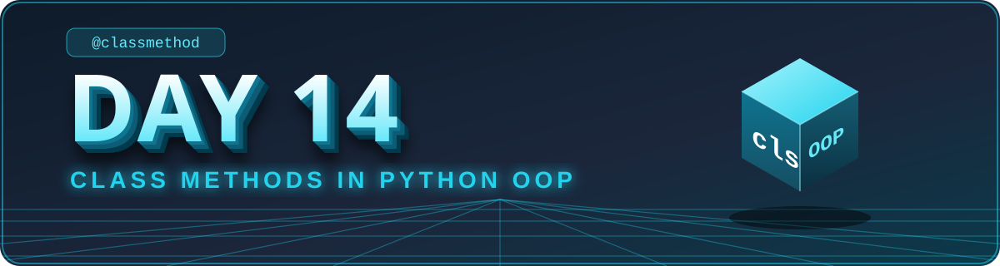

<div align="center">



</div>

# 🟢 Day 14 — Class Methods in Python OOP

## 🎯 Learning Objectives

Today I will learn:

- What is a class method in Python?
- What is the purpose of the `@classmethod` decorator?
- What is the difference between instance methods, class methods, and static methods?
- How to use `cls` in a class method.
- How to access and update class variables.
- How to create alternative constructors.
- How class methods are used in real-world applications.
- How to build a mini-project using class methods.

---

## 📖 Concept Guide — Understand Class Methods First

Read this section before solving the questions. It explains every idea from the objectives in simple words.

### 1️⃣ What is a Class Method?

A **class method** is a method that belongs to the **class itself**, not to one single object.
It automatically receives the **class** as its first argument. By convention this argument is named `cls`.
You create it by writing `@classmethod` above the method.

> 🏫 **Real-life picture:** A school has a rule like "uniform colour is white". The rule is about the **whole school**, not about one student.
> - What one student does → **instance method** (uses `self`)
> - What the whole school decides → **class method** (uses `cls`)

### 2️⃣ Basic Syntax

```python
class Shop:
    discount = 10                # class variable (shared by all objects)

    @classmethod
    def show_discount(cls):      # cls = the class itself (Shop)
        print("Discount:", cls.discount)


Shop.show_discount()             # called using the class name, no object needed
```

### 3️⃣ What does `@classmethod` do?

`@classmethod` is a **decorator**. It tells Python:

> "When this method is called, pass the **class** as the first argument, not the object."

Without it, Python treats the method as a normal instance method and expects an object (`self`).

### 4️⃣ `self` vs `cls`

| | `self` | `cls` |
|---|---|---|
| Represents | The **current object** | The **class** itself |
| Used in | Instance methods | Class methods |
| Gives access to | Object data (instance variables) | Class data (class variables) |
| Example | `self.name` | `cls.discount` |

### 5️⃣ Instance vs Class vs Static Method

| | Instance Method | Class Method | Static Method |
|---|---|---|---|
| Decorator | None | `@classmethod` | `@staticmethod` |
| First argument | `self` | `cls` | None |
| Can use object data? | ✅ Yes | ❌ No | ❌ No |
| Can use class data? | ✅ Yes (through `self`) | ✅ Yes (through `cls`) | ❌ No |
| Best used for | Work on one object | Work on class-level data / create objects | Simple utility function that only lives inside the class |

```python
class Demo:
    def instance_method(self):       # needs an object
        print("I work with one object")

    @classmethod
    def class_method(cls):           # needs the class
        print("I work with the class")

    @staticmethod
    def static_method():             # needs neither
        print("I am just a utility function")
```

### 6️⃣ Accessing and Updating Class Variables

A class method can **read** and **change** class variables using `cls`.

```python
class Pen:
    count = 0                         # class variable

    def __init__(self, colour):
        self.colour = colour          # instance variable
        Pen.count += 1                # every new pen increases the shared count

    @classmethod
    def total_pens(cls):
        return cls.count              # read the class variable


class Shop:
    discount = 10

    @classmethod
    def change_discount(cls, new_discount):
        cls.discount = new_discount   # update the class variable for everyone


Shop.change_discount(20)
print(Shop.discount)                  # 20
```

⚠️ **Important:** `cls.discount = 20` changes the value for the **whole class**.
`self.discount = 20` would create a separate variable for **only that one object**.

### 7️⃣ Alternative Constructors

An **alternative constructor** is another way to create an object. A class method takes data in a different form (string, year, dictionary...), converts it, and returns `cls(...)`.

```python
from datetime import date


class Person:
    def __init__(self, name, age):
        self.name = name
        self.age = age

    @classmethod
    def from_birth_year(cls, name, birth_year):
        age = date.today().year - birth_year
        return cls(name, age)         # create and return an object


p = Person.from_birth_year("Amit", 2000)
print(p.name, p.age)
```

💡 We write `cls(...)` instead of `Person(...)` so that it also works correctly for child classes.

### 8️⃣ How to Call a Class Method

```python
Shop.show_discount()       # ✅ using the class name (recommended)
s = Shop()
s.show_discount()          # ✅ using an object also works
```

Both calls pass the **class** as `cls`. Use the class name because it makes the code clearer.

### 9️⃣ Real-World Uses

- **Alternative constructors:** `Student.from_string(...)`, `User.from_json(...)`. Python's own `date.today()` and `dict.fromkeys()` are class methods.
- **Counters:** counting how many objects were created (students, users, orders).
- **Shared settings:** tax rate, interest rate, company name, app version.
- **Configuration:** turning debug mode on/off for the whole application.

### ⚠️ Common Mistakes

- Forgetting `@classmethod` above the method.
- Trying to use instance variables (like `self.name`) inside a class method. There is no object there, so it gives an error.
- Writing `self.count += 1` when you want to change the shared class variable. Use `ClassName.count` or `cls.count`.
- Writing `Person(...)` instead of `cls(...)` inside an alternative constructor.

### 🧾 Quick Revision Cheat Sheet

```text
Instance method  → self → object data
Class method     → cls  → class data   (@classmethod)
Static method    → no self, no cls     (@staticmethod)

Alternative constructor = class method that returns cls(...)
```

---

## 📚 Part 1 — Theory Questions (12 Questions)

Answer these questions in your own words.

1. What is a class method in Python?
2. What is the purpose of the `@classmethod` decorator?
3. What is `cls` in Python?
4. What is the difference between `self` and `cls`?
5. Can a class method access class variables?
6. Can a class method update a class variable?
7. Can we call a class method using the class name?
8. Can we call a class method using an object?
9. What is the difference between an instance method and a class method?
10. What is the difference between a class method and a static method?
11. What is an alternative constructor?
12. Give three real-world uses of class methods.

---

## 🧩 Part 2 — Practice Problems (15 Questions)

### 🟢 Level 1 — Basic Concepts

#### Q1. Student School Name

Create a `Student` class with:

- Class variable: `school_name = "BATU"`
- Instance variable: `name`

Requirements:

- Create a class method `display_school_name()`.
- Display the school name using the class method.
- Call the method using the class name.

#### Q2. Employee Company Name

Create an `Employee` class with:

- Class variable: `company_name = "Tech Solutions"`
- Instance variables: `name`, `salary`

Requirements:

- Create a class method `display_company()`.
- Display the company name without creating an object.
- Test the method using the class name.

#### Q3. Student Counter

Create a `Student` class with a class variable `student_count = 0`.

Requirements:

- Increase the count whenever a student object is created.
- Create a class method `get_student_count()`.
- Create five student objects.
- Display the total count using the class method.

#### Q4. Update School Name

Create a `School` class with:

- Class variable: `school_name = "Old School"`

Requirements:

- Create a class method `change_school_name(cls, new_name)`.
- Update the class variable through the method.
- Call the method and display the updated name.

#### Q5. Product Tax Rate

Create a `Product` class with:

- Class variable: `tax_rate = 18`
- Instance variables: `name`, `price`

Requirements:

- Create a class method `change_tax_rate(new_rate)`.
- Update the tax rate for the entire class.
- Display the current tax rate.
- Calculate the tax amount for a product using its price and the current tax rate.

### 🟡 Level 2 — Intermediate Practice

#### Q6. Employee ID Counter

Create an `Employee` class with:

- Class variable: `employee_count = 0`
- Instance variables: `employee_id`, `name`

Requirements:

- Generate a unique ID whenever an employee is created.
- Create a class method `get_employee_count()`.
- Create five employees and display the count.

#### Q7. Bank Interest Rate

Create a `BankAccount` class with:

- Class variable: `interest_rate = 5`
- Instance variables: `account_holder`, `balance`

Requirements:

- Create a class method `change_interest_rate(new_rate)`.
- Update the interest rate for all accounts.
- Display the current interest rate.
- Calculate simple yearly interest using the current rate.

#### Q8. Library Name

Create a `Library` class with:

- Class variable: `library_name = "City Library"`
- Instance variables: `book_title`, `author`

Requirements:

- Create a class method `change_library_name(new_name)`.
- Create three book objects.
- Change the library name.
- Display the updated library name with each book.

#### Q9. Temperature Converter

Create a `Temperature` class.

Requirements:

- Create a static method `celsius_to_fahrenheit(celsius)`.
- Create a static method `fahrenheit_to_celsius(fahrenheit)`.
- Create a class method `display_unit()` that displays the class's default temperature unit.
- Test all three methods.

#### Q10. Company Information

Create a `Company` class with:

- Class variables: `company_name`, `employee_count`
- Instance variable: `employee_name`

Requirements:

- Create a class method to update the company name.
- Create a class method to display the employee count.
- Create at least four employee objects.
- Display the company information.

### 🔴 Level 3 — Logic Building

#### Q11. Alternative Constructor — Date

Create a `Date` class with instance variables:

- `day`
- `month`
- `year`

Requirements:

- Create a regular constructor that accepts day, month, and year.
- Create a class method `from_string(date_string)`.
- Accept a date in the format `DD-MM-YYYY`.
- Split the string and create a `Date` object.
- Test both the regular constructor and the alternative constructor.

Example input: `28-10-2026`

#### Q12. Alternative Constructor — Student

Create a `Student` class with:

- `name`
- `marks`

Requirements:

- Create a regular constructor that accepts a name and marks.
- Create a class method `from_string(data)`.
- Accept input in the format `"Sudhanshu,85"`.
- Split the input and return a new `Student` object.
- Validate that marks are between 0 and 100.

#### Q13. Employee Salary Parser

Create an `Employee` class with:

- `name`
- `monthly_salary`

Requirements:

- Create a class method `from_string(data)`.
- Accept input in the format `"Rahul,35000"`.
- Convert the salary to a numeric value.
- Create and return an employee object.
- Display the employee's annual salary.

#### Q14. User Registration Counter

Create a `User` class with:

- Class variable: `total_users = 0`
- Instance variables: `username`, `email`

Requirements:

- Increase the user count whenever an object is created.
- Create a class method `get_total_users()`.
- Create at least five users.
- Display the total registered users.

#### Q15. Configuration Manager

Create a `Configuration` class with class variables:

- `app_name = "My Application"`
- `version = "1.0"`
- `debug_mode = False`

Requirements:

- Create a class method `update_version(new_version)`.
- Create a class method `enable_debug()`.
- Create a class method `display_config()`.
- Update the version and enable debug mode.
- Display the final configuration.

---

## ⭐ Part 3 — Main Challenge: Employee Management System

Build a mini-project using class methods and instance methods.

### Class: `Employee`

#### Class Variables

- `company_name = "Tech Solutions"`
- `employee_count = 0`
- `next_employee_id = 1`

#### Instance Variables

- `employee_id`
- `name`
- `department`
- `monthly_salary`

#### Methods

- `display_details()`
- `calculate_annual_salary()`
- `get_employee_count()` — class method
- `change_company_name(new_name)` — class method
- `from_string(data)` — alternative constructor

### Requirements

1. Initialize employee details using `__init__()`.
2. Automatically assign a unique employee ID.
3. Increase the employee count whenever an employee is created.
4. Create a class method to return the employee count.
5. Create a class method to update the company name.
6. Create an alternative constructor that accepts data in the format `"Name,Department,Salary"`.
7. Convert salary input to a numeric value.
8. Display employee details and annual salary.
9. Create at least five employees using both constructors.
10. Change the company name and display the updated information.
11. Test valid and invalid input.
12. Keep class-level data separate from employee-specific data.

### Example Input

```text
Sudhanshu,AI,35000
Rahul,IT,40000
Priya,HR,30000
```

### Expected Output Format

```text
Company: Tech Solutions
Employee ID: 1
Name: Sudhanshu
Department: AI
Monthly Salary: 35000
Annual Salary: 420000

Total Employees: 3
```

**Note:** The example output shows the format for three employees. Your program should create at least five employees.

### Bonus Challenge

Add a class method `reset_employee_count()` for a test scenario. Think carefully about how resetting a counter affects the uniqueness of employee IDs.

---

## 🧠 Part 4 — Interview Questions (10 Questions)

> 💡 Short and simple answers. Read them once, and you can say them in an interview in your own words.

**1. What is a class method?**
✅ A method that belongs to the **class**, not to an object. It receives the class as `cls` and is created with `@classmethod`.

**2. Why do we use `@classmethod`?**
✅ It tells Python to pass the **class** (not the object) as the first argument, so the method can work with class-level data.

**3. What does `cls` represent?**
✅ The **class itself**. Just like `self` means "this object", `cls` means "this class".

**4. How is `cls` different from `self`?**
✅ `self` = the current **object** (object data). `cls` = the **class** (shared class data).

**5. Can a class method modify class variables?**
✅ Yes. Writing `cls.variable = value` changes the value for the whole class, so all objects see the new value.

**6. What is an alternative constructor?**
✅ Another way to create an object. It is a class method that takes data in a different form and returns `cls(...)`. Example: `Student.from_string("Ravi,85")`.

**7. How does a class method differ from a static method?**
✅ A class method gets `cls` and can use class data. A static method gets **neither** `self` nor `cls`; it is just a utility function placed inside the class.

**8. Can a class method be called without creating an object?**
✅ Yes. Call it with the class name: `ClassName.method()`.

**9. Give an example of a class method in a real-world application.**
✅ Counting registered users (`User.get_total_users()`), changing a shared tax rate, or building an object from a string like `Employee.from_string(...)`. Python's own `date.today()` is also a class method.

**10. When would you choose a class method instead of an instance method?**
✅ When the work is about the **class** (shared data, counters, settings) or when you want to create objects in a different way. If the work needs one object's data, use an instance method.

### 🧠 One-Line Memory Trick

```text
self → object | cls → class | no self/cls → static
Class method = shared data + alternative constructors
```

---

## 📁 Day 14 Folder Structure

```text
Day14_Class_Methods/
│
├── README.md
├── day14_banner.svg
├── day14_footer.svg
├── theory_answers.md
├── practice.py
├── employee.py
└── main.py
```

### File Responsibilities

- `theory_answers.md` — answers to the theory questions.
- `practice.py` — solutions to Q1–Q15.
- `employee.py` — contains the `Employee` class.
- `main.py` — runs and tests the main challenge.
- `README.md` — project overview and learning outcomes.

**Beginner tip:** Solve Q1–Q8 first to understand `cls`. Then practise alternative constructors in Q11–Q13 before starting the main challenge.

---

## 📊 Day 14 Target

| Task | Target |
|---|---:|
| Theory questions | 12 |
| Practice problems | 15 |
| Interview questions | 10 |
| Main challenge | 1 |
| GitHub update | 1 |

---

## 🚫 Rules

- Attempt every question independently.
- Do not copy complete solutions.
- Use `cls` to access class-level data in class methods.
- Use `self` to access object-specific data in instance methods.
- Use class methods when an operation works with class-level information.
- Validate input before creating objects.
- Test regular and alternative constructors.
- Explain the logic before writing code.

---

## ✅ Completion Checklist

- [ ] Understood `@classmethod`
- [ ] Understood `cls` and `self`
- [ ] Practised updating class variables
- [ ] Created class methods for counters
- [ ] Practised alternative constructors
- [ ] Solved Q1–Q5
- [ ] Solved Q6–Q10
- [ ] Solved Q11–Q15
- [ ] Completed the Employee Management System
- [ ] Answered interview questions
- [ ] Tested valid and invalid inputs
- [ ] Updated the README
- [ ] Pushed code to GitHub

---

## 🚀 GitHub Commit

```bash
git add .
git commit -m "Day 14: Class methods and alternative constructors"
git push
```

**Day 14 Goal:** Understand how class methods use `cls` to manage shared class data and create alternative constructors in Python OOP.

---

<div align="center">


[](https://github.com/sudhanshudhande19)

</div>