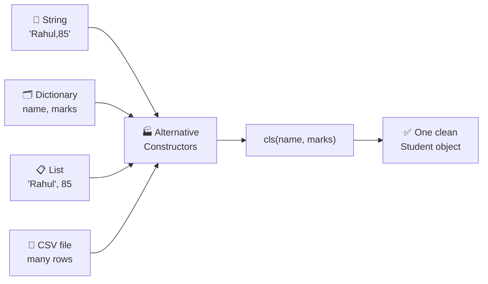
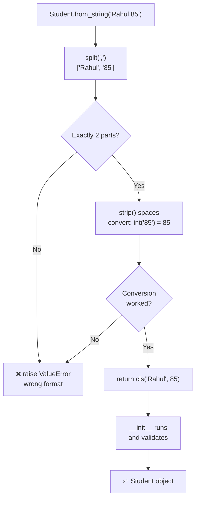
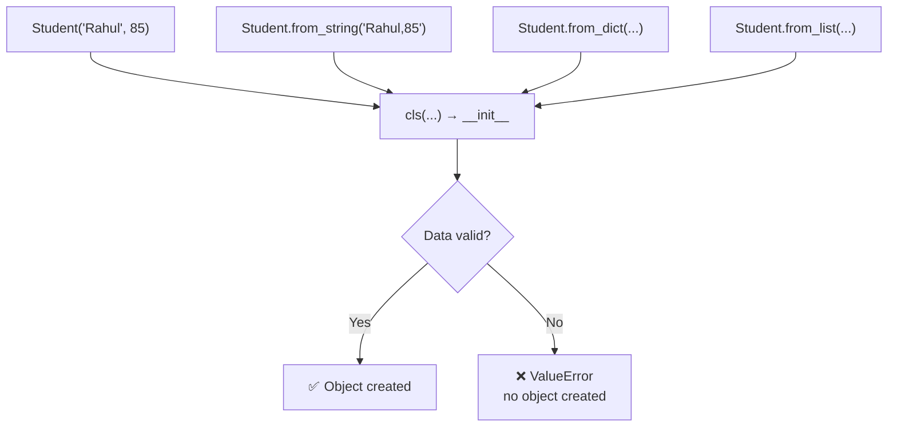
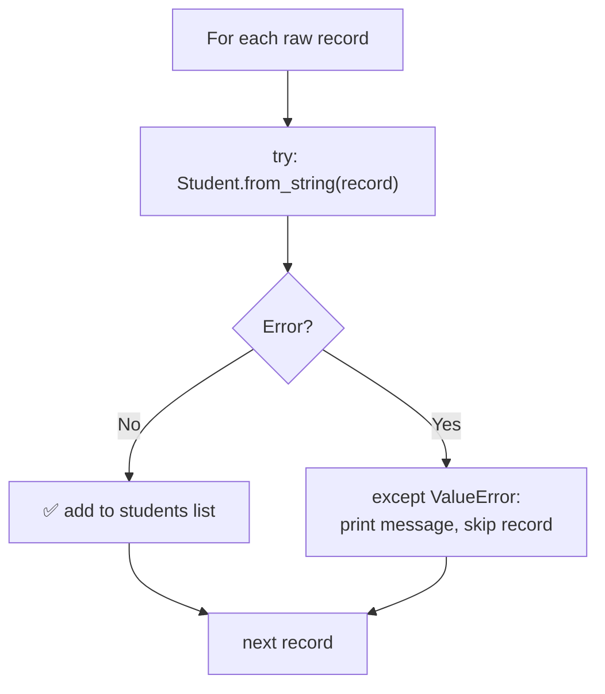

<p align="center">
  
</p>

<p align="center">
  
  
  
  
  
</p>

# 🟢 Day 15 — Alternative Constructors in Python OOP

## 🎯 Learning Objectives

Today I will learn:

- What is an alternative constructor?
- Why do we use alternative constructors?
- How to create alternative constructors using `@classmethod`.
- How to use `cls` to create and return objects.
- How to create objects from strings, dictionaries, and lists.
- How to convert input data into the correct data types.
- How to validate data before creating objects.
- How alternative constructors are used in real-world applications.

---

# 📖 Day 15 Concepts — Read & Understand First

> Today is a **concept + mini-project day** (Employee Data Management System). The new idea is using a **`@classmethod` as a second way to build an object**. Read this section slowly, type every example yourself, and **test each constructor with both valid and invalid data.**

## 1️⃣ The Problem: One `__init__`, Many Data Formats

Python allows **only one `__init__()`** per class. But real data arrives in many shapes:

```python
Student("Rahul", 85)                          # normal values
"Rahul,85"                                    # a string
{"name": "Rahul", "marks": 85}                # a dictionary
["Rahul", 85]                                 # a list
```



We cannot write four different `__init__` methods. So we add **extra class methods** that convert each format and then call the normal constructor.

---

## 2️⃣ Quick Recap: The Regular Constructor

A **constructor** (`__init__`) runs **automatically** when an object is created and sets its starting values.

```python
class Student:
    def __init__(self, name, marks):
        self.name = name
        self.marks = marks

s1 = Student("Rahul", 85)      # __init__ runs here
```

---

## 3️⃣ What Is an Alternative Constructor?

> **Alternative constructor** = a **class method that creates and returns an object** from a different kind of input. Inside, it still calls the normal constructor.

| Regular constructor                    | Alternative constructor                              |
| -------------------------------------- | ---------------------------------------------------- |
| `__init__(self, ...)`                  | `@classmethod` + `from_xxx(cls, ...)`                |
| Gets **ready-made values**             | Gets **raw data** (string, dict, list, file row)     |
| Called as `Student("Rahul", 85)`       | Called as `Student.from_string("Rahul,85")`          |
| Only **one** per class                 | **As many as you need**                              |
| Sets up the object (`self`)            | **Prepares data, then calls** `cls(...)`             |

> 🔑 Naming convention: `from_string`, `from_dict`, `from_list`, `from_csv_file`, `from_fahrenheit` — the name tells you **what you are building from**.

---

## 4️⃣ Three Kinds of Methods (Quick Compare)

| Method type        | First parameter | Can access            | Typical use                          |
| ------------------ | --------------- | --------------------- | ------------------------------------ |
| **Instance method** | `self`         | Object data           | `display_details()`                  |
| **Class method**    | `cls`          | Class data / the class | **Alternative constructors**        |
| **Static method**   | *(none)*       | Nothing automatically | Small helper / utility function      |

---

## 5️⃣ `@classmethod` and `cls`

```python
class Student:
    def __init__(self, name, marks):
        self.name = name
        self.marks = marks

    @classmethod
    def from_string(cls, data):          # cls = the class itself (Student)
        name, marks = data.split(",")    # "Rahul,85" -> ["Rahul", "85"]
        return cls(name, int(marks))     # build the object and RETURN it

s = Student.from_string("Rahul,85")      # called on the CLASS, no object needed
print(s.name, s.marks)                   # Rahul 85
```

| `self`                              | `cls`                                    |
| ----------------------------------- | ---------------------------------------- |
| Refers to **this object**           | Refers to **the class**                  |
| Used in instance methods            | Used in class methods                    |
| `def show(self):`                   | `def from_string(cls, data):`            |
| Needs an object to be called        | Called directly on the class             |

> ✅ **Why a class method?** When we call `Student.from_string(...)`, **no object exists yet**. A normal method needs `self` (an object), so it can't be used. A class method gets the **class**, so it can create the first object.

---

## 6️⃣ Flow: What Happens Inside `from_string()`



```text
"Rahul,85"  →  split(",")  →  ["Rahul", "85"]  →  int("85") = 85  →  cls("Rahul", 85)  →  Student object
```

---

## 7️⃣ `from_string()` — Parsing a Text Line

```python
@classmethod
def from_string(cls, data):
    parts = [p.strip() for p in data.split(",")]     # split + remove extra spaces
    if len(parts) != 2:
        raise ValueError("Expected format: name,marks")
    name, marks = parts
    return cls(name, int(marks))                      # int() raises ValueError for "abc"
```

| Tip                                          | Why                                                        |
| -------------------------------------------- | ---------------------------------------------------------- |
| `.split(",")` returns a **list of strings**  | Everything from a string is text until **you** convert it  |
| Use `.strip()`                                | `" Rahul "` and `"Rahul"` should be the same               |
| **Check `len(parts)`** before unpacking       | Wrong count → crash `ValueError: not enough values to unpack` |
| Convert with `int()` / `float()`             | `"35000"` is text, not a number                            |

---

## 8️⃣ `from_dict()` — Reading by Keys

```python
@classmethod
def from_dict(cls, data):
    return cls(data["name"], data["marks"])
```

| Style                       | When a key is missing               | Use it for                        |
| --------------------------- | ----------------------------------- | --------------------------------- |
| `data["marks"]`             | ❌ raises `KeyError`                 | **Required** fields               |
| `data.get("marks", 0)`      | ✅ returns the default (`0`)         | **Optional** fields (Q13)         |

```python
data = {"name": "Rahul"}                 # marks is missing
data.get("marks", 0)                     # 0   ← safe default
data["marks"]                            # KeyError: 'marks'
```

---

## 9️⃣ `from_list()` — Reading by Position

```python
@classmethod
def from_list(cls, data):
    if len(data) != 2:
        raise ValueError("Expected [name, marks]")
    name, marks = data                   # unpacking: order matters!
    return cls(name, marks)

s = Student.from_list(["Rahul", 85])
```

> ⚠️ A list has **no names**, only positions. `["Rahul", 85]` works, `[85, "Rahul"]` silently gives wrong data — so **order and length must be checked**.

---

## 🔟 Type Conversion (Very Important!)

Data from strings and files is **always text**:

```python
"35000" * 12          # '350003500035000...'  ← text repeated 12 times, NOT a number!
int("35000") * 12     # 420000                ← correct
```

| Conversion          | Result    | Invalid input                    |
| ------------------- | --------- | -------------------------------- |
| `int("85")`         | `85`      | `int("abc")` → `ValueError`      |
| `float("85.5")`     | `85.5`    | `float("x1")` → `ValueError`     |
| `int("85.5")`       | ❌ error   | Use `float()` first for decimals |
| `str(101)`          | `"101"`   | Never fails                      |

> ✅ **Convert first, then validate.** You can't check `marks > 100` while `marks` is still the text `"150"`.

---

## 1️⃣1️⃣ Validation — Check Before Creating

Bad data must **never** become an object. Best practice: **put the validation inside `__init__`** so **every constructor** (regular **and** alternative) gets the **same checks automatically**.

```python
class Student:
    def __init__(self, name, marks):
        if not str(name).strip():
            raise ValueError("Name cannot be empty")
        if not 0 <= marks <= 100:
            raise ValueError("Marks must be between 0 and 100")
        self.name = name
        self.marks = marks
```



> 🔑 One place for the rules = **consistent validation** everywhere (Q15, Main Challenge #14). If you validate only inside `from_string()`, someone can still create a bad object with `Student("", 500)`.

---

## 1️⃣2️⃣ Why `cls(...)` and Not the Class Name?

```python
class Student:
    def __init__(self, name, marks):
        self.name = name
        self.marks = marks

    @classmethod
    def from_string(cls, data):
        name, marks = data.split(",")
        return cls(name, int(marks))          # ✅ cls

class Topper(Student):                        # child class
    pass

t = Topper.from_string("Rahul,98")
print(type(t))        # <class '__main__.Topper'>   ← correct child type
```

If the method used `return Student(name, int(marks))`, the child class would **still get a plain `Student`**. With `cls`, the object is built from **whichever class called the method**.

---

## 1️⃣3️⃣ Handling Invalid Input Without Crashing

The constructor **raises** an error for bad data. The **caller** catches it, so the program continues:

```python
raw_records = ["Rahul,85", "Amit,abc", ",90", "Priya,150", "Neha,92"]
students = []

for record in raw_records:
    try:
        students.append(Student.from_string(record))
    except ValueError as e:                       # one bad record ≠ crash
        print(f"Skipped '{record}': {e}")

print(len(students), "valid students")            # 2 valid students
```



| Error        | Raised when                                           |
| ------------ | ----------------------------------------------------- |
| `ValueError` | Wrong format, `int("abc")`, empty name, out-of-range  |
| `KeyError`   | A required dictionary key is missing                  |
| `TypeError`  | Wrong type passed (e.g. `None.split()`)               |

> 💡 Catch **specific** errors (`except (ValueError, KeyError):`), never a bare `except:`.

---

## 1️⃣4️⃣ A Worked Example in a Different Domain: `Song`

To learn the **structure** without giving away your solution, here is a class with the **same design** but a **different domain** — a music `Song` with three ways to build it.

```python
class Song:
    def __init__(self, title, artist, seconds):
        if not title.strip():
            raise ValueError("Title cannot be empty")
        if seconds <= 0:
            raise ValueError("Duration must be positive")
        self.title = title
        self.artist = artist
        self.seconds = seconds

    @classmethod
    def from_string(cls, data):                       # "Believer,Imagine Dragons,3:24"
        parts = [p.strip() for p in data.split(",")]
        if len(parts) != 3:
            raise ValueError("Expected: title,artist,m:ss")
        title, artist, duration = parts
        minutes, secs = duration.split(":")
        return cls(title, artist, int(minutes) * 60 + int(secs))

    @classmethod
    def from_dict(cls, data):
        return cls(data["title"], data["artist"], int(data["seconds"]))

    def display(self):
        m, s = divmod(self.seconds, 60)
        print(f"{self.title} - {self.artist} ({m}:{s:02d})")


songs = [
    Song("Faded", "Alan Walker", 212),                                          # regular
    Song.from_string("Believer,Imagine Dragons,3:24"),                          # string
    Song.from_dict({"title": "Shape of You", "artist": "Ed Sheeran", "seconds": 234}),   # dict
]
for song in songs:
    song.display()

for raw in ["Bad Song,Nobody,0:00", ",Nobody,3:00", "OnlyTitle"]:
    try:
        Song.from_string(raw)
    except ValueError as e:
        print("Rejected:", e)
```

**Output:**

```text
Faded - Alan Walker (3:32)
Believer - Imagine Dragons (3:24)
Shape of You - Ed Sheeran (3:54)
Rejected: Duration must be positive
Rejected: Title cannot be empty
Rejected: Expected: title,artist,m:ss
```

| `Song`                                   | Your `Employee`                                        |
| ---------------------------------------- | ------------------------------------------------------ |
| `from_string("title,artist,m:ss")`       | `from_string("A101,Sudhanshu,AI,35000")`               |
| Converts `3:24` → seconds                | Converts `"35000"` → number                            |
| Rules live in `__init__`                 | Same: **all validation in `__init__`**                 |
| `display()`                              | `display_details()`                                    |

> 🎯 **Your task:** do **not** copy this. Understand the **pattern** (parse → convert → `return cls(...)` → validate in `__init__`), then build your own classes.

---

## 1️⃣5️⃣ Real-World Uses (Python Itself Does This!)

| Example                                | What it does                               |
| -------------------------------------- | ------------------------------------------ |
| `dict.fromkeys(["a", "b"], 0)`         | Builds a dictionary from a list of keys    |
| `datetime.fromtimestamp(...)`          | Builds a datetime from a number            |
| `date.fromisoformat("2026-10-29")`     | Builds a date from a string                |
| `int.from_bytes(...)`                  | Builds an integer from bytes               |
| `User.from_json(data)`                 | Builds a user from API / JSON data         |
| `Employee.from_csv_file("emp.csv")`    | Builds many employees from a file          |

---

## 1️⃣6️⃣ Create Your Sample CSV Automatically (Bonus Challenge)

This script creates `employees.csv` with **good and bad rows**, so you can test safe handling:

```python
from pathlib import Path

Path("employees.csv").write_text(
    "employee_id,name,department,monthly_salary\n"
    "A101,Sudhanshu,AI,35000\n"
    "A102,Rahul,IT,40000\n"
    "A103,,HR,30000\n"          # empty name        -> must be rejected
    "A104,Priya,HR,-500\n"      # negative salary   -> must be rejected
    "A105,Amit,Sales,abc\n"     # invalid number    -> must be rejected
    "A106,Neha,Finance,52000\n",
    encoding="utf-8",
)
```

**Reading a CSV with the built-in `csv` module:**

```python
import csv

try:
    with open("employees.csv", newline="", encoding="utf-8") as f:
        for row in csv.DictReader(f):                 # first row = column names
            print(row["name"], row["monthly_salary"])  # every value is a STRING
except FileNotFoundError:
    print("File not found")
```

> ✅ `csv.DictReader` gives each row as a **dictionary**, so each row can go straight into your `from_dict()`. Values are text — **convert and validate** them!

---

## 1️⃣7️⃣ Testing Checklist

| Test case                                            | What should happen                                |
| ---------------------------------------------------- | ------------------------------------------------- |
| Valid string (`"A101,Sudhanshu,AI,35000"`)           | Object created, salary is a **number**            |
| Valid dictionary / list                              | Same result as the string version                 |
| Extra spaces (`" Rahul , 85 "`)                      | Handled with `.strip()`                           |
| **Empty name** (`",85"`)                             | Rejected with a clear message                     |
| **Negative salary / marks out of range**             | Rejected                                          |
| **Non-numeric** value (`"abc"`)                      | `ValueError` caught, no crash                     |
| **Wrong number of fields** (`"Rahul"`)               | Rejected                                          |
| **Missing dictionary key**                           | `KeyError` caught (or default used if optional)   |
| Same data via **all constructors**                   | Identical objects / identical validation          |
| Two objects (carts) created                          | Their data stays **separate** (Q14)               |
| Missing CSV file / bad CSV row                       | Clear message, other rows still processed         |

---

## 1️⃣8️⃣ Common Mistakes (Avoid These!)

| ❌ Mistake                                                      | ✅ Fix                                                              |
| -------------------------------------------------------------- | ------------------------------------------------------------------ |
| Forgetting `@classmethod`                                       | Add the decorator, otherwise `TypeError: missing argument`         |
| Writing `self` instead of `cls` in a class method               | First parameter must be `cls`                                      |
| Forgetting `return` (just creating the object)                  | `return cls(...)` — otherwise you get `None`                       |
| Hard-coding `Student(...)` inside the method                    | Use `cls(...)` so child classes work                               |
| Not converting types (`"35000" * 12`)                           | `int()` / `float()` before any calculation                         |
| Not using `.strip()`                                            | Clean spaces from each part                                        |
| Unpacking without checking length                               | `if len(parts) != 4: raise ValueError(...)`                        |
| Validation only in `from_string()`                              | Put rules in `__init__` — **all** constructors share them          |
| `print()` the object details instead of returning the object    | An alternative constructor must **return** the object              |
| Mutable default (`def __init__(self, items={})`)                | Use `items=None` then `items = items or {}` (Q14: carts stay separate) |
| Bare `except:`                                                  | Catch `ValueError` / `KeyError` specifically                       |
| Accepting `-500` salary or empty name silently                  | Validate and raise an error                                        |

---

## 1️⃣9️⃣ Step-by-Step Build Plan

```text
Step 1  →  Q1–Q3    from_string() with split + type conversion
Step 2  →  Q4–Q5    from_string() with different separators + simple validation
Step 3  →  Q6–Q7    from_dict() (read by keys, convert salary)
Step 4  →  Q8       from_list() (unpack by position, check length)
Step 5  →  Q9–Q10   Validation + a conversion constructor (from_fahrenheit)
Step 6  →  Q11–Q12  Full validation, handle invalid numbers, bonus calculation
Step 7  →  Q13–Q14  Default values, type checks, separate objects
Step 8  →  Q15      Same class with ALL constructors and consistent validation
Step 9  →  Main challenge: Employee class + 3 alternative constructors
Step 10 →  Test valid AND invalid inputs, create at least 5 employees
Step 11 →  Bonus: from_csv_file() with the csv module
Step 12 →  Split into employee.py + main.py, update README, push to GitHub
```

---

## 📌 Day 15 in One Look

```text
Goal         →  Create objects from different data formats
Idea         →  Python has ONE __init__, so add MANY alternative constructors
Pattern      →  @classmethod
                def from_xxx(cls, data):
                    ...parse, convert...
                    return cls(...)
cls          →  The class itself (like self = the object)
Why classmethod → No object exists yet when we call it
Why cls(...) →  Works for child classes too
String       →  data.split(",")  → strip → convert → cls(...)
Dictionary   →  data["key"] (required) · data.get("key", default) (optional)
List         →  name, marks = data   (check len first)
Convert      →  int() / float() — text is not a number
Validate     →  Inside __init__ → every constructor is checked the same way
Errors       →  raise ValueError · caller uses try / except
Employee     →  annual = monthly × 12 · bonus = 10% of annual
```

---

## 📚 Part 1 — Theory Questions (12 Questions)

Answer these questions in your own words.

1. What is a constructor in Python?
2. What is an alternative constructor?
3. Why do we use alternative constructors?
4. Why is `@classmethod` commonly used to create alternative constructors?
5. What does `cls` represent?
6. What is the difference between a regular constructor and an alternative constructor?
7. What does the `return cls(...)` statement do?
8. Can a class have multiple alternative constructors?
9. How can we create an object from a string?
10. How can we create an object from a dictionary?
11. Why should we validate input before creating an object?
12. Give three real-world examples where alternative constructors are useful.

---

## 🧩 Part 2 — Practice Problems (15 Questions)

### 🟢 Level 1 — Basic Concepts

#### Q1. Student from String

Create a `Student` class with:

- `name`
- `marks`

Requirements:

- Create a regular constructor.
- Create a class method `from_string(data)`.
- Accept data in the format `"Rahul,85"`.
- Split the string and create a `Student` object.
- Display the student's details.

#### Q2. Employee from String

Create an `Employee` class with:

- `name`
- `department`
- `salary`

Requirements:

- Create a class method `from_string(data)`.
- Accept data in the format `"Amit,IT,35000"`.
- Convert the salary into a numeric value.
- Create and display the employee object.

#### Q3. Product from String

Create a `Product` class with:

- `product_name`
- `price`
- `quantity`

Requirements:

- Create a class method `from_string(data)`.
- Accept data in the format `"Laptop,55000,2"`.
- Convert price and quantity into numeric values.
- Calculate the total price.

#### Q4. Date from String

Create a `Date` class with:

- `day`
- `month`
- `year`

Requirements:

- Create a class method `from_string(date_string)`.
- Accept dates in the format `"29-10-2026"`.
- Convert the date components into integers.
- Display the date in `DD-MM-YYYY` format.

#### Q5. Rectangle from String

Create a `Rectangle` class with:

- `length`
- `width`

Requirements:

- Create a class method `from_string(data)`.
- Accept input in the format `"10,5"`.
- Convert both values to numbers.
- Calculate and display the area and perimeter.
- Reject zero or negative dimensions.

### 🟡 Level 2 — Intermediate Practice

#### Q6. Student from Dictionary

Create a `Student` class with:

- `name`
- `roll_number`
- `marks`

Requirements:

- Create a class method `from_dict(data)`.
- Accept a dictionary containing the student's details.
- Create and return a `Student` object.
- Display all details.

Example input:

```python
{
    "name": "Sudhanshu",
    "roll_number": 101,
    "marks": 85
}
```

#### Q7. Employee from Dictionary

Create an `Employee` class with:

- `employee_id`
- `name`
- `department`
- `monthly_salary`

Requirements:

- Create a class method `from_dict(data)`.
- Read employee details from a dictionary.
- Convert salary to a numeric value.
- Calculate annual salary.
- Display the employee details.

#### Q8. Book from List

Create a `Book` class with:

- `book_id`
- `title`
- `author`
- `price`

Requirements:

- Create a class method `from_list(data)`.
- Accept a list containing all four values.
- Create a `Book` object.
- Display the book details.

#### Q9. Bank Account from String

Create a `BankAccount` class with:

- `account_holder`
- `account_number`
- `balance`

Requirements:

- Create a class method `from_string(data)`.
- Accept input in the format `"Rahul,12345,10000"`.
- Convert the balance into a numeric value.
- Reject negative balances.
- Display the account details.

#### Q10. Temperature from Different Units

Create a `Temperature` class with a value stored in Celsius.

Requirements:

- Create a regular constructor that accepts Celsius.
- Create a class method `from_fahrenheit(value)`.
- Convert Fahrenheit to Celsius before creating the object.
- Create a method to display Celsius and Fahrenheit values.
- Test different temperatures.

### 🔴 Level 3 — Logic Building

#### Q11. Student with Input Validation

Improve your `Student` class.

Requirements:

- Store `name`, `roll_number`, and `marks`.
- Create `from_string(data)`.
- Accept data in the format `"Rahul,101,85"`.
- Reject empty names.
- Reject marks outside the range 0–100.
- Handle invalid numeric input.
- Create an object only when the input is valid.

#### Q12. Employee Salary Parser

Create an `Employee` class with:

- `name`
- `department`
- `monthly_salary`

Requirements:

- Create `from_string(data)`.
- Accept input such as `"Priya,AI,45000"`.
- Reject negative salaries.
- Calculate annual salary.
- Calculate a 10% bonus on annual base salary.
- Display the final compensation details.

#### Q13. Configuration from Dictionary

Create a `Configuration` class with:

- `app_name`
- `version`
- `debug_mode`

Requirements:

- Create a class method `from_dict(data)`.
- Accept application settings through a dictionary.
- Use default values for optional fields.
- Validate the data types.
- Display the final configuration.

#### Q14. Shopping Cart from Dictionary

Create a `ShoppingCart` class.

Requirements:

- Store items and their prices.
- Create a class method `from_dict(data)`.
- Accept a dictionary containing product names and prices.
- Calculate the total cart value.
- Reject negative prices.
- Create two different carts and ensure their items remain separate.

#### Q15. Multiple Alternative Constructors

Create a `Student` class with:

- `name`
- `roll_number`
- `marks`

Requirements:

- Create a regular constructor.
- Create `from_string(data)`.
- Create `from_dict(data)`.
- Create `from_list(data)`.
- Use all four methods to create student objects.
- Display and compare their details.
- Validate the data consistently across all constructors.

---

## ⭐ Part 3 — Main Challenge: Employee Data Management System

Build a mini-project using alternative constructors.

### Class: `Employee`

#### Instance Variables

- `employee_id`
- `name`
- `department`
- `monthly_salary`

#### Methods

- `display_details()`
- `calculate_annual_salary()`
- `calculate_bonus()`
- `from_string(data)` — alternative constructor
- `from_dict(data)` — alternative constructor
- `from_list(data)` — alternative constructor

### Requirements

1. Create a regular constructor using `__init__()`.
2. Create an employee using the regular constructor.
3. Create an employee using a comma-separated string.
4. Create an employee using a dictionary.
5. Create an employee using a list.
6. Convert salary values into numeric types.
7. Reject empty employee names.
8. Reject negative salaries.
9. Calculate annual salary as monthly salary × 12.
10. Calculate a bonus of 10% of annual base salary.
11. Display each employee's details and compensation.
12. Handle invalid input without crashing the program.
13. Create at least five employees using different constructors.
14. Ensure all constructors apply consistent validation.

### Example Input

```python
# String
"A101,Sudhanshu,AI,35000"

# Dictionary
{
    "employee_id": "A102",
    "name": "Rahul",
    "department": "IT",
    "monthly_salary": 40000
}

# List
["A103", "Priya", "HR", 30000]
```

### Expected Output Format

```text
Employee ID: A101
Name: Sudhanshu
Department: AI
Monthly Salary: 35000
Annual Salary: 420000
Annual Bonus: 42000
```

### Bonus Challenge

Add a class method `from_csv_file(file_path)` that reads employee records from a CSV file and creates employee objects.

Use Python's built-in `csv` module. Handle missing files and invalid records safely.

---

## 🧠 Part 4 — Interview Questions (with Short Answers)

> Try to answer each question yourself first, then compare with the short answer. Each answer is kept **simple and short** so it is easy to remember. 🧠 = memory trick.

### 1. What is an alternative constructor?

**Answer:** A **class method that creates an object from a different kind of input** (string, dictionary, list, file) and **returns it**. Inside, it calls the normal constructor.

```python
s = Student.from_string("Rahul,85")
```

🧠 *Another door to build the same object*

---

### 2. Why do we use `@classmethod` for alternative constructors?

**Answer:** When we call `Student.from_string(...)`, **no object exists yet**, so there is no `self`. A class method receives **the class (`cls`)**, so it can **create the first object**.

```python
@classmethod
def from_string(cls, data): ...
```

🧠 *No object yet → use the class*

---

### 3. What is the purpose of `return cls(...)`?

**Answer:** It **creates a new object of the class and returns it** to the caller. Using `cls` (not the class name) means it also works for **child classes**.

```python
return cls(name, int(marks))
```

🧠 *`cls(...)` = build + give back*

---

### 4. Can we create multiple alternative constructors in one class?

**Answer:** **Yes.** Python allows only one `__init__`, but a class can have **many class methods** such as `from_string()`, `from_dict()`, `from_list()` and `from_csv_file()`.

🧠 *One `__init__`, many `from_...`*

---

### 5. What is the difference between `from_string()` and `from_dict()`?

**Answer:**

| `from_string()`                          | `from_dict()`                            |
| ---------------------------------------- | ---------------------------------------- |
| Input is **text**                        | Input is a **dictionary**                |
| Must **split** and **convert** values    | Reads values by **keys**                 |
| Needs format checks (count of parts)     | Needs key checks (missing keys)          |

Both end with `return cls(...)`.

🧠 *String = split · Dict = key*

---

### 6. How can alternative constructors improve code readability?

**Answer:** The **method name tells the input type**, so the code explains itself. It also keeps `__init__` **simple** (no messy `if` checks for every format).

```python
Student.from_string("Rahul,85")      # clear
Student.from_dict(data)              # clear
```

🧠 *The name tells the story*

---

### 7. Why should all alternative constructors apply consistent validation?

**Answer:** So **bad data is rejected no matter how the object is created**. Best way: put the checks in **`__init__`** — every constructor calls it, so the rules live in **one place**.

🧠 *One rulebook for every door*

---

### 8. How would you create an object from a JSON dictionary?

**Answer:** Convert the JSON text into a dictionary with `json.loads()`, then pass it to `from_dict()`.

```python
import json

data = json.loads(json_text)
emp = Employee.from_dict(data)
```

🧠 *JSON → dict → `from_dict()`*

---

### 9. What happens if the input data contains invalid values?

**Answer:** The constructor should **raise an error** (`ValueError`, or `KeyError` for a missing key) and **no object is created**. The caller uses **`try / except`** so the program **does not crash** and can skip the bad record.

```python
try:
    emp = Employee.from_string(record)
except ValueError as e:
    print("Invalid:", e)
```

🧠 *Bad data → error → no object*

---

### 10. Explain one real-world use case of alternative constructors.

**Answer:** **Loading employees from a CSV file or an API response.** Raw rows are turned into ready-to-use objects: `Employee.from_csv_file("employees.csv")`. Python does the same: `datetime.fromtimestamp()`, `dict.fromkeys()`.

🧠 *Raw data in → clean objects out*

---

### ⚡ 10-Second Revision

```text
1. Alternative constructor → Class method that builds an object from another format
2. Why @classmethod        → No object exists yet → work with the class
3. return cls(...)         → Build the object + return it (works for subclasses)
4. Many constructors?      → Yes: from_string, from_dict, from_list ...
5. String vs dict          → split & convert vs read by keys
6. Readability             → The method name tells the input type
7. Consistent validation   → Put checks in __init__ (one place for all)
8. JSON                    → json.loads() → from_dict()
9. Invalid values          → raise ValueError · caller uses try / except
10. Real-world use         → CSV / API / database rows → objects
```

---

## 📁 Day 15 Folder Structure

```text
Day15_Alternative_Constructors/
│
├── banner.svg
├── README.md
├── practice.py
```

### File Responsibilities

- `banner.svg` — the Day 15 banner shown at the top of this README.
- `theory_answers.md` — answers to the theory questions.
- `practice.py` — solutions to Q1–Q15.
- `README.md` — explains the day and how to run the project.

**Beginner tip:** First complete `from_string()`. Then practise `from_dict()` and `from_list()`. Finally, combine all constructors in the Employee Data Management System.

---

## 📊 Day 15 Target

| Task | Target |
|---|---:|
| Theory questions | 12 |
| Practice problems | 15 |
| Interview questions | 10 |
| Main challenge | 1 |
| GitHub update | 1 |

---

## 🚫 Rules

- Attempt every problem independently.
- Do not copy complete solutions.
- Use `@classmethod` for alternative constructors.
- Use `cls(...)` to create and return objects.
- Convert input values to appropriate data types.
- Validate data consistently.
- Handle invalid inputs safely.
- Test each constructor with valid and invalid data.
- Explain the logic before writing code.

---

## ✅ Completion Checklist

- [ ] Understood alternative constructors
- [ ] Practised `from_string()`
- [ ] Practised `from_dict()`
- [ ] Practised `from_list()`
- [ ] Converted input data types correctly
- [ ] Added input validation
- [ ] Solved Q1–Q5
- [ ] Solved Q6–Q10
- [ ] Solved Q11–Q15
- [ ] Completed the Employee Data Management System
- [ ] Answered interview questions
- [ ] Tested valid and invalid inputs
- [ ] Updated the README
- [ ] Pushed code to GitHub

---

## 🚀 GitHub Commit

```bash
git add .
git status
git commit -m "Day 15: Alternative constructors practice"
git push
```

**Day 15 Goal:** Learn to create objects from different data formats using alternative constructors and build a practical Employee Data Management System.

---

<p align="center">
  
</p>

<h3 align="center"><b>Sudhanshu Dhande</b></h3>
<p align="center"><i>B.Tech (AI &amp; ML) · BATU, Lonere · Python OOP Journey</i></p>