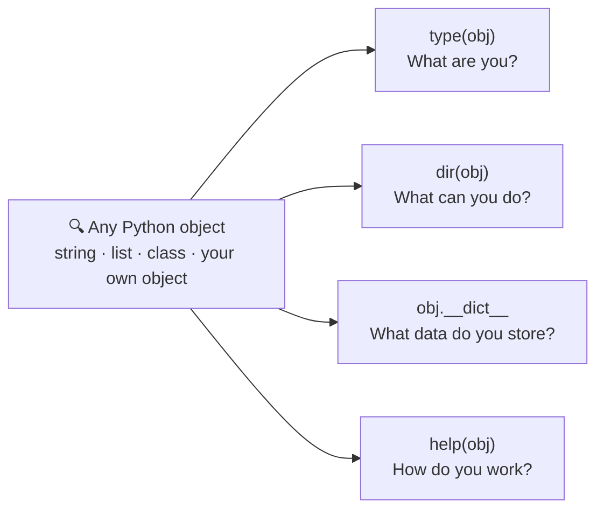
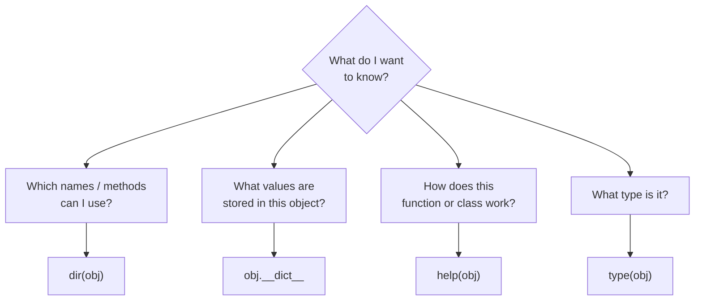
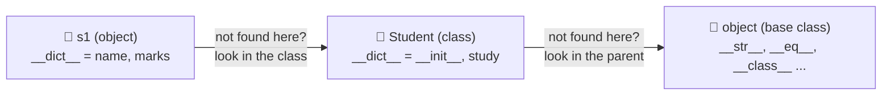
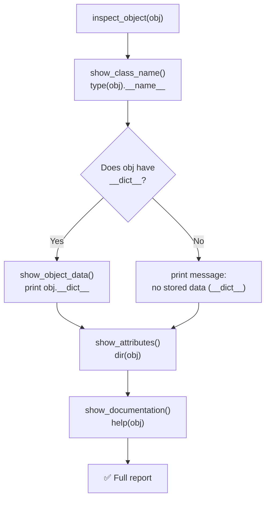

<p align="center">
  
</p>

<p align="center">
  
  
  
  
  
</p>

# 🐍 Day 16 — Python OOP: dir(), `__dict__` and help()

## 🎯 Learning Objectives

Today I will learn:

- What introspection means in Python.
- How to use the `dir()` function.
- How to use the `__dict__` attribute.
- How to use the `help()` function.
- How to inspect objects and classes.
- How to identify available methods and attributes.
- How these tools help in debugging and understanding code.

---

# 📖 Day 16 Concepts — Read & Understand First

> Today is a **concept + mini-project day** (Object Inspector System). The idea: Python lets you **look inside any object while the program is running**. Type every example yourself, run it, and **read the output carefully** — the output *is* the lesson.

## 1️⃣ What Is Introspection?

**Introspection = finding information about an object while the program is running.**

You hand Python an object and ask: *What are you? What can you do? What data do you hold? How do you work?*



> 🧠 *It's like opening the hood of a car while the engine is running.*

---

## 2️⃣ Why Do We Need It?

| Situation                                              | Tool that helps                   |
| ------------------------------------------------------ | --------------------------------- |
| "What methods does a string have?"                     | `dir("hello")`                    |
| "Why is my object's `marks` value wrong?"              | `print(obj.__dict__)`             |
| "What does `str.split()` do exactly?"                  | `help(str.split)`                 |
| "Did I spell the attribute name correctly?"            | `dir(obj)`                        |
| "Which attributes did I add later by mistake?"         | `obj.__dict__`                    |
| "I got an object from a library — what is it?"         | `type(obj)`, `dir(obj)`, `help(obj)` |

---

## 3️⃣ The Three Tools at a Glance

| Tool         | Question it answers      | Returns                                   |
| ------------ | ------------------------ | ----------------------------------------- |
| `dir()`      | **What is available?**   | A **sorted list of names** (strings)      |
| `__dict__`   | **What data is stored?** | A **dictionary** (attribute → value)      |
| `help()`     | **How does it work?**    | Documentation text printed on screen      |



---

## 4️⃣ `dir()` — What Is Available?

```python
class Student:
    def __init__(self, name):
        self.name = name

    def study(self):
        print("Student is studying")

s1 = Student("Rahul")
print(dir(s1))
```

The output is a **long list**, because it includes special (dunder) names inherited from `object`:

```text
['__class__', '__delattr__', '__dict__', '__dir__', '__doc__', '__eq__', ...,
 '__init__', ..., '__str__', ..., 'name', 'study']
```

**Filter out the special names to see only yours:**

```python
print([n for n in dir(s1) if not n.startswith("__")])
```

```text
['name', 'study']
```

| Fact about `dir()`                                          | Example                                   |
| ----------------------------------------------------------- | ----------------------------------------- |
| Returns a **sorted list of strings**                        | `dir(5)[0]`                               |
| Works on **objects, classes, modules, built-in types**      | `dir("hi")`, `dir(list)`, `dir(Student)`  |
| Includes **methods + attributes + inherited names**         | `'study'`, `'name'`, `'__init__'`         |
| `dir()` with **no argument** lists names in the current scope | `dir()`                                 |

---

## 5️⃣ Attribute vs Method vs Magic Method

| Term              | Meaning                                              | Example                          |
| ----------------- | ---------------------------------------------------- | -------------------------------- |
| **Attribute**     | A **variable** that belongs to an object / class     | `s1.name`, `s1.marks`            |
| **Method**        | A **function** that belongs to a class (callable)    | `s1.study()`                     |
| **Magic method**  | Special method with **double underscores** (`__x__`), called by Python automatically | `__init__`, `__str__`, `__len__` |

**Separate them using `callable()`:**

```python
for name in dir(s1):
    if not name.startswith("__"):
        kind = "method" if callable(getattr(s1, name)) else "attribute"
        print(name, "->", kind)
```

```text
name -> attribute
study -> method
```

| Magic method | When Python calls it                       |
| ------------ | ------------------------------------------ |
| `__init__`   | When an object is created                  |
| `__str__`    | When you `print(obj)` / `str(obj)`         |
| `__repr__`   | When the object is shown in the console    |
| `__len__`    | When you call `len(obj)`                   |
| `__class__`  | Points to the class of the object          |
| `__dict__`   | Stores the object's attributes             |
| `__doc__`    | Stores the docstring                       |

---

## 6️⃣ `__dict__` — What Data Is Stored?

```python
class Student:
    def __init__(self, name, marks):
        self.name = name
        self.marks = marks

s1 = Student("Rahul", 85)
print(s1.__dict__)
```

```text
{'name': 'Rahul', 'marks': 85}
```

`__dict__` is a **normal dictionary**: key = attribute name, value = attribute value.

### `dir()` vs `__dict__` (very important!)

```python
"study" in dir(s1)           # True   ← dir() shows methods too
"study" in s1.__dict__       # False  ← methods live in the CLASS, not in the object
"name"  in s1.__dict__       # True   ← instance data lives in the object
```

| `dir(obj)`                                   | `obj.__dict__`                               |
| -------------------------------------------- | -------------------------------------------- |
| A **list of names**                          | A **dictionary** of names → values           |
| Includes **methods, inherited and magic** names | Only the object's **own stored attributes** |
| Tells you what you **can use**               | Tells you what the object **holds right now** |

### Where do attributes live?



> 🔑 `dir(s1)` collects names from **all three levels**. `s1.__dict__` shows **only the first box**.

### Instance attributes vs class attributes

```python
class Student:
    school = "ABC School"                  # class attribute (shared by all)

    def __init__(self, name):
        self.name = name                   # instance attribute (per object)

s1 = Student("Rahul")
print(s1.__dict__)                         # {'name': 'Rahul'}       ← no 'school'
print("school" in Student.__dict__)        # True                    ← lives in the class
```

### Changing data through `__dict__` (and adding new attributes)

```python
s1 = Student("Rahul")
s1.marks = 85                              # add a NEW attribute dynamically
s1.__dict__["grade"] = "A"                 # add through the dictionary
print(s1.__dict__)                         # {'name': 'Rahul', 'marks': 85, 'grade': 'A'}
print(s1.grade)                            # A
```

> ✅ `vars(s1)` gives the **same result** as `s1.__dict__`.

### ⚠️ Not every object has `__dict__`

```python
print(hasattr(s1, "__dict__"))       # True
print(hasattr(5, "__dict__"))        # False  (int)
print(hasattr("hi", "__dict__"))     # False  (str)

(5).__dict__                         # ❌ AttributeError: 'int' object has no attribute '__dict__'
```

Built-in types (`int`, `str`, `list`, `tuple`...) and classes that use `__slots__` have **no** `__dict__`. Always check with `hasattr()` first (Main Challenge #7).

---

## 7️⃣ `help()` — How Does It Work?

```python
help(str)                 # documentation of the str class
help(str.upper)           # documentation of one method
help(len)                 # documentation of a built-in function
```

`help()` reads the **docstring** (a string written right under `def` / `class`):

```python
class Student:
    """Represents a student with a name and marks."""

    def __init__(self, name, marks):
        self.name = name
        self.marks = marks

    def study(self):
        """Print a study message."""
        print(f"{self.name} is studying")

help(Student)
```

```text
Help on class Student in module __main__:

class Student(builtins.object)
 |  Student(name, marks)
 |
 |  Represents a student with a name and marks.
 |
 |  Methods defined here:
 |
 |  __init__(self, name, marks)
 |
 |  study(self)
 |      Print a study message.
 ...
```

*(Output shortened. The exact text can differ slightly between Python versions.)*

| Tip                                                  | Why                                              |
| ---------------------------------------------------- | ------------------------------------------------ |
| Write a **docstring** for every class and method     | `help()` shows it — that is your documentation   |
| `print(Student.__doc__)`                             | Prints only the docstring                        |
| Press **`q`** to quit a long help page               | Some terminals open it in a pager                |
| Use `help(obj.method)` for **one method only**       | Short and focused                                |

---

## 8️⃣ Other Handy Inspection Tools

| Tool                          | What it does                               | Example                              |
| ----------------------------- | ------------------------------------------ | ------------------------------------ |
| `type(obj)`                   | The **class** of the object                | `type(5)` → `<class 'int'>`          |
| `type(obj).__name__`          | Just the **name** of the class             | `'int'`                              |
| `isinstance(obj, Student)`    | Is it an object of that class?             | `True` / `False`                     |
| `hasattr(obj, "name")`        | Does the attribute exist?                  | `True` / `False`                     |
| `getattr(obj, "name")`        | Read an attribute using a **string name**  | `'Rahul'`                            |
| `vars(obj)`                   | Same as `obj.__dict__`                     | `{'name': 'Rahul', ...}`             |
| `callable(x)`                 | Can it be called like a function?          | `True` for methods                   |

| `type()`                              | `dir()`                                  |
| ------------------------------------- | ---------------------------------------- |
| Tells **what kind** of object it is   | Tells **what names** are available       |
| Returns **one** class                 | Returns a **list** of names              |

---

## 9️⃣ Flow: Inspecting an Object Step by Step



---

## 🔟 A Worked Example in a Different Domain: `describe()` for `Pet`

To learn the **pattern** without giving away your solution, here is a small **function** that inspects a `Pet` object (your task is to build an **`ObjectInspector` class** with the methods given in the main challenge).

```python
class Pet:
    """A simple pet."""
    species = "Animal"

    def __init__(self, name, age):
        self.name = name
        self.age = age

    def speak(self):
        print(f"{self.name} makes a sound")


def describe(obj):
    print("Type   :", type(obj).__name__)
    if hasattr(obj, "__dict__"):
        print("Data   :", obj.__dict__)
    else:
        print("Data   : (no __dict__)")
    print("Public :", [n for n in dir(obj) if not n.startswith("__")])


describe(Pet("Tommy", 3))
print()
describe(42)
```

**Output:**

```text
Type   : Pet
Data   : {'name': 'Tommy', 'age': 3}
Public : ['age', 'name', 'species', 'speak']

Type   : int
Data   : (no __dict__)
Public : ['bit_count', 'bit_length', 'conjugate', ...]
```

*(List shortened for `int`.)*

| `describe()` for `Pet`                    | Your `ObjectInspector`                                  |
| ----------------------------------------- | ------------------------------------------------------- |
| One function does everything              | **Class** with one method per job                       |
| `type(obj).__name__`                      | `show_class_name()`                                     |
| `obj.__dict__` with `hasattr()` check     | `show_object_data()`                                    |
| `dir(obj)`                                | `show_attributes()`                                     |
| *(not included)*                          | `show_documentation()` using `help()`                   |

> 🎯 **Your task:** do **not** copy this. Understand the **pattern** (type → `__dict__` with a check → `dir()` → `help()`), then build the class.

---

## 1️⃣1️⃣ Comparing Two Types (Bonus Challenge Technique)

`dir()` returns a list, so you can turn two lists into **sets** and compare them:

```python
only_in_list = set(dir(list)) - set(dir(tuple))
print(sorted(n for n in only_in_list if not n.startswith("__")))
```

```text
['append', 'clear', 'copy', 'extend', 'insert', 'pop', 'remove', 'reverse', 'sort']
```

These are the methods a **list** has but a **tuple** does not — which is exactly why lists are changeable and tuples are not.

| Set operation        | Meaning                               |
| -------------------- | ------------------------------------- |
| `a - b`              | Names in `a` but **not** in `b`       |
| `a & b`              | Names **common** to both              |
| `a \| b`             | Names in **either**                   |

---

## 1️⃣2️⃣ Create Your Test Objects

The main challenge asks you to test with **at least three different objects**. Use a mix like this:

```python
class Student:
    """Represents a student."""
    def __init__(self, name, marks):
        self.name = name
        self.marks = marks

class Point:
    __slots__ = ("x", "y")          # no __dict__ for this class!
    def __init__(self, x, y):
        self.x = x
        self.y = y

test_objects = [
    Student("Rahul", 85),     # custom object, has __dict__
    [1, 2, 3],                # built-in list, no __dict__
    42,                       # built-in int, no __dict__
    Point(3, 4),              # custom class WITHOUT __dict__ (__slots__)
]
```

> ✅ `Point` is a **custom class that still has no `__dict__`** — a perfect test for your `hasattr()` check.

---

## 1️⃣3️⃣ Testing Checklist

| Test case                                         | What should happen                                  |
| ------------------------------------------------- | --------------------------------------------------- |
| Custom object (`Student`)                         | Shows class name, stored data, names, docs          |
| Built-in `str` / `list` / `dict`                  | Shows many methods, **no crash** on `__dict__`      |
| Object **without** `__dict__` (`42`, `Point`)     | Friendly message instead of `AttributeError`        |
| Add an attribute dynamically                      | New name appears in `__dict__` **and** `dir()`      |
| Update an existing value                          | `__dict__` shows the **new** value                  |
| Two objects of the same class                     | Same keys, **different** values                     |
| Class vs object (`dir(Car)` vs `dir(car1)`)       | Class has no instance data (`brand`, `speed`)       |
| Class with **no docstring**                       | `help()` still works (shows basic info only)        |
| Very long `dir()` output                          | Filter out names starting with `__` to read it      |

---

## 1️⃣4️⃣ Common Mistakes (Avoid These!)

| ❌ Mistake                                                       | ✅ Fix                                                              |
| --------------------------------------------------------------- | ------------------------------------------------------------------ |
| Thinking `dir()` shows values                                    | `dir()` shows **names only**; use `__dict__` for values            |
| Looking for methods inside `obj.__dict__`                        | Methods live in the **class** (`Student.__dict__`)                 |
| Calling `.__dict__` on `int`, `str`, `list`                      | Check `hasattr(obj, "__dict__")` first                             |
| Forgetting that `__dict__` has **double underscores on both sides** | `__dict__`, not `_dict_` or `dict`                              |
| Using `help` as `help` (without brackets)                        | Write `help(obj)`                                                  |
| Calling `help(obj.method())` (with brackets)                     | `help(obj.method)` — no `()`, you want the method, not its result  |
| Panicking at the long `dir()` list                               | Filter: `[n for n in dir(obj) if not n.startswith("__")]`          |
| Expecting class attributes in the **object's** `__dict__`        | They appear in `Class.__dict__`                                    |
| Confusing `type()` and `dir()`                                   | `type` = what kind · `dir` = what names                            |
| No docstrings in your own classes                                | Add `"""..."""` so `help()` is useful                              |
| Modifying `__dict__` carelessly in real projects                 | Use normal `obj.attr = value`; use `__dict__` mainly to **inspect** |

---

## 1️⃣5️⃣ Step-by-Step Build Plan

```text
Step 1  →  Q1–Q3    dir() on str, list, dict (read the output slowly)
Step 2  →  Q4–Q5    __dict__ on Student and Employee objects
Step 3  →  Q6–Q7    dir() on your own object, compare two __dict__ values
Step 4  →  Q8       dir() on the class AND on its object — spot the difference
Step 5  →  Q9–Q10   help() on a custom class, find special methods
Step 6  →  Q11–Q12  __dict__ inspector, update marks, add the "grade" attribute
Step 7  →  Q13      Compare two employees and list the different attributes
Step 8  →  Q14–Q15  Combine dir() + __dict__ + help() on Library / dynamic Student
Step 9  →  Main challenge: ObjectInspector class (5 methods)
Step 10 →  Test with at least 3 objects (custom, built-in, no __dict__)
Step 11 →  Bonus: compare str, list, dict, tuple, set methods
Step 12 →  Split into object_inspector.py + main.py, update README, push to GitHub
```

---

## 📌 Day 16 in One Look

```text
Introspection →  Finding information about an object while the program runs
dir(obj)      →  Sorted LIST of available names (methods + attributes + magic)
obj.__dict__  →  DICTIONARY of the object's own stored attributes
help(obj)     →  Documentation (docstrings) printed on screen
type(obj)     →  The class of the object
Filter dir    →  [n for n in dir(obj) if not n.startswith("__")]
Safe __dict__ →  hasattr(obj, "__dict__")
Attribute     →  Variable of an object  (obj.name)
Method        →  Function of a class    (obj.study())
Magic method  →  Double-underscore method (__init__, __str__, __len__)
Where is it?  →  Instance data → object.__dict__ · Methods → Class.__dict__
dir vs dict   →  Available names  vs  Stored attributes
```

---

## 📚 Part 1 — Theory: Understand Before Coding

### 1. What is Introspection?

Introspection means examining an object or class to understand its properties and behavior.

In simple words:

**Introspection = Finding information about an object while the program is running.**

### 2. `dir()` Function

- `dir()` displays the available attributes and methods of an object.
- It helps us understand what we can use with an object.
- It also displays special methods such as `__init__` and `__str__`.

Example:

```python
class Student:
    def __init__(self, name):
        self.name = name

    def study(self):
        print("Student is studying")

s1 = Student("Rahul")

print(dir(s1))
```

### 3. `__dict__` Attribute

- `__dict__` stores an object's attributes in dictionary form.
- It helps us see the data stored inside an object.
- For a normal class, it usually contains instance attributes.

Example:

```python
class Student:
    def __init__(self, name, marks):
        self.name = name
        self.marks = marks

s1 = Student("Rahul", 85)

print(s1.__dict__)
```

Output:

```text
{'name': 'Rahul', 'marks': 85}
```

### 4. `help()` Function

- `help()` provides documentation about an object, class, function or module.
- It explains available methods and their usage.
- It is useful when learning unfamiliar Python features.

Example:

```python
help(str)
```

This displays information about Python's string class.

### 5. Difference Between These Three

| Tool | Purpose |
|---|---|
| `dir()` | Shows available names |
| `__dict__` | Shows stored attributes |
| `help()` | Shows documentation |

**Remember:**
- `dir()` = What is available?
- `__dict__` = What data is stored?
- `help()` = How does it work?

---

## 🧠 Part 2 — Theory Questions (12 Questions)

Answer in your own words.

1. What is introspection in Python?
2. What is the purpose of `dir()`?
3. What does `dir(object)` return?
4. What is the `__dict__` attribute?
5. What type of data does `__dict__` store?
6. What is the purpose of `help()`?
7. What is the difference between `dir()` and `__dict__`?
8. What is the difference between an attribute and a method?
9. What are special or magic methods?
10. Can we use `dir()` with built-in data types?
11. How can introspection help in debugging?
12. Why are `dir()`, `__dict__` and `help()` useful for Python developers?

---

## 🧩 Part 3 — Practice Problems (15 Questions)

### 🟢 Level 1 — Basic Practice

**Q1. Explore a String**

Create a string and use `dir()` to display its available methods.

**Q2. Explore a List**

Create a list and use `dir()` to inspect its methods.

**Q3. Explore a Dictionary**

Create a dictionary and display its available methods using `dir()`.

**Q4. Student Attributes**

Create a `Student` class with:

- `name`
- `age`
- `marks`

Create an object and display its `__dict__`.

**Q5. Employee Attributes**

Create an `Employee` class with:

- `employee_id`
- `name`
- `salary`

Display all instance attributes using `__dict__`.

### 🟡 Level 2 — OOP Practice

**Q6. Student Methods**

Create a `Student` class with:

- `name`
- `marks`
- `study()`
- `display()`

Use `dir()` to inspect the object.

**Q7. Book Information**

Create a `Book` class with:

- `title`
- `author`
- `price`

Create two objects and compare their `__dict__` values.

**Q8. Class and Object Inspection**

Create a `Car` class with:

- `brand`
- `model`
- `speed`
- `start()`
- `stop()`

Use `dir()` on both the class and its object.

**Q9. Use help() with a Custom Class**

Create a `BankAccount` class with:

- `account_holder`
- `balance`
- `deposit()`
- `withdraw()`

Use `help(BankAccount)` and understand the displayed information.

**Q10. Explore Special Methods**

Create a `Product` class and inspect its object using `dir()`.

Find these special methods:

- `__init__`
- `__str__`
- `__class__`
- `__dict__`

### 🔴 Level 3 — Logic Building

**Q11. Object Attribute Inspector**

Create a class named `Person` with:

- `name`
- `age`
- `city`

Create an object and display all stored attributes using `__dict__`.

**Q12. Update Object Data**

Create a `Student` object.

Requirements:

- Display its `__dict__`.
- Update the marks.
- Add a new attribute called `grade`.
- Display `__dict__` again.

**Q13. Compare Two Objects**

Create an `Employee` class.

Requirements:

- Create two employee objects.
- Display both `__dict__` values.
- Compare their stored data.
- Identify which attributes are different.

**Q14. Inspect a Class**

Create a `Library` class with:

- `library_name`
- `books`
- `add_book()`
- `display_books()`

Use `dir()`, `__dict__` and `help()` to inspect the class and its object.

**Q15. Dynamic Attribute Inspection**

Create a `Student` class.

Requirements:

- Create an object.
- Add attributes dynamically.
- Display all stored attributes.
- Use `dir()` to inspect available names.
- Use `help()` to inspect the class.

---

## ⭐ Part 4 — Main Challenge: Object Inspector System

Build a small Python OOP application that inspects objects.

### Class: `ObjectInspector`

#### Attributes

- `target_object`
- `object_name`

#### Methods

- `show_attributes()`
- `show_object_data()`
- `show_documentation()`
- `show_class_name()`
- `inspect_object()`

### Requirements

1. Create an `ObjectInspector` class.
2. Pass an object to its constructor.
3. Use `dir()` to display available attributes and methods.
4. Use `__dict__` to display stored object attributes when available.
5. Use `help()` to display documentation.
6. Display the object's class name using `type()`.
7. Handle objects that do not have a `__dict__` attribute.
8. Test with at least three different objects.

### Example

```text
===== OBJECT INSPECTOR =====

Object: Student

Class Name: Student

Stored Data:
{'name': 'Rahul', 'marks': 85}

Available Attributes:
[ ... ]

Documentation:
Student class information...
```

### Bonus Challenge

Inspect these built-in objects:

- String
- List
- Dictionary
- Tuple
- Set

Compare their available methods.

---

## 🎤 Part 5 — OOP Interview Questions (with Short Answers)

> Try to answer each question yourself first, then compare with the short answer. Each answer is kept **simple and short** so it is easy to remember. 🧠 = memory trick.

### 1. What is introspection in Python?

**Answer:** **Examining an object while the program is running** to find out its type, attributes, methods and documentation. Python tools: `type()`, `dir()`, `__dict__`, `help()`.

```python
print(type(s1), dir(s1), s1.__dict__)
```

🧠 *Opening the hood while the engine runs*

---

### 2. What does `dir()` do?

**Answer:** It returns a **sorted list of the names** (attributes and methods, including special ones) that are available for an object, class or module.

```python
dir("hello")          # ['__add__', ..., 'upper', 'zfill']
```

🧠 *`dir` = What is available?*

---

### 3. What is `__dict__`?

**Answer:** A **dictionary that stores an object's attributes** (name → value). For a class it shows the class's own methods and attributes.

```python
s1.__dict__           # {'name': 'Rahul', 'marks': 85}
```

🧠 *`__dict__` = What data is stored?*

---

### 4. What is the use of `help()`?

**Answer:** It shows the **documentation** (docstrings) of an object, class, function or module — how to use it.

```python
help(str.upper)
```

🧠 *`help` = How does it work?*

---

### 5. What is the difference between `dir()` and `__dict__`?

**Answer:**

| `dir()`                                  | `__dict__`                              |
| ---------------------------------------- | --------------------------------------- |
| Returns a **list of names**              | Returns a **dictionary** with values    |
| Includes **methods and inherited** names | Only the object's **own attributes**    |
| Available names                          | Stored attributes                       |

🧠 *Available names vs stored values*

---

### 6. How can you inspect an object's attributes?

**Answer:** Use **`dir(obj)`** to see all names, **`obj.__dict__`** (or `vars(obj)`) to see stored attributes with values, and **`hasattr()` / `getattr()`** to check or read one attribute.

```python
dir(s1)
s1.__dict__
hasattr(s1, "name")
```

🧠 *`dir` for names · `__dict__` for values*

---

### 7. What is the difference between `type()` and `dir()`?

**Answer:** **`type(obj)`** tells **what kind (class)** the object is. **`dir(obj)`** tells **which names** the object has.

```python
type(s1)      # <class '__main__.Student'>
dir(s1)       # ['__class__', ..., 'name', 'study']
```

🧠 *`type` = what kind · `dir` = what names*

---

### 8. What are magic methods in Python?

**Answer:** **Special methods with double underscores** (`__init__`, `__str__`, `__len__`) that Python **calls automatically** at certain moments — for example `__init__` when an object is created.

🧠 *Dunder = Double UNDERscore, called by Python*

---

### 9. Can every Python object have a `__dict__`?

**Answer:** **No.** Built-in types like `int`, `str`, `list` and classes that use `__slots__` have **no `__dict__`**. Check first with `hasattr(obj, "__dict__")` to avoid `AttributeError`.

```python
hasattr(5, "__dict__")     # False
```

🧠 *Check before you open the box*

---

### 10. How does introspection help developers?

**Answer:** It helps them **understand unknown objects, find available methods, debug wrong values, check attribute names and read documentation** — all without leaving the program.

🧠 *See inside → understand → debug*

---

### ⚡ 10-Second Revision

```text
1. Introspection  → Examining objects during runtime
2. dir()          → Available attributes and methods (a list)
3. __dict__       → Stored attributes as a dictionary
4. help()         → Documentation
5. dir vs __dict__→ Available names vs stored attributes
6. Inspect        → dir() · __dict__ · hasattr() · getattr()
7. type vs dir    → What kind of object vs what names it has
8. Magic methods  → Double-underscore methods called by Python
9. __dict__ for all? → No: int, str, list, __slots__ classes have none
10. Benefit       → Understand, inspect and debug code
```

---

## 📁 Day 16 Folder Structure

```text
Day16_Object_Inspector/
│
├── banner.svg
├── README.md
├── theory.py
├── practice.py
└── main.py
```

### File Responsibilities

- `banner.svg` — the Day 16 banner shown at the top of this README.
- `theory.py` — Examples of dir(), __dict__ and help().
- `practice.py` — Solutions to Q1–Q15.
- `main.py` — Runs the main challenge.
- `README.md` — Learning notes and project details.

**Beginner tip:** First run the small examples in `theory.py` and read each output. Then solve Q1–Q15  finally move your working logic into the class.

---

## 📊 Day 16 Target

| Task | Target |
|---|---:|
| Theory Questions | 12 |
| Practice Problems | 15 |
| Interview Questions | 10 |
| Main Challenge | 1 |
| GitHub Update | 1 |

---

## 🚫 Rules

- First understand the concept.
- Attempt every question independently.
- Do not copy complete solutions.
- Write clean and readable code.
- Test with different objects.
- Understand the output of each tool.

---

## ✅ Completion Checklist

- [ ] Understood introspection
- [ ] Practised `dir()`
- [ ] Practised `__dict__`
- [ ] Practised `help()`
- [ ] Inspected built-in data types
- [ ] Inspected custom classes
- [ ] Completed Q1–Q15
- [ ] Completed the main challenge
- [ ] Prepared interview answers
- [ ] Updated GitHub README
- [ ] Pushed the project to GitHub

---

## 🚀 GitHub Commit

```bash
git add .
git status
git commit -m "Day 16: Python introspection practice"
git push
```

**Day 16 Goal:** Learn how to inspect Python objects, understand their attributes and methods, and use introspection tools confidently.

---

<p align="center">
  
</p>

<h3 align="center"><b>Sudhanshu Dhande</b></h3>
<p align="center"><i>B.Tech (AI &amp; ML) · BATU, Lonere · Python OOP Journey</i></p>