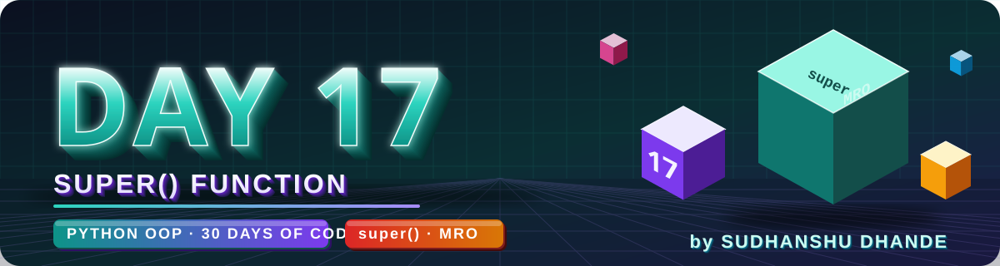
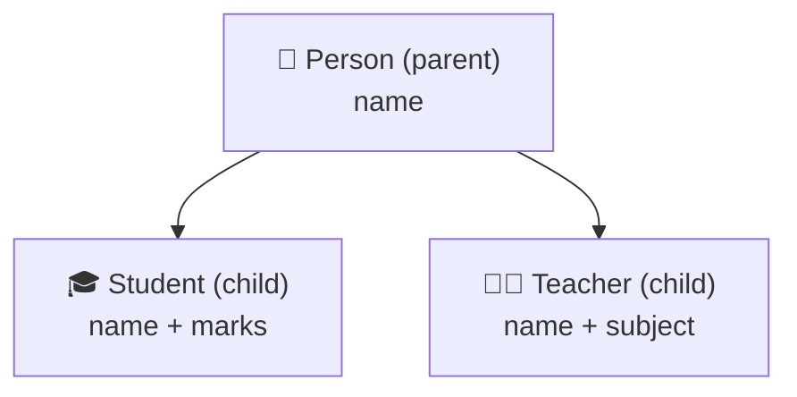
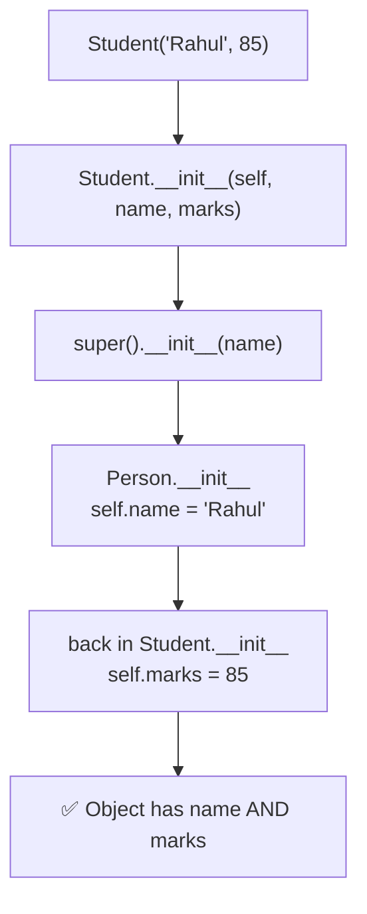
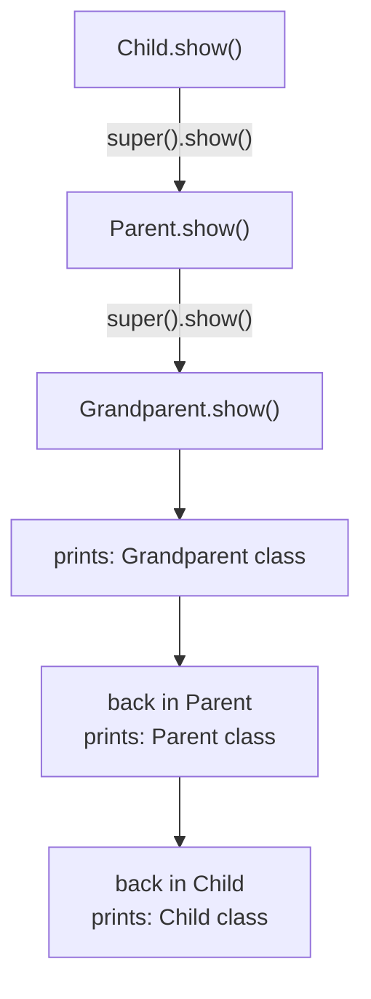
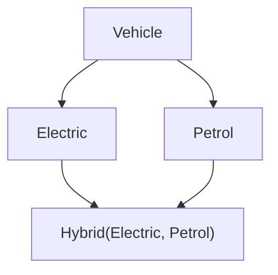
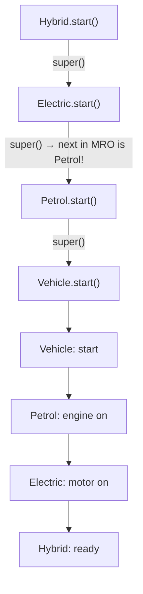
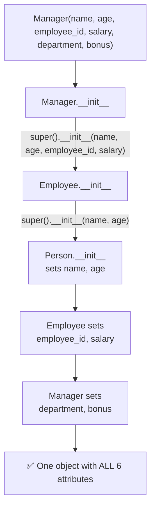
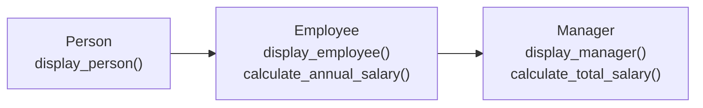

<p align="center">
  
</p>

<p align="center">
  
  
  
  
  
</p>

# 🐍 Day 17 — Python OOP: super() Function

## 🎯 Learning Objectives

Today I will learn:

- What is the `super()` function in Python.
- Why we use `super()` in inheritance.
- How to call a parent class constructor.
- How to access parent class methods.
- How to extend parent class functionality.
- How `super()` works in multilevel inheritance.
- How to use `super()` with method overriding.
- How to understand Method Resolution Order (MRO).

---

# 📖 Day 17 Concepts — Read & Understand First

> Today is a **concept + mini-project day** (Employee Management System). The key idea: a child class can **reuse** its parent's code instead of rewriting it. Type every example yourself, **run it, and trace the order of the printed lines** — that order is the whole lesson.

## 1️⃣ Quick Recap: Inheritance

**Inheritance** lets a **child class** get the attributes and methods of a **parent class**.



```python
class Person:
    def greet(self):
        print("Hello!")

class Student(Person):          # Student inherits from Person
    pass

Student().greet()               # Hello!   ← inherited, no code written in Student
```

---

## 2️⃣ The Problem: The Child Constructor Replaces the Parent's

If the child class defines its own `__init__`, it **replaces** the parent's `__init__`. The parent's setup code **never runs**:

```python
class Person:
    def __init__(self, name):
        self.name = name

class Student(Person):
    def __init__(self, name, marks):
        self.marks = marks               # forgot to call the parent!

s = Student("Rahul", 85)
print(s.marks)                           # 85
print(s.name)                            # ❌ AttributeError: no attribute 'name'
```

We need a way to say: **"also run my parent's `__init__`."** That is exactly what `super()` does.

---

## 3️⃣ What Is `super()`?

> **`super()`** is a built-in function that gives you access to the **next class in the Method Resolution Order (MRO)** — so you can call its methods **without writing the class name**.

In simple words: **`super()` = "ask the class above me to do its part."**

| We use `super()` to…                  | Example                          |
| ------------------------------------- | -------------------------------- |
| Call the parent **constructor**       | `super().__init__(name)`         |
| Reuse a parent **method**             | `super().sound()`                |
| **Avoid repeating** code              | No copy-paste of parent code     |
| **Extend** (add to) parent behaviour  | Parent part + child part         |
| Work with **multiple inheritance**    | Follows the MRO                  |

---

## 4️⃣ `super()` with the Constructor

```python
class Person:
    def __init__(self, name):
        self.name = name


class Student(Person):
    def __init__(self, name, marks):
        super().__init__(name)         # parent sets name
        self.marks = marks             # child sets marks


s1 = Student("Rahul", 85)
print(s1.name, s1.marks)               # Rahul 85
```



> ⚠️ **Do not pass `self`** to `super().__init__()`. Python adds it automatically.
> `super().__init__(name)` ✅  ·  `super().__init__(self, name)` ❌ `TypeError`

*(Older code writes `super(Student, self).__init__(name)`. It does the same thing — the short `super()` is the modern style.)*

---

## 5️⃣ `super()` with Methods — Replace vs Extend

**Method overriding** = the child defines a method with the **same name** as the parent's.

```python
class Animal:
    def sound(self):
        print("Animal makes a sound")


class Dog(Animal):
    def sound(self):                   # overrides Animal.sound
        super().sound()                # ✅ run the parent version first
        print("Dog barks")             # then add the child's own behaviour


Dog().sound()
```

```text
Animal makes a sound
Dog barks
```

| Overriding **without** `super()`        | Overriding **with** `super()`                |
| --------------------------------------- | -------------------------------------------- |
| Parent's version is **replaced**        | Parent's version is **reused and extended**  |
| Only `Dog barks` is printed             | `Animal makes a sound` + `Dog barks`         |

| Method Overriding                         | `super()`                              |
| ----------------------------------------- | -------------------------------------- |
| Child defines a method with the same name | Calls the next class's method in MRO   |
| Changes or replaces inherited behavior    | Reuses existing behavior               |
| Used to customize methods                 | Used to extend or reuse methods        |

**`super()` can also reuse a returned value:**

```python
class Ticket:
    def price(self):
        return 300

class VIPTicket(Ticket):
    def price(self):
        return super().price() + 200      # parent's result + extra

print(VIPTicket().price())                # 500
```

---

## 6️⃣ `super()` in Multilevel Inheritance

```python
class Grandparent:
    def show(self):
        print("Grandparent class")

class Parent(Grandparent):
    def show(self):
        super().show()
        print("Parent class")

class Child(Parent):
    def show(self):
        super().show()
        print("Child class")

Child().show()
```

```text
Grandparent class
Parent class
Child class
```



> 🔑 **Calls go UP the chain first, then the printing comes back DOWN.** Each class does its own job and trusts the one above to do theirs.

---

## 7️⃣ `super()` vs Calling the Parent Directly

```python
class Student(Person):
    def __init__(self, name, marks):
        super().__init__(name)             # ✅ with super()
        # Person.__init__(self, name)      # ⚠️ direct call (works, but fragile)
        self.marks = marks
```

| `super()`                                       | Direct call `Person.__init__(self, ...)`        |
| ----------------------------------------------- | ----------------------------------------------- |
| No class name written                           | Class name **hard-coded**                       |
| Follows the **MRO**                             | Names one **specific** class                    |
| Safe if the parent class is **renamed/changed** | Must edit every place if the parent changes     |
| Works properly with **multiple inheritance**    | Can call the same class **twice** by mistake    |
| Must **not** pass `self`                        | **Must** pass `self`                            |

---

## 8️⃣ What Is MRO (Method Resolution Order)?

**MRO** is the **order in which Python searches classes** to find a method.

```python
class Grandparent: pass
class Parent(Grandparent): pass
class Child(Parent): pass

print(Child.mro())
```

```text
[<class '__main__.Child'>, <class '__main__.Parent'>, <class '__main__.Grandparent'>, <class 'object'>]
```

| Way to see the MRO               | Result type |
| -------------------------------- | ----------- |
| `Child.mro()`                    | list        |
| `Child.__mro__`                  | tuple       |
| `[c.__name__ for c in Child.mro()]` | short, readable names |

> 🔑 Every class finally inherits from **`object`**, so `object` is always **last** in the MRO.

**Remember:**

- `super()` **follows the MRO**.
- It does **not always** mean "call my direct parent".
- In multiple inheritance, it calls the **next class in the MRO**.

---

## 9️⃣ Multiple Inheritance and the Diamond Shape

When a class has **two parents** that share the **same grandparent**, the shape is called a **diamond**:



Python builds **one single line** (the MRO) so that **every class appears once**: `Hybrid → Electric → Petrol → Vehicle → object`.

---

## 🔟 A Worked Example in a Different Domain: `Hybrid` Vehicle

To learn the **pattern** without giving away your solution, here is a diamond with **different class names**. Trace the order **before** you read the output.

```python
class Vehicle:
    def start(self):
        print("Vehicle: start")

class Electric(Vehicle):
    def start(self):
        super().start()
        print("Electric: motor on")

class Petrol(Vehicle):
    def start(self):
        super().start()
        print("Petrol: engine on")

class Hybrid(Electric, Petrol):
    def start(self):
        super().start()
        print("Hybrid: ready")


Hybrid().start()
print([c.__name__ for c in Hybrid.mro()])
```

**Output:**

```text
Vehicle: start
Petrol: engine on
Electric: motor on
Hybrid: ready
['Hybrid', 'Electric', 'Petrol', 'Vehicle', 'object']
```



**What to notice:**

- `Electric`'s `super()` did **not** go to its parent `Vehicle` — it went to **`Petrol`**, the next class in the MRO.
- `Vehicle.start()` ran **only once**, even though both `Electric` and `Petrol` inherit from it.
- Printing happens **in reverse order** of the calls (deepest class prints first).

| `Hybrid` example                          | Your Q15 (`A`, `B`, `C`, `D`)                         |
| ----------------------------------------- | ----------------------------------------------------- |
| `Vehicle` = the shared top class          | `A`                                                   |
| `Electric`, `Petrol` = the two middle classes | `B(A)`, `C(A)`                                    |
| `Hybrid(Electric, Petrol)`                | `D(B, C)`                                             |

> 🎯 **Your task:** do **not** copy this. First **predict** the order for your own `A, B, C, D` classes using `D.mro()`, then run it and check your prediction.

---

## 1️⃣1️⃣ Useful Extras

| Tool                                | What it shows                               | Example                          |
| ----------------------------------- | ------------------------------------------- | -------------------------------- |
| `Child.__bases__`                   | The **direct** parent classes (tuple)       | `(Parent,)`                      |
| `issubclass(Child, Parent)`         | Is `Child` derived from `Parent`?           | `True`                           |
| `isinstance(obj, Parent)`           | Is the object an instance of `Parent` (or its child)? | `True`                 |
| `Child.mro()`                       | Full search order                           | list of classes                  |

> 💡 `super()` only works **inside a method of a class** (it needs `self`). You cannot use it in a plain function.

---

## 1️⃣2️⃣ Flow: How the Employee Management System Fits Together





> 🔑 Each `display_...()` method can **call the parent's display first** using `super()` and then print only its **own** extra details — no repeated `print` lines.

---

## 1️⃣3️⃣ Testing Checklist

| Test case                                             | What should happen                                    |
| ----------------------------------------------------- | ----------------------------------------------------- |
| Create a `Student` using `super().__init__(name)`     | Both `name` and `marks` exist                         |
| Remove `super()` from a child constructor (on purpose) | `AttributeError` → you now **see why** it is needed  |
| Child method with `super()`                           | Parent output **and** child output appear             |
| Child method **without** `super()`                    | Only the child's output appears                       |
| 3-level chain (`Child → Parent → Grandparent`)        | Output order: Grandparent → Parent → Child            |
| `Child.mro()`                                         | Shows the full search order ending with `object`      |
| Diamond (`D(B, C)`)                                   | `A` runs **once**; order follows `D.mro()`            |
| Manager with bonus                                    | Total salary = salary + bonus                         |
| Several employees + one manager                       | Each object keeps **its own** data                    |

---

## 1️⃣4️⃣ Common Mistakes (Avoid These!)

| ❌ Mistake                                                         | ✅ Fix                                                              |
| ----------------------------------------------------------------- | ------------------------------------------------------------------ |
| Forgetting `super().__init__()` in the child constructor          | Call it so the parent's attributes get created                     |
| Passing `self`: `super().__init__(self, name)`                    | `super().__init__(name)` — `self` is automatic                     |
| Writing `super.__init__()` (no brackets after `super`)            | It is `super()` with **brackets**                                  |
| Forgetting `()` after the method: `super().show`                  | `super().show()` — otherwise nothing runs                          |
| Passing the wrong number / order of arguments to the parent       | Match the parent's `__init__` parameters exactly                   |
| Calling `super()` **after** using an attribute it should set      | Call `super().__init__()` **first**, then use `self.name`          |
| Assuming `super()` always means "direct parent"                   | It means "**next class in the MRO**"                               |
| Copy-pasting parent code into the child                           | Use `super()` to reuse it                                          |
| Overriding a method and **forgetting** to call `super()` when the parent logic is still needed | Add `super().method()`                        |
| Using `super()` in a plain function (outside a class)             | It only works **inside class methods**                             |
| Mixing `super()` and `Parent.method(self)` in the same hierarchy  | Pick one style — prefer `super()`                                  |
| Memorizing MRO output                                             | Understand it: print `Class.mro()` and trace the calls             |

---

## 1️⃣5️⃣ Step-by-Step Build Plan

```text
Step 1  →  Q1–Q2    super().__init__() and super().method() (the two basics)
Step 2  →  Q3–Q4    Pass several attributes to the parent constructor
Step 3  →  Q5       Override display() and extend it with super()
Step 4  →  Q6       Two child classes of the same parent (Student, Teacher)
Step 5  →  Q7–Q8    Parent attributes + child attributes + display everything
Step 6  →  Q9       Override process_payment() in two different children
Step 7  →  Q10      Three levels: Person → Employee → Developer
Step 8  →  Q11–Q12  Small systems (School, Online Shopping)
Step 9  →  Q13–Q14  Reuse the parent's returned value; extend display_info()
Step 10 →  Q15      Diamond shape: predict D.mro() first, then run it
Step 11 →  Main challenge: Person → Employee → Manager (3 classes)
Step 12 →  Split into employee_management.py + main.py, update README, push to GitHub
```

---

## 📌 Day 17 in One Look

```text
super()          →  Access the NEXT class in the MRO (usually the parent)
Constructor      →  super().__init__(args)         (no self!)
Method           →  super().method_name()
Extend           →  Parent part first, then the child's own part
Replace          →  Override WITHOUT super() = parent's version is ignored
Multilevel       →  Calls go UP the chain, printing comes back DOWN
vs direct call   →  super() follows MRO · Parent.method(self) names one class
MRO              →  Order Python searches for methods → Class.mro()
Always last      →  object
Diamond          →  Shared top class runs ONCE, order follows the MRO
Not always parent→  In multiple inheritance, super() = next in MRO
Manager total    →  salary + bonus
Annual salary    →  monthly salary × 12
```

---

## 📚 Part 1 — Theory: Understand Before Coding

### 1. What is super()?

`super()` is a built-in Python function used to access methods from the next class in the Method Resolution Order (MRO).

In simple words:

**super() = Call the next class's method without directly writing its class name.**

### 2. Why Do We Use super()?

We use `super()` to:

- Call the parent class constructor.
- Reuse parent class methods.
- Avoid repeating code.
- Extend parent class functionality.
- Work with multiple inheritance.

### 3. super() with Constructor

Example:

```python
class Person:
    def __init__(self, name):
        self.name = name


class Student(Person):
    def __init__(self, name, marks):
        super().__init__(name)
        self.marks = marks


s1 = Student("Rahul", 85)

print(s1.name)
print(s1.marks)
```

Output:

```text
Rahul
85
```

**Explanation:**

- `Person` is the parent class.
- `Student` is the child class.
- `super().__init__(name)` calls the next class's constructor.
- The parent constructor initializes `name`.
- The child constructor initializes `marks`.

### 4. super() with Methods

Example:

```python
class Animal:
    def sound(self):
        print("Animal makes a sound")


class Dog(Animal):
    def sound(self):
        super().sound()
        print("Dog barks")


d1 = Dog()
d1.sound()
```

Output:

```text
Animal makes a sound
Dog barks
```

Here, the child class calls the parent method and then adds its own behavior.

### 5. super() in Multilevel Inheritance

Example:

```python
class Grandparent:
    def show(self):
        print("Grandparent class")


class Parent(Grandparent):
    def show(self):
        super().show()
        print("Parent class")


class Child(Parent):
    def show(self):
        super().show()
        print("Child class")


obj = Child()
obj.show()
```

Output:

```text
Grandparent class
Parent class
Child class
```

### 6. What is MRO?

MRO stands for **Method Resolution Order**.

It defines the order in which Python searches for methods in an inheritance hierarchy.

Example:

```python
print(Child.mro())
```

Remember:

- `super()` follows MRO.
- It does not always mean "call my direct parent".
- In multiple inheritance, it calls the next class according to MRO.

---

## 📊 Part 2 — Difference Between Method Overriding and super()

| Method Overriding                         | super()                              |
| ----------------------------------------- | ------------------------------------ |
| Child defines a method with the same name | Calls the next class's method in MRO |
| Changes or replaces inherited behavior    | Reuses existing behavior             |
| Used to customize methods                 | Used to extend or reuse methods      |

---

## 🧠 Part 3 — Theory Questions (12 Questions)

Answer in your own words.

1. What is the `super()` function in Python?
2. Why do we use `super()`?
3. How can we call a parent class constructor?
4. Can `super()` call a parent class method?
5. What happens if we do not use `super()` in a child constructor?
6. What is the difference between `super()` and directly calling the parent class?
7. What is method overriding?
8. How does `super()` work with method overriding?
9. What is multilevel inheritance?
10. What is MRO in Python?
11. Does `super()` always call the direct parent class?
12. What are the benefits of using `super()`?

---

## 🧩 Part 4 — Practice Problems (15 Questions)

### 🟢 Level 1 — Basic Practice

**Q1. Person and Student**

Create a `Person` class with a `name` attribute.

Create a `Student` class that inherits from `Person`.

Requirements:

- Accept `name` and `marks`.
- Use `super()` to initialize `name`.
- Display both attributes.

**Q2. Animal and Dog**

Create an `Animal` class with a `sound()` method.

Create a `Dog` class that overrides `sound()`.

Requirements:

- Call the parent method using `super()`.
- Print the dog's own sound.

**Q3. Vehicle and Car**

Create a `Vehicle` class with:

- `brand`
- `start()`

Create a `Car` class with:

- `model`
- `display()`

Use `super()` to initialize the parent attributes.

**Q4. Employee and Manager**

Create an `Employee` class with:

- `name`
- `salary`

Create a `Manager` class with:

- `department`

Use `super()` to initialize employee details.

**Q5. Shape and Rectangle**

Create a `Shape` class with a method `display()`.

Create a `Rectangle` class that overrides `display()`.

Call the parent method using `super()`.

### 🟡 Level 2 — OOP Practice

**Q6. Person, Student and Teacher**

Create a `Person` class with:

- `name`
- `age`

Create `Student` and `Teacher` child classes.

Requirements:

- Use `super()` in both child constructors.
- Add `marks` to Student.
- Add `subject` to Teacher.

**Q7. Bank Account and Savings Account**

Create a `BankAccount` class with:

- `account_holder`
- `balance`
- `display_balance()`

Create a `SavingsAccount` class with:

- `interest_rate`

Use `super()` to initialize parent attributes.

**Q8. Product and Electronics**

Create a `Product` class with:

- `name`
- `price`

Create an `Electronics` class with:

- `warranty`

Use `super()` and display all details.

**Q9. Method Overriding**

Create a `Payment` class with a `process_payment()` method.

Create child classes:

- `UPIPayment`
- `CardPayment`

Each child class should call the parent method using `super()` and then display its payment details.

**Q10. Multilevel Inheritance**

Create three classes:

- `Person`
- `Employee`
- `Developer`

Requirements:

- Person stores `name`.
- Employee stores `salary`.
- Developer stores `programming_language`.
- Use `super()` at every inheritance level.
- Display all details.

### 🔴 Level 3 — Logic Building

**Q11. School Management**

Create a `Person` class.

Create child classes:

- `Student`
- `Teacher`

Requirements:

- Use `super()` in both classes.
- Student should store marks.
- Teacher should store salary.
- Display complete details.

**Q12. Online Shopping System**

Create a `Product` class with:

- `name`
- `price`

Create an `ElectronicProduct` class with:

- `warranty`
- `calculate_discount()`

Use `super()` to initialize product information.

**Q13. Employee Salary System**

Create an `Employee` class with:

- `name`
- `basic_salary`
- `calculate_salary()`

Create a `Manager` class.

Requirements:

- Use `super()` in the constructor.
- Override `calculate_salary()`.
- Call the parent method using `super()`.
- Add a 20% bonus to the parent's calculated salary.

**Q14. Library Management**

Create a `LibraryItem` class with:

- `title`
- `item_id`
- `display_info()`

Create child classes:

- `Book`
- `Magazine`

Requirements:

- Use `super()` in constructors.
- Override `display_info()`.
- Call the parent method using `super()`.

**Q15. MRO Exploration**

Create a multiple inheritance example.

Classes:

- `A`
- `B(A)`
- `C(A)`
- `D(B, C)`

Requirements:

- Each class should have a `show()` method.
- Use `super()` in each method.
- Create an object of `D`.
- Call `show()`.
- Display `D.mro()`.
- Understand the method calling order.

---

## ⭐ Part 5 — Main Challenge: Employee Management System

Build an Employee Management System using inheritance and `super()`.

### Classes

**Class 1: Person**

Attributes:

- `name`
- `age`

Methods:

- `display_person()`

**Class 2: Employee(Person)**

Attributes:

- `employee_id`
- `salary`

Methods:

- `display_employee()`
- `calculate_annual_salary()`

**Class 3: Manager(Employee)**

Attributes:

- `department`
- `bonus`

Methods:

- `calculate_total_salary()`
- `display_manager()`

### Requirements

1. Create all three classes.
2. Use inheritance correctly.
3. Use `super()` in every child constructor.
4. Reuse parent class methods.
5. Override at least one method.
6. Calculate annual salary.
7. Calculate manager's total salary including bonus.
8. Create at least three employee objects.
9. Create at least one manager object.
10. Display complete employee and manager details.

### Expected Output

```text
===== EMPLOYEE MANAGEMENT SYSTEM =====

Employee Name: Rahul
Age: 24
Employee ID: E101
Salary: 30000
Annual Salary: 360000

===== MANAGER DETAILS =====

Name: Amit
Age: 30
Employee ID: M101
Salary: 50000
Department: IT
Bonus: 10000
Total Salary: 60000
```

---

## 🎤 Part 6 — OOP Interview Questions (with Short Answers)

> Try to answer each question yourself first, then compare with the short answer. Each answer is kept **simple and short** so it is easy to remember. 🧠 = memory trick.

### 1. What is `super()` in Python?

**Answer:** A **built-in function that gives access to the next class in the MRO** (usually the parent), so you can call its methods **without writing the parent's name**.

```python
super().__init__(name)
```

🧠 *super() = ask the class above to do its part*

---

### 2. Why is `super()` used in constructors?

**Answer:** To **run the parent's `__init__`** so the **parent's attributes get created**. Without it, the child's constructor replaces the parent's and the parent data is **missing**.

```python
def __init__(self, name, marks):
    super().__init__(name)      # parent: name
    self.marks = marks          # child: marks
```

🧠 *Child builds its part · parent builds its part*

---

### 3. How do you call a parent class method?

**Answer:** Use **`super().method_name()`** inside the child's method.

```python
def sound(self):
    super().sound()
    print("Dog barks")
```

🧠 *`super().` + method name + `()`*

---

### 4. What is the difference between `super()` and direct parent class calling?

**Answer:**

| `super()`                         | Direct call `Parent.method(self)`     |
| --------------------------------- | ------------------------------------- |
| Follows the **MRO**               | Names one **specific** class          |
| No class name, **`self` not passed** | Class name written, **`self` passed** |
| Safe with multiple inheritance    | Can call a class **twice**            |

🧠 *super() follows the map · direct call picks one city*

---

### 5. Can `super()` be used in multiple inheritance?

**Answer:** **Yes.** It works through the **MRO**, calling the **next class in order**, and every class in a diamond runs **only once**.

```python
class D(B, C):
    def show(self):
        super().show()
```

🧠 *Multiple parents → super() follows one line (MRO)*

---

### 6. What is MRO?

**Answer:** **Method Resolution Order** — the **order in which Python searches classes** for a method. See it with `Class.mro()`. `object` is always **last**.

```python
print(D.mro())
```

🧠 *MRO = search order*

---

### 7. Does `super()` always call the direct parent?

**Answer:** **No.** It calls the **next class in the MRO**. In single inheritance that is the parent, but in multiple inheritance it can be a **sibling** class.

🧠 *Next in MRO, not always my parent*

---

### 8. What is method overriding?

**Answer:** When a **child class defines a method with the same name** as the parent's, the child's version is used. Use `super()` inside it if you also want the **parent's version**.

```python
class Dog(Animal):
    def sound(self):          # overrides Animal.sound
        ...
```

🧠 *Same name, new behaviour*

---

### 9. Why is code reuse important in inheritance?

**Answer:** It **avoids repeated code**, so programs are **shorter, easier to fix and easier to extend**. A change in the parent automatically reaches every child.

🧠 *Write once · use everywhere*

---

### 10. What is the advantage of using `super()` in large applications?

**Answer:** Classes **cooperate** instead of depending on exact parent names. If a parent is **renamed or the hierarchy changes**, the child code still works, and multiple inheritance stays **correct and reusable**.

🧠 *No hard-coded names → easy to change*

---

### ⚡ 10-Second Revision

```text
1. super()          → Accesses the next class in MRO
2. In constructor   → Initializes parent-class data
3. Parent method    → super().method_name()
4. vs direct call   → super() follows MRO · direct call names one class
5. Multiple inherit → Yes, works through MRO (each class runs once)
6. MRO              → Order Python searches for methods
7. Direct parent?   → Not always — next in MRO
8. Overriding       → Child redefines an inherited method
9. Code reuse       → Avoids unnecessary repeated code
10. Large apps      → More reusable and cooperative inheritance
```

---

## 📁 Day 17 Folder Structure

```text
Day17_Super_Function/
│
├── banner.svg
├── README.md
├── theory.py
├── practice.py

```

### File Responsibilities

- `banner.svg` — the Day 17 banner shown at the top of this README.
- `theory.py` — Examples of super() and MRO.
- `practice.py` — Solutions to Q1–Q15.
- `employee_management.py` — Main challenge classes.
- `README.md` — Learning notes and project details.

**Beginner tip:** First run the small examples in `theory.py` and trace the **order of the printed lines**. Then solve Q1–Q15, and finally build the Person → Employee → Manager chain in `employee_management.py`.

---

## 📊 Day 17 Target

| Task                | Target |
| ------------------- | -----: |
| Theory Questions    |     12 |
| Practice Problems   |     15 |
| Interview Questions |     10 |
| Main Challenge      |      1 |
| GitHub Update       |      1 |

---

## 🚫 Rules

- Understand inheritance before using super().
- Attempt questions independently.
- Do not copy complete solutions.
- Use meaningful class and method names.
- Practise constructor and method calls.
- Understand MRO instead of memorizing output.

---

## ✅ Completion Checklist

- [ ] Understood super()
- [ ] Used super() in constructors
- [ ] Used super() with methods
- [ ] Practised method overriding
- [ ] Practised multilevel inheritance
- [ ] Understood MRO
- [ ] Completed Q1–Q15
- [ ] Completed the main challenge
- [ ] Prepared interview answers
- [ ] Updated GitHub README
- [ ] Pushed the project to GitHub

---

## 🚀 GitHub Commit

```bash
git add .
git status
git commit -m "Day 17: super function practice"
git push
```

**Day 17 Goal:** Understand how `super()` helps reuse parent class functionality and build cleaner inheritance-based Python applications.

---

<p align="center">
  
</p>

<h3 align="center"><b>Sudhanshu Dhande</b></h3>
<p align="center"><i>B.Tech (AI &amp; ML) · BATU, Lonere · Python OOP Journey</i></p>