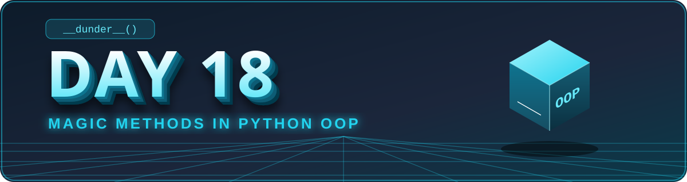
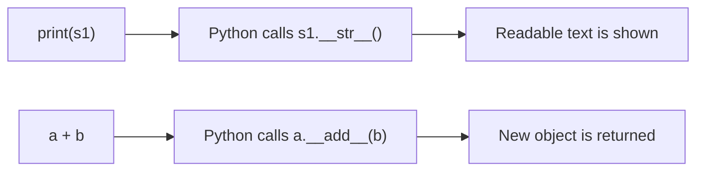

<div align="center">



</div>

# 🐍 Day 18 — Python OOP: Magic Methods (Dunder Methods)

## 🎯 Learning Objectives

Today I will learn:

- What are Magic Methods in Python.
- What are Dunder Methods.
- How `__init__()` works.
- How `__str__()` and `__repr__()` work.
- How to use `__len__()`.
- How to use comparison magic methods.
- How to overload operators using magic methods.
- How to customize object behavior.

---

## 📖 Concept Guide — Understand Magic Methods First

Read this section before the theory and questions. It explains the big idea in simple words.

### 1️⃣ The Big Idea

When you write `len(x)`, `print(x)` or `a + b`, Python does not know what to do with **your own objects**.
Magic methods are the **instructions you give Python** so it knows how your object should behave.

> 🎮 **Real-life picture:** A TV remote has buttons (`+`, `-`, power). Pressing a button calls something inside the TV.
> In the same way, `+`, `len()` and `print()` are the buttons, and magic methods are what happens inside your object.

### 2️⃣ Why "Dunder"?

**Dunder = Double UNDERscore.** The name starts and ends with `__`.

```text
__init__    __str__    __len__    __add__
```

💡 You almost **never call them yourself**. Python calls them **automatically** when you use a normal operation.

### 3️⃣ What You Write vs What Python Calls

| You write | Python secretly calls |
|---|---|
| `Student("Ravi", 80)` | `__init__()` |
| `print(obj)` / `str(obj)` | `obj.__str__()` |
| `repr(obj)` | `obj.__repr__()` |
| `len(obj)` | `obj.__len__()` |
| `a + b` | `a.__add__(b)` |
| `a - b` | `a.__sub__(b)` |
| `a * b` | `a.__mul__(b)` |
| `a == b` | `a.__eq__(b)` |
| `a < b` | `a.__lt__(b)` |
| `x in obj` | `obj.__contains__(x)` |



### 4️⃣ `__init__()` — Set Up the Object

Runs **automatically** when an object is created. Use it to store the starting data.

```python
class Pizza:
    def __init__(self, size, topping):
        self.size = size
        self.topping = topping


p = Pizza("Large", "Cheese")      # __init__ runs here by itself
```

### 5️⃣ `__str__()` and `__repr__()` — How the Object Looks as Text

Without them, printing an object shows an ugly default like `<__main__.Pizza object at 0x000...>`.

```python
class Pizza:
    def __init__(self, size, topping):
        self.size = size
        self.topping = topping

    def __str__(self):                       # for users
        return f"{self.size} {self.topping} pizza"

    def __repr__(self):                      # for developers
        return f"Pizza({self.size!r}, {self.topping!r})"


p = Pizza("Large", "Cheese")
print(p)          # Large Cheese pizza        (uses __str__)
print(repr(p))    # Pizza('Large', 'Cheese')  (uses __repr__)
```

- `__str__` → **pretty** text for users.
- `__repr__` → **exact** text for developers (debugging).
- If only `__repr__` is defined, `print()` falls back to it. If only `__str__` is defined, `repr()` does not use it.
- Both must **return** a string. Do not use `print()` inside them.

### 6️⃣ `__len__()` — Make `len()` Work

```python
class Playlist:
    def __init__(self, songs):
        self.songs = songs

    def __len__(self):
        return len(self.songs)        # must return a whole number (0 or more)


pl = Playlist(["Song A", "Song B"])
print(len(pl))                        # 2
```

### 7️⃣ `__contains__()` — Make `in` Work

```python
class Playlist:
    def __init__(self, songs):
        self.songs = songs

    def __contains__(self, song):
        return song in self.songs     # must give True or False


pl = Playlist(["Song A", "Song B"])
print("Song A" in pl)                 # True
```

### 8️⃣ Operator Overloading — Give `+`, `-`, `*` Your Own Meaning

**Operator overloading** means telling Python what an operator should do for **your** objects.

```python
class Money:
    def __init__(self, amount):
        self.amount = amount

    def __add__(self, other):
        if not isinstance(other, Money):
            return NotImplemented             # "I don't know how to add this"
        return Money(self.amount + other.amount)   # NEW object, originals unchanged

    def __str__(self):
        return f"₹{self.amount}"


wallet = Money(100) + Money(50)
print(wallet)                                 # ₹150
```

💡 Good habit: return a **new object**. Do not change `self` or `other` inside `__add__`.

### 9️⃣ Comparison Magic Methods — Make `==`, `<`, `>` Work

| Method | Operator |
|---|---|
| `__eq__` | `==` |
| `__ne__` | `!=` |
| `__lt__` | `<` |
| `__gt__` | `>` |
| `__le__` | `<=` |
| `__ge__` | `>=` |

```python
class Box:
    def __init__(self, weight):
        self.weight = weight

    def __eq__(self, other):
        return self.weight == other.weight    # decide what "equal" means

    def __lt__(self, other):
        return self.weight < other.weight     # decide what "smaller" means


print(Box(5) == Box(5))    # True
print(Box(3) < Box(8))     # True
```

You decide the rule. Here, boxes are compared by **weight**.

### ⚠️ Common Mistakes

- Using `print()` inside `__str__()` instead of `return`.
- Returning a number from `__str__()` (it must return a **string**).
- Returning a negative number or a non-integer from `__len__()`.
- Changing the original objects inside `__add__()` instead of returning a new one.
- Writing `__init__` with only one underscore on each side (`_init_`). It must be **double**.
- Calling `obj.__str__()` directly. Use `str(obj)` or `print(obj)` instead.

### 🧾 Quick Revision Cheat Sheet

```text
Magic method = double underscore method that Python calls automatically
__init__   → create object      __str__   → user-friendly text
__repr__   → developer text     __len__   → len()
__add__    → +                  __eq__    → ==
__lt__     → <                  __contains__ → in
Operator overloading = custom meaning for operators on your objects
```

---

## 📚 Part 1 — Theory: Understand Before Coding

### 1. What are Magic Methods?

Magic methods are special methods in Python that have double underscores before and after their names.

They are also called **Dunder Methods**.

Examples:

- `__init__()`
- `__str__()`
- `__len__()`
- `__add__()`
- `__eq__()`

In simple words:

**Magic Methods = Special methods that define how Python objects behave.**

### 2. `__init__()` Method

- It initializes an object's attributes.
- It runs automatically when an object is created.
- It is commonly called a constructor in beginner-level Python learning.

Example:

```python
class Student:
    def __init__(self, name, marks):
        self.name = name
        self.marks = marks

s1 = Student("Rahul", 85)
```

### 3. `__str__()` Method

- It defines the readable string representation of an object.
- It is called when we use `print(object)` or `str(object)`.

Example:

```python
class Student:
    def __init__(self, name):
        self.name = name

    def __str__(self):
        return f"Student Name: {self.name}"

s1 = Student("Rahul")

print(s1)
```

Output:

```text
Student Name: Rahul
```

### 4. `__repr__()` Method

- It provides an unambiguous representation of an object.
- It is mainly useful for debugging and development.
- Ideally, it returns a string that helps identify or recreate the object.

Example:

```python
class Student:
    def __init__(self, name, marks):
        self.name = name
        self.marks = marks

    def __repr__(self):
        return f"Student({self.name!r}, {self.marks!r})"

s1 = Student("Rahul", 85)

print(repr(s1))
```

Output:

```text
Student('Rahul', 85)
```

### 5. `__len__()` Method

- It defines what `len(object)` should return.
- It must return a non-negative integer.

Example:

```python
class ShoppingCart:
    def __init__(self, items):
        self.items = items

    def __len__(self):
        return len(self.items)

cart = ShoppingCart(["Shoes", "Watch", "Bag"])

print(len(cart))
```

Output:

```text
3
```

### 6. `__add__()` Method

- It defines how the `+` operator works with custom objects.
- It is an example of operator overloading.

Example:

```python
class Number:
    def __init__(self, value):
        self.value = value

    def __add__(self, other):
        return Number(self.value + other.value)

n1 = Number(10)
n2 = Number(20)

result = n1 + n2

print(result.value)
```

Output:

```text
30
```

### 7. Comparison Magic Methods

These methods define how objects are compared.

| Method | Operator |
|---|---|
| `__eq__()` | `==` |
| `__ne__()` | `!=` |
| `__lt__()` | `<` |
| `__gt__()` | `>` |
| `__le__()` | `<=` |
| `__ge__()` | `>=` |

### 8. Important Magic Methods

| Magic Method | Purpose |
|---|---|
| `__init__()` | Initializes object data |
| `__str__()` | Readable string representation |
| `__repr__()` | Developer-friendly representation |
| `__len__()` | Defines `len()` behavior |
| `__add__()` | Defines `+` behavior |
| `__sub__()` | Defines `-` behavior |
| `__mul__()` | Defines `*` behavior |
| `__eq__()` | Defines `==` behavior |
| `__lt__()` | Defines `<` behavior |
| `__contains__()` | Defines `in` behavior |

---

## 📊 Part 2 — Difference Between __str__() and __repr__()

| `__str__()` | `__repr__()` |
|---|---|
| Readable for users | Useful for developers |
| Used by `str()` | Used by `repr()` |
| Focuses on presentation | Focuses on clear representation |
| Should be easy to read | Should be unambiguous |

**Remember:**

- `str(object)` → User-friendly output.
- `repr(object)` → Developer-friendly output.

---

## 🧠 Part 3 — Theory Questions (12 Questions)

Answer in your own words.

1. What are magic methods in Python?
2. Why are they called Dunder Methods?
3. What is the purpose of `__init__()`?
4. What is the purpose of `__str__()`?
5. What is the difference between `__str__()` and `__repr__()`?
6. What is the purpose of `__len__()`?
7. What is operator overloading?
8. What does `__add__()` do?
9. Which magic method is used for the `==` operator?
10. Which magic method is used for the `<` operator?
11. What happens when we print an object without defining `__str__()`?
12. Why are magic methods useful in real-world applications?

---

## 🧩 Part 4 — Practice Problems (15 Questions)

### 🟢 Level 1 — Basic Practice

**Q1. Student Initialization**

Create a `Student` class using `__init__()`.

Attributes:

- `name`
- `age`
- `marks`

Create two objects and display their details.

**Q2. Student String Representation**

Create a `Student` class with `__str__()`.

Requirements:

- Store name and marks.
- Return a readable string.
- Print the object directly.

**Q3. Book Representation**

Create a `Book` class with:

- `title`
- `author`
- `price`

Implement `__repr__()` to display the book information.

**Q4. Shopping Cart Length**

Create a `ShoppingCart` class.

Requirements:

- Store a list of items.
- Implement `__len__()`.
- Use `len()` to count items.

**Q5. Employee Representation**

Create an `Employee` class with:

- `name`
- `salary`

Implement both `__str__()` and `__repr__()`.

### 🟡 Level 2 — Operator Overloading

**Q6. Add Two Numbers**

Create a `Number` class.

Requirements:

- Store one numeric value.
- Implement `__add__()`.
- Add two objects using `+`.
- Return a new `Number` object.

**Q7. Subtract Two Objects**

Create a `Number` class with `__sub__()`.

Subtract two objects using the `-` operator.

**Q8. Multiply Two Objects**

Create a `Product` class with:

- `price`
- `quantity`

Implement `__mul__()` to calculate the total cost when multiplying two compatible objects or a product by a supported numeric value. Clearly define the behavior you choose.

**Q9. Compare Student Marks**

Create a `Student` class.

Requirements:

- Store name and marks.
- Implement `__eq__()`.
- Compare two students using `==`.
- Define equality based on marks.

**Q10. Compare Employee Salaries**

Create an `Employee` class.

Requirements:

- Store name and salary.
- Implement `__lt__()`.
- Compare employees using `<`.

### 🔴 Level 3 — Logic Building

**Q11. Bank Account Addition**

Create a `BankAccount` class.

Requirements:

- Store account holder and balance.
- Implement `__add__()`.
- Add two account balances.
- Return the combined amount as a number.
- Do not modify either original account.

**Q12. Vector Addition**

Create a `Vector` class.

Requirements:

- Store `x` and `y`.
- Implement `__add__()`.
- Add two vectors.
- Return a new Vector object.

Example:

```text
Vector(2, 3) + Vector(4, 5)
Result: Vector(6, 8)
```

**Q13. Product Comparison**

Create a `Product` class.

Requirements:

- Store product name and price.
- Implement `__eq__()`.
- Implement `__lt__()`.
- Compare products by price.

**Q14. Library Collection**

Create a `Library` class.

Requirements:

- Store a list of books.
- Implement `__len__()`.
- Implement `__contains__()`.
- Use `len()` to count books.
- Use `in` to check whether a book exists.

**Q15. Custom Temperature Class**

Create a `Temperature` class.

Requirements:

- Store temperature in Celsius.
- Implement `__str__()`.
- Implement `__add__()` to add a numeric temperature change.
- Implement `__lt__()` to compare two temperatures.
- Return new objects when adding temperatures.

---

## ⭐ Part 5 — Main Challenge: Custom Shopping Cart System

Build a Shopping Cart application using magic methods.

### Class: `ShoppingCart`

#### Attributes

- `customer_name`
- `items`
- `total_amount`

#### Methods

- `__init__()`
- `__str__()`
- `__len__()`
- `__add__()`
- `__contains__()`
- `add_item()`
- `remove_item()`
- `calculate_total()`
- `display_cart()`

### Requirements

1. Create the `ShoppingCart` class.
2. Initialize customer name and items.
3. Store products with their prices.
4. Use `__str__()` to display cart information.
5. Use `__len__()` to count cart items.
6. Use `__contains__()` to check whether a product exists.
7. Use `__add__()` to combine two compatible shopping carts.
8. Implement methods to add and remove products.
9. Calculate the total amount.
10. Do not modify the original carts when combining them.
11. Handle invalid products and empty carts.
12. Test the application with at least two customers.

### Example Output

```text
===== SHOPPING CART =====

Customer: Rahul

Items:
Shoes - ₹1200
Watch - ₹1500
Bag - ₹800

Total Items: 3
Total Amount: ₹3500

Is Shoes Available? True
```

### Bonus Challenge

Add these features:

- Apply a discount.
- Compare two carts using `__lt__()`.
- Display cart information using `__repr__()`.
- Combine two carts using `+`.

---

## 🎤 Part 6 — OOP Interview Questions (10 Questions)

> 💡 Each question has a short, simple answer below it. Read once and say it in your own words.

**1. What are magic methods in Python?**
✅ Special methods with double underscores that Python calls **automatically** to decide how an object behaves.

**2. Why are magic methods also called Dunder Methods?**
✅ **D**ouble **UNDER**score. The name starts and ends with `__`, like `__init__`.

**3. What is the purpose of `__init__()`?**
✅ It runs automatically when an object is created and sets the object's starting data.

**4. What is the difference between `__str__()` and `__repr__()`?**
✅ `__str__` = readable text for **users** (`print`). `__repr__` = exact text for **developers** (debugging).

**5. What is operator overloading?**
✅ Giving operators like `+`, `==`, `<` a custom meaning for your own objects.

**6. How does `__add__()` work?**
✅ When you write `a + b`, Python calls `a.__add__(b)`. It usually returns a **new** object.

**7. Which method is called by `len()`?**
✅ `__len__()`. It must return a whole number (0 or more).

**8. Which method is called by the `==` operator?**
✅ `__eq__()`. You decide what "equal" means, for example equal marks or equal price.

**9. Can we define our own behavior for operators?**
✅ Yes. Define the matching magic method: `__add__` for `+`, `__eq__` for `==`, `__lt__` for `<`.

**10. Where are magic methods useful in real-world applications?**
✅ Money and price objects, vectors, custom collections (cart, library, playlist), and clear printing/logging while debugging.

### Short Answers to Remember

1. **Magic Methods:** Special methods that define object behavior.
2. **Dunder:** Double underscore before and after the method name.
3. **__init__():** Initializes object attributes.
4. **__str__() vs __repr__():** User-friendly vs developer-friendly representation.
5. **Operator Overloading:** Giving operators custom behavior for objects.
6. **__add__():** Defines the behavior of `+`.
7. **len():** Calls `__len__()`.
8. **==:** Usually calls `__eq__()`.
9. **Custom Operators:** Yes, using suitable magic methods.
10. **Real-world Use:** Custom collections, vectors, money and product objects.

### 🧠 One-Line Memory Trick

```text
init = create | str = show to user | repr = show to developer
len = size | add = plus | eq = equal | lt = less than | contains = in
```

---

## 📁 Day 18 Folder Structure

```text
Day18_Magic_Methods/
│
├── README.md
├── day18_banner.svg
├── day18_footer.svg
├── theory.py
├── practice.py
├── shopping_cart.py
└── main.py
```

### File Responsibilities

- `theory.py` — Examples of important magic methods.
- `practice.py` — Solutions to Q1–Q15.
- `shopping_cart.py` — ShoppingCart class.
- `main.py` — Runs the main challenge.
- `README.md` — Learning notes and project details.

---

## 📊 Day 18 Target

| Task | Target |
|---|---:|
| Theory Questions | 12 |
| Practice Problems | 15 |
| Interview Questions | 10 |
| Main Challenge | 1 |
| GitHub Update | 1 |

---

## 🚫 Rules

- Understand each magic method before using it.
- Do not memorize methods without understanding their purpose.
- Attempt every question independently.
- Use meaningful class and method names.
- Return the correct type from special methods.
- Avoid changing original objects unexpectedly.
- Test your custom operators with different inputs.

---

## ✅ Completion Checklist

- [ ] Understood Magic Methods
- [ ] Practised `__init__()`
- [ ] Practised `__str__()`
- [ ] Practised `__repr__()`
- [ ] Practised `__len__()`
- [ ] Practised `__add__()`
- [ ] Practised comparison methods
- [ ] Understood operator overloading
- [ ] Completed Q1–Q15
- [ ] Completed the main challenge
- [ ] Prepared interview answers
- [ ] Updated GitHub README
- [ ] Pushed the project to GitHub

---

## 🚀 GitHub Commit

```bash
git add .
git commit -m "Day 18: Python magic methods practice"
git push
```

**Day 18 Goal:** Learn how to customize Python object behavior using magic methods and build powerful OOP applications.

---

<div align="center">


[](https://github.com/sudhanshudhande19)

</div>