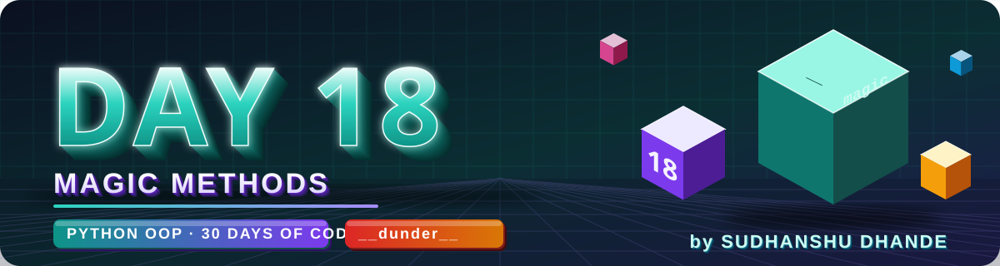
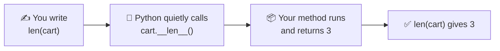
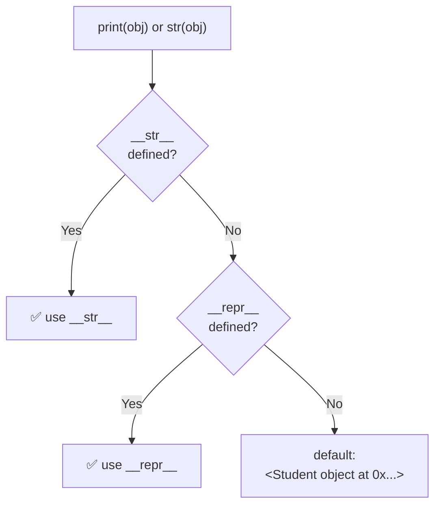
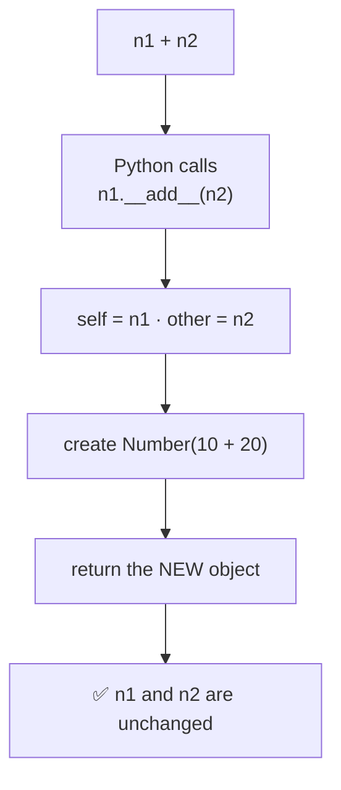
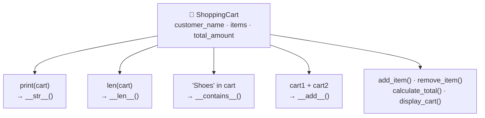
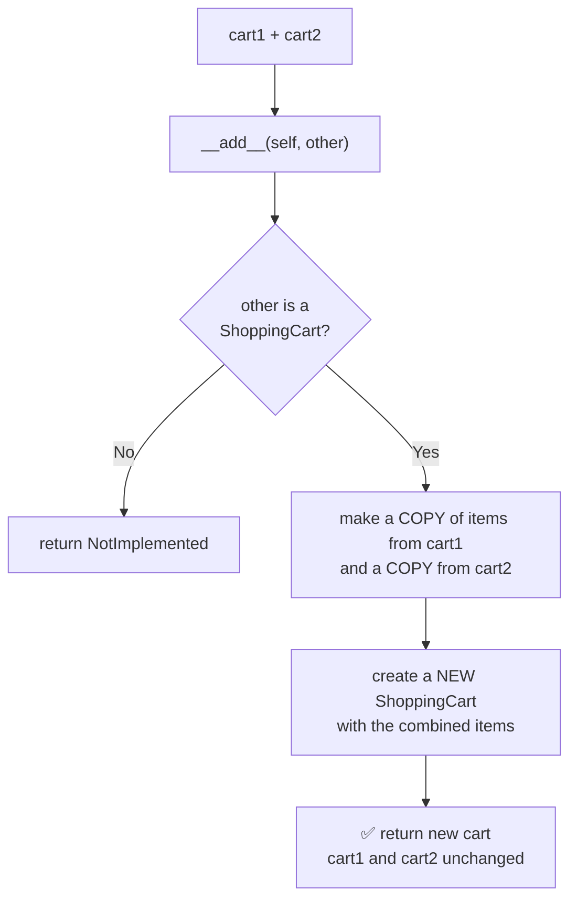

<p align="center">
  
</p>

<p align="center">
  
  
  
  
  
</p>

# 🐍 Day 18 — Python OOP: Magic Methods (Dunder Methods)

## 🎯 Learning Objectives

Today I will learn:

- What are Magic Methods in Python.
- What are Dunder Methods.
- How `__init__()` works.
- How `__str__()` and `__repr__()` work.
- How to use `__len__()`.
- How to use comparison magic methods.
- How to overload operators using magic methods.
- How to customize object behavior.

---

# 📖 Day 18 Concepts — Read & Understand First

> Today is a **concept + mini-project day** (Custom Shopping Cart System). The key idea: when you write `print(obj)`, `len(obj)`, `a + b` or `a == b`, Python secretly calls a **special method** on your object. If you define that method, **you decide what the object does**. Type every example yourself and **run it**.

## 1️⃣ What Are Magic Methods?

**Magic methods** are special methods whose names have **double underscores before and after** (`__init__`, `__str__`, `__len__`...). They are also called **dunder methods** (**D**ouble **UNDER**score).

> **Magic Methods = Special methods that define how Python objects behave.**



> 🧠 *You write the **simple syntax**. Python calls the **dunder method** behind the scenes.*

---

## 2️⃣ What You Write → What Python Calls

| You write            | Python calls                | Purpose                         |
| -------------------- | --------------------------- | ------------------------------- |
| `Student("Rahul", 85)` | `__init__(self, ...)`     | Set up a new object             |
| `print(obj)` / `str(obj)` | `obj.__str__()`        | Readable text for users         |
| `repr(obj)`          | `obj.__repr__()`            | Developer-friendly text         |
| `len(obj)`           | `obj.__len__()`             | Size / number of items          |
| `a + b`              | `a.__add__(b)`              | Addition                        |
| `a - b`              | `a.__sub__(b)`              | Subtraction                     |
| `a * b`              | `a.__mul__(b)`              | Multiplication                  |
| `a == b`             | `a.__eq__(b)`               | Equality                        |
| `a < b`              | `a.__lt__(b)`               | Less than                       |
| `x in obj`           | `obj.__contains__(x)`       | Membership test                 |

> ⚠️ **Never call dunder methods directly.** Write `len(cart)`, **not** `cart.__len__()`. The dunder method is for Python to call.

---

## 3️⃣ `__init__()` — Set Up the Object

`__init__()` runs **automatically** when an object is created and sets its starting data.

```python
class Student:
    def __init__(self, name, marks):
        self.name = name
        self.marks = marks

s1 = Student("Rahul", 85)      # __init__ runs here
```

| Fact                                         | Meaning                                       |
| -------------------------------------------- | --------------------------------------------- |
| Runs **automatically**                       | You never call `__init__` yourself            |
| **Initializes** the object                   | (The object itself is created just before it) |
| Must **not return** a value                  | It always returns `None`                      |
| Commonly called the **constructor**          | Beginner-level name                           |

---

## 4️⃣ What Happens Without `__str__()`?

```python
class Student:
    def __init__(self, name):
        self.name = name

s1 = Student("Rahul")
print(s1)
```

```text
<__main__.Student object at 0x000001A2B3C4D5E0>
```

That is Python's **default** text: the class name and a memory address — useless for users. `__str__()` fixes this.

---

## 5️⃣ `__str__()` vs `__repr__()`

```python
class Student:
    def __init__(self, name, marks):
        self.name = name
        self.marks = marks

    def __str__(self):                                   # for users
        return f"{self.name} scored {self.marks}"

    def __repr__(self):                                  # for developers
        return f"Student({self.name!r}, {self.marks!r})"


s = Student("Rahul", 85)
print(s)             # Rahul scored 85
print(repr(s))       # Student('Rahul', 85)
print([s])           # [Student('Rahul', 85)]   ← containers show items with repr
```

| `__str__()`                    | `__repr__()`                           |
| ------------------------------ | -------------------------------------- |
| Readable for **users**         | Useful for **developers**              |
| Used by `print()` and `str()`  | Used by `repr()`, the console, lists   |
| Focuses on **presentation**    | Focuses on a **clear, exact** form     |
| Should be easy to read         | Should be **unambiguous**              |



| Tip                                           | Why                                                        |
| --------------------------------------------- | ---------------------------------------------------------- |
| `!r` inside an f-string                       | Uses `repr()`, so text shows quotes: `'Rahul'`            |
| If you write **only one**, write `__repr__`   | `print()` falls back to it; the reverse does **not** work |
| Both must **`return` a string**               | Using `print()` inside them is a mistake                  |

---

## 6️⃣ `__len__()` — Define `len(obj)`

```python
class ShoppingCart:
    def __init__(self, items):
        self.items = items

    def __len__(self):
        return len(self.items)


cart = ShoppingCart(["Shoes", "Watch", "Bag"])
print(len(cart))                 # 3
```

- `__len__()` must return a **non-negative integer**.
- **Bonus effect:** an object with `__len__()` becomes **falsy when its length is 0**:

```python
empty = ShoppingCart([])

if not empty:                    # uses __len__() → 0 → False
    print("Cart is empty")       # Cart is empty
```

> ✅ This is a neat way to handle **empty carts** (Main Challenge #11).

---

## 7️⃣ Operator Overloading: `__add__`, `__sub__`, `__mul__`

**Operator overloading** = giving an operator (`+`, `-`, `*`, `==`, `<`) **your own behaviour** for your own objects.

```python
class Number:
    def __init__(self, value):
        self.value = value

    def __add__(self, other):
        return Number(self.value + other.value)      # returns a NEW object


n1 = Number(10)
n2 = Number(20)
result = n1 + n2
print(result.value)              # 30
```



| Operator | Method          | Note                                  |
| -------- | --------------- | ------------------------------------- |
| `+`      | `__add__`       | Return a **new** object               |
| `-`      | `__sub__`       | Order matters: `self - other`         |
| `*`      | `__mul__`       | Decide: object × object or × number   |
| `/`      | `__truediv__`   | Extra: true division                  |

**Make it safe — check the other type:**

```python
def __add__(self, other):
    if not isinstance(other, Number):
        return NotImplemented            # Python then raises a clean TypeError
    return Number(self.value + other.value)
```

> 🔑 **Golden rule:** `+` should **not change** the original objects. Build and return a **new** one (Rules: *"Avoid changing original objects unexpectedly"*).

---

## 8️⃣ Comparison Magic Methods

| Method     | Operator | Meaning                  |
| ---------- | -------- | ------------------------ |
| `__eq__()` | `==`     | equal to                 |
| `__ne__()` | `!=`     | not equal to             |
| `__lt__()` | `<`      | less than                |
| `__gt__()` | `>`      | greater than             |
| `__le__()` | `<=`     | less than or equal to    |
| `__ge__()` | `>=`     | greater than or equal to |

**Important facts:**

- You **decide** what "equal" or "less" means — for example, compare students by `marks`, products by `price`.
- If you define only `__eq__`, then `<` **does not work** → `TypeError`.
- In Python 3, `!=` automatically works from `__eq__()` — you need not write `__ne__()`.
- If you define `__lt__()`, **`sorted()` works** on a list of your objects.
- Defining `__eq__()` **without** `__hash__()` makes the object **unhashable** (cannot be a `set` item or `dict` key). Fine for now — just remember it.
- Optional shortcut: `functools.total_ordering` writes the other comparisons for you if you define `__eq__` and `__lt__`.

---

## 9️⃣ `__contains__()` — Define `in`

```python
class Playlist:
    def __init__(self, songs):
        self.songs = list(songs)

    def __len__(self):
        return len(self.songs)

    def __contains__(self, song):
        return song in self.songs


p = Playlist(["Faded", "Believer"])
print(len(p))              # 2
print("Faded" in p)        # True
print("Closer" in p)       # False
print(bool(Playlist([])))  # False  ← empty, because __len__ returns 0
```

---

## 🔟 A Worked Example in a Different Domain: `Duration`

To learn the **pattern** without giving away your solution, here is a class (`Duration`, in minutes) that uses **five magic methods together**.

```python
class Duration:
    def __init__(self, minutes):
        self.minutes = minutes

    def __str__(self):
        h, m = divmod(self.minutes, 60)
        return f"{h}h {m}m"

    def __repr__(self):
        return f"Duration({self.minutes!r})"

    def __add__(self, other):
        if not isinstance(other, Duration):
            return NotImplemented
        return Duration(self.minutes + other.minutes)

    def __eq__(self, other):
        if not isinstance(other, Duration):
            return NotImplemented
        return self.minutes == other.minutes

    def __lt__(self, other):
        if not isinstance(other, Duration):
            return NotImplemented
        return self.minutes < other.minutes


a = Duration(90)
b = Duration(45)
total = a + b

print(a, b)              # 1h 30m 0h 45m
print(total)             # 2h 15m
print(repr(total))       # Duration(135)
print(a == b)            # False
print(b < a)             # True
print(sorted([a, b]))    # [Duration(45), Duration(90)]
```

**Output:**

```text
1h 30m 0h 45m
2h 15m
Duration(135)
False
True
[Duration(45), Duration(90)]
```

| `Duration`                                    | Your questions                                              |
| --------------------------------------------- | ----------------------------------------------------------- |
| `__str__` → `"1h 30m"`                        | Q2, Q5, Q15 (readable text)                                 |
| `__repr__` → `Duration(135)`                  | Q3, Q5 (developer text)                                     |
| `__add__` returns a **new** `Duration`        | Q6, Q11, Q12, Q15                                           |
| `__eq__`, `__lt__` compare by `minutes`       | Q9, Q10, Q13, Q15                                           |
| `Playlist` uses `__len__` + `__contains__`    | Q4, Q14, Main Challenge                                     |

> 🎯 **Your task:** do **not** copy this. Understand the **pattern** (decide the rule → write the method → return the correct type), then build your own classes.

---

## 1️⃣1️⃣ A Few More Magic Methods (Extras)

| Magic Method      | Purpose                                    |
| ----------------- | ------------------------------------------ |
| `__init__()`      | Initializes object data                    |
| `__str__()`       | Readable string representation             |
| `__repr__()`      | Developer-friendly representation          |
| `__len__()`       | Defines `len()` behavior                   |
| `__add__()`       | Defines `+` behavior                       |
| `__sub__()`       | Defines `-` behavior                       |
| `__mul__()`       | Defines `*` behavior                       |
| `__eq__()`        | Defines `==` behavior                      |
| `__lt__()`        | Defines `<` behavior                       |
| `__contains__()`  | Defines `in` behavior                      |
| `__bool__()` *(extra)*    | Defines `bool(obj)` / `if obj:`    |
| `__getitem__()` *(extra)* | Defines `obj[index]`               |
| `__iter__()` *(extra)*    | Makes `for x in obj:` work         |
| `__call__()` *(extra)*    | Lets you call an object like a function |

> 💡 Real libraries use these too: `numpy` arrays and `pandas` columns support `a + b` and `a > b` because they define `__add__` and `__gt__`.

---

## 1️⃣2️⃣ Flow: How the Shopping Cart Fits Together





> ⚠️ **Copy, don't share.** `items=self.items` makes both carts point to the **same** list/dictionary — changing one changes the other. Build a **new** container (`list(...)` or `dict(...)`) for the combined cart.

> 💡 Decide (and write as a comment) what happens when **both carts contain the same product**.

---

## 1️⃣3️⃣ Testing Checklist

| Test case                                             | What should happen                                      |
| ----------------------------------------------------- | ------------------------------------------------------- |
| `print(obj)` **with** `__str__`                       | Readable text                                           |
| `print(obj)` **without** `__str__`                    | Ugly default `<... object at 0x...>`                    |
| `repr(obj)`                                           | Clear form such as `Student('Rahul', 85)`               |
| `len(obj)` with 0, 1 and many items                   | Correct integer each time                               |
| Empty collection in `if not obj:`                     | Treated as `False`                                      |
| `a + b`                                               | **New** object; `a` and `b` unchanged                   |
| `a + 5` (wrong type)                                  | Clean `TypeError`, not a strange crash                  |
| `a == b` with equal data / different data             | `True` / `False`                                        |
| `a < b`, `b < a`, `a == b`                            | All three cases give the right answer                   |
| `sorted([...])` on your objects                       | Sorted using `__lt__`                                   |
| `"item" in obj` for present / missing item            | `True` / `False`                                        |
| Two customers, two carts                              | Each cart keeps **its own** data                        |
| Remove a product that is not in the cart              | Friendly message, no crash                              |

---

## 1️⃣4️⃣ Common Mistakes (Avoid These!)

| ❌ Mistake                                                          | ✅ Fix                                                              |
| ------------------------------------------------------------------ | ------------------------------------------------------------------ |
| `print()` inside `__str__` instead of `return`                      | **Return** the string — otherwise `TypeError: __str__ returned non-string` |
| Returning a number from `__str__`                                   | Return a **string**: `f"Total: {self.total}"`                      |
| `__len__` returns a string, float or negative number                | Return a **non-negative int**                                      |
| Calling `obj.__len__()` / `obj.__str__()` directly                  | Use `len(obj)` / `str(obj)`                                        |
| `__add__` **changes** `self` and returns nothing                    | Create and **return a new object**                                 |
| Forgetting the `other` parameter: `def __add__(self):`              | `def __add__(self, other):`                                        |
| Assuming `other` is always the same class                           | Check with `isinstance()`, return `NotImplemented`                 |
| Sharing the same list: `ShoppingCart(self.items)`                   | Make a copy: `list(self.items)` / `dict(self.items)`               |
| Defining `__eq__` but trying `a < b`                                | Also define `__lt__`                                               |
| Comparing different attributes in `__eq__` and `__lt__`             | Use the **same rule** (e.g. both by `price`)                       |
| Confusing `__str__` and `__repr__`                                  | `str` = for users · `repr` = for developers                        |
| Misspelling: `__str_`, `_len_`, `__lenght__`                        | Exactly **two** underscores on **both** sides                      |
| Returning a value from `__init__`                                   | `__init__` returns nothing                                         |
| Not documenting your choice in Q8 (`__mul__`)                       | Write a comment: what does `*` mean for your class?                |
| Memorizing method names without understanding                       | Remember: **syntax → hidden dunder call**                          |

---

## 1️⃣5️⃣ Step-by-Step Build Plan

```text
Step 1  →  Q1–Q2    __init__ and __str__ (make print() readable)
Step 2  →  Q3       __repr__ (developer text) 
Step 3  →  Q4–Q5    __len__, then both __str__ and __repr__ together
Step 4  →  Q6–Q7    __add__ and __sub__ (return NEW objects)
Step 5  →  Q8       __mul__ (decide and document the behaviour)
Step 6  →  Q9–Q10   __eq__ and __lt__ (compare by one clear rule)
Step 7  →  Q11–Q12  __add__ with different return types (a number vs a new object)
Step 8  →  Q13      __eq__ + __lt__ together, then try sorted()
Step 9  →  Q14      __len__ + __contains__ in one class
Step 10 →  Q15      Temperature with __str__, __add__, __lt__
Step 11 →  Main challenge: ShoppingCart with all magic methods
Step 12 →  Bonus: discount, __lt__, __repr__, combine with +
Step 13 →  Split into shopping_cart.py + main.py, update README, push to GitHub
```

---

## 📌 Day 18 in One Look

```text
Magic methods  →  Special methods with __double underscores__ that Python calls for you
Dunder         →  Double UNDERscore before and after the name
You write      →  print(obj) · len(obj) · a + b · a == b · x in obj
Python calls   →  __str__ · __len__ · __add__ · __eq__ · __contains__
__init__       →  Sets up the object (returns nothing)
__str__        →  Readable text for users      → print(), str()
__repr__       →  Clear text for developers    → repr(), console, lists
No __str__?    →  Falls back to __repr__, then to <Class object at 0x...>
__len__        →  Must return a non-negative int; empty → falsy
__add__        →  a + b → return a NEW object, never change a or b
Not same type  →  return NotImplemented
Comparisons    →  __eq__ == · __lt__ < · __gt__ > · __le__ <= · __ge__ >= (and != comes free)
sorted()       →  Works once __lt__ is defined
__contains__   →  Defines  x in obj
Golden rule    →  Never call dunders directly; use the simple syntax
```

---

## 📚 Part 1 — Theory: Understand Before Coding

### 1. What are Magic Methods?

Magic methods are special methods in Python that have double underscores before and after their names.

They are also called **Dunder Methods**.

Examples:

- `__init__()`
- `__str__()`
- `__len__()`
- `__add__()`
- `__eq__()`

In simple words:

**Magic Methods = Special methods that define how Python objects behave.**

### 2. `__init__()` Method

- It initializes an object's attributes.
- It runs automatically when an object is created.
- It is commonly called a constructor in beginner-level Python learning.

Example:

```python
class Student:
    def __init__(self, name, marks):
        self.name = name
        self.marks = marks

s1 = Student("Rahul", 85)
```

### 3. `__str__()` Method

- It defines the readable string representation of an object.
- It is called when we use `print(object)` or `str(object)`.

Example:

```python
class Student:
    def __init__(self, name):
        self.name = name

    def __str__(self):
        return f"Student Name: {self.name}"

s1 = Student("Rahul")

print(s1)
```

Output:

```text
Student Name: Rahul
```

### 4. `__repr__()` Method

- It provides an unambiguous representation of an object.
- It is mainly useful for debugging and development.
- Ideally, it returns a string that helps identify or recreate the object.

Example:

```python
class Student:
    def __init__(self, name, marks):
        self.name = name
        self.marks = marks

    def __repr__(self):
        return f"Student({self.name!r}, {self.marks!r})"

s1 = Student("Rahul", 85)

print(repr(s1))
```

Output:

```text
Student('Rahul', 85)
```

### 5. `__len__()` Method

- It defines what `len(object)` should return.
- It must return a non-negative integer.

Example:

```python
class ShoppingCart:
    def __init__(self, items):
        self.items = items

    def __len__(self):
        return len(self.items)

cart = ShoppingCart(["Shoes", "Watch", "Bag"])

print(len(cart))
```

Output:

```text
3
```

### 6. `__add__()` Method

- It defines how the `+` operator works with custom objects.
- It is an example of operator overloading.

Example:

```python
class Number:
    def __init__(self, value):
        self.value = value

    def __add__(self, other):
        return Number(self.value + other.value)

n1 = Number(10)
n2 = Number(20)

result = n1 + n2

print(result.value)
```

Output:

```text
30
```

### 7. Comparison Magic Methods

These methods define how objects are compared.

| Method | Operator |
|---|---|
| `__eq__()` | `==` |
| `__ne__()` | `!=` |
| `__lt__()` | `<` |
| `__gt__()` | `>` |
| `__le__()` | `<=` |
| `__ge__()` | `>=` |

### 8. Important Magic Methods

| Magic Method | Purpose |
|---|---|
| `__init__()` | Initializes object data |
| `__str__()` | Readable string representation |
| `__repr__()` | Developer-friendly representation |
| `__len__()` | Defines `len()` behavior |
| `__add__()` | Defines `+` behavior |
| `__sub__()` | Defines `-` behavior |
| `__mul__()` | Defines `*` behavior |
| `__eq__()` | Defines `==` behavior |
| `__lt__()` | Defines `<` behavior |
| `__contains__()` | Defines `in` behavior |

---

## 📊 Part 2 — Difference Between __str__() and __repr__()

| `__str__()` | `__repr__()` |
|---|---|
| Readable for users | Useful for developers |
| Used by `str()` | Used by `repr()` |
| Focuses on presentation | Focuses on clear representation |
| Should be easy to read | Should be unambiguous |

**Remember:**

- `str(object)` → User-friendly output.
- `repr(object)` → Developer-friendly output.

---

## 🧠 Part 3 — Theory Questions (12 Questions)

Answer in your own words.

1. What are magic methods in Python?
2. Why are they called Dunder Methods?
3. What is the purpose of `__init__()`?
4. What is the purpose of `__str__()`?
5. What is the difference between `__str__()` and `__repr__()`?
6. What is the purpose of `__len__()`?
7. What is operator overloading?
8. What does `__add__()` do?
9. Which magic method is used for the `==` operator?
10. Which magic method is used for the `<` operator?
11. What happens when we print an object without defining `__str__()`?
12. Why are magic methods useful in real-world applications?

---

## 🧩 Part 4 — Practice Problems (15 Questions)

### 🟢 Level 1 — Basic Practice

**Q1. Student Initialization**

Create a `Student` class using `__init__()`.

Attributes:

- `name`
- `age`
- `marks`

Create two objects and display their details.

**Q2. Student String Representation**

Create a `Student` class with `__str__()`.

Requirements:

- Store name and marks.
- Return a readable string.
- Print the object directly.

**Q3. Book Representation**

Create a `Book` class with:

- `title`
- `author`
- `price`

Implement `__repr__()` to display the book information.

**Q4. Shopping Cart Length**

Create a `ShoppingCart` class.

Requirements:

- Store a list of items.
- Implement `__len__()`.
- Use `len()` to count items.

**Q5. Employee Representation**

Create an `Employee` class with:

- `name`
- `salary`

Implement both `__str__()` and `__repr__()`.

### 🟡 Level 2 — Operator Overloading

**Q6. Add Two Numbers**

Create a `Number` class.

Requirements:

- Store one numeric value.
- Implement `__add__()`.
- Add two objects using `+`.
- Return a new `Number` object.

**Q7. Subtract Two Objects**

Create a `Number` class with `__sub__()`.

Subtract two objects using the `-` operator.

**Q8. Multiply Two Objects**

Create a `Product` class with:

- `price`
- `quantity`

Implement `__mul__()` to calculate the total cost when multiplying two compatible objects or a product by a supported numeric value. Clearly define the behavior you choose.

**Q9. Compare Student Marks**

Create a `Student` class.

Requirements:

- Store name and marks.
- Implement `__eq__()`.
- Compare two students using `==`.
- Define equality based on marks.

**Q10. Compare Employee Salaries**

Create an `Employee` class.

Requirements:

- Store name and salary.
- Implement `__lt__()`.
- Compare employees using `<`.

### 🔴 Level 3 — Logic Building

**Q11. Bank Account Addition**

Create a `BankAccount` class.

Requirements:

- Store account holder and balance.
- Implement `__add__()`.
- Add two account balances.
- Return the combined amount as a number.
- Do not modify either original account.

**Q12. Vector Addition**

Create a `Vector` class.

Requirements:

- Store `x` and `y`.
- Implement `__add__()`.
- Add two vectors.
- Return a new Vector object.

Example:

```text
Vector(2, 3) + Vector(4, 5)
Result: Vector(6, 8)
```

**Q13. Product Comparison**

Create a `Product` class.

Requirements:

- Store product name and price.
- Implement `__eq__()`.
- Implement `__lt__()`.
- Compare products by price.

**Q14. Library Collection**

Create a `Library` class.

Requirements:

- Store a list of books.
- Implement `__len__()`.
- Implement `__contains__()`.
- Use `len()` to count books.
- Use `in` to check whether a book exists.

**Q15. Custom Temperature Class**

Create a `Temperature` class.

Requirements:

- Store temperature in Celsius.
- Implement `__str__()`.
- Implement `__add__()` to add a numeric temperature change.
- Implement `__lt__()` to compare two temperatures.
- Return new objects when adding temperatures.

---

## ⭐ Part 5 — Main Challenge: Custom Shopping Cart System

Build a Shopping Cart application using magic methods.

### Class: `ShoppingCart`

#### Attributes

- `customer_name`
- `items`
- `total_amount`

#### Methods

- `__init__()`
- `__str__()`
- `__len__()`
- `__add__()`
- `__contains__()`
- `add_item()`
- `remove_item()`
- `calculate_total()`
- `display_cart()`

### Requirements

1. Create the `ShoppingCart` class.
2. Initialize customer name and items.
3. Store products with their prices.
4. Use `__str__()` to display cart information.
5. Use `__len__()` to count cart items.
6. Use `__contains__()` to check whether a product exists.
7. Use `__add__()` to combine two compatible shopping carts.
8. Implement methods to add and remove products.
9. Calculate the total amount.
10. Do not modify the original carts when combining them.
11. Handle invalid products and empty carts.
12. Test the application with at least two customers.

### Example Output

```text
===== SHOPPING CART =====

Customer: Rahul

Items:
Shoes - ₹1200
Watch - ₹1500
Bag - ₹800

Total Items: 3
Total Amount: ₹3500

Is Shoes Available? True
```

### Bonus Challenge

Add these features:

- Apply a discount.
- Compare two carts using `__lt__()`.
- Display cart information using `__repr__()`.
- Combine two carts using `+`.

---

## 🎤 Part 6 — OOP Interview Questions (with Short Answers)

> Try to answer each question yourself first, then compare with the short answer. Each answer is kept **simple and short** so it is easy to remember. 🧠 = memory trick.

### 1. What are magic methods in Python?

**Answer:** **Special methods with double underscores** (`__init__`, `__str__`, `__add__`...) that **Python calls automatically** and that **define how an object behaves**.

```python
len(cart)        # Python calls cart.__len__()
```

🧠 *You write the syntax · Python calls the dunder*

---

### 2. Why are magic methods also called Dunder Methods?

**Answer:** **Dunder = Double UNDERscore.** The name has **two underscores before and two after**: `__name__`.

🧠 *D-under = Double Under*

---

### 3. What is the purpose of `__init__()`?

**Answer:** It **initializes an object's attributes** and **runs automatically** when the object is created. It returns nothing.

```python
s1 = Student("Rahul", 85)      # __init__ runs here
```

🧠 *Object born → `__init__` runs*

---

### 4. What is the difference between `__str__()` and `__repr__()`?

**Answer:**

| `__str__()`                    | `__repr__()`                      |
| ------------------------------ | --------------------------------- |
| **User-friendly** text         | **Developer-friendly** text       |
| Used by `print()` / `str()`    | Used by `repr()` / console / lists |
| Easy to read                   | Clear and unambiguous             |

```python
print(s1)        # Rahul scored 85
repr(s1)         # Student('Rahul', 85)
```

🧠 *str = for users · repr = for developers*

---

### 5. What is operator overloading?

**Answer:** **Giving operators (`+`, `-`, `==`, `<`) custom behaviour for your own objects** by defining magic methods.

```python
Vector(2, 3) + Vector(4, 5)      # Vector(6, 8)
```

🧠 *Same operator · your own rule*

---

### 6. How does `__add__()` work?

**Answer:** `a + b` becomes **`a.__add__(b)`**. The method gets `self` (left side) and `other` (right side) and should **return a new object**, without changing `a` or `b`.

```python
def __add__(self, other):
    return Number(self.value + other.value)
```

🧠 *`a + b` → `a.__add__(b)` → return NEW*

---

### 7. Which method is called by `len()`?

**Answer:** **`__len__()`**. It must return a **non-negative integer**.

```python
def __len__(self):
    return len(self.items)
```

🧠 *`len()` → `__len__()`*

---

### 8. Which method is called by the `==` operator?

**Answer:** **`__eq__()`** (usually). If you do not define it, Python compares whether both names point to the **same object**.

```python
def __eq__(self, other):
    return self.marks == other.marks
```

🧠 *`==` → `__eq__()`*

---

### 9. Can we define our own behavior for operators?

**Answer:** **Yes.** Define the matching magic method: `__add__` for `+`, `__sub__` for `-`, `__mul__` for `*`, `__eq__` for `==`, `__lt__` for `<`.

🧠 *Operator → its own dunder*

---

### 10. Where are magic methods useful in real-world applications?

**Answer:** In **custom collections (cart, playlist, library), vectors, money, dates and product objects**. Libraries like `numpy` and `pandas` use them so `a + b` and `a > b` work on arrays and columns.

🧠 *Make your objects feel like built-in Python types*

---

### ⚡ 10-Second Revision

```text
1. Magic methods   → Special methods that define object behavior
2. Dunder          → Double underscore before and after the name
3. __init__()      → Initializes object attributes
4. __str__ vs __repr__ → User-friendly vs developer-friendly
5. Operator overloading → Giving operators custom behavior for objects
6. __add__()       → Defines the behavior of +  (return a NEW object)
7. len()           → Calls __len__()
8. ==              → Usually calls __eq__()
9. Custom operators→ Yes, using suitable magic methods
10. Real-world use → Collections, vectors, money and product objects
```

---

## 📁 Day 18 Folder Structure

```text
Day18_Magic_Methods/
│
├── banner.svg
├── README.md
├── theory.py
├── practice.py

```

### File Responsibilities

- `banner.svg` — the Day 18 banner shown at the top of this README.
- `theory.py` — Examples of important magic methods.
- `practice.py` — Solutions to Q1–Q15.
- `README.md` — Learning notes and project details.

**Beginner tip:** First run the examples in `theory.py` and see which dunder method each line triggers. Then solve Q1–Q15, and finally build the `ShoppingCart` class using all the magic methods you practised.

---

## 📊 Day 18 Target

| Task | Target |
|---|---:|
| Theory Questions | 12 |
| Practice Problems | 15 |
| Interview Questions | 10 |
| Main Challenge | 1 |
| GitHub Update | 1 |

---

## 🚫 Rules

- Understand each magic method before using it.
- Do not memorize methods without understanding their purpose.
- Attempt every question independently.
- Use meaningful class and method names.
- Return the correct type from special methods.
- Avoid changing original objects unexpectedly.
- Test your custom operators with different inputs.

---

## ✅ Completion Checklist

- [ ] Understood Magic Methods
- [ ] Practised `__init__()`
- [ ] Practised `__str__()`
- [ ] Practised `__repr__()`
- [ ] Practised `__len__()`
- [ ] Practised `__add__()`
- [ ] Practised comparison methods
- [ ] Understood operator overloading
- [ ] Completed Q1–Q15
- [ ] Completed the main challenge
- [ ] Prepared interview answers
- [ ] Updated GitHub README
- [ ] Pushed the project to GitHub

---

## 🚀 GitHub Commit

```bash
git add .
git status
git commit -m "Day 18: Python magic methods practice"
git push
```

**Day 18 Goal:** Learn how to customize Python object behavior using magic methods and build powerful OOP applications.

---

<p align="center">
  
</p>

<h3 align="center"><b>Sudhanshu Dhande</b></h3>
<p align="center"><i>B.Tech (AI &amp; ML) · BATU, Lonere · Python OOP Journey</i></p>