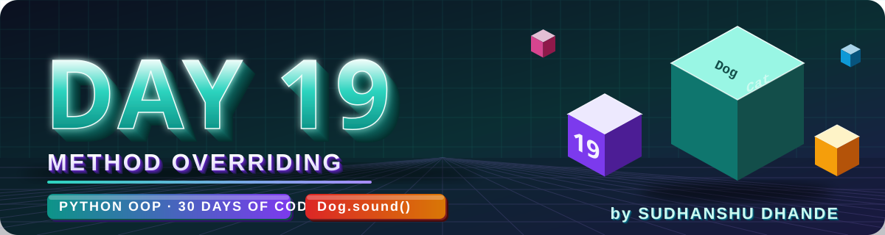
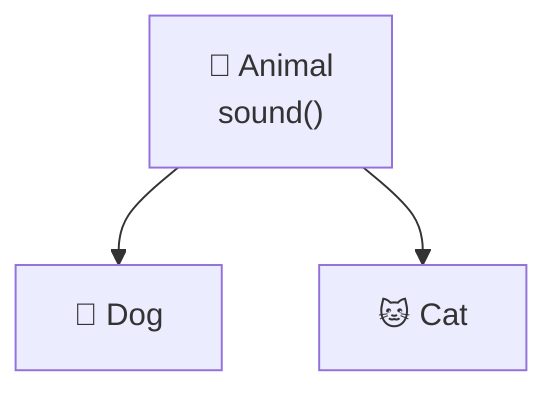
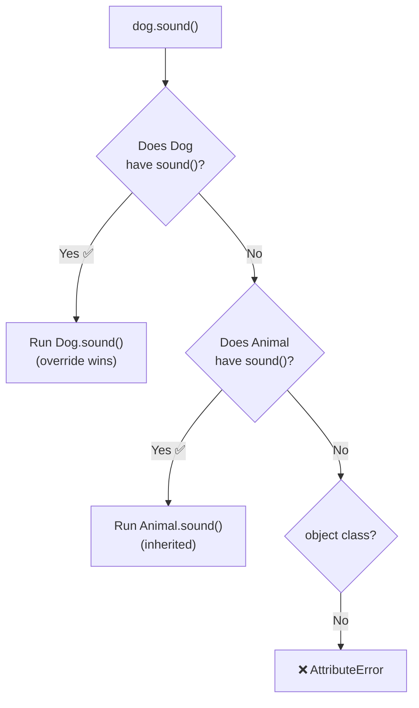
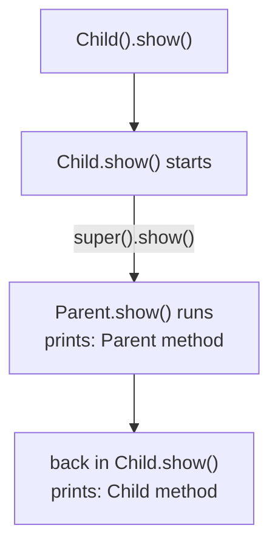
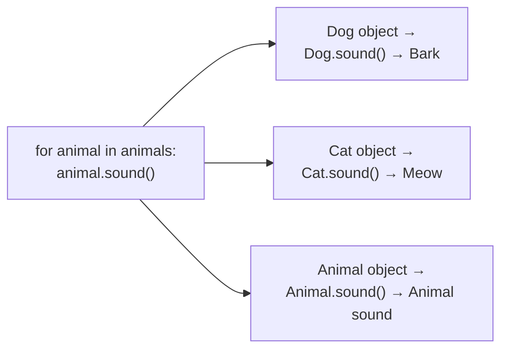
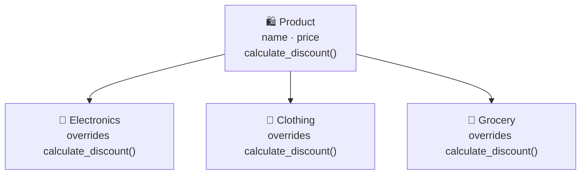
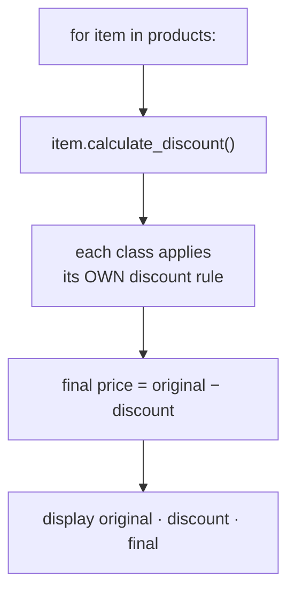

<p align="center">
  
</p>

<p align="center">
  
  
  
  
  
</p>

# 🚀 DAY 19 — PYTHON OOP: METHOD OVERRIDING

## 🎯 Learning Objectives

Today I will learn:

- What method overriding is.
- Why we override inherited methods.
- How Python decides which method to run.
- How to use `super()` inside an overridden method.
- How runtime polymorphism works.
- The difference between overriding and overloading.
- How to build a small system where each child class behaves differently.

---

# 📖 Day 19 Concepts — Read & Understand First

> Today is a **concept + mini-project day** (Online Shopping System). The key idea: a child class can **change** what an inherited method does. Type every example yourself, run it, and **say out loud which class's method is running**.

## 1️⃣ Quick Recap: Inheritance Gives Methods for Free



```python
class Animal:
    def sound(self):
        print("Animal makes a sound")

class Dog(Animal):          # Dog inherits sound() from Animal
    pass

Dog().sound()               # Animal makes a sound
```

The child **gets the parent's method for free**. But what if the dog should say something **different**? → **override** the method.

---

## 2️⃣ What Is Method Overriding?

> **Method Overriding** = a child class defines a method with the **same name** as a method in its parent class, **replacing** the inherited behaviour with its own.

```python
class Animal:
    def sound(self):
        print("Animal makes a sound")

class Dog(Animal):
    def sound(self):                 # same name → overrides Animal.sound
        print("Dog barks")

Dog().sound()                        # Dog barks
```

| Rule for overriding                         | Meaning                                              |
| ------------------------------------------- | ---------------------------------------------------- |
| Needs **inheritance**                       | Only works between **parent and child** classes      |
| **Same method name**                        | `sound` in both. A typo = a brand-new method!        |
| **Same parameters** (good practice)         | So callers can use any child in the same way         |
| The **child's** version wins                | When called through a child object                   |
| The **parent** class is **not changed**     | `Animal().sound()` still prints `Animal makes a sound` |

---

## 3️⃣ Which Method Runs? (How Python Searches)

When you write `obj.sound()`, Python looks for `sound` **starting at the object's own class** and then **moves upward**:



> 🔑 This search order is the **MRO** you learned on Day 17. The **first match wins**, so a child's method **hides** the parent's.

```python
print([c.__name__ for c in Dog.mro()])      # ['Dog', 'Animal', 'object']
```

---

## 4️⃣ If the Child Does Not Override → Parent's Method Is Used

```python
class Animal:
    def sound(self):
        print("Animal makes a sound")
    def eat(self):
        print("Animal eats")

class Dog(Animal):
    def sound(self):                 # only sound() is overridden
        print("Dog barks")

d = Dog()
d.sound()        # Dog barks            ← child's version
d.eat()          # Animal eats          ← inherited, not overridden
```

A child can override **one**, **several** or **all** inherited methods — everything else stays inherited.

---

## 5️⃣ Overriding with `super()` — Replace vs Extend

| Override **without** `super()`          | Override **with** `super()`                     |
| --------------------------------------- | ----------------------------------------------- |
| Parent's version is **replaced**        | Parent's version is **reused**, then extended   |
| `Dog barks` only                        | Parent line **+** child line                    |

```python
class Parent:
    def show(self):
        print("Parent method")

class Child(Parent):
    def show(self):
        super().show()               # run the parent version first
        print("Child method")        # then add the child's own work

Child().show()
```

```text
Parent method
Child method
```



> ✅ Use **`super()`** when the parent's work is **still needed**. Skip it when the child needs a **completely different** behaviour.

---

## 6️⃣ Runtime Polymorphism (Same Call, Different Result)

**Poly** = many · **morph** = forms. The **same method call** gives **different results** depending on the **object's class**.

```python
class Animal:
    def sound(self):
        print("Animal sound")

class Dog(Animal):
    def sound(self):
        print("Bark")

class Cat(Animal):
    def sound(self):
        print("Meow")

for animal in [Dog(), Cat(), Animal()]:
    animal.sound()                   # same line, different behaviour
```

```text
Bark
Meow
Animal sound
```



> 🔑 It is called **runtime** polymorphism because Python picks the method **while the program runs**, based on the **actual object** — not on the variable name.

**Why it is powerful:** one loop handles **any new child class** you add later — no `if/else` chains needed (Main Challenge Bonus).

---

## 7️⃣ Overriding `__init__` and Other Special Methods

Constructors and magic methods can be overridden too:

```python
class Person:
    def __init__(self, name):
        self.name = name
    def __str__(self):
        return f"Person: {self.name}"

class Student(Person):
    def __init__(self, name, marks):
        super().__init__(name)               # reuse the parent constructor
        self.marks = marks
    def __str__(self):                       # override __str__ (Day 18)
        return f"Student: {self.name}, marks {self.marks}"

print(Student("Rahul", 85))                  # Student: Rahul, marks 85
```

---

## 8️⃣ Overriding vs Overloading

| Method Overriding                              | Method Overloading                                   |
| ---------------------------------------------- | ---------------------------------------------------- |
| Same method name in **parent and child**       | Same method name with **different parameter lists**  |
| **Inheritance is required**                    | Inheritance is **not** required                      |
| Child **changes inherited** behaviour          | Different calls perform different operations         |
| **Supported directly** in Python               | **Not supported** the traditional way in Python      |

**Python does not do classic overloading** — if you write the same method name twice in one class, the **last one wins**:

```python
class Demo:
    def show(self):
        print("no arguments")
    def show(self, x):                # replaces the first show()
        print("one argument")

Demo().show(5)                        # one argument
Demo().show()                         # ❌ TypeError: missing 1 required positional argument
```

**Simulate overloading with default arguments or `*args`:**

```python
class Calculator:
    def add(self, a, b, c=0):             # default argument
        return a + b + c

    def total(self, *args):               # any number of arguments
        return sum(args)

calc = Calculator()
print(calc.add(2, 3))          # 5
print(calc.add(2, 3, 4))       # 9
print(calc.total(1, 2, 3, 4))  # 10
```

---

## 9️⃣ Can a Parent Call a Child Method?

A parent class **knows nothing about its children**, so it cannot call a child's method on its own. But there is a useful trick: if a **parent method** calls `self.something()` and `self` is a **child object**, Python runs the **child's** version.

```python
class Report:
    def print_report(self):
        print("--- REPORT ---")
        self.body()                      # which body()? depends on the object!

    def body(self):
        print("Default body")

class SalesReport(Report):
    def body(self):                      # override
        print("Sales: 50 items sold")

Report().print_report()                  # Default body
SalesReport().print_report()             # Sales: 50 items sold
```

---

## 🔟 A Worked Example in a Different Domain: `Subscription`

To learn the **pattern** without giving away your solution, here is a system with **different class names**. Predict each line **before** you read the output.

```python
class Subscription:
    def __init__(self, user):
        self.user = user

    def monthly_fee(self):
        return 100

    def describe(self):
        print(f"{self.user}: base plan")


class StudentPlan(Subscription):
    def monthly_fee(self):                    # REPLACE the parent's value
        return 50


class FamilyPlan(Subscription):
    def monthly_fee(self):                    # EXTEND the parent's value
        return super().monthly_fee() + 150

    def describe(self):                       # EXTEND the parent's output
        super().describe()
        print("  + family members allowed")


plans = [Subscription("Ann"), StudentPlan("Raj"), FamilyPlan("Meera")]

for plan in plans:                            # runtime polymorphism
    plan.describe()
    print("  fee:", plan.monthly_fee())
```

**Output:**

```text
Ann: base plan
  fee: 100
Raj: base plan
  fee: 50
Meera: base plan
  + family members allowed
  fee: 250
```

**What to notice:**

- `StudentPlan` overrides **only** `monthly_fee()` → its `describe()` is **inherited** (`Raj: base plan`).
- `StudentPlan.monthly_fee()` **replaces** the parent's value (no `super()`).
- `FamilyPlan` uses **`super()`** to **reuse** the parent's fee (`100`) and add `150`.
- One loop works for **all three** classes (**runtime polymorphism**).

| `Subscription` example                          | Your questions                                          |
| ----------------------------------------------- | ------------------------------------------------------- |
| `monthly_fee()` overridden in each child         | Q3, Q4, Q5, Q11, Q12 (same method, different result)    |
| `super().describe()` then extra line            | Q6–Q9 (extend with `super()`)                           |
| Loop over a **list of objects**                 | Q11–Q15, Main Challenge Bonus                           |
| `super().monthly_fee() + 150`                   | Q15, Main Challenge (reuse the parent's result)         |

> 🎯 **Your task:** do **not** copy this. Understand the **pattern** (same method name → different behaviour per child → loop over objects), then build your own classes.

---

## 1️⃣1️⃣ Flow: How the Online Shopping System Fits Together





| Design choice              | What it means                                                            |
| -------------------------- | ------------------------------------------------------------------------ |
| Child **replaces** parent  | Each child has its **own complete** discount rule                        |
| Child **extends** parent   | Parent gives a **common rule**; the child **adds** to it using `super()` |
| Validate in `__init__`     | Reject **negative or invalid prices** once, for **all** products         |

> 💡 Decide your design, **write it as a comment**, and use `super()` only where the parent's work is **really reused**.

---

## 1️⃣2️⃣ Testing Checklist

| Test case                                           | What should happen                                      |
| --------------------------------------------------- | ------------------------------------------------------- |
| Call the method on the **parent** object            | Parent's version runs                                   |
| Call the method on each **child** object            | Each child's **own** version runs                       |
| Child that does **not** override a method           | Parent's version is used                                |
| Override **with** `super()`                         | Parent output **and** child output both appear          |
| Override **without** `super()`                      | Only the child output appears                           |
| Loop over a list with mixed objects                 | Each object behaves differently with the same call      |
| Child overrides `__init__`                          | Parent attributes **and** child attributes exist        |
| Negative or zero price                              | Clear error message, no crash                           |
| Final price = original − discount                   | Numbers are correct for every product                   |
| Add a **new** child class later                     | Works in the same loop with **no changes** to the loop  |

---

## 1️⃣3️⃣ Common Mistakes (Avoid These!)

| ❌ Mistake                                                         | ✅ Fix                                                              |
| ----------------------------------------------------------------- | ------------------------------------------------------------------ |
| Misspelling the method name (`sounds()` vs `sound()`)             | Use the **exact same name** — otherwise it is **not** overriding   |
| Different parameters in the child                                  | Keep the **same parameters** so every child can be used the same way |
| Forgetting `self` in the child method                              | `def sound(self):`                                                 |
| Forgetting `super()` when the parent logic is still needed         | Add `super().method()`                                             |
| Writing `super().show` without brackets                            | `super().show()`                                                   |
| Overriding but **not returning** a value the parent returns        | If the parent `return`s, the child should `return` too             |
| Parent **prints**, child **returns** (mixed styles)                | Keep the same style in parent and children                         |
| Expecting two methods with the same name in **one class** to coexist | The **last** one wins — use default arguments or `*args`         |
| Confusing overriding with overloading                              | Overriding = parent vs child · Overloading = different parameters  |
| Using `Parent.method(self)` inside the child                       | Use `super().method()`                                             |
| Using long `if/elif` chains on type names                          | Override the method and let **polymorphism** choose                |
| Not validating price (negative values)                             | Check it in `__init__` and raise / report an error                 |
| Overriding a method just to copy the parent's code                 | Don't override; or call `super()`                                  |

---

## 1️⃣4️⃣ Step-by-Step Build Plan

```text
Step 1  →  Q1        Animal → Dog (the simplest override)
Step 2  →  Q2–Q3     One parent, TWO children (Vehicle, Employee)
Step 3  →  Q4–Q5     Same method, different results (area, interest_rate)
Step 4  →  Q6        super() with show_details()
Step 5  →  Q7–Q8     super() plus extra attributes (department, warranty)
Step 6  →  Q9        University: College and Department with super()
Step 7  →  Q10       Notification: Email vs SMS
Step 8  →  Q11–Q12   Three children, a loop over all objects (runtime polymorphism)
Step 9  →  Q13–Q14   Library and Food systems
Step 10 →  Q15       Different passing rules for School vs College
Step 11 →  Main challenge: Product → Electronics / Clothing / Grocery
Step 12 →  Bonus: display_details(), loop over products, invalid prices
Step 13 →  Update README, push to GitHub
```

---

## 📌 Day 19 in One Look

```text
Overriding       →  Child defines a method with the SAME NAME as the parent's
Needs            →  Inheritance (parent + child)
Who wins?        →  The child's version (Python searches the child first)
Not overridden   →  The inherited parent method is used
With super()     →  Reuse the parent's work, then extend it
Without super()  →  The parent's version is completely replaced
Polymorphism     →  Same call · different result · decided at runtime
__init__         →  Can be overridden · use super().__init__()
Overloading      →  Not supported in Python · use default args or *args
Same name twice  →  In one class, the last method wins
Parent → child?  →  A parent can't know its child, but self.method() runs the child's version
Remember         →  Same name · same parameters · new behaviour
```

---

## 📚 1. Introduction

**Method Overriding** is an OOP concept in which a child class defines a method that already exists in its parent class.

The child class replaces the inherited method's behavior with its own implementation.

### Example

```python
class Animal:
    def sound(self):
        print("Animal makes a sound")

class Dog(Animal):
    def sound(self):
        print("Dog barks")

obj = Dog()
obj.sound()
```

**Output:**
```text
Dog barks
```

**Remember:** When the child class overrides a method, Python calls the child's version when that method is accessed through the child object.

## 🎯 2. Why Do We Use Method Overriding?

- To customize inherited methods.
- To provide different behavior in child classes.
- To make code reusable and flexible.
- To implement runtime polymorphism.

## 🧠 3. Important Concepts

### A. Basic Method Overriding

A child class defines a method with the same name as the parent class.

### B. Method Overriding with `super()`

Use `super()` when you want to call the parent class's method inside the overridden method.

```python
class Parent:
    def show(self):
        print("Parent method")

class Child(Parent):
    def show(self):
        super().show()
        print("Child method")

obj = Child()
obj.show()
```

**Output:**
```text
Parent method
Child method
```

### C. Method Overriding and Polymorphism

Different child classes can implement the same method differently.

```python
class Animal:
    def sound(self):
        print("Animal sound")

class Dog(Animal):
    def sound(self):
        print("Bark")

class Cat(Animal):
    def sound(self):
        print("Meow")
```

Each child class provides its own behavior for `sound()`.

## ⚖️ 4. Overriding vs Overloading

| Method Overriding | Method Overloading |
|---|---|
| Same method name in parent and child | Same method name with different parameter lists |
| Inheritance is required | Inheritance is not required |
| Child changes inherited behavior | Different calls are intended to perform different operations |
| Supported directly in Python | Not supported traditionally in Python |

**Note:** Python can simulate overloading using default arguments or `*args`.

## ✍️ 5. Theory Questions

1. What is method overriding?
2. Why do we use method overriding?
3. Is inheritance required for method overriding?
4. Can a child class override multiple parent methods?
5. What happens if a child class does not override a method?
6. Can we use `super()` inside an overridden method?
7. What is runtime polymorphism?
8. What is the difference between overriding and overloading?
9. Can a parent class call a child class method automatically?
10. Can we override the `__init__()` method?

## 💻 6. Practice Questions — 15 Problems

### Part 1 — Basic Method Overriding

**Q1. Animal Sound**

Create an `Animal` class with a `sound()` method. Create a `Dog` class that overrides it.

**Q2. Vehicle Information**

Create a `Vehicle` class with a `start()` method. Override it in `Car` and `Bike`.

**Q3. Employee Salary**

Create an `Employee` class with a `calculate_salary()` method. Override it in `Manager` and `Developer`.

**Q4. Shape Area**

Create a `Shape` class with an `area()` method. Override it in `Rectangle` and `Circle`.

**Q5. Bank Interest**

Create a `Bank` class with an `interest_rate()` method. Override it in `SBI`, `HDFC`, and `ICICI`.

### Part 2 — Overriding with `super()`

**Q6. Person Details**

Create a `Person` class with a `show_details()` method. Override it in `Student` and call the parent method using `super()`.

**Q7. Employee Details**

Create an `Employee` class with name and salary. Override its display method in `Manager` and display additional department information.

**Q8. Product Details**

Create a `Product` class with a `show_info()` method. Override it in `ElectronicProduct` and add warranty information.

**Q9. University System**

Create a `University` class with a `display()` method. Override it in `College` and `Department`, using `super()`.

**Q10. Notification System**

Create a `Notification` class with a `send()` method. Override it in `EmailNotification` and `SMSNotification`.

### Part 3 — Logic Building

**Q11. Payment System**

Create a `Payment` parent class. Override `pay()` in `UPIPayment`, `CardPayment`, and `CashPayment`.

**Q12. Transport Fare**

Create a `Transport` class with a `calculate_fare()` method. Override it in `Bus`, `Train`, and `Taxi`.

**Q13. Library System**

Create a `LibraryItem` class with a `get_details()` method. Override it in `Book` and `Magazine`.

**Q14. Food Ordering System**

Create a `Food` class with a `prepare()` method. Override it in `Pizza`, `Burger`, and `Sandwich`.

**Q15. Student Result System**

Create a `Student` class with a `calculate_result()` method. Override it in `SchoolStudent` and `CollegeStudent`, using different passing criteria.

## 🏆 7. Main Challenge — Online Shopping System

Build an Online Shopping System using method overriding.

### Requirements

1. Create a parent class `Product`.
2. Add product name and price.
3. Create a method `calculate_discount()`.
4. Create child classes:
   - `Electronics`
   - `Clothing`
   - `Grocery`
5. Override `calculate_discount()` in each child class.
6. Use `super()` where appropriate.
7. Display original price, discount, and final price.
8. Create objects of all three child classes.

**Bonus Challenge:**
- Add a common method `display_details()`.
- Use a loop to process different product objects.
- Handle invalid or negative prices.

## 🎤 8. OOP Interview Questions with Answers

> Try to answer each question yourself first, then compare with the short answer. Each answer is kept **simple and short** so it is easy to remember. 🧠 = memory trick.

### Q1. What is method overriding?

**Ans:** When a **child class defines its own version of a parent method** (same name).

```python
class Dog(Animal):
    def sound(self):        # overrides Animal.sound
        print("Dog barks")
```

🧠 *Same name · new behaviour*

---

### Q2. Why is overriding useful?

**Ans:** It lets child classes **customize inherited behaviour** without changing the parent. It also makes **runtime polymorphism** possible.

🧠 *Inherit first · customize later*

---

### Q3. Is inheritance required?

**Ans:** **Yes.** Overriding happens **between a parent and a child class**. Without inheritance there is nothing to override.

🧠 *No parent → no overriding*

---

### Q4. What is `super()`?

**Ans:** It gives access to the **parent's methods** (precisely: the next class in the MRO). Use it inside an overridden method to **reuse the parent's version**.

```python
def show(self):
    super().show()
    print("Child method")
```

🧠 *super() = call the one above me*

---

### Q5. What is runtime polymorphism?

**Ans:** The **same method call gives different results** depending on the **object's class**, decided **while the program runs**.

```python
for animal in [Dog(), Cat()]:
    animal.sound()          # Bark, Meow
```

🧠 *One call · many results*

---

### Q6. Can we override a constructor?

**Ans:** **Yes.** A child class can define its own `__init__()`. Call `super().__init__()` if the parent's setup is still needed.

🧠 *`__init__` is a method too*

---

### Q7. What if a child class does not override a method?

**Ans:** It **uses the inherited parent method**.

```python
Dog().eat()      # runs Animal.eat
```

🧠 *Not overridden → inherited*

---

### Q8. Can we override multiple methods?

**Ans:** **Yes.** A child can override **one, several or all** inherited methods.

🧠 *Override only what you need*

---

### Q9. What is the difference between overriding and overloading?

**Ans:**

| Overriding                          | Overloading                                |
| ----------------------------------- | ------------------------------------------ |
| Parent vs **child** (inheritance)   | Same class, **different parameters**       |
| Changes inherited behaviour         | Different parameter combinations           |
| **Supported** in Python             | **Not** supported traditionally (use default args / `*args`) |

🧠 *Overriding = child changes · Overloading = parameters change*

---

### Q10. Can `super()` call the parent constructor?

**Ans:** **Yes.** `super().__init__()` calls the parent's constructor.

```python
def __init__(self, name, marks):
    super().__init__(name)
    self.marks = marks
```

🧠 *super().__init__() = parent builds its part*

---

### ⚡ 10-Second Revision

```text
1. Overriding        → Child defines its own version of a parent method
2. Why useful        → Customize inherited behavior
3. Inheritance?      → Yes, parent and child are required
4. super()           → Access the parent's method (next in MRO)
5. Runtime polymorphism → Same call, different result by object
6. Constructor       → Yes, a child can define its own __init__()
7. Not overridden    → The parent's method is used
8. Multiple methods  → Yes, override as many as needed
9. Overriding vs overloading → Child changes behavior vs different parameters
10. super().__init__() → Calls the parent constructor
```

---

## 📁 9. GitHub Folder Structure

```text
Day19_Method_Overriding/
│
├── banner.svg
├── README.md
├── theory.py
├── practice.py
├── overriding_examples.py
├── super_examples.py
└── online_shopping_system.py
```

### File Responsibilities

- `banner.svg` — the Day 19 banner shown at the top of this README.
- `theory.py` — Examples from the theory section.
- `practice.py` — Solutions to Q1–Q15.
- `overriding_examples.py` — Extra examples of overriding and runtime polymorphism.
- `super_examples.py` — Extra examples of overriding with `super()`.
- `online_shopping_system.py` — Main challenge: Online Shopping System.
- `README.md` — Learning notes and project details.

**Beginner tip:** First run `theory.py` and say which class's method runs for each line. Then solve Q1–Q15, and finally build the Online Shopping System.

---

## 📊 Day 19 Target

| Task | Target |
|---|---:|
| Theory Questions | 10 |
| Practice Problems | 15 |
| Interview Questions | 10 |
| Main Challenge | 1 |
| GitHub Update | 1 |

---

## 🚫 Rules

- Understand inheritance before overriding.
- Keep the **same method name** and **same parameters** in the child.
- Attempt every problem independently.
- Do not copy complete solutions.
- Use `super()` only where the parent's work is really reused.
- Test every child class, and test the loop with mixed objects.

---

## ✅ 10. Completion Checklist

- [ ] Understand method overriding.
- [ ] Understand overriding with inheritance.
- [ ] Practise using `super()`.
- [ ] Understand runtime polymorphism.
- [ ] Complete all 15 practice questions.
- [ ] Complete the Online Shopping System.
- [ ] Push your work to GitHub.

## 🚀 GitHub Commit

```bash
git add .
git status
git commit -m "Day 19: Python method overriding practice"
git push
```

**Keep Practising — Consistency Makes You Job-Ready!**

---

<p align="center">
  
</p>

<h3 align="center"><b>Sudhanshu Dhande</b></h3>
<p align="center"><i>B.Tech (AI &amp; ML) · BATU, Lonere · Python OOP Journey</i></p>