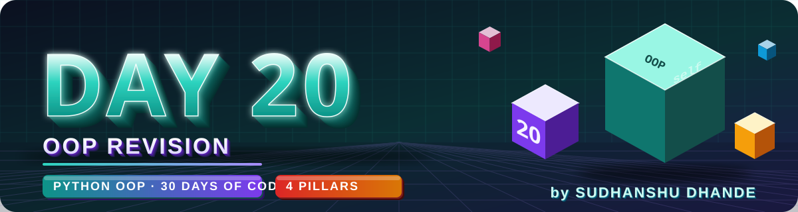
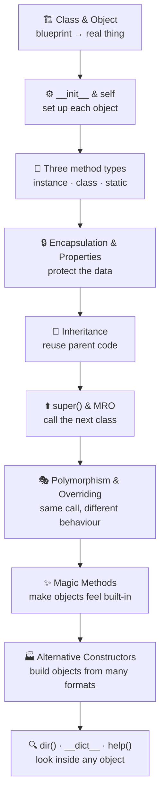
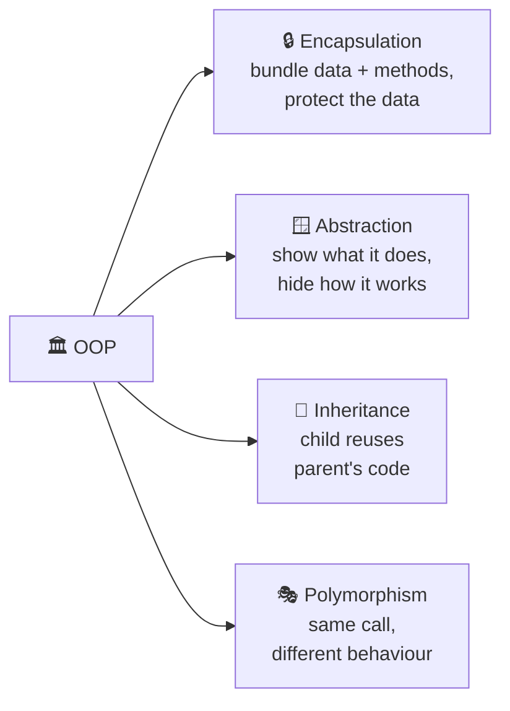
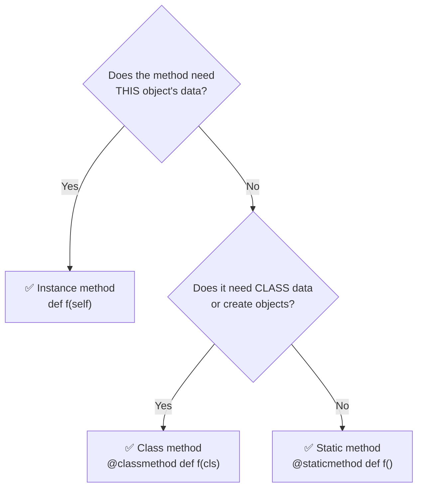
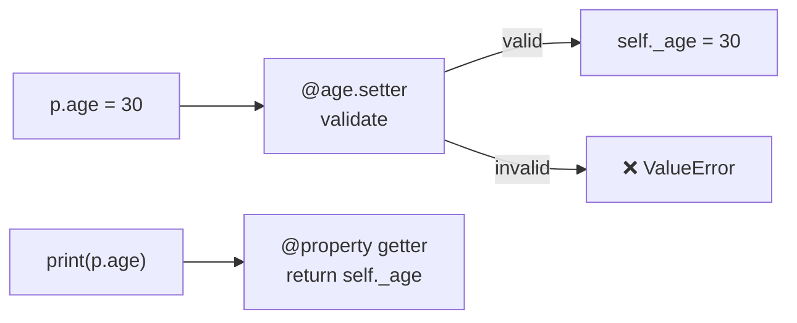
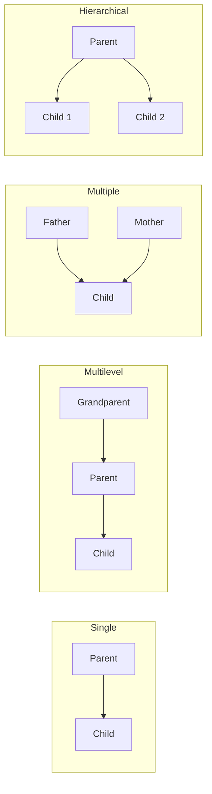
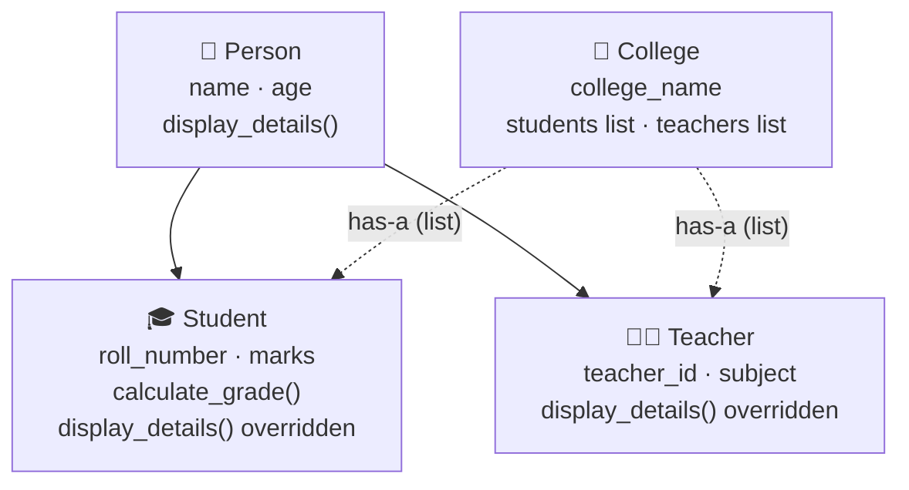
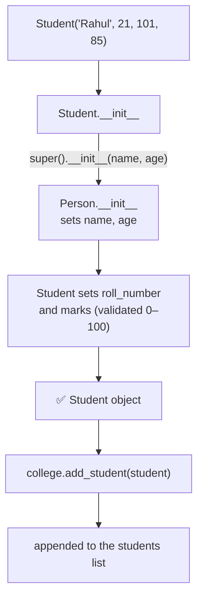

<p align="center">
  
</p>

<p align="center">
  
  
  
  
  
</p>

# 🐍 DAY 20 — Complete Python OOP Revision

## 🎯 Learning Objectives

Today I will revise:

- Classes and Objects
- Constructors (`__init__`)
- Instance Methods
- Class Methods
- Static Methods
- Encapsulation
- Getters, Setters and Properties
- Inheritance
- Multiple and Multilevel Inheritance
- Polymorphism
- Method Overriding
- `super()` Function
- Magic Methods (Dunder Methods)
- Alternative Constructors
- `dir()`, `__dict__`, and `help()`

---

# 📖 Day 20 Concepts — Revise & Connect Everything

> Today is a **revision + project day** (College Management System). Do not just read — **connect the topics**: every concept below is a tool, and the project needs **many tools together**. Run the files in `revision/`, and **explain each one out loud** as if you were teaching a friend.

## 1️⃣ The Big Picture: Your Python OOP Journey



---

## 2️⃣ The Four Pillars of OOP



| Pillar            | One-line meaning                             | Python tool                                   |
| ----------------- | -------------------------------------------- | --------------------------------------------- |
| **Encapsulation** | Keep data **and** its methods together, **protect** the data | `self`, `_x`, `__x`, `@property`  |
| **Abstraction**   | Show **only what is needed**, hide the details | Methods, `len()`, `abc` module              |
| **Inheritance**   | **Reuse** a parent class                     | `class Child(Parent)`, `super()`              |
| **Polymorphism**  | **One interface**, many behaviours           | Overriding, duck typing, operator overloading |

> 💡 **Abstraction in daily life:** you press a button on a remote — you don't need to know the electronics inside. In Python, `len(x)` works without you knowing how it counts.
> *(Extra)* Python's `abc` module lets you **force** child classes to implement a method:
> ```python
> from abc import ABC, abstractmethod
>
> class Shape(ABC):
>     @abstractmethod
>     def area(self): ...
>
> Shape()      # ❌ TypeError — an abstract class cannot be created directly
> ```

> 🧠 *Memory trick: **A-PIE** = **A**bstraction · **P**olymorphism · **I**nheritance · **E**ncapsulation*

---

## 3️⃣ Class, Object, `self` and `__init__`

```python
class Car:
    wheels = 4                              # class variable (shared)

    def __init__(self, brand, speed=0):     # runs when an object is created
        self.brand = brand                  # instance variables (per object)
        self.speed = speed

    def accelerate(self, amount):           # instance method
        self.speed += amount

c1 = Car("Tata")                            # c1 is an OBJECT of the CLASS Car
c1.accelerate(40)
```

| Term              | Meaning                                              | Example                |
| ----------------- | ---------------------------------------------------- | ---------------------- |
| **Class**         | **Blueprint** of an object                           | `Car`                  |
| **Object**        | A **real instance** made from the blueprint          | `c1`                   |
| **`__init__()`**  | Sets up the object's data (runs automatically)       | `Car("Tata")`          |
| **`self`**        | **This object** (the one calling the method)         | `self.brand`           |
| **Attribute**     | A variable of an object                              | `c1.speed`             |
| **Method**        | A function inside a class                            | `c1.accelerate(40)`    |

> 🧠 *Class = cookie cutter · Object = the cookie*

---

## 4️⃣ Instance Variables vs Class Variables

| Instance variable                       | Class variable                              |
| --------------------------------------- | ------------------------------------------- |
| Created with `self.x = ...` in `__init__` | Written directly inside the class body    |
| **Different for every object**          | **Shared by all objects**                   |
| Stored in `obj.__dict__`                | Stored in `Class.__dict__`                  |
| Example: `self.brand`                   | Example: `wheels = 4`                       |

```python
Car.wheels = 6                  # changes it for EVERY car (shared)
c1.wheels = 3                   # creates a NEW instance variable only for c1!
print(c1.wheels, Car.wheels)    # 3 6
```

> ⚠️ Changing a class variable through an **object** (`c1.wheels = 3`) does **not** change the class — it creates a separate variable on that object.

---

## 5️⃣ The Three Method Types



| Type                 | First parameter | Works with                | Typical use                         |
| -------------------- | --------------- | ------------------------- | ----------------------------------- |
| **Instance method**  | `self`          | One object's data         | `display()`, `deposit()`            |
| **Class method**     | `cls`           | Class-level data          | **Alternative constructors**, counters |
| **Static method**    | *(none)*        | Nothing automatically     | Utility / helper (`is_valid(x)`)    |

```python
class Pizza:
    shop = "Pizza Point"

    def describe(self): ...                      # instance → needs a pizza

    @classmethod
    def margherita(cls):                          # class → builds a pizza
        return cls("medium", ["cheese", "tomato"])

    @staticmethod
    def is_valid_size(size):                      # static → plain helper
        return size in ("small", "medium", "large")
```

---

## 6️⃣ Encapsulation (and Name Mangling)

**Encapsulation** = bundle **data + methods** in one class and **control access** to the data.

| Style       | Syntax         | Meaning                                         |
| ----------- | -------------- | ----------------------------------------------- |
| **Public**  | `self.name`    | Anyone can use it                               |
| **Protected** | `self._name` | "Please don't touch" (convention only)          |
| **Private** | `self.__name`  | Python **renames** it → **name mangling**       |

```python
class Wallet:
    def __init__(self, balance):
        self.__balance = balance                 # private

    def get_balance(self):
        return self.__balance

w = Wallet(1000)
print(w.get_balance())                           # 1000
print(w.__balance)                               # ❌ AttributeError
print(w.__dict__)                                # {'_Wallet__balance': 1000}   ← mangled name
```

> 🔑 **Name mangling:** `__balance` inside `Wallet` becomes **`_Wallet__balance`**. It is a **shield against accidents**, not real security — Python trusts the programmer.

---

## 7️⃣ Getters, Setters and `@property`

A **property** lets you use a method like an attribute, **with validation**:

```python
class Person:
    def __init__(self, name, age):
        self.name = name
        self.age = age                           # runs the setter below!

    @property                                    # getter → reading p.age
    def age(self):
        return self._age

    @age.setter                                  # setter → writing p.age = ...
    def age(self, value):
        if not 0 <= value <= 120:
            raise ValueError("Age must be between 0 and 120")
        self._age = value

p = Person("Amit", 25)
p.age = 30            # ✅ setter runs
p.age = -4            # ❌ ValueError
```



> ✅ Why use a property? You keep the **simple syntax** (`p.age`) but gain **protection** and **validation**.

---

## 8️⃣ Inheritance Types



| Type             | Shape                                  | Example                          |
| ---------------- | -------------------------------------- | -------------------------------- |
| **Single**       | One parent → one child                 | `Dog(Animal)`                    |
| **Multilevel**   | A chain: grandparent → parent → child  | `Person → Employee → Developer`  |
| **Multiple**     | One child, **two or more parents**     | `Child(Father, Mother)`          |
| **Hierarchical** | One parent → **many children**         | `Student(Person)`, `Teacher(Person)` |
| **Hybrid**       | A mix of the above                     | Diamond shape                    |

> 🔑 **is-a** relationship: a `Student` **is a** `Person` → use inheritance.
> **has-a** relationship: a `College` **has** students → use a **list of objects** (composition).

---

## 9️⃣ `super()` and MRO — Quick Recap

```python
class Person:
    def __init__(self, name):
        self.name = name

class Employee(Person):
    def __init__(self, name, salary):
        super().__init__(name)             # parent sets name
        self.salary = salary

print([c.__name__ for c in Employee.mro()])    # ['Employee', 'Person', 'object']
```

- **`super()`** = access the **next class in the MRO** (usually the parent).
- **MRO** = the **order Python searches** for a method; **first match wins**; `object` is always **last**.
- Do **not** pass `self` to `super().__init__()`.

---

## 🔟 Polymorphism, Overriding and Overloading

```python
class Animal:
    def sound(self): print("Animal sound")
class Dog(Animal):
    def sound(self): print("Bark")           # overriding
class Cat(Animal):
    def sound(self): print("Meow")

for a in [Dog(), Cat()]:
    a.sound()                                # polymorphism: same call, different result
```

| Method Overriding                       | Method Overloading                              |
| --------------------------------------- | ----------------------------------------------- |
| Child redefines a **parent** method     | Same name, **different parameters**             |
| Needs inheritance                       | No inheritance needed                           |
| **Supported** in Python                 | **Not** supported (last one wins) — use default args / `*args` |

> 🔑 **Overriding** is the *tool*; **polymorphism** is the *result*.

---

## 1️⃣1️⃣ Magic Methods Cheat Sheet

| You write                | Python calls                | Purpose                         |
| ------------------------ | --------------------------- | ------------------------------- |
| `Student(...)`           | `__init__`                  | Set up the object               |
| `print(obj)` / `str(obj)`| `__str__`                   | Readable text for users         |
| `repr(obj)`              | `__repr__`                  | Developer-friendly text         |
| `len(obj)`               | `__len__`                   | Number of items                 |
| `a + b`                  | `__add__`                   | Addition (return a **new** object) |
| `a == b`                 | `__eq__`                    | Equality                        |
| `a < b`                  | `__lt__`                    | Less than                       |
| `x in obj`               | `__contains__`              | Membership                      |

> ⚠️ Never call dunders directly — write `len(cart)`, not `cart.__len__()`.

---

## 1️⃣2️⃣ Alternative Constructors and Introspection — Quick Recap

**Alternative constructor** = a `@classmethod` that builds an object from another format:

```python
@classmethod
def from_string(cls, data):              # "Rahul,85"
    name, marks = data.split(",")
    return cls(name, int(marks))         # convert → validate (in __init__) → build
```

**Introspection tools:**

| Tool            | Question it answers        | Returns              |
| --------------- | -------------------------- | -------------------- |
| `dir(obj)`      | What is **available**?     | List of names        |
| `obj.__dict__`  | What data is **stored**?   | Dictionary           |
| `help(obj)`     | **How** does it work?      | Documentation        |
| `type(obj)`     | What **kind** of object?   | The class            |

---

## 1️⃣3️⃣ Confusing Pairs — Side by Side

| Pair                                   | Difference in one line                                                  |
| -------------------------------------- | ----------------------------------------------------------------------- |
| **Class** vs **Object**                | Blueprint vs the real thing made from it                                |
| **`self`** vs **`cls`**                | This **object** vs this **class**                                       |
| **Instance** vs **class variable**     | Per-object value vs shared value                                        |
| **Class method** vs **static method**  | Gets `cls` (works with the class) vs gets nothing (plain helper)        |
| **Encapsulation** vs **Abstraction**   | **Protect** the data vs **hide** the complexity                         |
| **Overriding** vs **Overloading**      | Child redefines parent's method vs same name with different parameters  |
| **`super()`** vs **direct parent call**| Follows the MRO vs names one specific class                             |
| **`__str__`** vs **`__repr__`**        | For users vs for developers                                             |
| **`dir()`** vs **`__dict__`**          | Available names (list) vs stored values (dictionary)                    |
| **Inheritance** vs **Composition**     | **is-a** (`Student` is a `Person`) vs **has-a** (`College` has students) |

---

## 1️⃣4️⃣ A Worked Example in a Different Domain: `Gym`

To learn how **many concepts work together** without giving away your solution, here is a small **Gym** system using almost everything from this revision. Trace it **before** you read the output.

```python
class Member:
    gym_name = "FitZone"                              # class variable
    _count = 0

    def __init__(self, name, age):                    # constructor
        self.name = name
        self.age = age                                # goes through the setter
        Member._count += 1

    @property
    def age(self):                                    # property (getter)
        return self._age

    @age.setter
    def age(self, value):                             # validation
        if value < 12:
            raise ValueError("Minimum age is 12")
        self._age = value

    @classmethod
    def from_string(cls, data):                       # alternative constructor
        name, age = data.split(",")
        return cls(name.strip(), int(age))

    @staticmethod
    def is_adult(age):                                # static method
        return age >= 18

    def monthly_fee(self):
        return 1000

    def __str__(self):                                # magic method
        return f"{self.name} ({self.age})"


class PremiumMember(Member):                          # inheritance
    def __init__(self, name, age, trainer):
        super().__init__(name, age)                   # super() in constructor
        self.trainer = trainer

    def monthly_fee(self):                            # overriding + super()
        return super().monthly_fee() + 1500

    def __str__(self):
        return f"{super().__str__()} [Premium, trainer: {self.trainer}]"


class Gym:                                            # composition: Gym HAS members
    def __init__(self):
        self.__members = []                           # private (encapsulation)

    def add(self, member):
        self.__members.append(member)

    def show(self):
        for m in self.__members:                      # polymorphism
            print(m, "- fee", m.monthly_fee())

    def __len__(self):
        return len(self.__members)

    def __contains__(self, name):
        return any(m.name == name for m in self.__members)


gym = Gym()
gym.add(Member("Ravi", 25))
gym.add(Member.from_string("Neha, 30"))
gym.add(PremiumMember("Sam", 28, "Kiran"))

gym.show()
print("Members:", len(gym))
print("Is Neha a member?", "Neha" in gym)
print("Is 17 an adult?", Member.is_adult(17))
print("Created so far:", Member._count)

try:
    Member("Kid", 8)
except ValueError as error:
    print("Rejected:", error)
```

**Output:**

```text
Ravi (25) - fee 1000
Neha (30) - fee 1000
Sam (28) [Premium, trainer: Kiran] - fee 2500
Members: 3
Is Neha a member? True
Is 17 an adult? False
Created so far: 3
Rejected: Minimum age is 12
```

| Concept in the `Gym` code                              | Where to use it in your practice / project                  |
| ------------------------------------------------------ | ----------------------------------------------------------- |
| Class variable `gym_name`, counter `_count`            | Q8, Main Challenge (college name)                           |
| `@property` + setter validation                        | Q7, Q6, Main Challenge (marks between 0 and 100)            |
| `@classmethod from_string`                             | Q10                                                         |
| `@staticmethod is_adult`                               | Q9, Main Challenge (grade calculation helper)               |
| `PremiumMember(Member)` + `super()` + overriding       | Q11, Q12, Q15, Q16, Main Challenge                          |
| `Gym` holds a **list** of members                      | Q19, Main Challenge (`College` holds students and teachers) |
| `__str__`, `__len__`, `__contains__`                   | Q17                                                         |
| Loop calling `m.monthly_fee()` on mixed objects        | Q14, Q15 (polymorphism)                                     |

> 🎯 **Your task:** do **not** copy this. Understand **how the pieces fit**, then build your own classes.

---

## 1️⃣5️⃣ Flow: How the College Management System Fits Together





| Design question                                | Hint                                                                    |
| ---------------------------------------------- | ----------------------------------------------------------------------- |
| Student **is a** Person?                       | Yes → **inheritance**                                                   |
| College **has** students?                      | Yes → **list of objects** (composition)                                 |
| Where do name and age get stored?              | In `Person` → child calls `super().__init__()`                          |
| How can `display_details()` avoid repeated lines? | Child calls `super().display_details()` first, then prints its own data |
| How to keep marks valid?                       | Validate in the constructor or a **property setter**                    |
| What should `add_student()` accept?            | Only `Student` objects → check with `isinstance()`                      |
| Where can a **static** method help?            | A helper that converts marks into a grade                               |

---

## 1️⃣6️⃣ Debugging Helper (for Q20)

Q20 asks you to **build your own buggy class** and fix it. Here is a **catalog of typical OOP bugs** to get ideas from:

| #  | Bug                                                   | What you see                                               | Fix                                              |
| -- | ----------------------------------------------------- | ---------------------------------------------------------- | ------------------------------------------------ |
| 1  | Forgot `self` in a method definition                  | `TypeError: takes 0 positional arguments but 1 was given`  | `def show(self):`                                |
| 2  | Wrote `brand = brand` instead of `self.brand = brand` | `AttributeError: no attribute 'brand'`                     | `self.brand = brand`                             |
| 3  | Misspelled `__init__` (e.g. `__int__`)                | Constructor never runs, arguments rejected                 | `__init__`                                       |
| 4  | Forgot `super().__init__()` in the child              | Parent attributes missing                                  | Call `super().__init__(...)`                     |
| 5  | Passed `self` to `super().__init__(self, ...)`        | `TypeError` (too many arguments)                           | `super().__init__(...)`                          |
| 6  | `print()` instead of `return` in `__str__`            | `TypeError: __str__ returned non-string`                   | `return f"..."`                                  |
| 7  | Missing `@classmethod` above a `cls` method           | `TypeError: missing 1 required positional argument`        | Add the decorator                                |
| 8  | Accessed a private attribute from outside             | `AttributeError`                                           | Use a getter / property                          |
| 9  | Used a mutable default (`items=[]`)                   | Objects **share** one list                                 | `items=None` then `self.items = items or []`     |
| 10 | Forgot `return` in a calculation method               | Result is `None`                                           | Add `return`                                     |
| 11 | Compared with `=` instead of `==`                     | `SyntaxError`                                              | Use `==`                                         |
| 12 | Called a method without `()`                          | Prints `<bound method ...>` instead of a value             | `obj.method()`                                   |

**A tiny demo in a different domain (3 bugs):**

```python
class Pen:
    colour = "blue"

    def __init__(self, brand):
        brand = brand                    # Bug 1: should be self.brand = brand

    def write(text):                     # Bug 2: missing self
        print(text)

    def info(self):
        print("Pen:", self.brand)
        return                           # Bug 3: nothing useful is returned


p = Pen("Cello")
p.write("Hello")                         # TypeError
p.info()                                 # AttributeError
```

> 🎯 For Q20, write **your own** class with **at least five** such mistakes, then explain each error and fix it.

---

## 1️⃣7️⃣ Testing Checklist

| Test case                                               | What should happen                                    |
| ------------------------------------------------------- | ----------------------------------------------------- |
| Create a `Student` and a `Teacher`                      | Each shows its own details (name and age from `Person`) |
| Marks **-5**, **101** and **abc**                       | Rejected with a clear message                         |
| Marks **0** and **100** (boundary values)               | Accepted                                              |
| Grade for each range of marks                           | Correct grade every time                              |
| `display_details()` on a `Student` vs a `Teacher`       | Different output (method overriding)                  |
| Loop over a **mixed** list of people                    | Each object prints its own style (polymorphism)       |
| Add **several** students and teachers                   | Lists grow; counts are correct                        |
| Display a college with **no** students                  | Friendly message, no crash                            |
| Add something that is **not** a `Student`               | Rejected (`isinstance` check)                         |
| Two colleges (if created)                               | Their lists stay **separate**                         |
| Access a private attribute from outside                 | `AttributeError`, so access goes through a method     |

---

## 1️⃣8️⃣ Common Mistakes (Avoid These!)

| ❌ Mistake                                                          | ✅ Fix                                                              |
| ------------------------------------------------------------------ | ------------------------------------------------------------------ |
| Forgetting `self` in method definitions and attribute assignments   | `def show(self)` and `self.name = name`                            |
| Forgetting `super().__init__()` in a child class                    | Always initialize the parent's data                                |
| Confusing `self` and `cls`                                          | `self` = object · `cls` = class                                    |
| Using instance data inside a `@staticmethod`                        | Static methods have no `self` — use an instance method             |
| Changing a class variable through an object                         | Change it through the class: `Car.wheels = 6`                      |
| Mutable default arguments (`items=[]`)                              | Use `None` and create a new list inside                            |
| `print()` instead of `return` in `__str__`                          | **Return** the string                                              |
| `__add__` that modifies `self`                                      | Return a **new** object                                            |
| Overriding with a different method name or parameters               | Keep the **same name and parameters**                              |
| Using inheritance when the relationship is **has-a**                | Use a list of objects (composition)                                |
| Putting all code in one huge class                                  | One class = one job (`Person`, `Student`, `Teacher`, `College`)    |
| Skipping validation                                                 | Validate in `__init__` or a property setter                        |
| Copy-pasting solutions                                              | Explain the logic **before** writing code                          |

---

## 1️⃣9️⃣ Step-by-Step Build Plan

```text
Step 1  →  Revise     Run every file inside revision/ and explain the output aloud
Step 2  →  Q1–Q5      Basic classes (Student, BankAccount, Employee, Circle, Product)
Step 3  →  Q6–Q7      Encapsulation and @property with validation
Step 4  →  Q8–Q10     Class method, static method, alternative constructor
Step 5  →  Q11–Q13    Inheritance: single, multilevel, multiple
Step 6  →  Q14–Q15    Polymorphism and method overriding
Step 7  →  Q16        super() at every level (Person → Employee → Manager)
Step 8  →  Q17–Q18    Magic methods and operator overloading
Step 9  →  Q19        A class that holds a list (Library)
Step 10 →  Q20        Build a buggy class → find and fix at least 5 mistakes
Step 11 →  Main challenge: Person → Student / Teacher → College
Step 12 →  Test valid and invalid marks, empty lists, mixed objects
Step 13 →  Answer the theory and interview questions in your own words
Step 14 →  Update README, push everything to GitHub 🎉
```

---

## 📌 Day 20 in One Look

```text
Class            →  Blueprint · Object → real instance
__init__ / self  →  Set up the object / this object
Instance method  →  self  → works with one object
Class method     →  cls   → works with the class; alternative constructors
Static method    →  no self, no cls → utility helper
Class variable   →  Shared by all · Instance variable → per object
Encapsulation    →  Bundle data + methods; _protected, __private (name mangling)
Property         →  @property getter + @x.setter with validation
Abstraction      →  Hide complexity, show only what is needed
Inheritance      →  Child reuses parent · single, multilevel, multiple, hierarchical
super()          →  Next class in the MRO · super().__init__(...) (no self)
MRO              →  Search order · Class.mro() · object is last
Polymorphism     →  Same call · different behaviour
Overriding       →  Child redefines parent's method · Overloading is not supported
Magic methods    →  __init__ __str__ __repr__ __len__ __add__ __eq__ __lt__ __contains__
Alt constructor  →  @classmethod from_xxx(cls, data) → return cls(...)
Introspection    →  dir() names · __dict__ values · help() docs · type() kind
is-a / has-a     →  Inheritance / list of objects (composition)
Pillars          →  A-PIE: Abstraction · Polymorphism · Inheritance · Encapsulation
```

---

## 🎯 Part 1 — Complete OOP Concepts Revision

| No. | Concept           | Important Point                         |
| --- | ----------------- | --------------------------------------- |
| 1   | Class             | Blueprint of an object                  |
| 2   | Object            | Instance of a class                     |
| 3   | `__init__()`      | Initializes object attributes           |
| 4   | `self`            | Refers to the current object            |
| 5   | Instance Method   | Works with instance data                |
| 6   | Class Method      | Works with class-level data             |
| 7   | Static Method     | Utility method inside a class           |
| 8   | Encapsulation     | Bundles data and methods                |
| 9   | Inheritance       | Reuses parent class functionality       |
| 10  | Polymorphism      | Same interface, different behavior      |
| 11  | Method Overriding | Child redefines parent method           |
| 12  | `super()`         | Accesses the next class in MRO          |
| 13  | Magic Methods     | Special methods with double underscores |
| 14  | Property          | Controls attribute access               |
| 15  | MRO               | Method Resolution Order                 |

## 🧠 Part 2 — Quick Revision Examples

### 1. Class and Object

```python
class Student:
    def __init__(self, name):
        self.name = name

s1 = Student("Rahul")
print(s1.name)
```

### 2. Class Method

```python
class Student:
    college = "KCEM"

    @classmethod
    def change_college(cls, name):
        cls.college = name
```

### 3. Static Method

```python
class Calculator:
    @staticmethod
    def add(a, b):
        return a + b
```

### 4. Encapsulation

```python
class Bank:
    def __init__(self, balance):
        self.__balance = balance

    def get_balance(self):
        return self.__balance
```

### 5. Inheritance

```python
class Animal:
    def sound(self):
        print("Animal sound")

class Dog(Animal):
    pass
```

### 6. Polymorphism

```python
class Dog:
    def sound(self):
        print("Bark")

class Cat:
    def sound(self):
        print("Meow")
```

### 7. Method Overriding

```python
class Parent:
    def show(self):
        print("Parent")

class Child(Parent):
    def show(self):
        print("Child")
```

### 8. super()

```python
class Parent:
    def show(self):
        print("Parent")

class Child(Parent):
    def show(self):
        super().show()
        print("Child")
```

### 9. Magic Methods

```python
class Book:
    def __init__(self, title):
        self.title = title

    def __str__(self):
        return self.title
```

---

## 📝 Part 3 — Theory Revision Questions (20)

1. What is a class in Python?
2. What is an object?
3. What is the purpose of `self`?
4. What is a constructor?
5. What is the difference between instance and class variables?
6. What is the difference between class methods and static methods?
7. What is encapsulation?
8. What is name mangling?
9. What is inheritance?
10. What are the different types of inheritance?
11. What is polymorphism?
12. What is method overriding?
13. What is the purpose of `super()`?
14. What is MRO?
15. What is the difference between `__str__()` and `__repr__()`?
16. What are magic methods?
17. What is a property decorator?
18. What is an alternative constructor?
19. What are `dir()`, `__dict__`, and `help()`?
20. What is the difference between method overriding and overloading?

---

## 💻 Part 4 — Practical Revision Problems (20)

### 🟢 Level 1 — Basic OOP

**Q1. Student Class**

Create a Student class with name, roll number, and marks. Display all details.

**Q2. Bank Account**

Create a BankAccount class with deposit, withdraw, and balance methods.

**Q3. Employee**

Create an Employee class with name and salary. Calculate annual salary.

**Q4. Circle**

Create a Circle class with radius. Calculate area and circumference.

**Q5. Product**

Create a Product class with name, price, and quantity. Calculate total price.

### 🟡 Level 2 — Intermediate OOP

**Q6. Encapsulation**

Create a BankAccount class with a private balance. Implement deposit and withdraw methods with validation.

**Q7. Property Decorator**

Create a Temperature class with a Celsius property and validation.

**Q8. Class Method**

Create a Student class with a class variable `college`. Use a class method to update the college name.

**Q9. Static Method**

Create a Calculator class with static methods for addition, subtraction, multiplication, and division.

**Q10. Alternative Constructor**

Create an Employee class with a `from_string()` class method that creates an employee from a string.

### 🔴 Level 3 — Advanced OOP

**Q11. Inheritance**

Create a Person class and inherit Student and Teacher classes.

**Q12. Multilevel Inheritance**

Create Person → Employee → Developer classes.

**Q13. Multiple Inheritance**

Create Father and Mother classes. Inherit both into a Child class.

**Q14. Polymorphism**

Create a Payment parent class and UPI, Card, and Cash payment classes with different payment methods.

**Q15. Method Overriding**

Create an Animal class and override its sound method in Dog, Cat, and Cow.

**Q16. super()**

Create Person → Employee → Manager classes. Use `super()` at every inheritance level.

**Q17. Magic Methods**

Create a ShoppingCart class using `__str__()`, `__len__()`, `__add__()`, and `__contains__()`.

**Q18. Operator Overloading**

Create a Vector class and overload the `+` operator.

**Q19. Collections in Classes**

Create a Library class that stores books in a list. Add, remove, search, and display books.

**Q20. Debugging Challenge**

Create a class containing at least five intentional mistakes. Identify and correct all mistakes.

---

## 🏆 Part 5 — Main Challenge: College Management System

Build a complete College Management System using Python OOP.

### Required Classes

**1. Person**

- name
- age
- display_details()

**2. Student (inherits Person)**

- roll_number
- marks
- calculate_grade()
- display_details()

**3. Teacher (inherits Person)**

- teacher_id
- subject
- display_details()

**4. College**

- college_name
- students list
- teachers list
- add_student()
- add_teacher()
- display_students()
- display_teachers()

### Requirements

1. Use classes and objects.
2. Use constructors.
3. Apply inheritance.
4. Use `super()`.
5. Apply encapsulation where appropriate.
6. Use method overriding.
7. Use class or static methods where useful.
8. Store multiple students and teachers using lists.
9. Validate student marks between 0 and 100.
10. Display complete college information.

### Expected Output

```text
===== COLLEGE MANAGEMENT SYSTEM =====

College Name: KCEM

===== STUDENT DETAILS =====
Name: Rahul
Age: 21
Roll Number: 101
Marks: 85
Grade: A

===== TEACHER DETAILS =====
Name: Amit
Age: 35
Teacher ID: T101
Subject: Python

Total Students: 1
Total Teachers: 1
```

---

## 🎤 Part 6 — OOP Interview Questions (with Short Answers)

> Try to answer each question yourself first, then compare with the short answer. Each answer is kept **simple and short** so it is easy to remember. 🧠 = memory trick.

### 1. What are the four pillars of OOP?

**Answer:** **Encapsulation, Abstraction, Inheritance, Polymorphism.**

🧠 *A-PIE: **A**bstraction · **P**olymorphism · **I**nheritance · **E**ncapsulation*

---

### 2. What is the difference between a class and an object?

**Answer:** A **class** is the **blueprint**; an **object** is a **real instance** created from it.

```python
s1 = Student("Rahul")      # Student = class · s1 = object
```

🧠 *Class = cookie cutter · Object = cookie*

---

### 3. What is the difference between `self` and `cls`?

**Answer:**

| `self`                       | `cls`                              |
| ---------------------------- | ---------------------------------- |
| Refers to the **object**     | Refers to the **class**            |
| Instance methods             | Class methods (`@classmethod`)     |

🧠 *self = this object · cls = this class*

---

### 4. What is the difference between instance and class variables?

**Answer:** **Instance variables** (`self.x`) are **different for each object**. **Class variables** (written in the class body) are **shared by all objects**.

```python
class Car:
    wheels = 4                 # class variable
    def __init__(self, brand):
        self.brand = brand     # instance variable
```

🧠 *Instance = mine · Class = ours*

---

### 5. Why do we use constructors?

**Answer:** To **set up an object's attributes automatically** at the moment it is created — so every object starts in a valid state.

```python
Student("Rahul", 85)           # __init__ runs automatically
```

🧠 *Object born → `__init__` runs*

---

### 6. What is encapsulation?

**Answer:** **Bundling data and methods in one class and protecting the data** (using `_protected`, `__private` and properties), so it can only be changed in a controlled way.

```python
self.__balance = balance       # private, changed only via methods
```

🧠 *Capsule: data inside, methods are the door*

---

### 7. What is abstraction?

**Answer:** **Showing only what is necessary and hiding how it works.** The user calls a method without knowing the details inside.

```python
len("hello")                   # you don't know HOW it counts, and don't need to
```

🧠 *Abstraction = hide the complexity*

---

### 8. What is inheritance?

**Answer:** A **child class reuses the attributes and methods of a parent class**. Types: single, multilevel, multiple, hierarchical.

```python
class Dog(Animal): ...
```

🧠 *Child gets the parent's things for free*

---

### 9. What is polymorphism?

**Answer:** **One interface, many behaviours** — the same method call works differently depending on the object.

```python
for a in [Dog(), Cat()]:
    a.sound()                  # Bark, Meow
```

🧠 *Poly = many · morph = forms*

---

### 10. What is method overriding?

**Answer:** A **child class redefines a method it inherited**, so the child's version is used.

```python
class Dog(Animal):
    def sound(self):           # overrides Animal.sound
        print("Bark")
```

🧠 *Same name · new behaviour*

---

### 11. What is the use of `super()`?

**Answer:** It gives access to the **next class in the MRO** (usually the parent), so you can **reuse the parent's constructor or method** without writing its name.

```python
super().__init__(name)
```

🧠 *super() = ask the class above to do its part*

---

### 12. What is MRO?

**Answer:** **Method Resolution Order** — the **order Python searches classes** for a method. See it with `Class.mro()`. `object` is always last.

🧠 *MRO = search order*

---

### 13. What are magic methods?

**Answer:** **Special methods with double underscores** (`__init__`, `__str__`, `__len__`, `__add__`) that **Python calls automatically** to define how objects behave.

```python
len(cart)                      # Python calls cart.__len__()
```

🧠 *You write the syntax · Python calls the dunder*

---

### 14. What is the difference between `__str__()` and `__repr__()`?

**Answer:** **`__str__`** gives **user-friendly** text (`print`). **`__repr__`** gives **developer-friendly, unambiguous** text (`repr`, console, lists).

```python
print(s1)        # Rahul scored 85
repr(s1)         # Student('Rahul', 85)
```

🧠 *str = for users · repr = for developers*

---

### 15. How is OOP useful in real-world applications?

**Answer:** It **models real things as objects**, so code is **organized, reusable, easier to maintain and easier to extend** — used in banking systems, shopping apps, games, school and college systems, and big libraries.

🧠 *Organize · reuse · grow*

---

### ⚡ 10-Second Revision

```text
1. Four pillars      → Encapsulation, Abstraction, Inheritance, Polymorphism (A-PIE)
2. Class vs object   → Blueprint vs real instance
3. self vs cls       → This object vs this class
4. Instance vs class variable → Per object vs shared by all
5. Constructor       → Sets up object data automatically
6. Encapsulation     → Bundle data + methods, protect the data
7. Abstraction       → Hide complexity, show what is needed
8. Inheritance       → Child reuses the parent's code
9. Polymorphism      → Same call, different behaviour
10. Overriding       → Child redefines a parent method
11. super()          → Next class in MRO (reuse parent code)
12. MRO              → Method search order
13. Magic methods    → Double-underscore methods called by Python
14. __str__ vs __repr__ → User-friendly vs developer-friendly
15. OOP in real life → Organized, reusable, maintainable code
```

---

## 📁 Part 7 — GitHub Folder Structure

```text
Day20_OOP_Revision/
│
├── banner.svg
├── README.md
│
├── revision/
│   ├── basic_oop.py
│   ├── encapsulation.py
│   ├── inheritance.py
│   ├── polymorphism.py
│   ├── class_static_methods.py
│   └── magic_methods.py
│
├── practice/
│   └── revision_questions.py
│
└── project/
    ├── college_management.py
    
```

### File Responsibilities

- `banner.svg` — the Day 20 banner shown at the top of this README.
- `revision/basic_oop.py` — class, object, `self`, instance vs class variables.
- `revision/encapsulation.py` — public / protected / private, name mangling, property.
- `revision/inheritance.py` — single, multilevel, multiple, hierarchical, `super()`, MRO.
- `revision/polymorphism.py` — overriding, duck typing, built-in polymorphism.
- `revision/class_static_methods.py` — instance, class and static methods.
- `revision/magic_methods.py` — `__str__`, `__repr__`, `__add__`, `__eq__`, `__lt__`, `__len__`, `__contains__`.
- `practice/revision_questions.py` — solutions to Q1–Q20.
- `project/college_management.py` — `Person`, `Student`, `Teacher`, `College` classes.


**Beginner tip:** First run each file in `revision/` and explain the output out loud. Then solve Q1–Q20 **without looking** at the examples, and finally build the College Management System.

## 📊 Part 8 — Day 20 Target

| Task                | Target |
| ------------------- | -----: |
| Theory Questions    |     20 |
| Practical Questions |     20 |
| Interview Questions |     15 |
| Main Challenge      |      1 |
| GitHub Update       |      1 |

## 🚫 Rules

- Attempt every problem independently.
- Do not copy complete solutions.
- Explain the logic **before** writing code.
- Use meaningful class and method names.
- Validate data and test with valid **and** invalid inputs.
- Keep each class focused on **one job**.

## ✅ Part 9 — Completion Checklist

- [ ] Revised all OOP concepts.
- [ ] Answered 20 theory questions.
- [ ] Solved 20 practical problems.
- [ ] Practised inheritance and polymorphism.
- [ ] Practised method overriding and `super()`.
- [ ] Revised magic methods.
- [ ] Completed College Management System.
- [ ] Prepared interview answers.
- [ ] Updated GitHub README.
- [ ] Pushed all work to GitHub.

## 🚀 GitHub Commit

```bash
git add .
git status
git commit -m "Day 20: Complete Python OOP revision"
git push
```

**Day 20 Goal:** Build strong OOP fundamentals, solve problems independently, and become confident in Python OOP interviews.

---

<p align="center">
  
</p>

<h3 align="center"><b>Sudhanshu Dhande</b></h3>
<p align="center"><i>B.Tech (AI &amp; ML) · BATU, Lonere · Python OOP Journey</i></p>