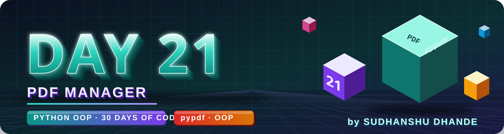
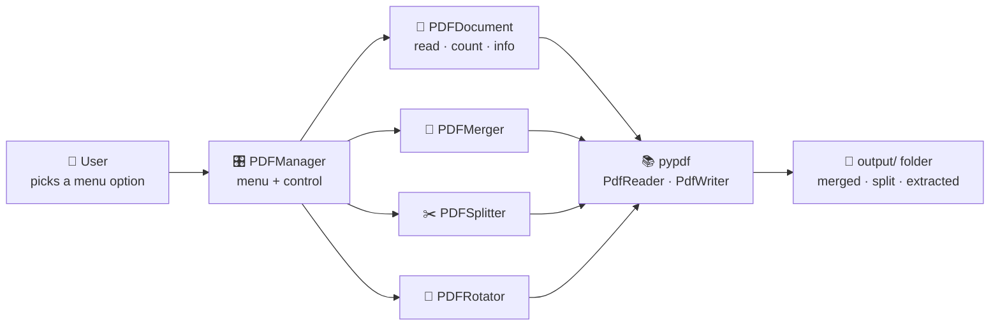
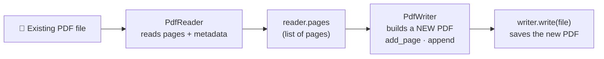
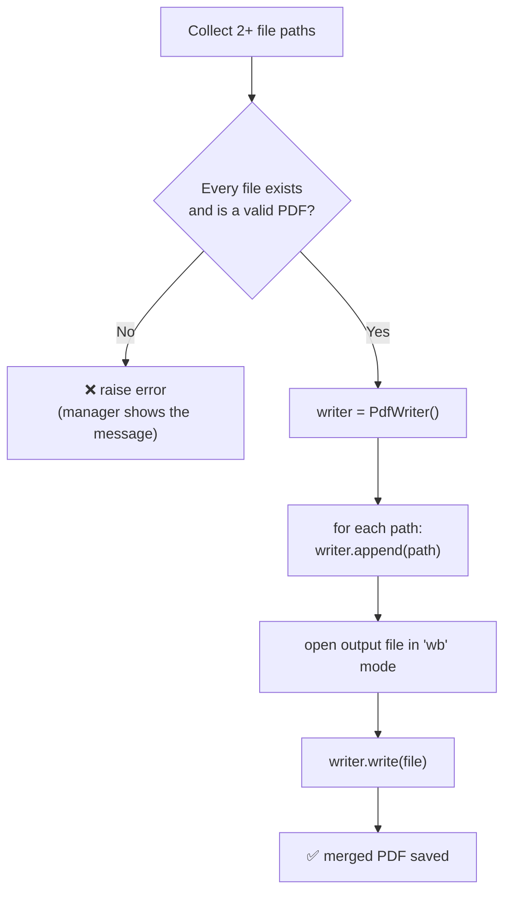
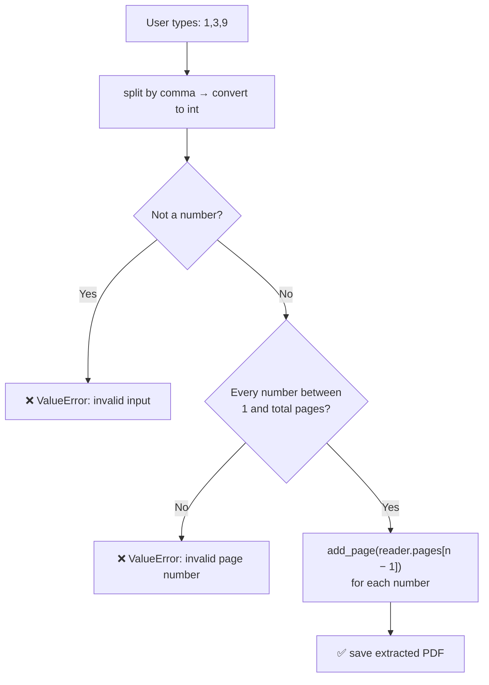
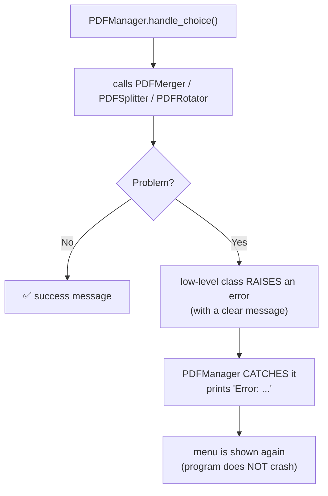
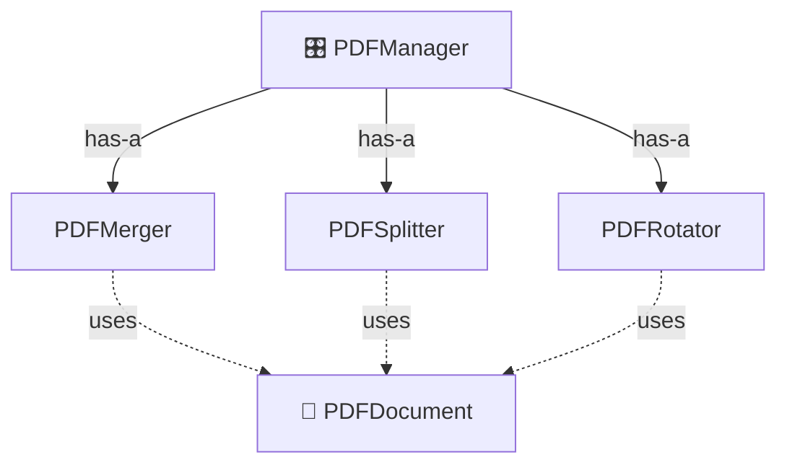
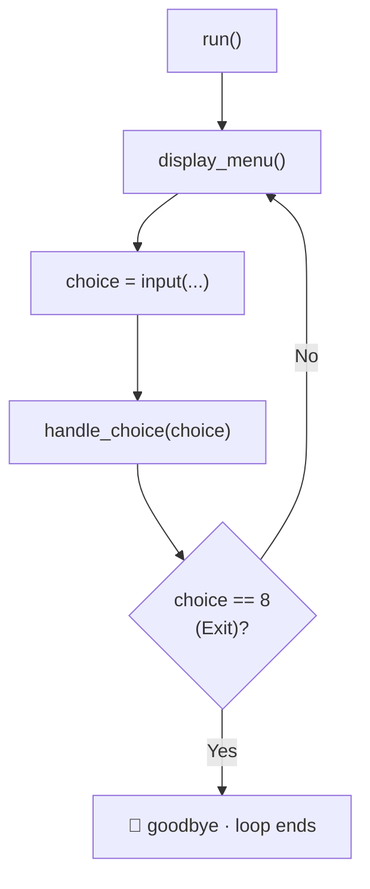

<p align="center">
  
</p>

<p align="center">
  
  
  
  
  
</p>

# 🐍 DAY 21 — Python OOP: PDF Management System

## 🎯 Project Objective

Build a PDF Management System using Python and Object-Oriented Programming.

The application will allow users to:

- Create PDF files.
- Merge multiple PDF files.
- Split PDF pages.
- Extract selected pages.
- Rotate PDF pages.
- Count PDF pages.
- Get basic PDF information.
- Handle invalid files and errors.

---

# 📖 Day 21 Concepts — Read & Understand First

> Today is a **full project day**. There are **no new OOP rules** — you now **use** everything from Days 1–20 in a real application. Read this section, run the small examples, and make **every design decision on paper before you code**.
> *(Code in this section was tested with **pypdf 5.x**. Old tutorials use `PyPDF2` / `PdfFileReader` — those names are outdated.)*

## 1️⃣ What Are We Building?



| Menu option       | What it does                         | pypdf tools used                 |
| ----------------- | ------------------------------------ | -------------------------------- |
| 1. Create PDF     | PDF from text typed by the user      | *(needs another library — see 1️⃣1️⃣)* |
| 2. Merge PDFs     | Many PDFs → one PDF                  | `PdfWriter.append()`             |
| 3. Split PDF      | One PDF → one file per page          | `PdfReader.pages`, `add_page()`  |
| 4. Extract Pages  | Pick some pages → new PDF            | `pages[index]`, `add_page()`     |
| 5. Rotate PDF     | Turn selected pages 90 / 180 / 270°  | `page.rotate()`                  |
| 6. Count Pages    | Total number of pages                | `len(reader.pages)`              |
| 7. PDF Information| Name, pages, size, metadata          | `reader.metadata`, `os.path`     |

---

## 2️⃣ Which OOP Concepts Will You Use?

| Concept you learned          | Where it appears in this project                              |
| ---------------------------- | ------------------------------------------------------------- |
| Classes & objects            | `PDFDocument`, `PDFMerger`, `PDFSplitter`, `PDFRotator`, `PDFManager` |
| Constructor `__init__`       | `PDFDocument(file_path)` validates and stores the path        |
| Encapsulation (private)      | `self.__file_path` + a read-only `@property`                  |
| Instance methods             | `count_pages()`, `merge_pdfs()`, `rotate_pdf()` ...           |
| Composition (**has-a / uses**)| `PDFManager` has a merger, splitter, rotator; they **use** `PDFDocument` |
| Inheritance (**is-a**)       | Only where a class is truly *a kind of* another (decide carefully!) |
| Exception handling           | `try / except` around every PDF operation                     |
| Static / class methods       | Helper such as "format file size" (optional)                  |
| Magic methods (optional)     | `__str__` for a printable PDF summary, `__len__` for page count |

---

## 3️⃣ Project Setup (Task 1)

```bash
# 1. Create the folders
mkdir Day21_PDF_Management_System
cd Day21_PDF_Management_System

# 2. Create and activate a virtual environment
python -m venv venv
venv\Scripts\activate            # Windows
source venv/bin/activate         # macOS / Linux

# 3. Install the library
pip install pypdf

# 4. Save the dependencies
pip freeze > requirements.txt
```

```text
requirements.txt  →  pypdf==5.9.0        (your version number may differ)
```

**Folders for the output files:**

```python
import os
os.makedirs("output/merged", exist_ok=True)       # exist_ok=True → no error if it already exists
os.makedirs("output/split", exist_ok=True)
os.makedirs("output/extracted", exist_ok=True)
```

> 💡 Add a **`.gitignore`** file so GitHub does not store your virtual environment:
> ```text
> venv/
> __pycache__/
> *.pyc
> ```

---

## 4️⃣ File Handling Basics

| Task                          | Code                                      | Note                                   |
| ----------------------------- | ----------------------------------------- | -------------------------------------- |
| Does the **path exist**?      | `os.path.exists(path)`                    | File **or** folder                     |
| Is it a **file**?             | `os.path.isfile(path)`                    | Better check for our project           |
| Get the **file name**         | `os.path.basename(path)`                  | `"data/sample.pdf"` → `"sample.pdf"`   |
| Get the **file size** (bytes) | `os.path.getsize(path)`                   | Divide by 1024 for KB                  |
| Check the **extension**       | `path.lower().endswith(".pdf")`           | Quick format check                     |
| Create a folder               | `os.makedirs(folder, exist_ok=True)`      | Creates parent folders too             |
| Open a file safely            | `with open(path, "rb") as f:`             | `with` closes the file automatically   |

| Mode  | Meaning                  | Use for                          |
| ----- | ------------------------ | -------------------------------- |
| `"r"` / `"w"`   | Read / write **text**      | `.txt`, `.csv`                 |
| `"rb"` / `"wb"` | Read / write **binary**    | **PDF files** ✅               |

> ⚠️ PDF files are **binary**. Writing a PDF with `"w"` (text mode) **corrupts** it — always use **`"wb"`**.

---

## 5️⃣ PDF and pypdf — Reader vs Writer



| Class / member       | Purpose                                | Think of it as…                   |
| -------------------- | -------------------------------------- | --------------------------------- |
| `PdfReader(path)`    | **Read** an existing PDF               | Opening a book                    |
| `PdfWriter()`        | **Create** a new PDF                   | A blank notebook                  |
| `reader.pages`       | List of all pages (index starts at **0**) | The pages of the book          |
| `len(reader.pages)`  | **Count** pages                        | Page count                        |
| `writer.add_page(p)` | Put **one page** into the new PDF      | Paste a page                      |
| `writer.append(path)`| Put **all pages** of a PDF into the new PDF | Paste a whole book           |
| `writer.write(f)`    | **Save** the new PDF to a file object  | Close the notebook                |
| `page.rotate(angle)` | **Turn** a page clockwise              | Rotate a sheet                    |

> ⚠️ **About `merge()` in your table:** `page.merge_page(other_page)` **overlays** one page on top of another (e.g., a watermark). To **combine files**, use **`append()`** or a loop with **`add_page()`**.

---

## 6️⃣ Reading a PDF: Count, Metadata, Text

```python
import os
from pypdf import PdfReader

reader = PdfReader("data/sample.pdf")

print(len(reader.pages))                       # 3   → number of pages
print(reader.pages[1].extract_text())          # text of the 2nd page (index 1)
print(reader.is_encrypted)                     # False
print(os.path.getsize("data/sample.pdf"))      # size in bytes

info = reader.metadata                         # can be None if the PDF has no metadata!
if info:
    print(info.title, info.author)             # fields can be None too
```

> ⚠️ `reader.metadata` may be **`None`**. Always check before using `.title` / `.author`.
> ⚠️ **Page numbers:** users count from **1**, Python lists start at **0** → use `reader.pages[number - 1]`.

---

## 7️⃣ Merge PDFs (Task 3)

```python
from pypdf import PdfWriter

writer = PdfWriter()
for path in ["data/a.pdf", "data/b.pdf"]:
    writer.append(path)                        # adds ALL pages of that file, in order

with open("output/merged/merged.pdf", "wb") as f:    # "wb" = write binary
    writer.write(f)
```



> 🔑 **The order of the paths = the order of the pages** in the merged file.

---

## 8️⃣ Split a PDF (Task 4)

```python
from pypdf import PdfReader, PdfWriter

reader = PdfReader("data/sample.pdf")

for number, page in enumerate(reader.pages, start=1):     # start=1 → page numbers 1, 2, 3...
    writer = PdfWriter()                                   # a NEW writer for EACH page
    writer.add_page(page)
    with open(f"output/split/page_{number}.pdf", "wb") as f:
        writer.write(f)
```

```text
sample.pdf (3 pages)  →  output/split/page_1.pdf
                         output/split/page_2.pdf
                         output/split/page_3.pdf
```

> ⚠️ Create a **new `PdfWriter` inside the loop**. Re-using one writer would pile **all pages** into every file.

---

## 9️⃣ Extract Selected Pages (Task 5)

```python
from pypdf import PdfReader, PdfWriter

reader = PdfReader("data/sample.pdf")
selected = [1, 3]                                  # page numbers typed by the user (1-based)

writer = PdfWriter()
for number in selected:
    writer.add_page(reader.pages[number - 1])      # convert to 0-based index

with open("output/extracted/extracted.pdf", "wb") as f:
    writer.write(f)
```



> ✅ **Validate before extracting.** Without a check, `reader.pages[10]` raises `IndexError` on a 3-page PDF.
> 🎁 *Bonus idea:* also accept ranges such as `2-4`.

---

## 🔟 Rotate Pages (Task 6)

```python
from pypdf import PdfReader, PdfWriter

reader = PdfReader("data/sample.pdf")
writer = PdfWriter()

for index, page in enumerate(reader.pages):
    if index == 1:                                  # rotate only page 2
        page.rotate(90)                             # 90 = clockwise
    writer.add_page(page)                           # keep ALL pages in the new file

with open("output/rotated.pdf", "wb") as f:
    writer.write(f)
```

| Fact                                               | Meaning                                            |
| -------------------------------------------------- | -------------------------------------------------- |
| `page.rotate(angle)` turns the page **clockwise**  | `90` = quarter turn · `180` = upside down · `270` = quarter turn the other way |
| The angle must be a **multiple of 90**             | `page.rotate(95)` → `ValueError`                   |
| Your project allows only **90, 180, 270**          | **Validate** the angle yourself first              |
| Rotation changes the page **in memory**            | You must **write a new file** to keep it           |
| **Never overwrite the original** by accident       | Save to a new file name or the `output/` folder    |

> 💡 Add an `output/rotated/` folder too — your folder structure has `merged`, `split` and `extracted`, but not `rotated`.

---

## 1️⃣1️⃣ Create a PDF from Text (Important Note!)

⚠️ **`pypdf` cannot write text onto a page.** It can only read, copy, merge, split and rotate pages (and add blank pages). To **create a PDF from typed text**, install a second library — for example **`reportlab`**:

```bash
pip install reportlab
```

```python
from reportlab.lib.pagesizes import A4
from reportlab.pdfgen import canvas

def create_pdf(text, output_path):
    pdf = canvas.Canvas(output_path, pagesize=A4)
    width, height = A4
    y = height - 50                                  # start near the top
    for line in text.splitlines():
        if y < 50:                                   # page full → new page
            pdf.showPage()
            y = height - 50
        pdf.drawString(50, y, line)                  # draw one line of text
        y -= 20                                      # move down for the next line
    pdf.save()

create_pdf("Hello PDF\nSecond line", "output/hello.pdf")
```

| Limit of this simple code                | Remember                                           |
| ---------------------------------------- | -------------------------------------------------- |
| `drawString` does **not wrap** long lines | Split long lines yourself (bonus)                  |
| Default font supports **Latin letters only** | Hindi / Marathi text needs a special font       |
| Add `reportlab` to **`requirements.txt`**| So others can run the project                      |

> 🎯 In your README, mention that **Create PDF uses `reportlab`** and all other features use `pypdf`.

---

## 1️⃣2️⃣ PDF Information (Task 2)

```python
import os
from pypdf import PdfReader

path = "data/sample.pdf"
reader = PdfReader(path)

print("File name :", os.path.basename(path))
print("Pages     :", len(reader.pages))
print("Size      :", round(os.path.getsize(path) / 1024, 2), "KB")

meta = reader.metadata
print("Title     :", meta.title if meta and meta.title else "Not available")
print("Author    :", meta.author if meta and meta.author else "Not available")
```

| Information   | Source                          | Watch out for                          |
| ------------- | ------------------------------- | -------------------------------------- |
| File name     | `os.path.basename(path)`        | —                                      |
| Total pages   | `len(reader.pages)`             | Encrypted PDFs need `reader.decrypt(password)` first |
| File size     | `os.path.getsize(path)`         | Bytes → KB: divide by `1024`           |
| Metadata      | `reader.metadata`               | May be **`None`**, fields may be `None`|

---

## 1️⃣3️⃣ Exception Handling (Task 7)

| Problem                          | What Python / pypdf raises                              | Your handling                              |
| -------------------------------- | ------------------------------------------------------- | ------------------------------------------ |
| **Empty file path**              | *(nothing automatic)* → `FileNotFoundError` on `""`      | Check first, raise `ValueError("File path cannot be empty")` |
| **Missing file**                 | `FileNotFoundError`                                     | Friendly message, ask again                |
| **Path is a folder**             | `IsADirectoryError`                                     | Use `os.path.isfile()` first               |
| **Invalid PDF file** (fake `.pdf`) | `pypdf.errors.PdfReadError` (or its child `PdfStreamError`) | `except PdfReadError:`                |
| **Invalid page number**          | `IndexError` if you just index blindly                  | **Validate range** and raise `ValueError`  |
| **Invalid rotation angle**       | `ValueError` for non-multiples of 90                    | Allow only `90, 180, 270` yourself         |
| **PermissionError**              | Read-only folder, or the PDF is **open in another program** (common on Windows) | Ask the user to close the file |

```python
from pypdf import PdfReader
from pypdf.errors import PdfReadError

try:
    reader = PdfReader("data/sample.pdf")
except FileNotFoundError:
    print("Error: file not found")
except PdfReadError:
    print("Error: this is not a valid PDF")
except PermissionError:
    print("Error: permission denied — close the file and try again")
```



> 🔑 **Good design:** the PDF classes **raise** errors; the **manager catches** them and talks to the user. This keeps `print` / `input` in **one place**.
> 🎁 *Extra:* make your own error class: `class PDFError(Exception): pass`.

---

## 1️⃣4️⃣ OOP Design: Inheritance or Composition?

Your project note says: **decide which classes inherit from `PDFDocument` and which use it through composition.** Use this test:

| Question                                  | If **YES**              | If **NO**                 |
| ----------------------------------------- | ----------------------- | ------------------------- |
| Is `X` **a kind of** `PDFDocument`? (is-a) | Inheritance is possible | Don't inherit             |
| Does `X` **use / hold** a `PDFDocument`? (has-a / uses) | **Composition** | —                         |



| Class          | Relationship to `PDFDocument`                  | Think about…                                           |
| -------------- | ---------------------------------------------- | ------------------------------------------------------ |
| `PDFMerger`    | Is a merger **a document**? It **works with** documents. | Takes **several** `PDFDocument` objects        |
| `PDFSplitter`  | **Works with** one document                    | Receives a `PDFDocument` (or its path)                 |
| `PDFRotator`   | **Works with** one document                    | Receives a `PDFDocument`                               |
| `PDFManager`   | **Has** the helper classes                     | Creates them once in `__init__`                        |

> ⚠️ **Avoid unnecessary inheritance.** If you cannot say *"X is a Y"* in a natural sentence, use **composition**. Write your decision and the **reason** in a comment or in your README.

**Encapsulation of the file path (Practice Q7):**

```python
class PDFDocument:
    def __init__(self, file_path):
        self.__file_path = file_path       # private

    @property
    def file_path(self):                    # read-only access from outside
        return self.__file_path
```

---

## 1️⃣5️⃣ The Menu Loop (Task 8)



```text
while the user has not chosen Exit:
    show the menu
    read the choice
    try:   run the matching operation
    except (known errors):   print the error message
```

> 💡 Always `.strip()` the input, and show **"Invalid choice"** for anything that is not 1–8.

---

## 1️⃣6️⃣ A Worked Example in a Different Domain: Text Toolkit

To learn the **structure** without giving away your solution, here is a **menu-driven toolkit for text files** with the **same design** as your project: a document class, a merger, a splitter and a manager.

```python
import os


class TextFile:                                           # ← like PDFDocument
    def __init__(self, file_path):
        if not file_path or not file_path.strip():
            raise ValueError("File path cannot be empty")
        if not os.path.isfile(file_path):
            raise FileNotFoundError(f"File not found: {file_path}")
        self.__file_path = file_path                      # encapsulated
        self.file_name = os.path.basename(file_path)

    @property
    def file_path(self):
        return self.__file_path

    def read_lines(self):
        with open(self.__file_path, encoding="utf-8") as f:
            return f.read().splitlines()

    def count_lines(self):
        return len(self.read_lines())

    def get_information(self):
        return {
            "name": self.file_name,
            "lines": self.count_lines(),
            "size_bytes": os.path.getsize(self.__file_path),
        }


class TextMerger:                                         # ← like PDFMerger (composition)
    def merge(self, files, output_path):                  # files = list of TextFile objects
        if len(files) < 2:
            raise ValueError("Select at least two files to merge")
        lines = []
        for file in files:
            lines.extend(file.read_lines())
        os.makedirs(os.path.dirname(output_path) or ".", exist_ok=True)
        with open(output_path, "w", encoding="utf-8") as out:
            out.write("\n".join(lines))
        return output_path


class TextSplitter:                                       # ← like PDFSplitter.extract_pages
    def extract_lines(self, file, line_numbers, output_path):
        lines = file.read_lines()
        for number in line_numbers:
            if not 1 <= number <= len(lines):             # validate BEFORE extracting
                raise ValueError(f"Line {number} is outside 1-{len(lines)}")
        os.makedirs(os.path.dirname(output_path) or ".", exist_ok=True)
        with open(output_path, "w", encoding="utf-8") as out:
            out.write("\n".join(lines[n - 1] for n in line_numbers))
        return output_path


class TextManager:                                        # ← like PDFManager
    def __init__(self):
        self.merger = TextMerger()                        # has-a
        self.splitter = TextSplitter()                    # has-a

    def display_menu(self):
        print("\n=== TEXT TOOLKIT ===")
        print("1. File information")
        print("2. Merge files")
        print("3. Extract lines")
        print("4. Exit")

    def handle_choice(self, choice):
        if choice == "1":
            file = TextFile(input("File path: "))
            print(file.get_information())
        elif choice == "2":
            paths = input("File paths (comma separated): ").split(",")
            files = [TextFile(p.strip()) for p in paths]
            print("Saved:", self.merger.merge(files, "output/merged.txt"))
        elif choice == "3":
            file = TextFile(input("File path: "))
            numbers = [int(n) for n in input("Line numbers (e.g. 1,3): ").split(",")]
            print("Saved:", self.splitter.extract_lines(file, numbers, "output/extracted.txt"))
        elif choice == "4":
            print("Goodbye!")
            return False                                  # tells run() to stop
        else:
            print("Invalid choice. Enter 1-4.")
        return True

    def run(self):
        running = True
        while running:
            self.display_menu()
            choice = input("Enter your choice: ").strip()
            try:
                running = self.handle_choice(choice)
            except (ValueError, FileNotFoundError, PermissionError) as error:
                print("Error:", error)                    # the ONE place that reports errors


if __name__ == "__main__":
    TextManager().run()
```

**Sample session** (`a.txt` has 3 lines, `b.txt` has 2 lines; the menu is shown only once here to save space, but it repeats before every choice):

```text
=== TEXT TOOLKIT ===
1. File information
2. Merge files
3. Extract lines
4. Exit
Enter your choice: 1
File path: a.txt
{'name': 'a.txt', 'lines': 3, 'size_bytes': 20}
Enter your choice: 2
File paths (comma separated): a.txt, b.txt
Saved: output/merged.txt
Enter your choice: 3
File path: a.txt
Line numbers (e.g. 1,3): 1,9
Error: Line 9 is outside 1-3
Enter your choice: 3
File path: a.txt
Line numbers (e.g. 1,3): 1,3
Saved: output/extracted.txt
Enter your choice: 1
File path: missing.txt
Error: File not found: missing.txt
Enter your choice: 1
File path:
Error: File path cannot be empty
Enter your choice: 2
File paths (comma separated): a.txt
Error: Select at least two files to merge
Enter your choice: 3
File path: a.txt
Line numbers (e.g. 1,3): one,two
Error: invalid literal for int() with base 10: 'one'
Enter your choice: 9
Invalid choice. Enter 1-4.
Enter your choice: 4
Goodbye!
```

| Text Toolkit                                  | Your PDF project                                              |
| --------------------------------------------- | ------------------------------------------------------------- |
| `TextFile` (validates path, reads, info)      | `PDFDocument`                                                 |
| `TextMerger.merge(files, output)`             | `PDFMerger.merge_pdfs()`                                      |
| `TextSplitter.extract_lines(...)`             | `PDFSplitter.extract_pages()`                                 |
| `TextManager.run / handle_choice`             | `PDFManager.run / handle_choice`                              |
| `raise ValueError(...)` in low-level classes  | Same: raise clear errors                                      |
| `except (...)` **only** in `run()`            | Same: the manager reports errors, then the menu returns       |
| `return False` from `handle_choice` to exit   | Same trick for option 8                                       |
| Non-numeric input caught as `ValueError`      | Page-number input (also catch `PdfReadError` for bad PDFs)    |

> 🎯 **Your task:** do **not** copy this. Understand the **structure** (document class → helper classes → manager with a menu loop), then build the PDF version with `pypdf`.

---

## 1️⃣7️⃣ Testing Checklist (Task 9)

| Test case                                           | What should happen                                      |
| --------------------------------------------------- | ------------------------------------------------------- |
| **One** valid PDF → count, info                     | Correct page count, name, size                          |
| **Multiple** PDFs → merge                           | Pages appear in the **order** you gave                  |
| Merge with **only one** path                        | Clear message (need at least two)                       |
| Split a 3-page PDF                                  | **3** new files in `output/split/`                      |
| Extract pages `1,3`                                 | New PDF with exactly those 2 pages                      |
| Extract page **0**, **-1**, or **more than total**  | Clear "invalid page number" message                     |
| Extract with letters (`a,b`)                        | Clear message, no crash                                 |
| Rotate with angle **90 / 180 / 270**                | Works; original file is unchanged                       |
| Rotate with angle **45** or **abc**                 | Clear "invalid angle" message                           |
| **Missing** file                                    | `File not found` message, menu returns                  |
| **Invalid PDF** (rename a `.txt` to `.pdf`)         | "Not a valid PDF" message                               |
| **Empty input** for a path                          | "Path cannot be empty" message                          |
| PDF **open in another program** (Windows)           | Permission message                                      |
| Menu choice **0**, **9**, **abc**, empty            | "Invalid choice", program keeps running                 |
| Output folders missing                              | Program creates them automatically                      |
| Run the same operation twice                        | No crash (overwrite or a new name — your decision)      |

---

## 1️⃣8️⃣ Common Mistakes (Avoid These!)

| ❌ Mistake                                                          | ✅ Fix                                                              |
| ------------------------------------------------------------------ | ------------------------------------------------------------------ |
| Writing a PDF with `open(path, "w")`                                | Use **`"wb"`** (binary)                                            |
| Forgetting `writer.write(file)`                                     | Nothing is saved until you **write**                               |
| Using **one** `PdfWriter` for every split page                      | Create a **new writer per page**                                   |
| Mixing up **1-based** user pages and **0-based** indexes            | `reader.pages[number - 1]`                                         |
| Rotating a page but writing the **original** file back              | Save to a **new** file in `output/`                                |
| Allowing any angle                                                  | Accept only **90, 180, 270**                                       |
| Not creating output folders                                         | `os.makedirs(folder, exist_ok=True)`                               |
| Hard-coding paths with single backslashes (`"C:\new\file.pdf"`)     | Use forward slashes, a raw string `r"..."`, or `pathlib`           |
| Catching everything with a bare `except:`                           | Catch **specific** errors (`FileNotFoundError`, `PdfReadError`...) |
| Putting `input()` / `print()` inside every PDF class                | Keep the **user interaction in `PDFManager`** only                 |
| One giant class that does everything                                | One class = **one job**                                            |
| Inheriting just to reuse a few lines                                | Use **composition** (is-a vs has-a test)                           |
| Forgetting `reader.metadata` can be `None`                          | Check before using `.title` / `.author`                            |
| Forgetting `requirements.txt` (and `reportlab` if you use it)       | Anyone must be able to `pip install -r requirements.txt`           |
| Pushing `venv/` or huge PDFs to GitHub                              | Add a `.gitignore`; keep only small sample PDFs                    |
| Following old `PyPDF2` / `PdfFileReader` tutorials                  | Use **`pypdf`** with `PdfReader` / `PdfWriter`                     |

---

## 1️⃣9️⃣ Step-by-Step Build Plan

```text
Step 1  →  Task 1       Folders, virtual environment, pip install pypdf, sample PDFs, .gitignore
Step 2  →  Task 2       PDFDocument: path validation, open, count pages, information
Step 3  →  Practice Q7  Make the file path private + a read-only property
Step 4  →  Task 3       PDFMerger: several files → one PDF
Step 5  →  Task 4       PDFSplitter.split_pdf: one file per page
Step 6  →  Task 5       PDFSplitter.extract_pages: validate page numbers first
Step 7  →  Task 6       PDFRotator: valid angles only, save as a new file
Step 8  →  Task 7       Add exception handling (raise in classes, catch in the manager)
Step 9  →  Task 8       PDFManager: menu loop + handle_choice
Step 10 →  Create PDF   Option 1 with reportlab (note it in the README)
Step 11 →  Task 9       Run the full testing checklist
Step 12 →  Task 10      Connect everything, write README + requirements.txt
Step 13 →  Push to GitHub 🎉
```

---

## 📌 Day 21 in One Look

```text
Goal            →  A menu-driven PDF tool built with OOP + pypdf
Install         →  pip install pypdf   (and reportlab for "Create PDF")
Read            →  PdfReader(path) → reader.pages · len(reader.pages) · reader.metadata
Write           →  PdfWriter() → add_page(page) / append(path) → writer.write(file)
Binary files    →  open(path, "wb") for PDFs
Merge           →  writer.append(path) for every file, in order
Split           →  New PdfWriter per page → output/split/
Extract         →  Validate numbers → reader.pages[number - 1]
Rotate          →  page.rotate(90 / 180 / 270) → save a NEW file
Page numbers    →  User: starts at 1 · Python index: starts at 0
Errors          →  FileNotFoundError · PdfReadError · ValueError · PermissionError
Error design    →  Classes RAISE · PDFManager CATCHES and reports
Design          →  has-a / uses → composition · is-a → inheritance (avoid unnecessary inheritance)
Encapsulation   →  self.__file_path + @property
Menu            →  while loop · handle_choice returns False to exit
Files           →  requirements.txt · .gitignore · output/ folders
```

---

## 📚 Part 1 — Concepts to Learn

Before starting the project, understand these concepts:

### 1. Python OOP Revision

- Classes and Objects
- Constructors (`__init__`)
- Instance Methods
- Encapsulation
- Inheritance
- Method Overriding
- `super()`
- Exception Handling

### 2. File Handling

Learn how to:

- Open files.
- Read files.
- Write files.
- Check file paths.
- Handle missing files.

### 3. PDF Handling

Use the **pypdf** library.

Installation:

```bash
pip install pypdf
```

Important classes and methods to explore:

| Name | Purpose |
|---|---|
| `PdfReader` | Read PDF files |
| `PdfWriter` | Create and write PDF files |
| `append()` | Append PDF pages |
| `add_page()` | Add a page |
| `pages` | Access PDF pages |
| `merge()` | Merge page content |
| `rotate()` | Rotate a page |

---

## 🧠 Part 2 — Project Planning

### Application Name

**PDF Management System**

### Main Menu

```text
=================================
       PDF MANAGEMENT SYSTEM
=================================

1. Create PDF
2. Merge PDFs
3. Split PDF
4. Extract Pages
5. Rotate PDF
6. Count PDF Pages
7. Display PDF Information
8. Exit

Enter your choice:
```

### Feature Explanation

**1. Create PDF**

Create a PDF file from text entered by the user.

**2. Merge PDFs**

Combine two or more PDF files into one PDF.

**3. Split PDF**

Separate a PDF into individual page files.

**4. Extract Pages**

Extract selected pages from a PDF.

**5. Rotate PDF**

Rotate selected pages by 90, 180, or 270 degrees.

**6. Count PDF Pages**

Display the total number of pages.

**7. Display PDF Information**

Display:
- File name
- Total pages
- File size
- PDF metadata (if available)

**8. Exit**

Close the application.

---

## 🏗️ Part 3 — OOP Class Design

Create these classes:

### Class 1: PDFDocument

Attributes:
- `file_path`
- `file_name`

Methods:
- `open_pdf()`
- `count_pages()`
- `get_information()`

### Class 2: PDFMerger

Methods:
- `merge_pdfs()`

### Class 3: PDFSplitter

Methods:
- `split_pdf()`
- `extract_pages()`

### Class 4: PDFRotator

Methods:
- `rotate_pdf()`

### Class 5: PDFManager

Methods:
- `display_menu()`
- `run()`
- `handle_choice()`

**Important:** Decide which classes should inherit from `PDFDocument` and which should use it through composition. Avoid unnecessary inheritance.

---

## 📝 Part 4 — Development Tasks

Complete these tasks one by one.

### Task 1 — Project Setup

- Create the project folder.
- Create a virtual environment.
- Install pypdf.
- Create the required Python files.
- Prepare sample PDF files for testing.

### Task 2 — PDFDocument Class

- Create the class.
- Add file path and file name.
- Open a PDF file.
- Count its pages.
- Display basic information.

### Task 3 — PDF Merge

- Accept multiple PDF paths.
- Read all PDF files.
- Combine their pages.
- Save the merged PDF.

### Task 4 — PDF Split

- Read a PDF.
- Separate its pages.
- Save each page as a different PDF file.

### Task 5 — Page Extraction

- Accept page numbers from the user.
- Validate the selected page numbers.
- Extract the selected pages.
- Save the new PDF.

### Task 6 — PDF Rotation

- Accept a PDF path.
- Accept a page number and rotation angle.
- Rotate the selected page.
- Save the updated PDF.

### Task 7 — Exception Handling

Handle these errors:

- FileNotFoundError
- Invalid PDF file
- Invalid page number
- Invalid rotation angle
- PermissionError
- Empty file path

### Task 8 — Main Menu

- Display all PDF operations.
- Accept user choices.
- Call the appropriate class methods.
- Keep the application running until Exit is selected.

### Task 9 — Testing

Test the application with:
- One PDF file.
- Multiple PDF files.
- A missing file.
- An invalid PDF file.
- An invalid page number.
- An empty input.

### Task 10 — Final Project

Connect all features into one working application.

---

## 🧩 Part 5 — Additional OOP Practice (10 Questions)

1. Create a `PDFDocument` class with a constructor.
2. Create a method to display PDF file information.
3. Create a method to count PDF pages.
4. Create a `PDFMerger` class to merge multiple files.
5. Create a `PDFSplitter` class to split pages.
6. Create a `PDFRotator` class to rotate pages.
7. Use encapsulation to protect the PDF file path.
8. Use inheritance or composition appropriately.
9. Add exception handling to every PDF operation.
10. Create a menu-driven PDF Management System.

---

## 🏆 Part 6 — Final Project Requirements

Your final application should:

- Use multiple classes.
- Use constructors and instance methods.
- Use appropriate OOP design.
- Use file handling.
- Use the pypdf library.
- Handle exceptions.
- Validate user input.
- Save output files in an organized folder.
- Run through a menu-driven interface.

---

## 📁 Part 7 — GitHub Folder Structure

```text
Day21_PDF_Management_System/
│
├── banner.svg
├── README.md
├── requirements.txt
├── .gitignore
│
├── data/
│   └── sample.pdf
│
├── output/
│   ├── merged/
│   ├── split/
│   └── extracted/
│
├── src/
│   ├── pdf_document.py
│   ├── pdf_merger.py
│   ├── pdf_splitter.py
│   ├── pdf_rotator.py
│   └── pdf_manager.py
│
└── main.py
```

### File Responsibilities

- `banner.svg` — the Day 21 banner shown at the top of this README.
- `pdf_document.py` — PDF reading and information.
- `pdf_merger.py` — Merge PDF files.
- `pdf_splitter.py` — Split and extract pages.
- `pdf_rotator.py` — Rotate PDF pages.
- `pdf_manager.py` — Main menu and application control.
- `main.py` — Start the application.
- `requirements.txt` — Project dependencies (`pypdf`, plus `reportlab` if you use it for Create PDF).
- `.gitignore` — Keeps `venv/` and cache files out of GitHub.
- `README.md` — Project documentation.

**Beginner tip:** Build in this order — `PDFDocument` → one feature at a time (merge, split, extract, rotate) → exception handling → `PDFManager` menu. **Test each step** before moving to the next.

---

## 🎤 Part 8 — Interview Questions (with Short Answers)

> Try to answer each question yourself first, then compare with the short answer. Each answer is kept **simple and short** so it is easy to remember. 🧠 = memory trick.

### 1. What is PDF handling in Python?

**Answer:** **Reading, creating, merging, splitting, rotating and extracting data from PDF files using Python libraries** such as `pypdf`.

🧠 *Python + library = control over PDFs*

---

### 2. What is the pypdf library?

**Answer:** A **pure-Python library** to **read, write, merge, split, rotate and extract text from PDFs**. Install it with `pip install pypdf`.

```python
from pypdf import PdfReader, PdfWriter
```

🧠 *pypdf = Python's PDF toolbox*

---

### 3. What is the difference between PdfReader and PdfWriter?

**Answer:**

| `PdfReader`                          | `PdfWriter`                            |
| ------------------------------------ | -------------------------------------- |
| **Reads** an existing PDF            | **Builds a new** PDF                   |
| Gives `pages`, metadata              | Has `add_page()`, `append()`, `write()`|

🧠 *Reader = open the book · Writer = fill a new notebook*

---

### 4. How can we merge PDF files?

**Answer:** Create a **`PdfWriter`**, **`append()`** every file in order, then **`write()`** the result to a file opened in **`"wb"`** mode.

```python
writer = PdfWriter()
for path in paths:
    writer.append(path)
with open("merged.pdf", "wb") as f:
    writer.write(f)
```

🧠 *Writer + append + write*

---

### 5. How can we extract a PDF page?

**Answer:** Read the PDF with **`PdfReader`**, take the page by **index** (`reader.pages[n - 1]`), put it into a **`PdfWriter`** with **`add_page()`** and save it. *(To get the page's text instead, use `page.extract_text()`.)*

```python
writer.add_page(reader.pages[0])
```

🧠 *Index starts at 0*

---

### 6. What is exception handling?

**Answer:** Handling **errors that happen while the program runs**, so the program **does not crash** and can show a **friendly message**.

🧠 *Expect trouble · stay calm*

---

### 7. What is the purpose of `try-except`?

**Answer:** Put **risky code in `try`**; if an error happens, **`except` catches it** and handles it. Catch **specific** errors, not everything.

```python
try:
    reader = PdfReader(path)
except FileNotFoundError:
    print("File not found")
```

🧠 *try = attempt · except = rescue*

---

### 8. What is the difference between inheritance and composition?

**Answer:**

| Inheritance                          | Composition                              |
| ------------------------------------ | ---------------------------------------- |
| **is-a** (`Student` is a `Person`)   | **has-a / uses** (`College` has students)|
| Child **extends** a parent           | A class **holds / uses** another object  |

🧠 *is-a → inherit · has-a → compose*

---

### 9. Why should we divide a project into multiple classes?

**Answer:** **One class = one job.** The code becomes **easier to read, test, fix, reuse and extend**, and several people can work on different parts.

🧠 *Small classes · big clarity*

---

### 10. How do you handle a missing PDF file?

**Answer:** **Check first** with `os.path.isfile()` **or catch `FileNotFoundError`**, then show a **clear message** and let the user try again — **do not crash**.

```python
if not os.path.isfile(path):
    raise FileNotFoundError(f"File not found: {path}")
```

🧠 *Check the path · catch the error · tell the user*

---

### ⚡ 10-Second Revision

```text
1. PDF handling   → Read, create, merge, split, rotate PDFs with a library
2. pypdf          → Pure-Python PDF library (pip install pypdf)
3. Reader/Writer  → Reader reads existing PDFs · Writer builds new PDFs
4. Merge          → PdfWriter + append() each file + write("wb")
5. Extract a page → reader.pages[index] → writer.add_page() → save
6. Exception handling → Handle runtime errors without crashing
7. try-except     → Risky code in try · errors handled in except
8. Inherit vs compose → is-a vs has-a
9. Multiple classes   → One class, one job: easier to read, test, reuse
10. Missing file  → os.path.isfile() or FileNotFoundError + friendly message
```

---

## 📊 Part 9 — Project Target

| Task | Target |
|---|---:|
| Development Tasks | 10 |
| OOP Practice Questions | 10 |
| Interview Questions | 10 |
| Main Project | 1 |
| GitHub Update | 1 |

---

## 🚫 Rules

- Plan the classes on paper before coding.
- Build and **test one feature at a time**.
- Do not copy complete solutions.
- Keep `input()` / `print()` in `PDFManager`; keep the other classes clean.
- Validate every user input and handle every error.
- Never overwrite the original PDF by accident.

---

## ✅ Part 10 — Completion Checklist

- [ ] Project folder created.
- [ ] Virtual environment created.
- [ ] pypdf installed.
- [ ] PDFDocument class completed.
- [ ] PDF merge completed.
- [ ] PDF split completed.
- [ ] Page extraction completed.
- [ ] PDF rotation completed.
- [ ] Exception handling completed.
- [ ] Main menu completed.
- [ ] All features tested.
- [ ] README updated.
- [ ] Project pushed to GitHub.

## 🚀 GitHub Commit

```bash
git add .
git status
git commit -m "Day 21: PDF Management System using Python OOP"
git push
```

**Day 21 Goal:** Build a functional PDF Management System and apply Python OOP concepts in a real-world project.

---

<p align="center">
  
</p>

<h3 align="center"><b>Sudhanshu Dhande</b></h3>
<p align="center"><i>B.Tech (AI &amp; ML) · BATU, Lonere · Python OOP Journey</i></p>
