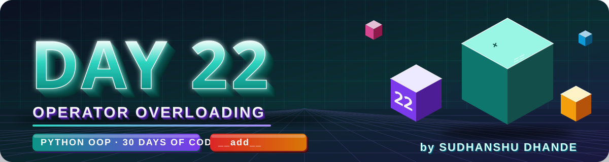
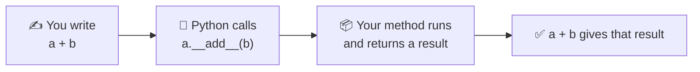
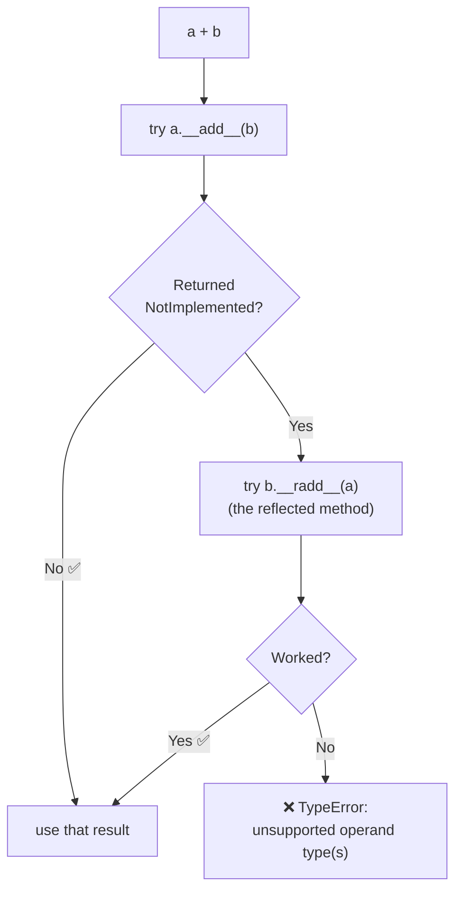
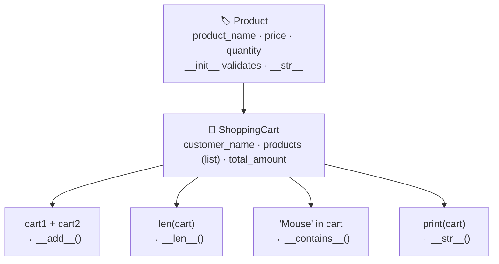
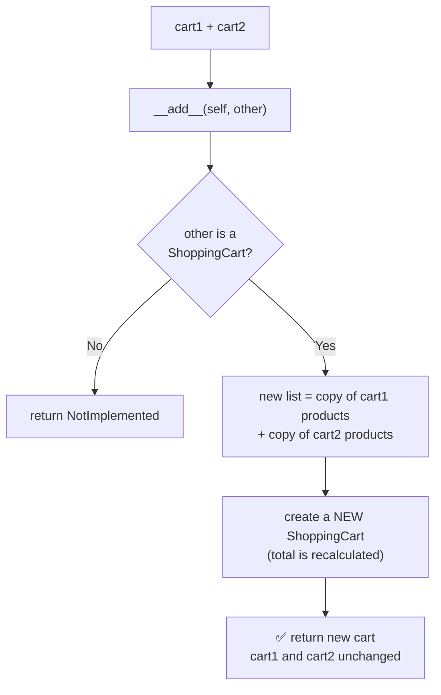

<p align="center">
  
</p>

<p align="center">
  
  
  
  
  
</p>

# 🐍 DAY 22 — Python OOP: Operator Overloading

## 🎯 Learning Objectives

Today I will learn:

- What is Operator Overloading?
- What are Magic Methods (Dunder Methods)?
- How to overload arithmetic operators.
- How to overload comparison operators.
- How to overload logical-style operators.
- How to overload the `+`, `-`, `*`, `/` operators.
- How to overload comparison operators.
- How to use `__add__()`, `__sub__()`, `__mul__()`, etc.
- How operator overloading works in real-world applications.

---

# 📖 Day 22 Concepts — Read & Understand First

> Today is a **concept + mini-project day** (E-Commerce Shopping Cart). On Day 18 you met `__add__`, `__eq__` and `__lt__`. Today you go **deeper**: every operator, what to **return**, what to do with **unsupported types**, and **when not to overload**. Type every example and **say which magic method Python is calling**.

## 1️⃣ What Is Operator Overloading?

Python operators **already** behave differently for different types:

```python
print(10 + 20)                # 30            → numbers are added
print("Hello " + "Python")    # Hello Python  → strings are joined
print([1, 2] + [3])           # [1, 2, 3]     → lists are joined
print([0] * 3)                # [0, 0, 0]     → list is repeated
```

> **Operator Overloading = giving operators like `+`, `-`, `*`, `==` your own behaviour for your own objects.**



> 🧠 *Operator = a nice-looking shortcut for a magic method call.*

---

## 2️⃣ What Python Does When It Sees `a + b`



| Step                         | Meaning                                                              |
| ---------------------------- | -------------------------------------------------------------------- |
| `a.__add__(b)`               | **Left** object gets the **first chance**                            |
| `return NotImplemented`      | "I don't know how to do this with that type — ask the other object"  |
| `b.__radd__(a)`              | **Reflected (right-side) version**, tried next                       |
| Nobody can handle it         | Python raises a clean **`TypeError`**                                |

```python
class Money:
    def __init__(self, amount):
        self.amount = amount

    def __add__(self, other):                    # Money + 3
        if isinstance(other, Money):
            return Money(self.amount + other.amount)
        if isinstance(other, (int, float)):
            return Money(self.amount + other)
        return NotImplemented

    __radd__ = __add__                           # 3 + Money  (same logic)

    def __repr__(self):
        return f"Money({self.amount})"

print(Money(5) + 3)       # Money(8)     → Money.__add__
print(3 + Money(5))       # Money(8)     → int can't do it → Money.__radd__
```

---

## 3️⃣ Operator → Magic Method Map

### Arithmetic

| Operator | Magic method     | Purpose          | Note                                  |
| -------- | ---------------- | ---------------- | ------------------------------------- |
| `+`      | `__add__()`      | Addition         |                                       |
| `-`      | `__sub__()`      | Subtraction      | **Order matters:** `self - other`     |
| `*`      | `__mul__()`      | Multiplication   |                                       |
| `/`      | `__truediv__()`  | True division    | Result is usually a float             |
| `//`     | `__floordiv__()` | Floor division   | Result is rounded **down**            |
| `%`      | `__mod__()`      | Modulus          | Remainder                             |
| `**`     | `__pow__()`      | Power            |                                       |

### Comparison

| Operator | Magic method | Purpose               |
| -------- | ------------ | --------------------- |
| `==`     | `__eq__()`   | Equality              |
| `!=`     | `__ne__()`   | Inequality            |
| `<`      | `__lt__()`   | Less than             |
| `>`      | `__gt__()`   | Greater than          |
| `<=`     | `__le__()`   | Less than or equal    |
| `>=`     | `__ge__()`   | Greater than or equal |

### Container-style

| Syntax        | Magic method     | Purpose                          |
| ------------- | ---------------- | -------------------------------- |
| `len(obj)`    | `__len__()`      | Number of items                  |
| `x in obj`    | `__contains__()` | Membership check                 |
| `obj[i]`      | `__getitem__()`  | Access an item (index / slice)   |

### Extras (good to know)

| Syntax      | Magic method              | Note                                                         |
| ----------- | ------------------------- | ------------------------------------------------------------ |
| `3 + obj`   | `__radd__()`              | Reflected: object on the **right** side                      |
| `3 * obj`   | `__rmul__()`              | Same idea for `*`                                            |
| `a += b`    | `__iadd__()`              | In-place; if missing, Python uses `__add__`                  |
| `-obj`      | `__neg__()`               | Unary minus                                                  |
| `print(obj)`| `__str__()`               | **Not** an operator — it makes **text** (Day 18)             |

> 💡 **`__str__()` vs `__add__()`:** `__str__` decides **how an object looks as text**; `__add__` decides **what `+` does**.
> ⚠️ In Python 3 the division method is **`__truediv__`** (the old `__div__` does not exist).

---

## 4️⃣ What Should `__add__` Return? (Design Choice)

The notes' first example returns a **plain number**:

```python
def __add__(self, other):
    return self.value + other.value        # returns 30 (a number)
```

The **usual convention** is to return a **new object of the same class**, so you can keep calculating:

```python
def __add__(self, other):
    return Number(self.value + other.value)   # returns Number(30) (a new object)
```

| Return type              | Good for                                      | Example from your questions          |
| ------------------------ | --------------------------------------------- | ------------------------------------ |
| A **plain value**        | Simple demos, or when the question says so    | Q1 (sum), Q6 (Boolean), Q9 (Boolean) |
| A **new object**         | Real classes (so `a + b + c` works)           | Q7 Vector, Q8 Money, Q10–Q15         |
| A **Boolean**            | Comparisons (`==`, `<`, `>`)                  | Q5, Q6, Q9, Q12                      |

> 🔑 **Golden rule:** an operator should **not change** `self` or `other`. Build and **return a new object**.

---

## 5️⃣ `NotImplemented` — Handling Unsupported Types

```python
def __add__(self, other):
    if not isinstance(other, Weight):
        return NotImplemented              # ✅ return it
    return Weight(self.grams + other.grams)

Weight(1500) + 5
# TypeError: unsupported operand type(s) for +: 'Weight' and 'int'
```

| Question                                  | Answer                                                              |
| ----------------------------------------- | ------------------------------------------------------------------- |
| What is `NotImplemented`?                 | A **special value** meaning "this operation isn't supported for that type" |
| `return NotImplemented` or `raise`?       | **Return** it. `raise NotImplemented` itself breaks (`exceptions must derive from BaseException`) |
| What happens then?                        | Python tries the **other** object's reflected method, then raises **`TypeError`** |
| Why not just crash with `AttributeError`? | `NotImplemented` gives a **clean, standard** error and allows `3 + obj` to work |

**Two different situations — two different tools:**

| Situation                                             | Use                                              |
| ----------------------------------------------------- | ------------------------------------------------ |
| **Wrong type** (`Weight + 5`)                         | `return NotImplemented`                          |
| **Right type, bad value** (`Money("₹") + Money("$")`, negative result) | `raise ValueError("...")`    |

> 💡 Q8 (Money with different currencies) is the **second** situation — same class, but the values don't match.

---

## 6️⃣ Division Operators: `/`, `//`, `%`, `**`

```python
class Number:
    def __init__(self, value):
        self.value = value

    def __truediv__(self, other):                  # a / b
        if other.value == 0:
            raise ZeroDivisionError("Cannot divide by zero")
        return Number(self.value / other.value)

    def __floordiv__(self, other):                 # a // b
        return Number(self.value // other.value)

    def __mod__(self, other):                      # a % b
        return Number(self.value % other.value)

    def __pow__(self, other):                      # a ** b
        return Number(self.value ** other.value)
```

| Operator | `17` and `5` give | Meaning                          |
| -------- | ----------------- | -------------------------------- |
| `17 / 5`  | `3.4`            | **True** division (float)        |
| `17 // 5` | `3`              | **Floor** division (rounded down)|
| `17 % 5`  | `2`              | Remainder                        |
| `17 ** 5` | `1419857`        | Power                            |

> ⚠️ Handle **division by zero** yourself (Q4) — raise a clear error **before** dividing.

---

## 7️⃣ Comparison Operators — The Smart Rules

```python
class Student:
    def __init__(self, marks):
        self.marks = marks

    def __gt__(self, other):
        return self.marks > other.marks

print(Student(85) > Student(70))       # True   → Student.__gt__
```

| Rule                                                              | Meaning                                                              |
| ----------------------------------------------------------------- | -------------------------------------------------------------------- |
| **You decide** what "greater" or "equal" means                    | By marks, price, salary, balance...                                  |
| `!=` comes **free** from `__eq__`                                 | Python simply reverses the `==` answer                               |
| If you define only `__lt__`, then `a > b` **still works**         | Python tries `b.__lt__(a)` as a fallback                             |
| `sorted()`, `min()`, `max()` work once `__lt__` exists            | They compare with `<`                                                |
| `<=` and `>=` do **not** come from `__lt__` + `__eq__`            | Define them **or** use `@total_ordering`                             |
| Defining `__eq__` **removes the default hash**                    | Object can't be put in a `set` or used as a `dict` key (`TypeError: unhashable`) |
| Use the **same attribute** in `__eq__` and `__lt__`               | Otherwise the results contradict each other                          |

**Let Python write the other comparisons:**

```python
from functools import total_ordering

@total_ordering                         # define __eq__ and ONE of <, >, <=, >=
class Version:
    def __init__(self, text):
        self.parts = tuple(int(p) for p in text.split("."))

    def __eq__(self, other):
        if not isinstance(other, Version):
            return NotImplemented
        return self.parts == other.parts

    def __lt__(self, other):
        if not isinstance(other, Version):
            return NotImplemented
        return self.parts < other.parts

print(Version("1.9") < Version("1.10.2"))      # True  → (1, 9) < (1, 10, 2)
print(Version("1.9") >= Version("1.10.2"))     # False → generated by total_ordering
```

---

## 8️⃣ Container Operators: `len()`, `in`, `[]`

```python
class Playlist:
    def __init__(self, songs):
        self.songs = list(songs)

    def __add__(self, other):
        if not isinstance(other, Playlist):
            return NotImplemented
        return Playlist(self.songs + other.songs)     # NEW list → originals unchanged

    def __len__(self):
        return len(self.songs)

    def __contains__(self, song):
        return song in self.songs

    def __getitem__(self, index):
        return self.songs[index]


p = Playlist(["Faded", "Believer"]) + Playlist(["Closer"])
print(len(p))                  # 3
print("Faded" in p)            # True
print(p[0], p[-1])             # Faded Closer
print(p[0:2])                  # ['Faded', 'Believer']
```

| Syntax      | Calls            | Must return                       |
| ----------- | ---------------- | --------------------------------- |
| `len(p)`    | `__len__`        | A **non-negative integer**        |
| `x in p`    | `__contains__`   | `True` or `False`                 |
| `p[i]`      | `__getitem__`    | The item at that position         |

> 💡 If a class has `__getitem__`, a **`for` loop** and **`in`** also work automatically (Python walks through index 0, 1, 2…). And an object with `__len__` returning `0` counts as **empty** in `if not obj:`.

---

## 9️⃣ A Worked Example in a Different Domain: `Weight`

To learn the **pattern** without giving away your solution, here is a `Weight` class (stored in grams) that uses **many operators together**. Predict each line **before** you read the output.

```python
class Weight:
    def __init__(self, grams):
        if grams < 0:
            raise ValueError("Weight cannot be negative")      # validate once, here
        self.grams = grams

    def __str__(self):
        kg, g = divmod(self.grams, 1000)
        return f"{kg} kg {g} g"

    def __repr__(self):
        return f"Weight({self.grams!r})"

    def __add__(self, other):
        if not isinstance(other, Weight):
            return NotImplemented
        return Weight(self.grams + other.grams)                # NEW object

    def __sub__(self, other):
        if not isinstance(other, Weight):
            return NotImplemented
        return Weight(self.grams - other.grams)                # __init__ rejects negatives

    def __mul__(self, factor):                                 # Weight * number
        if not isinstance(factor, (int, float)):
            return NotImplemented
        return Weight(round(self.grams * factor))

    __rmul__ = __mul__                                         # number * Weight

    def __truediv__(self, other):
        if isinstance(other, Weight):                          # Weight / Weight → ratio
            if other.grams == 0:
                raise ZeroDivisionError("Cannot divide by a zero weight")
            return self.grams / other.grams
        if isinstance(other, (int, float)):                    # Weight / number → Weight
            return Weight(round(self.grams / other))
        return NotImplemented

    def __eq__(self, other):
        if not isinstance(other, Weight):
            return NotImplemented
        return self.grams == other.grams

    def __lt__(self, other):
        if not isinstance(other, Weight):
            return NotImplemented
        return self.grams < other.grams


a = Weight(1500)
b = Weight(750)

print(a + b)                              # 2 kg 250 g
print(a - b)                              # 0 kg 750 g
print(a * 2)                              # 3 kg 0 g
print(2 * a)                              # 3 kg 0 g      (__rmul__)
print(a / 2)                              # 0 kg 750 g
print(a / b)                              # 2.0
print(a == Weight(1500))                  # True
print(b < a)                              # True
print(a > b)                              # True          (Python uses b.__lt__(a))
print(sorted([a, b]))                     # [Weight(750), Weight(1500)]
print(sum([a, b, Weight(250)], Weight(0)))  # 2 kg 500 g

try:
    a + 5
except TypeError as error:
    print("Error:", error)

try:
    b - a
except ValueError as error:
    print("Error:", error)
```

**Output:**

```text
2 kg 250 g
0 kg 750 g
3 kg 0 g
3 kg 0 g
0 kg 750 g
2.0
True
True
True
[Weight(750), Weight(1500)]
2 kg 500 g
Error: unsupported operand type(s) for +: 'Weight' and 'int'
Error: Weight cannot be negative
```

**What to notice:**

- Every arithmetic method **returns a new `Weight`** — `a` and `b` are never changed.
- **Wrong type** → `return NotImplemented` → clean `TypeError`. **Bad value** → `ValueError`.
- `__rmul__ = __mul__` makes `2 * a` work too.
- Only `__lt__` was written, yet `a > b` and `sorted()` work.
- `sum()` starts with the number `0`, so I gave it a **start value** `Weight(0)`. (Without it: `TypeError: unsupported operand type(s) for +: 'int' and 'Weight'`.)

| `Weight` example                                  | Your questions                                           |
| ------------------------------------------------- | -------------------------------------------------------- |
| `__add__`, `__sub__` → new object                 | Q1, Q2, Q7, Q8, Q10, Q11, Q13, Q14                       |
| `__mul__` / `__truediv__` with checks             | Q3, Q4 (division by zero)                                |
| `__eq__`, `__lt__` on **one** attribute           | Q5, Q6, Q9, Q12                                          |
| `isinstance` + `NotImplemented`                   | Q8 and every "safe" operator                             |
| Validation inside `__init__`                      | Q10 (zero denominator), Main Challenge (price / quantity)|

> 🎯 **Your task:** do **not** copy this. Understand the **pattern** (validate in `__init__` → check the other type → compute → return a **new** object), then build your own classes.

---

## 🔟 Real-World Operator Overloading (You Already Use It!)

| Example                                    | Operator → what it does                                    |
| ------------------------------------------ | ---------------------------------------------------------- |
| `date2 - date1`                            | Gives a **timedelta** (e.g. `7 days`)                      |
| `date + timedelta(days=10)`                | Gives a **new date**                                       |
| `Path("data") / "sample.pdf"`              | `/` **joins** path pieces (`__truediv__`)                  |
| `numpy_array_a + numpy_array_b`            | **Element-wise** addition                                  |
| `set1 \| set2`, `set1 & set2`              | Union, intersection of sets                                |
| `Fraction(1, 3) + Fraction(1, 6)`          | Exact fractions (`fractions` module)                       |
| `Vector(2, 3) + Vector(4, 5)`              | Adds coordinates (maths / games / physics)                 |
| `Money(100) + Money(50)`                   | Safe money arithmetic (finance apps)                       |

---

## 1️⃣1️⃣ When to Overload — and When NOT To

> *"Avoid changing the natural meaning of operators unnecessarily."*

| ✅ Good idea (meaning is **obvious**)                   | ❌ Bad idea (meaning is **confusing**)                    |
| ------------------------------------------------------- | --------------------------------------------------------- |
| `Vector + Vector`                                       | `Student + Student` (what does it even mean?)             |
| `Money + Money`                                         | `Dog * Cat`                                               |
| `Product < Product` (by price)                          | Using `-` to mean "delete something"                      |
| `Playlist + Playlist` (join), `song in playlist`        | `+` that secretly **modifies** the left object            |

**Test:** *Would another programmer guess what `a + b` does without reading my code?* If not, use a normal **method name** (`merge()`, `combine()`) instead.

---

## 1️⃣2️⃣ Flow: How the E-Commerce Shopping Cart Fits Together





| Design question                                       | Hint                                                                       |
| ----------------------------------------------------- | -------------------------------------------------------------------------- |
| Where do I reject a negative price or quantity?       | In **`Product.__init__`** — once, for every product                        |
| How do I stop the original carts from changing?       | Build a **new list** (`list1 + list2`); never use `.extend()` on `self`    |
| Who owns the total?                                   | Calculate it from the products (price × quantity) each time or on creation |
| What should `__contains__` accept?                    | Decide: a **product name** (string) or a `Product` object — and write it as a comment |
| What if both carts contain the **same** product?      | Decide (separate lines or combine quantities) and **write it as a comment**|
| What should `__str__` print for an **empty cart**?    | A friendly message such as "Cart is empty"                                 |
| What can `Product.__add__` mean?                      | Optional: e.g. same product → add quantities; different products → `NotImplemented` / `ValueError` |
| What should `len(cart)` count?                        | Number of **product lines** (state your choice)                            |

---

## 1️⃣3️⃣ Testing Checklist

| Test case                                           | What should happen                                      |
| --------------------------------------------------- | ------------------------------------------------------- |
| `a + b`, `a - b`, `a * b`, `a / b` with normal values | Correct result, **new object**, `a` and `b` unchanged |
| Subtraction with a **negative** result (Q2)         | Correct negative number (or an error, if your class forbids it) |
| Division by **zero** (Q4)                           | Clear error message, no crash                           |
| `a + 5` / `a + "text"` (wrong type)                 | Clean `TypeError` (`NotImplemented`)                    |
| `Money` with **same** / **different** currency      | Works / clear error                                     |
| `Fraction` with zero denominator                    | Rejected in `__init__`                                  |
| `==` with equal / unequal / **different type**      | `True` / `False` / `False` (or `NotImplemented`)        |
| `<` and `>` both directions                         | Opposite answers; equal objects → both `False`          |
| `sorted()` on a list of your objects                | Sorted by the attribute you chose                       |
| `Distance` 900 m + 300 m / `Time` 50 min + 30 min   | **Normalized** result (1 km 200 m / 1 h 20 min)         |
| `len()`, `in` on an **empty** collection            | `0` and `False`                                         |
| Combined cart / playlist                            | Originals still have their **old** contents             |
| Cart with **negative price** or **zero quantity**   | Rejected with a clear message                           |
| Print an **empty** cart                             | Friendly message, no crash                              |

---

## 1️⃣4️⃣ Common Mistakes (Avoid These!)

| ❌ Mistake                                                         | ✅ Fix                                                              |
| ----------------------------------------------------------------- | ------------------------------------------------------------------ |
| `raise NotImplemented`                                             | **`return NotImplemented`**                                        |
| `__add__` changes `self` and returns it (`self.value += ...`)      | Create and **return a new object**                                 |
| Forgetting `return` (the result is `None`)                         | Always `return` a value                                            |
| Not checking the type of `other`                                   | `isinstance(other, ClassName)` → else `NotImplemented`             |
| Wrong order in subtraction/division (`other - self`)               | `self` is the **left** operand                                     |
| Not handling **division by zero**                                  | Check first and raise a clear error                                |
| Using the Python 2 name `__div__`                                  | Use **`__truediv__`** (and `__floordiv__`)                         |
| Defining `__eq__` and expecting `<=` / `>=` to work                | Define them, or use `@functools.total_ordering`                    |
| Comparing **different attributes** in `__eq__` and `__lt__`        | Compare **one** clear attribute in all comparison methods          |
| Expecting `sum(objects)` to work without a start value             | `sum(objects, Weight(0))` or define `__radd__`                     |
| Expecting `3 + obj` to work with only `__add__`                    | Add `__radd__` (and `__rmul__` for `*`)                            |
| `__len__` returning a float, a string or a negative number         | Return a **non-negative int**                                      |
| `__str__` that `print`s instead of `return`s                       | **Return** a string                                                |
| `ShoppingCart(self.products)` / `.extend()` shares or changes a list | `self.products + other.products` creates a **new** list          |
| Fractions not simplified (`2/4`)                                   | Divide by `math.gcd(numerator, denominator)`                       |
| Forgetting to normalize meters (≥ 1000) or minutes (≥ 60)          | Use `divmod(total, 1000)` / `divmod(total, 60)`                    |
| Overloading an operator with a confusing meaning                   | Use a normal method name instead                                   |

---

## 1️⃣5️⃣ Step-by-Step Build Plan

```text
Step 1  →  Q1–Q3    __add__, __sub__, __mul__ on a simple Number / Calculator
Step 2  →  Q4       __truediv__ with a zero check
Step 3  →  Q5       __eq__ on one attribute (marks)
Step 4  →  Q6, Q9   __gt__ and __lt__ (salary, price)
Step 5  →  Q7       Vector + Vector → return a NEW Vector
Step 6  →  Q8       Money + Money with the same-currency rule
Step 7  →  Q10      Fraction: common denominator, validate in __init__
Step 8  →  Q11      ShoppingCart + ShoppingCart (new list, originals unchanged)
Step 9  →  Q12      BankAccount: __gt__ and __eq__ together
Step 10 →  Q13–Q14  Distance and Time: add, then normalize with divmod
Step 11 →  Q15      Playlist: __add__ + __len__ + __contains__
Step 12 →  Main challenge: Product + ShoppingCart with every operator
Step 13 →  Test edge cases (zero, negative, empty, wrong type), then update README and push to GitHub
```

---

## 📌 Day 22 in One Look

```text
Operator overloading →  Giving +, -, *, == ... custom behaviour for your objects
How it works         →  a + b  becomes  a.__add__(b)
Arithmetic           →  + __add__ · - __sub__ · * __mul__ · / __truediv__ · // __floordiv__ · % __mod__ · ** __pow__
Comparison           →  == __eq__ · != __ne__ · < __lt__ · > __gt__ · <= __le__ · >= __ge__
Container            →  len() __len__ · in __contains__ · [] __getitem__
Return               →  A NEW object (arithmetic) · a Boolean (comparison)
Never                →  Change self or other inside an operator
Unsupported type     →  return NotImplemented  (NOT raise) → Python gives TypeError
Bad value            →  raise ValueError
Reflected            →  3 + obj needs __radd__ · 3 * obj needs __rmul__
Comparison tricks    →  != is free · only __lt__ gives > and sorted() · use @total_ordering for the rest
__eq__ side effect   →  Object becomes unhashable (no set / dict key)
sum(objects)         →  Needs a start value or __radd__
Division             →  __truediv__ (Python 3) · handle zero yourself
Golden rule          →  Overload only when the meaning is obvious
```

---

## 📚 Part 1 — Theory: Understand Before Coding

### 1. What is Operator Overloading?

Operator Overloading means giving special behavior to Python operators when they are used with objects of a class.

In simple words:

**Operator Overloading = Using operators like `+`, `-`, `*`, and `==` with custom objects.**

Example:

```python
print(10 + 20)
print("Hello " + "Python")
```

The `+` operator behaves differently depending on the data types.

We can also define its behavior for our own classes.

### 2. Important Magic Methods

| Operator | Magic Method | Purpose |
|---|---|---|
| `+` | `__add__()` | Addition |
| `-` | `__sub__()` | Subtraction |
| `*` | `__mul__()` | Multiplication |
| `/` | `__truediv__()` | Division |
| `//` | `__floordiv__()` | Floor division |
| `%` | `__mod__()` | Modulus |
| `**` | `__pow__()` | Power |
| `==` | `__eq__()` | Equality |
| `!=` | `__ne__()` | Inequality |
| `<` | `__lt__()` | Less than |
| `>` | `__gt__()` | Greater than |
| `<=` | `__le__()` | Less than or equal |
| `>=` | `__ge__()` | Greater than or equal |
| `[]` | `__getitem__()` | Access an item |
| `in` | `__contains__()` | Membership check |

### 3. Example: Overloading the + Operator

```python
class Number:
    def __init__(self, value):
        self.value = value

    def __add__(self, other):
        return self.value + other.value


n1 = Number(10)
n2 = Number(20)

print(n1 + n2)
```

**Output:**

```text
30
```

Explanation:

- `n1 + n2` internally calls `n1.__add__(n2)`.
- `self` represents `n1`.
- `other` represents `n2`.
- The method returns their sum.

### 4. Example: Comparison Operator

```python
class Student:
    def __init__(self, marks):
        self.marks = marks

    def __gt__(self, other):
        return self.marks > other.marks


s1 = Student(85)
s2 = Student(70)

print(s1 > s2)
```

**Output:**

```text
True
```

### 5. Important Rules

- Magic methods use double underscores.
- Operator overloading is implemented inside a class.
- The method should return an appropriate result.
- Use `NotImplemented` when an operation does not support the other object's type.
- Avoid changing the natural meaning of operators unnecessarily.

---

## 🧠 Part 2 — Theory Questions (15)

Answer in your own words.

1. What is operator overloading?
2. Why do we use operator overloading?
3. What are magic methods?
4. What is the purpose of `__add__()`?
5. Which magic method is called when we use `-`?
6. Which method is called when we use `*`?
7. What is the purpose of `__eq__()`?
8. What is the difference between `__lt__()` and `__gt__()`?
9. Can we overload the `+` operator in Python?
10. What happens when we use an operator with unsupported objects?
11. What is the purpose of `NotImplemented`?
12. What is the difference between `__str__()` and `__add__()`?
13. Can we overload comparison operators?
14. What is the difference between `__truediv__()` and `__floordiv__()`?
15. Give two real-world examples of operator overloading.

---

## 💻 Part 3 — Practice Problems (15 Questions)

### 🟢 Level 1 — Basic Operator Overloading

**Q1. Number Addition**

Create a `Number` class and overload the `+` operator.

**Requirements:**

- Create a class named `Number`.
- Add a constructor that accepts one numeric value.
- Create an `__add__()` method.
- Accept another `Number` object as an argument.
- Return the sum of both values.
- Create two objects and add them using `+`.


**Q2. Subtraction Calculator**

Create a `Calculator` class and overload the `-` operator.

**Requirements:**

- Store a number in each object.
- Define `__sub__()`.
- Subtract the second object's value from the first.
- Return the result.
- Test with positive and negative results.

Create a `Number` class and overload `*`.

**Requirements:**

- Store a numeric value.
- Define `__mul__()`.
- Multiply two object values.
- Return the result.
- Test with different numbers.

**Q4. Division of Objects**

Create a `Number` class and overload `/`.

**Requirements:**

- Store a number in each object.
- Define `__truediv__()`.
- Divide the first object's value by the second.
- Handle division by zero.
- Return the result.

**Q5. Equality Comparison**

Create a `Student` class and overload `==`.

**Requirements:**

- Store student name and marks.
- Define `__eq__()`.
- Compare two students using their marks.
- Return `True` if marks are equal.
- Return `False` otherwise.


### 🟡 Level 2 — Intermediate Operator Overloading

**Q6. Compare Employee Salaries**

Create an `Employee` class and overload `>`.

**Requirements:**

- Store employee name and salary.
- Define `__gt__()`.
- Compare the salaries of two employees.
- Return a Boolean result.
- Identify the employee with the higher salary.

**Q7. Vector Addition**

Create a `Vector` class and overload `+`.

**Requirements:**

- Store x and y coordinates.
- Define `__add__()`.
- Add the x coordinates separately.
- Add the y coordinates separately.
- Return a new Vector object.
- Display the resulting vector.

**Q8. Money Addition**

Create a `Money` class and overload `+`.

**Requirements:**

- Store an amount.
- Store the currency.
- Define `__add__()`.
- Allow addition only when currencies match.
- Return a new Money object.
- Handle different currencies safely.

**Q9. Product Price Comparison**

Create a `Product` class and overload `<`.

**Requirements:**

- Store product name and price.
- Define `__lt__()`.
- Compare two product prices.
- Return a Boolean result.
- Find the cheaper product.

**Q10. Fraction Addition**

Create a `Fraction` class and overload `+`.

**Requirements:**

- Store numerator and denominator.
- Define `__add__()`.
- Add two fractions correctly.
- Calculate a common denominator.
- Return a new Fraction object.
- Handle a zero denominator during initialization.

### 🔴 Level 3 — Advanced Logic Building

**Q11. Shopping Cart Addition**

Create a `ShoppingCart` class and overload `+`.

**Requirements:**

- Store products in a list.
- Store the total amount.
- Define `__add__()`.
- Combine products from two carts.
- Calculate the new total amount.
- Return a new ShoppingCart object.
- Do not modify the original carts.

**Q12. Bank Account Comparison**

Create a `BankAccount` class and overload `>` and `==`.

**Requirements:**

- Store account holder name.
- Store account balance.
- Define `__gt__()` to compare balances.
- Define `__eq__()` to compare balances.
- Test two different accounts.

**Q13. Distance Addition**

Create a `Distance` class and overload `+`.

**Requirements:**

- Store distance in kilometers and meters.
- Define `__add__()`.
- Add two distance objects.
- Convert excess meters into kilometers.
- Return a new Distance object.
- Display the final normalized distance.

**Q14. Time Addition**

Create a `Time` class and overload `+`.

**Requirements:**

- Store hours and minutes.
- Define `__add__()`.
- Add two time objects.
- Convert excess minutes into hours.
- Return a new Time object.
- Display the final time.

**Q15. Custom Collection**

Create a `Playlist` class and overload `+`, `len()`, and `in`.

**Requirements:**

- Store song names in a list.
- Define `__add__()` to combine playlists.
- Define `__len__()` to count songs.
- Define `__contains__()` to search for songs.
- Return a new Playlist when combining two playlists.
- Test all three operations.

---

## 🏆 Part 4 — Main Challenge: E-Commerce Shopping Cart

Build an E-Commerce Shopping Cart using Operator Overloading.

### Class: Product

**Attributes:**

- product_name
- price
- quantity

**Methods:**

- `__init__()`
- `__str__()`
- `__add__()` (optional: define a meaningful product-combination behavior)

### Class: ShoppingCart

**Attributes:**

- customer_name
- products
- total_amount

**Methods:**

- `__init__()`
- `__add__()`
- `__len__()`
- `__contains__()`
- `__str__()`

### Requirements

1. Create the Product class.
2. Store product name, price, and quantity.
3. Create the ShoppingCart class.
4. Store multiple products in a list.
5. Calculate the total amount.
6. Overload `+` to combine two carts.
7. Overload `len()` to count products.
8. Overload `in` to search for a product.
9. Overload `str()` to display cart information.
10. Handle empty carts.
11. Prevent invalid product prices and quantities.
12. Ensure combining carts does not change the original carts.

### Expected Output

```text
===== E-COMMERCE SHOPPING CART =====

Customer: Rahul

Products:
Laptop - Rs. 50000
Mouse - Rs. 500
Keyboard - Rs. 1200

Total Amount: Rs. 51700
Total Products: 3

Mouse in cart: True
```

---

## 🎤 Part 5 — OOP Interview Questions (with Short Answers)

> Try to answer each question yourself first, then compare with the short answer. Each answer is kept **simple and short** so it is easy to remember. 🧠 = memory trick.

### Q1. What is operator overloading?

**Ans:** Giving **custom behaviour to operators** (`+`, `-`, `==`, `<`) for **your own class objects**, using magic methods.

```python
Vector(2, 3) + Vector(4, 5)      # Vector(6, 8)
```

🧠 *Same operator · your own rule*

---

### Q2. What is a magic method?

**Ans:** A **special method with double underscores** (`__add__`, `__len__`) that **Python calls automatically** for an operator or built-in function.

🧠 *You write the symbol · Python calls the dunder*

---

### Q3. Which method is called by the `+` operator?

**Ans:** **`__add__()`** — `a + b` becomes `a.__add__(b)`.

🧠 *+ → add*

---

### Q4. Which method is called by the `-` operator?

**Ans:** **`__sub__()`** — `a - b` becomes `a.__sub__(b)` (`self` is the **left** side).

🧠 *− → sub*

---

### Q5. Which method is called by the `*` operator?

**Ans:** **`__mul__()`** — `a * b` becomes `a.__mul__(b)`.

🧠 *× → mul*

---

### Q6. Which method is called by `==`?

**Ans:** **`__eq__()`**. It should return `True` or `False`. (`!=` then works automatically.)

```python
def __eq__(self, other):
    return self.marks == other.marks
```

🧠 *== → eq*

---

### Q7. Which method is called by `<`?

**Ans:** **`__lt__()`** (**l**ess **t**han). With `__lt__`, `sorted()` also works.

🧠 *< → lt (less than)*

---

### Q8. Which method is called by `>`?

**Ans:** **`__gt__()`** (**g**reater **t**han).

```python
def __gt__(self, other):
    return self.marks > other.marks
```

🧠 *> → gt (greater than)*

---

### Q9. Can we overload operators in Python?

**Ans:** **Yes**, by defining the matching **magic method** inside the class.

🧠 *Operator → its own dunder*

---

### Q10. What is `__len__()`?

**Ans:** It defines what **`len(obj)`** returns. It must return a **non-negative integer**.

```python
def __len__(self):
    return len(self.songs)
```

🧠 *`len()` → `__len__()`*

---

### Q11. What is `__contains__()`?

**Ans:** It defines the **`in`** operator (membership check). It returns **`True` or `False`**.

```python
"Faded" in playlist        # Python calls playlist.__contains__("Faded")
```

🧠 *`in` → `__contains__()`*

---

### Q12. What is `__truediv__()`?

**Ans:** It defines the **`/`** operator. (`//` uses `__floordiv__()`.) Handle **division by zero** yourself.

🧠 *`/` → truediv · `//` → floordiv*

---

### Q13. Can we overload comparison operators?

**Ans:** **Yes** — `__eq__` (`==`), `__ne__` (`!=`), `__lt__` (`<`), `__gt__` (`>`), `__le__` (`<=`), `__ge__` (`>=`).

🧠 *Six comparison operators · six dunders*

---

### Q14. What is `NotImplemented`?

**Ans:** A **special value** you **`return`** to tell Python *"this operation is not supported for that type"*. Python then tries the other object, and finally raises a clean **`TypeError`**.

```python
if not isinstance(other, Weight):
    return NotImplemented
```

🧠 *return it, never raise it*

---

### Q15. Give a real-world example of operator overloading.

**Ans:** **Adding two Vector objects** with `+`. Python itself does it too: `date2 - date1`, `Path("a") / "b"`, `numpy_array + numpy_array`.

🧠 *Make your objects behave like built-in types*

---

### ⚡ 10-Second Revision

```text
1.  Operator overloading → Custom behavior for operators on objects
2.  Magic method         → Special double-underscore method called by Python
3.  +   → __add__()
4.  -   → __sub__()
5.  *   → __mul__()
6.  ==  → __eq__()
7.  <   → __lt__()
8.  >   → __gt__()
9.  Overload operators?  → Yes, using magic methods
10. len()  → __len__()
11. in     → __contains__()
12. /      → __truediv__()   (// → __floordiv__)
13. Comparison operators → Yes: eq, ne, lt, gt, le, ge
14. NotImplemented       → "Not supported for this type" (return it, don't raise it)
15. Real-world example   → Vector + Vector
```

---

## 📁 Part 6 — GitHub Folder Structure

```text
Day22_Operator_Overloading/
│
├── banner.svg
├── README.md
│
├── theory/
│   └── magic_methods.py
│
├── practice/
│   ├── Q01 / Q15.py
│   
│   
│
├── project/
    ├── shopping_cart.py
   


```

### File Responsibilities

- `banner.svg` — the Day 22 banner shown at the top of this README.
- `magic_methods.py` — Theory examples (arithmetic, comparison, `NotImplemented`, `total_ordering`, containers).
- `basic_operations.py` — Q1–Q5.
- `comparison_operators.py` — Q6–Q9.
- `advanced_operations.py` — Q10–Q15.
- `shopping_cart.py` — ShoppingCart class.
- `README.md` — Learning notes and project documentation.

**Beginner tip:** First run `theory/magic_methods.py` and say which magic method each line triggers. Then solve Q1–Q15, and finally build the `Product` and `ShoppingCart` classes.

---

## 📊 Part 7 — Day 22 Target

| Task | Target |
|---|---:|
| Theory Questions | 15 |
| Practice Problems | 15 |
| Interview Questions | 15 |
| Main Challenge | 1 |
| GitHub Update | 1 |

---

## 🚫 Part 8 — Rules

- Understand the purpose of every magic method.
- Attempt each question independently.
- Do not copy complete solutions.
- Use meaningful class and method names.
- Return appropriate values from magic methods.
- Test edge cases.
- Avoid unnecessary operator overloading.

---

## ✅ Part 9 — Completion Checklist

- [ ] Understood operator overloading.
- [ ] Practised `__add__()`.
- [ ] Practised `__sub__()`.
- [ ] Practised `__mul__()` and `__truediv__()`.
- [ ] Practised comparison operators.
- [ ] Practised `__len__()` and `__contains__()`.
- [ ] Completed Q1–Q15.
- [ ] Completed Shopping Cart project.
- [ ] Prepared interview answers.
- [ ] Updated GitHub README.
- [ ] Pushed code to GitHub.

---

## 🚀 GitHub Commit

```bash
git add .
git status
git commit -m "Day 22: Python operator overloading practice"
git push
```

**Day 22 Goal:** Understand how to customize Python operators for objects and apply operator overloading in real-world OOP projects.

---

<p align="center">
  
</p>

<h3 align="center"><b>Sudhanshu Dhande</b></h3>
<p align="center"><i>B.Tech (AI &amp; ML) · BATU, Lonere · Python OOP Journey</i></p>
