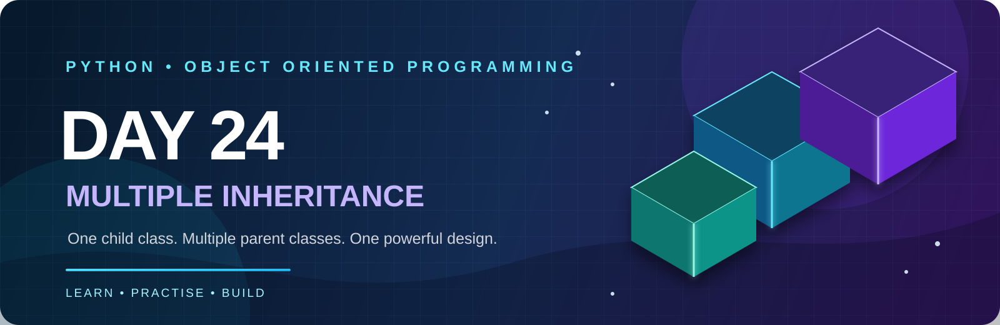
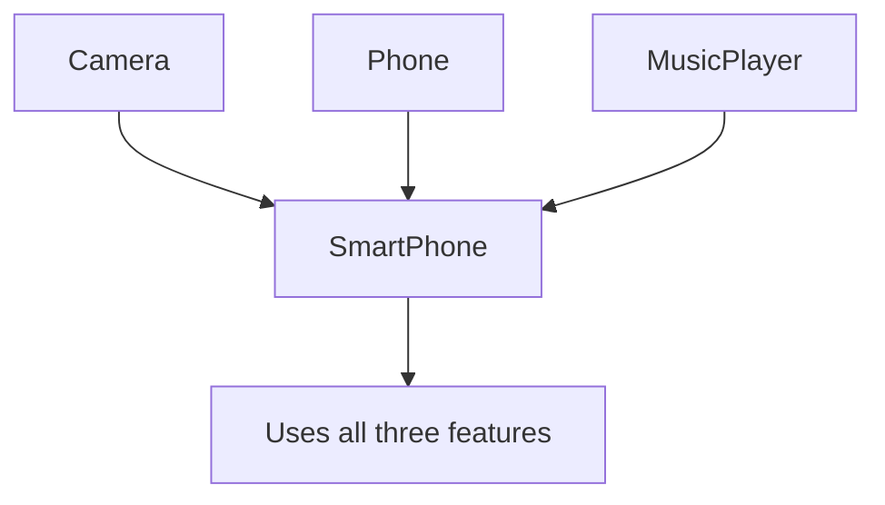

<p align="center">
  
</p>

<p align="center">
  
  
  
  
  
</p>

# 🐍 DAY 24 — Python OOP: Multiple Inheritance

> **Today's learning path:** First understand the concept and examples, then solve the theory questions, practise all 15 coding problems, and finally build the Smart Device Management System.

---

# 📘 Day 24 Concepts — Read & Understand Before Solving

## 1. What Is Inheritance?

Inheritance means a new class can reuse the data and methods of an existing class.

- **Parent class:** The class that provides features.
- **Child class:** The class that receives and can extend those features.

**Remember:** Parent gives features → Child reuses them.

## 2. What Is Multiple Inheritance?

Multiple Inheritance is an OOP feature in which **one child class inherits from two or more parent classes**.

Imagine a smartphone: it can use camera features, phone-call features, and music-player features. Instead of writing all these features again, one `SmartPhone` class can inherit them from separate classes.

**One-line definition to remember:**

> Multiple Inheritance = One child + two or more parents.

### Visual: How Multiple Inheritance Works



## 3. Syntax — How to Write It

```python
class ParentOne:
    def feature_one(self):
        print("Feature one")


class ParentTwo:
    def feature_two(self):
        print("Feature two")


class Child(ParentOne, ParentTwo):
    pass


obj = Child()
obj.feature_one()
obj.feature_two()
```

**Understand the syntax:** `class Child(ParentOne, ParentTwo)` means the child receives features from both parents. Parent order is important because it affects MRO.

## 4. How Does the Child Access Both Parents?

A child object can call methods inherited from either parent.

```python
class Camera:
    def take_photo(self):
        print("Photo captured")


class Phone:
    def make_call(self):
        print("Calling...")


class SmartPhone(Camera, Phone):
    pass


mobile = SmartPhone()
mobile.take_photo()
mobile.make_call()
```

**Output:**
```text
Photo captured
Calling...
```

The `SmartPhone` class did not define these two methods. It can still use them because it inherited them.

## 5. Multiple Inheritance With Constructors

A constructor (`__init__`) runs when an object is created. If both parent classes have constructors, the child must make sure both sets of required data are initialized.

### Simple method: call each parent constructor directly

```python
class Father:
    def __init__(self, father_name):
        self.father_name = father_name


class Mother:
    def __init__(self, mother_name):
        self.mother_name = mother_name


class Child(Father, Mother):
    def __init__(self, father_name, mother_name, child_name):
        Father.__init__(self, father_name)
        Mother.__init__(self, mother_name)
        self.child_name = child_name
```

This is easy to understand for a small example. In a cooperative inheritance design, prefer using `super()` consistently so Python can follow the MRO.

## 6. What Is MRO (Method Resolution Order)?

If two or more parent classes contain a method with the same name, Python needs to decide which method to search first.

**MRO is the order Python follows to search for a method or attribute.**

```python
class Father:
    def show(self):
        print("Father method")


class Mother:
    def show(self):
        print("Mother method")


class Child(Father, Mother):
    pass


Child().show()       # Father method
print(Child.mro())
```

Because `Father` is written before `Mother`, Python checks `Father` first in this example.

**Remember:** Parent order → MRO order → method lookup.

## 7. How to Check MRO?

Python provides two common ways:

```python
print(Child.mro())
print(Child.__mro__)
```

- `mro()` returns the method-resolution order as a **list**.
- `__mro__` exposes the order as a **tuple**.

Both show the order Python uses, including the final `object` base class.

## 8. What Is the Diamond Problem?

The Diamond Problem happens when two parent classes inherit from the same base class, and another child inherits from both of those parents.

```text
       A
      / \
     B   C
      \ /
       D
```

The question is: if both `B` and `C` inherit from `A`, should `D` reach `A` once or more than once?

Python uses MRO (based on C3 linearization) to create a consistent search order and avoid visiting the shared base repeatedly in the MRO.

## 9. What Does `super()` Do?

`super()` lets a method continue to the **next class in the MRO**.

It does **not** simply mean “call my direct parent.” This difference is very important in multiple inheritance.

```python
class A:
    def show(self):
        print("A")


class B(A):
    def show(self):
        print("B")
        super().show()


class C(A):
    def show(self):
        print("C")
        super().show()


class D(B, C):
    def show(self):
        print("D")
        super().show()


D().show()
print(D.mro())
```

**Output:**
```text
D
B
C
A
```

**MRO:** `D → B → C → A → object`

Each class uses `super()` to hand control to the next class in the MRO.

## 10. Advantages, Risks, and When to Use It

**Advantages**
- Reuse methods from more than one class.
- Combine independent capabilities in one child class.
- Reduce duplicated code.

**Risks**
- Complex inheritance can make code difficult to follow.
- Same-named methods can create confusion if MRO is not understood.
- Constructor coordination needs care.

**Good rule:** Use multiple inheritance when the parent classes represent compatible, reusable capabilities. If you only need to use another object, composition may be simpler.

## 🧠 Quick Memory Sheet

| Term | Easy meaning |
|---|---|
| Multiple Inheritance | One child, many parents |
| MRO | Python's method-search order |
| `mro()` | Shows MRO as a list |
| `__mro__` | Shows MRO as a tuple |
| `super()` | Calls the next class in MRO |
| Diamond Problem | Two paths lead to the same base class |
| C3 Linearization | Python's algorithm for calculating MRO |

### Before You Start the Questions

1. Explain Multiple Inheritance aloud in one sentence.
2. Write the syntax without looking.
3. Predict which `show()` method runs when parent order changes.
4. Print the MRO and compare it with your prediction.
5. Trace the `super()` example: `D → B → C → A`.

---

## 🎯 Learning Objectives

Today I will learn:

- What is Multiple Inheritance?
- How can one child class inherit from multiple parent classes?
- How to access methods from multiple parent classes.
- How to use multiple constructors.
- How to use `super()` in Multiple Inheritance.
- What is Method Resolution Order (MRO)?
- How to check MRO using `mro()` and `__mro__`.
- What is the Diamond Problem?
- How Python resolves method conflicts.
- How to implement Multiple Inheritance in real-world applications.

---

## 📚 Part 1 — Theory: Understand Before Coding

### 1. What is Multiple Inheritance?

Multiple Inheritance is an OOP concept in which one child class inherits properties and methods from more than one parent class.

In simple words:

**Multiple Inheritance = One child class inherits from two or more parent classes.**

### 2. Multiple Inheritance Syntax

```python
class Father:
    pass


class Mother:
    pass


class Child(Father, Mother):
    pass
```

Here:
- `Father` is the first parent class.
- `Mother` is the second parent class.
- `Child` inherits from both classes.

### 3. Simple Example

```python
class Father:
    def father_skill(self):
        print("Father: Driving")


class Mother:
    def mother_skill(self):
        print("Mother: Cooking")


class Child(Father, Mother):
    def child_skill(self):
        print("Child: Programming")


obj = Child()

obj.father_skill()
obj.mother_skill()
obj.child_skill()
```

**Output:**

```text
Father: Driving
Mother: Cooking
Child: Programming
```

### 4. Multiple Inheritance with Constructors

```python
class Father:
    def __init__(self, father_name):
        self.father_name = father_name


class Mother:
    def __init__(self, mother_name):
        self.mother_name = mother_name


class Child(Father, Mother):
    def __init__(self, father_name, mother_name, child_name):
        Father.__init__(self, father_name)
        Mother.__init__(self, mother_name)
        self.child_name = child_name


obj = Child("Rajesh", "Sunita", "Rahul")

print(obj.father_name)
print(obj.mother_name)
print(obj.child_name)
```

**Output:**

```text
Rajesh
Sunita
Rahul
```

**Important:** In this example, we explicitly call both parent constructors. This is a simple approach for understanding multiple constructors.

### 5. What is Method Resolution Order (MRO)?

When multiple parent classes contain a method with the same name, Python needs a rule to decide which method to call.

This order is called **Method Resolution Order (MRO)**.

Example:

```python
class Father:
    def show(self):
        print("Father Method")


class Mother:
    def show(self):
        print("Mother Method")


class Child(Father, Mother):
    pass


obj = Child()
obj.show()
```

**Output:**

```text
Father Method
```

Why?

Because `Father` appears before `Mother` in the inheritance declaration.

Python checks the classes according to MRO.

### 6. How to Check MRO?

We can check MRO using:

- `ClassName.mro()`
- `ClassName.__mro__`

Example:

```python
print(Child.mro())
```

**Output:**

```text
[<class '__main__.Child'>,
 <class '__main__.Father'>,
 <class '__main__.Mother'>,
 <class 'object'>]
```

### 7. What is the Diamond Problem?

The Diamond Problem occurs when a class inherits from two classes that both inherit from the same parent class.

Structure:

```text
        A
       / \
      B   C
       \ /
        D
```

Python uses MRO to decide the order in which methods are searched.

### 8. Multiple Inheritance with super()

In Python, `super()` follows MRO. It does not simply mean "call my direct parent."

For cooperative multiple inheritance, parent classes should use `super()` consistently and accept compatible constructor arguments.

Example:

```python
class A:
    def show(self):
        print("Class A")


class B(A):
    def show(self):
        print("Class B")
        super().show()


class C(A):
    def show(self):
        print("Class C")
        super().show()


class D(B, C):
    def show(self):
        print("Class D")
        super().show()


obj = D()
obj.show()

print(D.mro())
```

**Output:**

```text
Class D
Class B
Class C
Class A
```

MRO:

```text
D → B → C → A → object
```

### 9. Advantages of Multiple Inheritance

- Reuse functionality from multiple classes.
- Combine different features in one class.
- Reduce repeated code.
- Support flexible class design.
- Useful for combining independent capabilities.

### 10. Important Rules

- A class can inherit from multiple parent classes.
- The order of parent classes matters.
- Python follows MRO to resolve methods.
- `super()` follows the MRO.
- Avoid unnecessary complex inheritance.
- Use composition when inheritance does not represent a suitable relationship.

---

## 🧠 Part 2 — Theory Questions (15)

Answer in your own words.

1. What is Multiple Inheritance?
2. How is Multiple Inheritance different from Single Inheritance?
3. Can a child class inherit from two parent classes?
4. How do we write Multiple Inheritance syntax?
5. Can a child class access methods from both parent classes?
6. What happens if both parent classes have a method with the same name?
7. What is Method Resolution Order (MRO)?
8. Why is MRO important?
9. How can we check MRO in Python?
10. What is the purpose of `super()`?
11. Does `super()` always call the direct parent class?
12. What is the Diamond Problem?
13. How does Python solve the Diamond Problem?
14. What is the difference between `mro()` and `__mro__`?
15. Give three real-world examples of Multiple Inheritance.

---

## 💻 Part 3 — Practice Problems (15 Questions)

### 🟢 Level 1 — Basic Multiple Inheritance

### Q1. Father and Mother Skills

Create a `Father` class and a `Mother` class. Inherit both into a `Child` class.

**Concept:** Basic Multiple Inheritance.

**Requirements:**

- Father class should have a `father_skill()` method.
- Mother class should have a `mother_skill()` method.
- Child class should inherit both parent classes.
- Child class should have its own `child_skill()` method.
- Call all three methods using one Child object.

**Steps to Solve:**

1. Create the Father class.
2. Define a method to display the father's skill.
3. Create the Mother class.
4. Define a method to display the mother's skill.
5. Create `Child(Father, Mother)`.
6. Add a child-specific method.
7. Create one Child object.
8. Call all three methods.

**Expected Output:**

```text
Father Skill: Driving
Mother Skill: Cooking
Child Skill: Programming
```

### Q2. Person and Student Information

Create a `Person` class and a `School` class. Inherit both into a `Student` class.

**Concept:** Combining Attributes from Multiple Parents.

**Requirements:**

- Person stores name and age.
- School stores school name and location.
- Student stores roll number and marks.
- Student should access attributes from both parents.
- Display all student details.

**Steps to Solve:**

1. Create the Person class with name and age.
2. Create the School class with school name and location.
3. Create `Student(Person, School)`.
4. Initialize attributes from both parent classes.
5. Add roll number and marks.
6. Create a Student object.
7. Display all attributes.

**Expected Output:**

```text
Name: Rahul
Age: 20
School: ABC College
Location: Nagpur
Roll Number: 101
Marks: 85
```

### Q3. Camera and Phone

Create a `Camera` class and a `Phone` class. Inherit both into a `Smartphone` class.

**Concept:** Reusing Methods from Multiple Parents.

**Requirements:**

- Camera should have a `take_photo()` method.
- Phone should have a `make_call()` method.
- Smartphone should inherit both.
- Smartphone should have an `install_app()` method.
- Call all methods using a Smartphone object.

**Steps to Solve:**

1. Create the Camera class.
2. Add the photo-taking method.
3. Create the Phone class.
4. Add the calling method.
5. Create the Smartphone child class.
6. Add the app installation method.
7. Create an object and test all methods.

**Expected Output:**

```text
Photo Captured
Calling...
App Installed
```

### Q4. Employee and Department

Create an `Employee` class and a `Department` class. Inherit both into an `EmployeeDetails` class.

**Concept:** Multiple Parent Attributes.

**Requirements:**

- Employee stores employee name and ID.
- Department stores department name and department code.
- EmployeeDetails stores salary.
- Use all parent attributes in the child class.
- Display complete details.

**Steps to Solve:**

1. Create the Employee class.
2. Initialize employee name and ID.
3. Create the Department class.
4. Initialize department name and code.
5. Create `EmployeeDetails(Employee, Department)`.
6. Add salary.
7. Initialize both parent classes.
8. Display complete employee details.

### Q5. Father and Mother Constructors

Create two parent classes with constructors and inherit them into a Child class.

**Concept:** Multiple Parent Constructors.

**Requirements:**

- Father constructor accepts father name.
- Mother constructor accepts mother name.
- Child constructor accepts both names and child name.
- Initialize both parent attributes.
- Display all names.

**Steps to Solve:**

1. Create Father with its constructor.
2. Store father name.
3. Create Mother with its constructor.
4. Store mother name.
5. Create Child inheriting both classes.
6. Initialize both parent constructors explicitly.
7. Store child name.
8. Create an object and display all names.

**Expected Output:**

```text
Father: Rajesh
Mother: Sunita
Child: Rahul
```

### 🟡 Level 2 — Intermediate Multiple Inheritance

### Q6. Teacher and Researcher

Create a `Teacher` class and a `Researcher` class. Inherit both into a `Professor` class.

**Concept:** Combining Two Independent Roles.

**Requirements:**

- Teacher stores subject and experience.
- Researcher stores research topic and publication count.
- Professor stores professor name.
- Professor should access all parent attributes.
- Display complete professor information.

**Steps to Solve:**

1. Create the Teacher class.
2. Add subject and experience.
3. Create the Researcher class.
4. Add research topic and publication count.
5. Create `Professor(Teacher, Researcher)`.
6. Add professor name.
7. Initialize both parent classes.
8. Display all information.

### Q7. Printer and Scanner

Create a `Printer` class and a `Scanner` class. Inherit both into a `MultiFunctionMachine` class.

**Concept:** Combining Device Functionalities.

**Requirements:**

- Printer should have a `print_document()` method.
- Scanner should have a `scan_document()` method.
- MultiFunctionMachine should inherit both.
- Add a `copy_document()` method.
- Test all three functionalities.

**Steps to Solve:**

1. Create the Printer class.
2. Define the print method.
3. Create the Scanner class.
4. Define the scan method.
5. Create MultiFunctionMachine inheriting both.
6. Add the copy method.
7. Test all methods using one object.

### Q8. Student and Sports Player

Create a `Student` class and a `SportsPlayer` class. Inherit both into a `CollegeStudent` class.

**Concept:** Multiple Inheritance with Real-World Roles.

**Requirements:**

- Student stores name, roll number and marks.
- SportsPlayer stores sport name and achievements.
- CollegeStudent stores college name.
- Access attributes from both parent classes.
- Display academic and sports details.

**Steps to Solve:**

1. Create the Student class.
2. Initialize student information.
3. Create the SportsPlayer class.
4. Initialize sport and achievements.
5. Create CollegeStudent inheriting both.
6. Add college name.
7. Initialize both parents.
8. Display all details.

### Q9. Method Name Conflict

Create two parent classes with the same method name and inherit both into a child class.

**Concept:** Method Resolution Order.

**Requirements:**

- Parent class A should contain a `show()` method.
- Parent class B should also contain a `show()` method.
- Child class should inherit A first and B second.
- Call `show()` using a child object.
- Check the MRO.

**Steps to Solve:**

1. Create class A and define `show()`.
2. Create class B and define another `show()`.
3. Create `Child(A, B)`.
4. Create a Child object.
5. Call the `show()` method.
6. Observe which parent method runs.
7. Print `Child.mro()`.
8. Reverse the parent order and observe the difference.

**Expected Output for `Child(A, B)`:**

```text
Method from Class A
```

### Q10. Check MRO

Create a four-class inheritance structure and examine its MRO.

**Concept:** Understanding MRO.

**Requirements:**

- Create class A.
- Create class B inheriting A.
- Create class C inheriting A.
- Create class D inheriting B and C.
- Display MRO using both supported approaches.

**Steps to Solve:**

1. Create class A.
2. Create B(A).
3. Create C(A).
4. Create D(B, C).
5. Print `D.mro()`.
6. Print `D.__mro__`.
7. Identify the order of classes.
8. Explain why A appears only once.

**Expected MRO:**

```text
D → B → C → A → object
```

### 🔴 Level 3 — Advanced Logic Building

### Q11. Diamond Problem

Create a diamond-shaped inheritance structure.

**Concept:** Diamond Problem and MRO.

**Requirements:**

- Class A should have a `show()` method.
- Class B should inherit A.
- Class C should inherit A.
- Class D should inherit B and C.
- Use `super()` in each `show()` method.
- Observe the method execution order.

**Steps to Solve:**

1. Create class A and define `show()`.
2. Create class B inheriting A.
3. Override `show()` in B and call `super()`.
4. Create class C inheriting A.
5. Override `show()` in C and call `super()`.
6. Create class D inheriting B and C.
7. Override `show()` in D and call `super()`.
8. Create a D object.
9. Call `show()`.
10. Check `D.mro()` and compare the execution order.

**Expected Output:**

```text
Class D
Class B
Class C
Class A
```

### Q12. Banking System

Create a `Customer` class and an `Account` class. Inherit both into a `BankAccount` class.

**Concept:** Multiple Inheritance in a Banking Application.

**Requirements:**

- Customer stores customer name and customer ID.
- Account stores account number and balance.
- BankAccount inherits both classes.
- Add deposit and withdrawal methods.
- Prevent withdrawal when balance is insufficient.
- Display complete account details.

**Steps to Solve:**

1. Create the Customer class.
2. Initialize customer name and ID.
3. Create the Account class.
4. Initialize account number and balance.
5. Create BankAccount inheriting both classes.
6. Initialize both parent classes.
7. Add deposit logic.
8. Add withdrawal logic with balance validation.
9. Display customer and account information.
10. Test valid and invalid withdrawals.

### Q13. E-Commerce Product System

Create `ProductInfo` and `Inventory` classes. Inherit both into an `OnlineProduct` class.

**Concept:** Combining Product and Inventory Features.

**Requirements:**

- ProductInfo stores product name, price and category.
- Inventory stores stock quantity and warehouse location.
- OnlineProduct inherits both classes.
- Add a method to calculate total stock value.
- Add a method to check product availability.
- Validate price and stock quantity.

**Steps to Solve:**

1. Create ProductInfo.
2. Initialize product details.
3. Create Inventory.
4. Initialize stock and warehouse details.
5. Create OnlineProduct inheriting both.
6. Initialize both parent classes.
7. Calculate stock value using price and quantity.
8. Check whether the product is available.
9. Test products with zero and positive stock.

### Q14. University Management System

Create `Student`, `SportsPlayer` and `Researcher` parent classes. Inherit all three into a `UniversityStudent` class.

**Concept:** Multiple Inheritance with Three Parent Classes.

**Requirements:**

- Student stores name, roll number and marks.
- SportsPlayer stores sport and achievements.
- Researcher stores research topic and publication count.
- UniversityStudent stores university name.
- Access all parent attributes.
- Display complete student information.

**Steps to Solve:**

1. Create the Student class.
2. Initialize academic information.
3. Create the SportsPlayer class.
4. Initialize sports information.
5. Create the Researcher class.
6. Initialize research information.
7. Create `UniversityStudent(Student, SportsPlayer, Researcher)`.
8. Add university name.
9. Initialize all parent information.
10. Display all details.

### Q15. Cooperative Multiple Inheritance

Create a class hierarchy that uses `super()` and MRO correctly.

**Concept:** Advanced MRO and Cooperative Inheritance.

**Requirements:**

- Create class A with a `show()` method.
- Create class B inheriting A.
- Create class C inheriting A.
- Create class D inheriting B and C.
- Every class should call `super().show()`.
- Display the method execution order.
- Print the MRO.

**Steps to Solve:**

1. Create class A and define `show()`.
2. Create class B(A).
3. Override `show()` in B and call `super()`.
4. Create class C(A).
5. Override `show()` in C and call `super()`.
6. Create class D(B, C).
7. Override `show()` in D and call `super()`.
8. Create a D object.
9. Call `show()`.
10. Print the MRO.
11. Compare method execution order with MRO.

**Important:** This question reinforces the cooperative inheritance pattern. Avoid directly calling a specific parent method in each class; use `super()` consistently.

---

## 🏆 Part 4 — Main Challenge: Smart Device Management System

Build a Smart Device Management System using Multiple Inheritance.

### Class 1: Camera

**Methods:**

- `take_photo()`
- `record_video()`

### Class 2: Phone

**Methods:**

- `make_call()`
- `send_message()`

### Class 3: MusicPlayer

**Methods:**

- `play_music()`
- `stop_music()`

### Class 4: SmartPhone

Inherit all three parent classes.

**Attributes:**

- brand
- model
- price

**Methods:**

- `display_details()`
- `use_camera()`
- `use_phone()`
- `use_music_player()`

### Requirements

1. Create Camera class.
2. Create Phone class.
3. Create MusicPlayer class.
4. Create SmartPhone inheriting all three.
5. Store brand, model and price in SmartPhone.
6. Use methods from all parent classes.
7. Add child-specific methods.
8. Display complete smartphone details.
9. Create at least two smartphone objects.
10. Test all inherited functionalities.
11. Validate that price is not negative.
12. Print the SmartPhone class MRO.

### Expected Output

```text
===== SMARTPHONE MANAGEMENT SYSTEM =====

Brand: Samsung
Model: Galaxy S24
Price: Rs. 75000

--- Camera Features ---
Photo Captured
Video Recording Started

--- Phone Features ---
Calling...
Message Sent

--- Music Features ---
Music Playing
Music Stopped

--- Inheritance Information ---
SmartPhone
Camera
Phone
MusicPlayer
object
```

**Note:** The exact MRO order depends on the order in which parent classes are listed in the class declaration.

---

## 🎤 Part 5 — OOP Interview Questions (15)

**Q1. What is Multiple Inheritance?**

Ans: One child class gets features from two or more parent classes.

**Q2. What is the difference between Single and Multiple Inheritance?**

Ans: Single = one parent; Multiple = two or more parents.

**Q3. Can Python support Multiple Inheritance?**

Ans: Yes, Python supports it.

**Q4. What is MRO?**

Ans: MRO is Python's method-search order.

**Q5. How can we check MRO?**

Ans: Use `ClassName.mro()` or `ClassName.__mro__`.

**Q6. What happens when two parent classes have the same method?**

Ans: Python calls the method found first by MRO.

**Q7. What is the Diamond Problem?**

Ans: Two parents share one base, and a child inherits from both.

**Q8. How does Python solve the Diamond Problem?**

Ans: Python uses MRO to choose a clear search order.

**Q9. What is `super()`?**

Ans: `super()` moves to the next class in MRO.

**Q10. Does `super()` always call the direct parent?**

Ans: No. It follows MRO, not just the direct parent.

**Q11. Can a class inherit from three parent classes?**

Ans: Yes, a class can inherit from three or more parents.

**Q12. Does parent class order matter?**

Ans: Yes. Parent order changes the search order.

**Q13. What is C3 Linearization?**

Ans: C3 is Python's algorithm for building a consistent MRO.

**Q14. What is cooperative inheritance?**

Ans: Classes use `super()` together to follow the MRO.

**Q15. What is one disadvantage of Multiple Inheritance?**

Ans: Complex inheritance can make code hard to understand and maintain.

---

## 📁 Part 6 — GitHub Folder Structure

```text
Day24_Multiple_Inheritance/
│
├── README.md
│
│
├── practice/
│   ├── basic_multiple_inheritance.py
│   ├── intermediate_multiple_inheritance.py
│   └── advanced_multiple_inheritance.py
│
├── project/
    ├── challengeDay24.py

```

### File Responsibilities

- `basic_multiple_inheritance.py` — Q1–Q5.
- `intermediate_multiple_inheritance.py` — Q6–Q10.
- `advanced_multiple_inheritance.py` — Q11–Q15.
- `README.md` — Learning notes and project documentation.

---

## 📊 Part 7 — Day 24 Target

| Task | Target |
|---|---:|
| Theory Questions | 15 |
| Practice Problems | 15 |
| Interview Questions | 15 |
| Main Challenge | 1 |
| GitHub Update | 1 |

---

## 🚫 Part 8 — Rules

- Understand every parent-child relationship.
- Attempt each question independently.
- Practise accessing methods from multiple parents.
- Understand MRO instead of memorizing only the output.
- Use `super()` correctly.
- Do not copy complete solutions.
- Test method conflicts.
- Avoid unnecessary complex inheritance.

---

## ✅ Part 9 — Completion Checklist

- [ ] Understood Multiple Inheritance.
- [ ] Created a child class with two parents.
- [ ] Accessed methods from multiple parents.
- [ ] Practised multiple constructors.
- [ ] Understood MRO.
- [ ] Used `mro()` and `__mro__`.
- [ ] Understood the Diamond Problem.
- [ ] Practised `super()`.
- [ ] Completed Q1–Q15.
- [ ] Completed Smart Device Management System.
- [ ] Prepared interview answers.
- [ ] Updated GitHub README.
- [ ] Pushed code to GitHub.

---

## 🚀 GitHub Commit

```bash
git add .
git commit -m "Day 24: Python multiple inheritance practice"
git push
```

**Day 24 Goal:** Understand Multiple Inheritance, MRO, and the Diamond Problem, and build Python applications using multiple parent classes.

---

<p align="center">
  
</p>

<h3 align="center"><b>Sudhanshu Dhande</b></h3>
<p align="center"><i>B.Tech (AI &amp; ML) · BATU, Lonere · Python OOP Journey</i></p>
