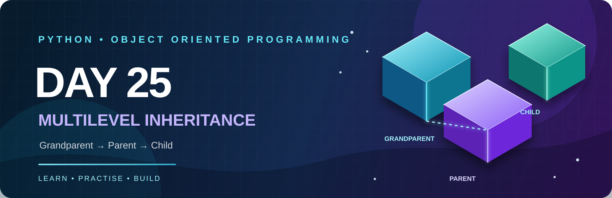
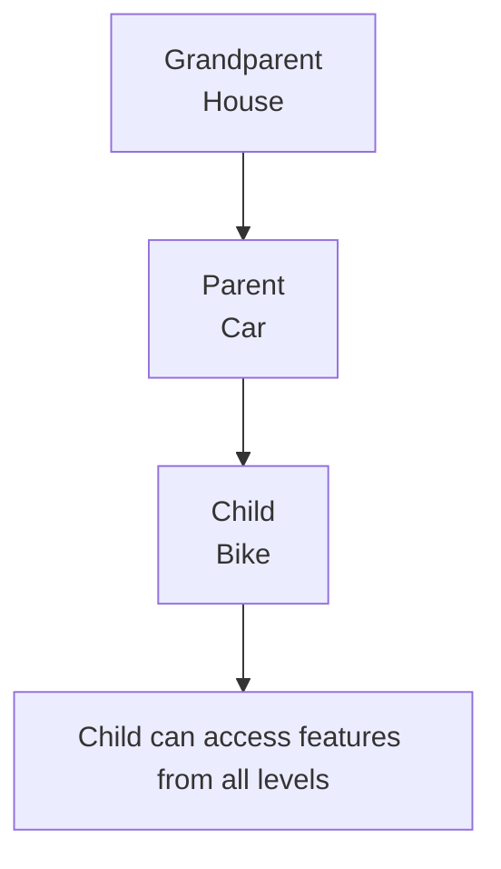

<p align="center">
  
</p>

<p align="center">
  
  
  
  
  
</p>

# 🚀 DAY 25 — PYTHON OOP: MULTILEVEL INHERITANCE

> **Study first, code later:** Understand the inheritance chain, read each example, trace `super()`, and then attempt the 15 practice problems yourself.

---

# 📘 Day 25 Concepts — Read & Understand Before Solving

## 1. First, What Is Inheritance?

Inheritance is an OOP feature that allows one class to reuse attributes and methods from another class.

- **Parent class:** Gives its features to another class.
- **Child class:** Receives and can extend those features.

**Remember:** Inheritance = Reusing features of an existing class.

## 2. What Is Multilevel Inheritance?

Multilevel Inheritance means a class inherits from a parent class, and another class inherits from that child class. Inheritance continues through multiple levels.

**Easy definition to remember:**

> Multilevel Inheritance = Grandparent → Parent → Child.

Example:
- `Grandparent` has a house.
- `Parent` inherits the house and has a car.
- `Child` inherits features from both earlier levels and has a bike.

### Visual: The Inheritance Chain



## 3. Basic Syntax

```python
class Grandparent:
    def house(self):
        print("Grandparent has a house")


class Parent(Grandparent):
    def car(self):
        print("Parent has a car")


class Child(Parent):
    def bike(self):
        print("Child has a bike")


obj = Child()
obj.house()
obj.car()
obj.bike()
```

**Output:**
```text
Grandparent has a house
Parent has a car
Child has a bike
```

**Understand it:** `Parent(Grandparent)` means Parent inherits Grandparent. `Child(Parent)` means Child inherits Parent. So a Child object can use methods from all three levels.

## 4. What Is an Inheritance Chain?

An inheritance chain is the path through which features are passed from one class to another.

```text
Grandparent
     |
     v
   Parent
     |
     v
   Child
```

The last child can access inherited methods and attributes from earlier classes, provided they are accessible.

## 5. What Is `super()`?

`super()` is used to continue method lookup in the inheritance order, commonly to call a parent class method or constructor.

**Remember:** `super()` helps the child continue parent initialization or behaviour.

```python
class Person:
    def __init__(self, name):
        self.name = name


class Employee(Person):
    def __init__(self, name, salary):
        super().__init__(name)
        self.salary = salary


class Manager(Employee):
    def __init__(self, name, salary, department):
        super().__init__(name, salary)
        self.department = department


manager = Manager("Amit", 60000, "IT")
print(manager.name)
print(manager.salary)
print(manager.department)
```

**Output:**
```text
Amit
60000
IT
```

## 6. What Is Constructor Chaining?

A constructor is the `__init__()` method. Constructor chaining means constructors are called through the inheritance chain so each level can initialize its own data.

In the example above:
1. `Manager` receives all details.
2. `Manager` calls `super()` to initialize `Employee`.
3. `Employee` calls `super()` to initialize `Person`.
4. Each class stores its own attributes.

**Memory line:** Manager → Employee → Person initialization.

## 7. What Is Method Overriding?

Method overriding happens when a child class defines a method with the same name as a method in its parent class.

```python
class Device:
    def start(self):
        print("Device is starting")


class Computer(Device):
    def start(self):
        print("Computer is starting")


class GamingComputer(Computer):
    def start(self):
        print("Gaming Computer is starting")


GamingComputer().start()
```

**Output:**
```text
Gaming Computer is starting
```

Python uses the method defined in the closest class in the inheritance chain.

## 8. What Is MRO?

MRO means **Method Resolution Order**. It is the order Python follows when searching for a method or attribute in an inheritance hierarchy.

```python
class Person:
    pass

class Employee(Person):
    pass

class Manager(Employee):
    pass

print(Manager.mro())
```

For this simple chain, the order is:

```text
Manager → Employee → Person → object
```

## 9. What Is Code Reusability?

Code reusability means writing a feature once and using it in other classes instead of repeating the same code.

Example: `Person` stores a name once. `Employee` can reuse it, and `Manager` can reuse it through `Employee`.

## 10. Benefits and Good Practices

**Benefits**
- Reuse code across multiple levels.
- Keep related classes organized.
- Extend existing behaviour in child classes.
- Model real-world hierarchies.

**Good practices**
- Keep the inheritance chain understandable.
- Use `super()` consistently when chaining constructors.
- Override methods only when the child needs different behaviour.
- Avoid unnecessary inheritance levels.

## 🧠 Quick Memory Sheet

| Term | Easy meaning |
|---|---|
| Inheritance | Reuse features from another class |
| Multilevel Inheritance | Grandparent → Parent → Child |
| `super()` | Continue to the next class in the inheritance order |
| Constructor chaining | Initialize each level in the chain |
| Method overriding | Child redefines a parent method |
| MRO | Python's method-search order |
| Code reusability | Write once, reuse in child classes |

### Before You Start the Questions

1. Draw the chain: `Grandparent → Parent → Child`.
2. Explain why a Child object can use Grandparent methods.
3. Trace the constructor calls in `Person → Employee → Manager`.
4. Predict which `start()` method runs in the overriding example.
5. Explain `super()` in one simple sentence.

---
## 1. Learning Objectives

By the end of this day, you should understand:

1. What is Multilevel Inheritance?
2. Parent, Child, and Grandchild classes.
3. How inheritance works across multiple levels.
4. How to use `super()`.
5. Method overriding in multilevel inheritance.
6. Constructor execution across inheritance levels.
7. Code reusability in real-world applications.

---

## 2. What is Multilevel Inheritance?

Multilevel Inheritance means one child class inherits from a parent class, and another class inherits from that child class.

### Structure

```text
        Grandparent
             |
             v
          Parent
             |
             v
           Child
```

### Example

```python
class Grandparent:
    def house(self):
        print("Grandparent has a house")


class Parent(Grandparent):
    def car(self):
        print("Parent has a car")


class Child(Parent):
    def bike(self):
        print("Child has a bike")
```

### Object Creation

```python
obj = Child()

obj.house()
obj.car()
obj.bike()
```

**Expected Output:**

```text
Grandparent has a house
Parent has a car
Child has a bike
```

**Remember:** The Child class can access its own methods, Parent methods, and Grandparent methods.

---

## 3. Important Concepts

### A. Inheritance Chain

A class can inherit properties and methods from its parent, which itself inherits from another class.

### B. super()

`super()` is used to access methods from the parent class.

### C. Constructor Execution

When constructors are defined at multiple levels, use `super().__init__()` to initialize the parent classes in the inheritance chain.

### D. Method Overriding

A child class can define a method with the same name as its parent class method.

### E. Code Reusability

Instead of writing the same code again, reuse methods from existing classes.

---

## 4. Theory Questions — 15 Questions

1. What is Multilevel Inheritance?
2. What is the difference between Single and Multilevel Inheritance?
3. What is a Grandparent class?
4. What is a Parent class?
5. What is a Child class?
6. How many levels can inheritance have?
7. Can a Child class access Grandparent methods?
8. What is the purpose of `super()`?
9. How do constructors work in Multilevel Inheritance?
10. What happens if `super()` is not used?
11. Can a Child class override a Grandparent method?
12. What is method resolution order (MRO)?
13. What is the benefit of code reusability?
14. Can we create an object of the Child class?
15. Give three real-world examples of Multilevel Inheritance.

---

# 5. Practical Questions — 15 Problems

**Instructions:** Solve every question yourself. Follow the requirements and steps. Do not copy solutions directly.

## Q1. Person → Student → CollegeStudent

**Concept:** Basic Multilevel Inheritance.

**Requirements:**
- Create a `Person` class.
- Create a `Student` class inheriting from `Person`.
- Create a `CollegeStudent` class inheriting from `Student`.
1. Store name and age in Person.
2. Store roll number and marks in Student.
3. Store college name in CollegeStudent.
4. Create an object of CollegeStudent.
5. Display all information using methods.

**Expected Output:**

```text
Name: Sudhanshu
Age: 22
Roll Number: 101
Marks: 85
College: ABC College
```

## Q2. Animal → Mammal → Dog

**Concept:** Multilevel Inheritance with methods.

**Requirements:**
- Create Animal, Mammal, and Dog classes.
1. Animal should have an `eat()` method.
2. Mammal should have a `walk()` method.
3. Dog should have a `bark()` method.
4. Create a Dog object.
5. Call all three methods.

**Expected Output:**

```text
Animal is eating
Mammal is walking
Dog is barking
```

## Q3. Vehicle → Car → ElectricCar

**Concept:** Multilevel Inheritance with attributes.

**Requirements:**
- Create three classes: Vehicle, Car, ElectricCar.
1. Vehicle should store brand.
2. Car should store model.
3. ElectricCar should store battery capacity.
4. Display all details using an object of ElectricCar.

**Expected Output:**

```text
Brand: Tesla
Model: Model 3
Battery: 75 kWh
```

## Q4. Employee → Developer → SeniorDeveloper

**Concept:** Multilevel Inheritance with salary.

**Requirements:**
- Create Employee, Developer, and SeniorDeveloper classes.
1. Employee stores employee name and basic salary.
2. Developer stores programming language.
3. SeniorDeveloper stores experience.
4. Add a method to calculate annual salary.
5. Display complete employee information.

**Expected Output:**

```text
Name: Rahul
Salary: 50000
Language: Python
Experience: 5 Years
Annual Salary: 600000
```

## Q5. Bank → Account → SavingsAccount

**Concept:** Multilevel Inheritance with calculations.

**Requirements:**
- Create Bank, Account, and SavingsAccount classes.
1. Bank stores bank name.
2. Account stores account number and balance.
3. SavingsAccount stores interest rate.
4. Create a method to calculate annual interest.
5. Display account details and interest.

**Expected Output:**

```text
Bank: SBI
Account Number: 12345
Balance: 50000
Interest Rate: 5%
Annual Interest: 2500
```

## Q6. Product → Electronics → Laptop

**Concept:** Multilevel Inheritance with product details.

**Requirements:**
- Create Product, Electronics, and Laptop classes.
1. Product stores product name and price.
2. Electronics stores warranty period.
3. Laptop stores RAM and storage.
4. Display all product details.

**Expected Output:**

```text
Product: Laptop
Price: 55000
Warranty: 2 Years
RAM: 16 GB
Storage: 512 GB SSD
```

## Q7. School → Department → Teacher

**Concept:** Multilevel Inheritance with organizational structure.

**Requirements:**
- Create School, Department, and Teacher classes.
1. School stores school name.
2. Department stores department name.
3. Teacher stores teacher name and subject.
4. Display all details.

**Expected Output:**

```text
School: ABC School
Department: Computer Science
Teacher: Amit
Subject: Python
```

## Q8. User → Customer → PremiumCustomer

**Concept:** Multilevel Inheritance with customer information.

**Requirements:**
- Create User, Customer, and PremiumCustomer classes.
1. User stores username and email.
2. Customer stores customer ID.
3. PremiumCustomer stores discount percentage.
4. Create a method to calculate final price after discount.
5. Display all customer details.

**Expected Output:**

```text
Username: Rahul
Customer ID: 101
Discount: 20%
Original Price: 1000
Final Price: 800
```

## Q9. Device → Computer → GamingComputer

**Concept:** Method overriding.

**Requirements:**
- Create Device, Computer, and GamingComputer classes.
1. Device should contain a `start()` method.
2. Computer should override the `start()` method.
3. GamingComputer should override it again.
4. Create an object of GamingComputer.
5. Call the `start()` method.
6. Observe which method executes.

**Expected Output:**

```text
Gaming Computer is starting
```

## Q10. Person → Employee → Manager

**Concept:** Constructor chaining using `super()`.

**Requirements:**
- Create Person, Employee, and Manager classes.
1. Person initializes name and age.
2. Employee initializes employee ID and salary.
3. Manager initializes department.
4. Use `super()` to initialize parent attributes.
5. Display all information.

**Expected Output:**

```text
Name: Amit
Age: 30
Employee ID: 101
Salary: 60000
Department: IT
```

## Q11. Library → LibraryItem → Book

**Concept:** Real-world Multilevel Inheritance.

**Requirements:**
- Create Library, LibraryItem, and Book classes.
1. Library stores library name.
2. LibraryItem stores item ID and title.
3. Book stores author and price.
4. Create a method to display book information.
5. Display all details.

**Expected Output:**

```text
Library: Central Library
Item ID: 101
Title: Python Programming
Author: Harry
Price: 500
```

## Q12. Organization → Department → Employee

**Concept:** Multiple attributes across inheritance levels.

**Requirements:**
- Create Organization, Department, and Employee classes.
1. Organization stores organization name.
2. Department stores department name.
3. Employee stores employee name and salary.
4. Use constructors to initialize attributes.
5. Display complete information.

**Expected Output:**

```text
Organization: ABC Company
Department: Data Science
Employee: Rahul
Salary: 45000
```

## Q13. Transport → Bus → ElectricBus

**Concept:** Multilevel Inheritance with fare and capacity.

**Requirements:**
- Create Transport, Bus, and ElectricBus classes.
1. Transport stores vehicle name.
2. Bus stores passenger capacity.
3. ElectricBus stores battery capacity.
4. Create a method to calculate total fare.
5. Assume fare is ₹15 per passenger.
6. Display vehicle information and total fare for 20 passengers.

**Expected Output:**

```text
Vehicle: Electric Bus
Capacity: 40
Battery: 120 kWh
Passengers: 20
Total Fare: 300
```

## Q14. Account → SavingsAccount → PremiumSavingsAccount

**Concept:** Advanced calculations and method overriding.

**Requirements:**
- Create Account, SavingsAccount, and PremiumSavingsAccount classes.
1. Account stores account holder and balance.
2. SavingsAccount stores normal interest rate.
3. PremiumSavingsAccount stores premium interest rate.
4. Create an interest calculation method.
5. Override the method in PremiumSavingsAccount.
6. Compare the interest earned by both accounts.

**Expected Output:**

```text
Account Holder: Rahul
Balance: 100000
Normal Interest: 4000
Premium Interest: 7000
```

## Q15. Hospital → Department → Doctor

**Concept:** Complete Multilevel Inheritance.

**Requirements:**
- Create Hospital, Department, and Doctor classes.
1. Hospital stores hospital name and location.
2. Department stores department name.
3. Doctor stores doctor name, specialization, and consultation fee.
4. Use constructors and `super()`.
5. Create a method to display the complete doctor profile.
6. Create an object of Doctor and display all information.

**Expected Output:**

```text
Hospital: City Hospital
Location: Nagpur
Department: Cardiology
Doctor: Dr. Amit
Specialization: Heart Specialist
Consultation Fee: 800
```

---

# 6. Main Challenge — Employee Management System

**Difficulty:** Advanced

Build an Employee Management System using Multilevel Inheritance.

### Class Structure

```text
Person
  |
  v
Employee
  |
  v
Manager
```

### Requirements

1. Create a Person class.
2. Store employee name and age.
3. Create an Employee class inheriting from Person.
4. Store employee ID and basic salary.
5. Create a Manager class inheriting from Employee.
6. Store department and bonus.
7. Use `super()` for constructor chaining.
8. Calculate annual salary.
9. Display the complete manager profile.
10. Create at least two Manager objects.

### Expected Output

```text
========== MANAGER DETAILS ==========

Name: Rahul
Age: 30
Employee ID: 101
Basic Salary: 50000
Department: AI & ML
Bonus: 10000
Annual Salary: 610000
```

---

# 7. OOP Interview Questions — 15 Questions with Answers

**Q1. What is Multilevel Inheritance?**

**Q2. What is the structure of Multilevel Inheritance?**

**Q3. Can a child access grandparent methods?**

**Q4. What is `super()`?**

**Q5. What is constructor chaining?**

**Q6. What is method overriding?**

**Q7. Can we override a grandparent method?**

**Q8. What is code reusability?**

**Q9. Can we create an object of the last child class?**

**Q10. What is MRO?**

**Q11. Which method helps inspect MRO?**

**Q12. Is Multilevel Inheritance supported in Python?**

**Q13. What happens when a child overrides a method?**

**Q14. What is the difference between Multiple and Multilevel Inheritance?**

**Q15. Give a real-world example.**


---

# 8. GitHub Folder Structure

```text
Day25_Multilevel_Inheritance/
│
├── README.md
│
├── theory/
│   └── multilevel_inheritance_notes.py
│
├── practice/
│   ├── question_01.py
│   ├── question_02.py
│   ├── question_03.py
│   ├── question_04.py
│   ├── question_05.py
│   ├── question_06.py
│   ├── question_07.py
│   ├── question_08.py
│   ├── question_09.py
│   ├── question_10.py
│   ├── question_11.py
│   ├── question_12.py
│   ├── question_13.py
│   ├── question_14.py
│   └── question_15.py
│
├── main_challenge/
│   └── employee_management.py
│
└── interview_questions/
    └── answers.md
```

---

# 9. Day 25 Checklist

- [ ] Understand Multilevel Inheritance.
- [ ] Understand the Grandparent → Parent → Child relationship.
- [ ] Practise `super()`.
- [ ] Understand constructor chaining.
- [ ] Practise method overriding.
- [ ] Complete all 15 practice questions.
- [ ] Complete the Main Challenge.
- [ ] Revise all 15 interview questions.
- [ ] Push your work to GitHub.

---

# 10. GitHub Commit

```bash
git add .
git commit -m "Complete Day 25 Multilevel Inheritance"
git push
```

---

## Final Goal

After completing Day 25, you should be able to design your own classes using Multilevel Inheritance and solve real-world OOP problems independently.

**Practice first. Understand the logic. Then write the code yourself.**

---

<p align="center">
  
</p>

<h3 align="center"><b>Sudhanshu Dhande</b></h3>
<p align="center"><i>B.Tech (AI &amp; ML) · BATU, Lonere · Python OOP Journey</i></p>
