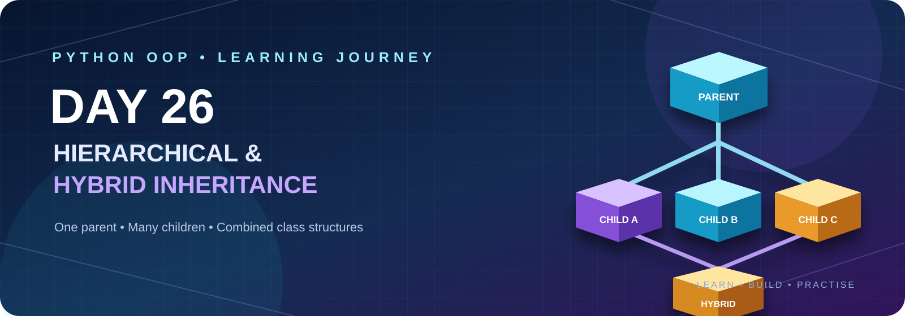

<p align="center">
  
</p>

<p align="center">
  
  
  
</p>

---

# 📘 Start Here — Understand Day 26 Before Solving Questions

Aaj ka topic **Inheritance ke do important patterns** hain: **Hierarchical Inheritance** aur **Hybrid Inheritance**. Pehle inka simple meaning, structure aur examples samjho; phir neeche diye gaye theory aur practical questions solve karo.

## 1. Inheritance kya hota hai?

**Definition:** Inheritance ek OOP feature hai jisme ek class doosri class ke attributes aur methods ko reuse kar sakti hai.

- Jis class se features milte hain, use **Parent / Base class** kehte hain.
- Jo class features leti hai, use **Child / Derived class** kehte hain.

**Easy example:** `Animal` parent class mein `eat()` method hai. `Dog` class `Animal` se inherit kare, to Dog apna `bark()` method bhi rakh sakta hai aur parent ka `eat()` bhi use kar sakta hai.

```python
class Animal:
    def eat(self):
        print("Animal is eating")

class Dog(Animal):
    def bark(self):
        print("Dog is barking")

dog = Dog()
dog.eat()   # inherited method
dog.bark()  # Dog's own method
```

## 2. Hierarchical Inheritance kya hai?

**Definition:** Jab **ek hi parent class se multiple child classes** inherit karti hain, use Hierarchical Inheritance kehte hain.

<pre>
              Animal (Parent)
             /      |       \
          Dog      Cat      Cow
</pre>

**Yaad rakhne ka shortcut:** *One Parent → Many Children.*

Har child ko parent ke common methods milte hain, lekin har child apne alag methods bhi bana sakta hai. Jaise Dog `bark()`, Cat `meow()` aur Cow `sound()` use kar sakti hai.

**Kab useful hai?** Jab multiple classes mein kuch common information ya behaviour ho, jaise `Person` se `Student`, `Teacher` aur `Employee`.

## 3. Hybrid Inheritance kya hai?

**Definition:** Jab ek class structure mein **do ya do se zyada inheritance patterns combine** hote hain, use Hybrid Inheritance kehte hain.

<pre>
             Person
            /      \
        Student   Employee
            \      /
         WorkingStudent
</pre>

Yahaan `Person` se `Student` aur `Employee` dono inherit karte hain (Hierarchical pattern), aur `WorkingStudent` dono classes se inherit karta hai (Multiple Inheritance). Isliye ye Hybrid Inheritance hai.

**Yaad rakhne ka shortcut:** *Hybrid = Mix of inheritance types.*

## 4. Multiple Inheritance se relation

**Definition:** Jab ek child class ek se zyada parent classes se inherit karti hai, use Multiple Inheritance kehte hain.

```python
class Student:
    def study(self):
        print("Studying")

class Employee:
    def work(self):
        print("Working")

class WorkingStudent(Student, Employee):
    pass

obj = WorkingStudent()
obj.study()
obj.work()
```

Hybrid inheritance ke structure mein Multiple Inheritance ek part ho sakta hai.

## 5. Diamond Problem kya hai?

Jab do parent classes ek hi common parent se inherit karti hain, aur ek child un dono parent classes se inherit karta hai, to method lookup mein ambiguity ka question aa sakta hai. Is situation ko **Diamond Problem** kehte hain.

<pre>
          A
         / \
        B   C
         \ /
          D
</pre>

Python is method lookup order ko **MRO (Method Resolution Order)** se manage karta hai.

## 6. MRO kya hai?

**Definition:** MRO woh order hai jisme Python kisi class ke method ko search karta hai.

MRO check karne ke liye:

```python
print(MyClass.mro())
# or
print(MyClass.__mro__)
```

Example mein `class D(B, C)` ho, to aam taur par order `D → B → C → A → object` hota hai. Python C3 linearization algorithm use karke MRO calculate karta hai.

**Memory tip:** *MRO = Method Search Order.*

## 7. `super()` kya karta hai?

**Definition:** `super()` current class ke baad MRO mein aane wali next class ke method ko call karne mein help karta hai.

```python
class Parent:
    def show(self):
        print("Parent")

class Child(Parent):
    def show(self):
        print("Child")
        super().show()

Child().show()
```

Output:
```text
Child
Parent
```

Complex inheritance mein `super()` aur MRO ko saath samajhna important hai. `super()` hamesha seedha “parent” ko hi call nahi karta; woh MRO ki **next class** par jaata hai.

## 8. Quick Revision — 6 Lines

| Term | Easy meaning |
|---|---|
| Inheritance | Reuse another class's features |
| Hierarchical | One parent, many children |
| Multiple | One child, many parents |
| Hybrid | Mix of inheritance patterns |
| Diamond Problem | Two branches share one parent |
| MRO | Order of method search |
| `super()` | Call next class in MRO |

**Study order:** Definitions samjho → diagrams dekho → examples run karo → theory questions attempt karo → practical problems solve karo → interview answers revise karo.

---

# 🚀 DAY 26 — PYTHON OOP: HIERARCHICAL & HYBRID INHERITANCE

**Level:** Beginner to Advanced  
**Goal:** Understand and implement Hierarchical and Hybrid Inheritance through practical problems.

---

# 1. Learning Objectives

By the end of Day 26, you should understand:

1. What is Hierarchical Inheritance?
2. What is Hybrid Inheritance?
3. Difference between both inheritance types.
4. How multiple child classes inherit from one parent.
5. How to combine different inheritance types.
6. How to use `super()` in complex inheritance.
7. What is Method Resolution Order (MRO)?
8. How Python handles the Diamond Problem.

---

# 2. Hierarchical Inheritance

## What is Hierarchical Inheritance?

When multiple child classes inherit from a single parent class, it is called Hierarchical Inheritance.

### Structure

```text
             Parent
           /   |    \
          /    |     \
       Child1 Child2 Child3
```

### Example

```python
class Animal:
    def eat(self):
        print("Animal is eating")


class Dog(Animal):
    def bark(self):
        print("Dog is barking")


class Cat(Animal):
    def meow(self):
        print("Cat is meowing")


class Cow(Animal):
    def sound(self):
        print("Cow is mooing")
```

### Object Creation

```python
dog = Dog()
cat = Cat()
cow = Cow()

dog.eat()
dog.bark()

cat.eat()
cat.meow()

cow.eat()
cow.sound()
```

### Expected Output

```text
Animal is eating
Dog is barking
Animal is eating
Cat is meowing
Animal is eating
Cow is mooing
```

### Important Points

- One parent class can have multiple child classes.
- Every child inherits the parent's methods.
- Each child can have its own methods.
- Changes to the parent class can affect all child classes.

---

# 3. Hybrid Inheritance

## What is Hybrid Inheritance?

When two or more types of inheritance are combined in a single class structure, it is called Hybrid Inheritance.

### Structure Example

```text
          Person
         /      \
      Student   Employee
         \      /
        WorkingStudent
```

This combines Hierarchical and Multiple Inheritance.

### Example

```python
class Person:
    def show_person(self):
        print("Person details")


class Student(Person):
    def show_student(self):
        print("Student details")


class Employee(Person):
    def show_employee(self):
        print("Employee details")


class WorkingStudent(Student, Employee):
    def show_working_student(self):
        print("Working student details")
```

### Object Creation

```python
obj = WorkingStudent()

obj.show_person()
obj.show_student()
obj.show_employee()
obj.show_working_student()
```

### Expected Output

```text
Person details
Student details
Employee details
Working student details
```

---

# 4. Diamond Problem and MRO

## What is the Diamond Problem?

The Diamond Problem happens when a class inherits from two classes that share the same parent.

### Structure

```text
             A
            / \
           B   C
            \ /
             D
```

Both B and C inherit from A, and D inherits from B and C.

Python uses Method Resolution Order (MRO) to decide which method should execute first.

### Example

```python
class A:
    def show(self):
        print("Class A")


class B(A):
    def show(self):
        print("Class B")


class C(A):
    def show(self):
        print("Class C")


class D(B, C):
    pass
```

### Object Creation

```python
obj = D()

obj.show()

print(D.mro())
```

### Expected Output

```text
Class B
```

MRO order:

```text
D → B → C → A → object
```

**Remember:** Python follows C3 Method Resolution Order to resolve method lookup in multiple inheritance.

---

# 5. Important Concepts

| Concept | Meaning |
|---|---|
| Hierarchical Inheritance | Multiple children inherit from one parent |
| Hybrid Inheritance | Combination of inheritance types |
| Multiple Inheritance | One child inherits from multiple parents |
| MRO | Method lookup order |
| Diamond Problem | Two parent classes share a common ancestor |
| `super()` | Accesses the next class in the MRO |

---

# 6. Theory Questions — 15 Questions

1. What is Hierarchical Inheritance?
2. What is Hybrid Inheritance?
3. What is the difference between Hierarchical and Multiple Inheritance?
4. Can multiple child classes inherit from one parent?
5. Can each child class have different methods?
6. What is the advantage of Hierarchical Inheritance?
7. What is the structure of Hybrid Inheritance?
8. What is the Diamond Problem?
9. What is Method Resolution Order?
10. What is the purpose of `ClassName.mro()`?
11. What is C3 Linearization?
12. How does Python resolve conflicting methods?
13. What is the role of `super()` in Hybrid Inheritance?
14. Can Hybrid Inheritance contain Multiple Inheritance?
15. Give three real-world examples of Hybrid Inheritance.

---

# 7. Practical Questions — 15 Problems

Solve all questions independently. Follow the requirements and steps.

## Q1. Animal → Dog, Cat, Cow

**Concept:** Basic Hierarchical Inheritance.

**Requirements:**
- Create one parent class `Animal`.
- Create three child classes: `Dog`, `Cat`, and `Cow`.

**Steps to Solve:**
1. Add an `eat()` method in Animal.
2. Add a `bark()` method in Dog.
3. Add a `meow()` method in Cat.
4. Add a `sound()` method in Cow.
5. Create separate objects for all three child classes.
6. Call the inherited and individual methods.

**Expected Output:**
```text
Animal is eating
Dog is barking
Animal is eating
Cat is meowing
Animal is eating
Cow is mooing
```

## Q2. Person → Student, Teacher, Employee

**Concept:** Hierarchical Inheritance with attributes.

**Requirements:**
- Create Person as the parent class.
- Create Student, Teacher, and Employee as child classes.

**Steps to Solve:**
1. Store name and age in Person.
2. Student stores roll number.
3. Teacher stores subject.
4. Employee stores salary.
5. Use constructors to initialize attributes.
6. Display information for each object.

**Expected Output:**
```text
Student: Rahul, Age: 20, Roll: 101
Teacher: Amit, Age: 35, Subject: Python
Employee: Raj, Age: 28, Salary: 40000
```

## Q3. Vehicle → Car, Bike, Bus

**Concept:** Method reusability.

**Requirements:**
- Create Vehicle as the parent class.
- Create Car, Bike, and Bus as child classes.

**Steps to Solve:**
1. Vehicle should have a `start()` method.
2. Car should have a `four_wheels()` method.
3. Bike should have a `two_wheels()` method.
4. Bus should have a `passenger_capacity()` method.
5. Create one object of each class.
6. Call all available methods.

**Expected Output:**
```text
Vehicle started
Car has four wheels
Vehicle started
Bike has two wheels
Vehicle started
Bus carries passengers
```

## Q4. Employee → Manager, Developer, Designer

**Concept:** Hierarchical Inheritance with salary details.

**Requirements:**
- Create Employee parent class.
- Create three child classes.

**Steps to Solve:**
1. Store employee name and basic salary in Employee.
2. Manager stores team size.
3. Developer stores programming language.
4. Designer stores design tool.
5. Display complete details for each employee.

**Expected Output:**
```text
Manager: Rahul, Salary: 60000, Team: 10
Developer: Amit, Salary: 50000, Language: Python
Designer: Priya, Salary: 45000, Tool: Figma
```

## Q5. Bank → SavingsAccount, CurrentAccount

**Concept:** Hierarchical Inheritance with calculations.

**Requirements:**
- Create BankAccount parent class.
- Create SavingsAccount and CurrentAccount child classes.

**Steps to Solve:**
1. Store account holder and balance in BankAccount.
2. SavingsAccount stores interest rate.
3. CurrentAccount stores overdraft limit.
4. Add a method to calculate savings interest.
5. Display the details of both accounts.

**Expected Output:**
```text
Savings Account: Rahul
Balance: 50000
Interest: 2500

Current Account: Amit
Balance: 80000
Overdraft Limit: 20000
```

## Q6. Shape → Circle, Rectangle, Triangle

**Concept:** Hierarchical Inheritance with mathematical calculations.

**Requirements:**
- Create Shape as parent class.
- Create Circle, Rectangle, and Triangle child classes.

**Steps to Solve:**
1. Circle stores radius.
2. Rectangle stores length and width.
3. Triangle stores base and height.
4. Calculate the area of each shape.
5. Display all three areas.

**Expected Output:**
```text
Circle Area: 78.5
Rectangle Area: 50
Triangle Area: 25
```

## Q7. Product → Electronics, Clothing, Furniture

**Concept:** Real-world product hierarchy.

**Requirements:**
- Create Product parent class.
- Create three child classes.

**Steps to Solve:**
1. Product stores name and price.
2. Electronics stores warranty.
3. Clothing stores size.
4. Furniture stores material.
5. Display the details of all products.

**Expected Output:**
```text
Laptop: 55000, Warranty: 2 Years
Shirt: 800, Size: L
Table: 5000, Material: Wood
```

## Q8. Payment → CreditCard, UPI, Cash

**Concept:** Method overriding.

**Requirements:**
- Create Payment parent class.
- Create CreditCard, UPI, and Cash child classes.

**Steps to Solve:**
1. Add a `pay()` method in Payment.
2. Override `pay()` in each child class.
3. Give each child class a different payment message.
4. Create objects of all three classes.
5. Call their `pay()` methods.

**Expected Output:**
```text
Payment using Credit Card
Payment using UPI
Payment using Cash
```

## Q9. Person → Student, Employee → WorkingStudent

**Concept:** Hybrid Inheritance.

**Requirements:**
- Create Person as parent class.
- Student and Employee inherit from Person.
- WorkingStudent inherits from Student and Employee.

**Steps to Solve:**
1. Person stores name and age.
2. Student stores roll number.
3. Employee stores company name.
4. WorkingStudent should access the information from all classes.
5. Use `super()` where appropriate.
6. Display all information.

**Expected Output:**
```text
Name: Rahul
Age: 22
Roll Number: 101
Company: ABC Company
```

## Q10. Device → Computer, Mobile → SmartDevice

**Concept:** Hybrid Inheritance.

**Requirements:**
- Create Device as parent.
- Computer and Mobile inherit from Device.
- SmartDevice inherits from Computer and Mobile.

**Steps to Solve:**
1. Device stores brand.
2. Computer stores RAM.
3. Mobile stores battery capacity.
4. SmartDevice should inherit from Computer and Mobile.
5. Display all inherited attributes.

**Expected Output:**
```text
Brand: Samsung
RAM: 8 GB
Battery: 5000 mAh
```

## Q11. University → Student, Professor → ResearchStudent

**Concept:** Hybrid Inheritance with academic details.

**Requirements:**
- Create University as parent.
- Student and Professor inherit from University.
- ResearchStudent inherits from Student and Professor.

**Steps to Solve:**
1. University stores university name.
2. Student stores roll number.
3. Professor stores department.
4. ResearchStudent stores research topic.
5. Display all details.
6. Check the MRO.

**Expected Output:**
```text
University: ABC University
Roll Number: 101
Department: Computer Science
Research Topic: Artificial Intelligence
```

## Q12. Person → Student, Employee → Intern

**Concept:** Hybrid Inheritance with constructors.

**Requirements:**
- Create Person as the common parent.
- Student and Employee inherit from Person.
- Intern inherits from Student and Employee.

**Steps to Solve:**
1. Person initializes name and age.
2. Student initializes roll number.
3. Employee initializes employee ID.
4. Intern initializes internship duration.
5. Use `super()` and understand MRO.
6. Print the complete intern profile.

**Expected Output:**
```text
Name: Rahul
Age: 21
Roll Number: 101
Employee ID: 501
Internship Duration: 3 Months
```

## Q13. Organization → Department → Manager, Developer

**Concept:** Combination of Multilevel and Hierarchical Inheritance.

**Requirements:**
- Create Organization.
- Create Department inheriting from Organization.
- Create Manager and Developer inheriting from Department.

**Steps to Solve:**
1. Organization stores company name.
2. Department stores department name.
3. Manager stores team size.
4. Developer stores programming language.
5. Create both child objects.
6. Display inherited and individual details.

**Expected Output:**
```text
Company: ABC Technologies
Department: AI

Manager Team Size: 10
Developer Language: Python
```

## Q14. Account → Savings, Current → PremiumSavings

**Concept:** Diamond Inheritance and MRO.

**Requirements:**
- Create Account as common parent.
- SavingsAccount and CurrentAccount inherit from Account.
- PremiumSavingsAccount inherits from SavingsAccount and CurrentAccount.

**Steps to Solve:**
1. Account stores holder name and balance.
2. SavingsAccount defines an interest method.
3. CurrentAccount defines a transaction method.
4. PremiumSavingsAccount inherits from both.
5. Override the interest method if required.
6. Print `PremiumSavingsAccount.mro()`.
7. Observe the method execution order.

**Expected Output:**
```text
Account Holder: Rahul
Balance: 100000
Premium Interest: 7000
```

## Q15. Complete College Management System

**Concept:** Advanced Hybrid Inheritance.

**Requirements:**
- Create College as the common parent class.
- Create Student and Teacher child classes.
- Create TeachingAssistant inheriting from Student and Teacher.

**Steps to Solve:**
1. College stores college name and location.
2. Student stores roll number and marks.
3. Teacher stores subject and salary.
4. TeachingAssistant stores assistant ID.
5. Use constructors and `super()`.
6. Display all inherited information.
7. Print the MRO.
8. Create at least two TeachingAssistant objects.

**Expected Output:**
```text
College: ABC Engineering College
Location: Nagpur
Student Roll Number: 101
Marks: 85
Subject: Python
Salary: 40000
Assistant ID: TA01
```

---

# 8. Main Challenge — College Management System

**Difficulty:** Advanced

Build a complete College Management System using Hybrid Inheritance.

### Class Structure

```text
                 College
                /       \
           Student      Teacher
                \       /
             TeachingAssistant
```

### Requirements

1. Create a College class.
2. Store college name and location.
3. Create a Student class.
4. Store student name, roll number, and marks.
5. Create a Teacher class.
6. Store teacher name, subject, and salary.
7. Create TeachingAssistant inheriting from Student and Teacher.
8. Store assistant ID.
9. Use `super()` and constructor chaining.
10. Display all details.
11. Print the MRO.
12. Create at least two objects.

### Expected Output

```text
========== COLLEGE MANAGEMENT SYSTEM ==========

College: ABC Engineering College
Location: Nagpur

Student Name: Rahul
Roll Number: 101
Marks: 85

Teacher Name: Amit
Subject: Python
Salary: 40000

Assistant ID: TA01
```

---

# 9. OOP Interview Questions — 15 Questions

**Q1. What is Hierarchical Inheritance?**

**Q2. What is Hybrid Inheritance?**

**Q3. What is the difference between Hierarchical and Hybrid Inheritance?**

**Q4. Can multiple child classes use the same parent method?**

**Q5. What is the Diamond Problem?**

**Q6. How does Python solve the Diamond Problem?**

**Q7. What is MRO?**

**Q8. How can we check MRO?**

**Q9. What is C3 Linearization?**

**Q10. What does `super()` do?**

**Q11. Can a child class override a parent method?**

**Q12. Can Hybrid Inheritance contain Multiple Inheritance?**

**Q13. What is the benefit of Hierarchical Inheritance?**

**Q14. Does Python support Hybrid Inheritance?**

**Q15. Give an example of Hybrid Inheritance.**


---

# 10. GitHub Folder Structure

```text
Day26_Hierarchical_Hybrid_Inheritance/
│
├── README.md
│
├── theory/
│   └── inheritance_notes.py
│
├── practice.py
|     ├── hierarchical/
│     |       ├── question_01.py
│     |       ├── question_02.py
│     |       ├── question_03.py
│     |       ├── question_04.py
│     |       ├── question_05.py
│     |       ├── question_06.py
│     |       ├── question_07.py
│     |       └── question_08.py
│     |──hybrid/    
│              ├── question_09.py
│              ├── question_10.py
│              ├── question_11.py
│              ├── question_12.py
│              ├── question_13.py
│              ├── question_14.py
│              └── question_15.py
│
├── main_challenge/
│   └── college_management.py
│
└── interview_questions/
    └── answers.md
```

---

# 11. Day 26 Checklist

- [ ] Understand Hierarchical Inheritance.
- [ ] Understand Hybrid Inheritance.
- [ ] Practise multiple child classes.
- [ ] Understand the Diamond Problem.
- [ ] Practise MRO.
- [ ] Understand `super()`.
- [ ] Complete all 15 practice questions.
- [ ] Complete the Main Challenge.
- [ ] Revise all interview questions.
- [ ] Push your work to GitHub.

---

# 12. GitHub Commit

```bash
git add .
git commit -m "Complete Day 26 Hierarchical and Hybrid Inheritance"
git push
```

---

## Final Goal

After completing Day 26, you should be able to:

- Build hierarchical class structures.
- Combine different inheritance types.
- Understand Diamond Inheritance.
- Use MRO and `super()` correctly.
- Solve advanced real-world OOP problems independently.

**Practice first. Understand the logic. Then write the code yourself.**

---


<p align="center">
  
</p>

<h3 align="center"><b>Sudhanshu Dhande</b></h3>
<p align="center"><i>B.Tech (AI &amp; ML) · BATU, Lonere · Python OOP Journey</i></p>
