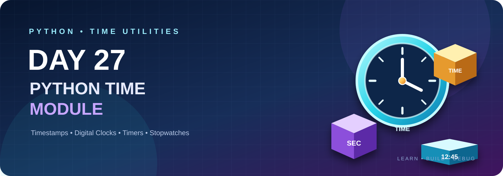

<p align="center">
  
</p>

<p align="center">
  
  
  
</p>

---

# 📘 Start Here — Day 27: Python Time Module

Aaj hum Python ke built-in **`time` module** ko samjhenge. Is module se current time lena, program ko pause karna, date/time format karna aur code ko execute hone mein kitna time laga ye measure karna seekhenge.

## 1. Module kya hota hai?

**Definition:** Module ek Python file hoti hai jisme reusable functions, classes ya variables hote hain. Inhe hum apne program mein import karke use kar sakte hain.

`time` Python ka built-in module hai; ise install karne ki zaroorat nahi.

```python
import time
```

## 2. Timestamp kya hota hai?

**Definition:** Timestamp ek number hota hai jo Unix Epoch — 1 January 1970, 00:00:00 UTC — se guzre seconds ko represent karta hai.

```python
import time
print(time.time())
```

**Memory tip:** `time.time()` = current timestamp.

## 3. `time.sleep()` kya karta hai?

**Definition:** `time.sleep(seconds)` program ke current thread ko diye gaye seconds ke liye pause karta hai.

```python
print("Start")
time.sleep(3)
print("After 3 seconds")
```

**Memory tip:** `sleep()` = wait / pause.

## 4. `time.localtime()` kya deta hai?

**Definition:** `time.localtime()` local date aur time ko structured `struct_time` form mein deta hai. Iske fields se year, month, day, hour, minute aur second access kar sakte hain.

```python
now = time.localtime()
print(now.tm_year, now.tm_mon, now.tm_mday)
```

**Memory tip:** `localtime()` = time ke parts.

## 5. `time.ctime()` kya karta hai?

**Definition:** `time.ctime()` timestamp ko readable date aur time string mein convert karta hai.

```python
print(time.ctime())
```

**Memory tip:** `ctime()` = readable time.

## 6. `time.strftime()` kya karta hai?

**Definition:** `time.strftime()` date/time ko selected format ke according string mein convert karta hai.

```python
now = time.localtime()
print(time.strftime("%d-%m-%Y %H:%M:%S", now))
```

| Code | Meaning |
|---|---|
| `%Y` | Four-digit year |
| `%y` | Two-digit year |
| `%m` | Month |
| `%d` | Day |
| `%H` | Hour (24-hour) |
| `%I` | Hour (12-hour) |
| `%M` | Minute |
| `%S` | Second |
| `%p` | AM/PM |
| `%A` | Full weekday |
| `%B` | Full month name |

**Memory tip:** `strftime()` = format time.

## 7. `time.perf_counter()` kya karta hai?

**Definition:** `time.perf_counter()` high-resolution counter deta hai. Iski start aur end readings ka difference kisi operation ka elapsed time batata hai.

```python
start = time.perf_counter()
time.sleep(2)
end = time.perf_counter()

print("Elapsed:", end - start, "seconds")
```

**Memory tip:** `perf_counter()` = performance / duration measure.

## 8. Functions ka quick revision

| Function | Easy meaning |
|---|---|
| `time.time()` | Timestamp |
| `time.sleep()` | Pause |
| `time.localtime()` | Local time parts |
| `time.ctime()` | Readable date/time |
| `time.strftime()` | Custom formatting |
| `time.perf_counter()` | Elapsed duration |

## 9. Real-life use cases

- Digital clock — har second time update karna.
- Countdown timer — seconds ko zero tak count karna.
- Stopwatch — start aur stop ke beech ka duration.
- Reminder — delay ke baad message show karna.
- Performance check — code execution duration measure karna.

**Study order:** Definitions samjho → examples run karo → practice questions solve karo → debugging karo → final project banao.

---

# 🐍 Day 27 — Python Time Module

> **Learn → Understand → Practice → Build → Debug → Push**

## 🎯 Learning Objectives

By completing Day 27, I will be able to:

- Understand Python's built-in `time` module.
- Work with timestamps.
- Get the current local time.
- Pause program execution.
- Format date and time.
- Measure program execution time.
- Create countdown timers and stopwatches.
- Build time-based Python applications.

---

## 1. Introduction to Time Module

Python provides a built-in module called `time` that allows us to work with time-related operations.

### Import Time Module

```python
import time
```

### Important Functions

| Function              | Description                           |
| --------------------- | ------------------------------------- |
| `time.time()`         | Returns the current timestamp         |
| `time.sleep()`        | Pauses program execution              |
| `time.localtime()`    | Returns local time information        |
| `time.ctime()`        | Converts timestamp into readable time |
| `time.strftime()`     | Formats date and time                 |
| `time.perf_counter()` | Measures elapsed execution time       |

### A. `time.time()`

Returns the current timestamp.

```python
import time

current_time = time.time()

print(current_time)
```

### B. `time.sleep()`

Pauses program execution for a specified number of seconds.

```python
import time

print("Hello")

time.sleep(3)

print("Welcome")
```

### C. `time.localtime()`

Returns structured information about the current local time.

```python
import time

current_time = time.localtime()

print(current_time)
print(current_time.tm_year)
print(current_time.tm_mon)
print(current_time.tm_mday)
```

### D. `time.ctime()`

Converts a timestamp into a readable date and time.

```python
import time

current_time = time.time()

print(time.ctime(current_time))
```

### E. `time.strftime()`

Formats time into a readable string.

```python
import time

current_time = time.localtime()

formatted_time = time.strftime(
    "%d-%m-%Y %H:%M:%S",
    current_time
)

print(formatted_time)
```

### Important Formatting Codes

| Code | Meaning               |
| ---- | --------------------- |
| `%Y` | Four-digit year       |
| `%y` | Two-digit year        |
| `%m` | Month                 |
| `%d` | Day                   |
| `%H` | Hour (24-hour format) |
| `%I` | Hour (12-hour format) |
| `%M` | Minute                |
| `%S` | Second                |
| `%p` | AM/PM                 |
| `%A` | Full weekday name     |
| `%B` | Full month name       |

### F. `time.perf_counter()`

Measures the elapsed time of an operation.

```python
import time

start = time.perf_counter()

time.sleep(2)

end = time.perf_counter()

print("Execution time:", end - start)
```

---

# 2. Practice Questions

Solve these questions independently. Follow the requirements and steps instead of copying code.

## Level 1 — Basic Practice

### Q1. Display Current Timestamp

**Concept:** `time.time()`

**Requirements:**

- Import the time module.
- Get the current timestamp.
- Store it in a variable.
- Display the timestamp.
1. Import `time`.
2. Call `time.time()`.
3. Store the returned value.
4. Print the value.

### Q2. Display Current Date and Time

**Concept:** `time.ctime()`

**Requirements:**

- Get the current timestamp.
- Convert it into readable date and time.
- Display the result.
1. Get the timestamp.
2. Pass it to `time.ctime()`.
3. Store the result.
4. Print the readable date and time.

### Q3. Create a 5-Second Delay

**Concept:** `time.sleep()`

**Requirements:**

- Display a starting message.
- Pause the program for 5 seconds.
- Display a completion message.
1. Import the time module.
2. Print the starting message.
3. Use `time.sleep(5)`.
4. Print the completion message.

### Q4. Display Current Local Time

**Concept:** `time.localtime()`

**Requirements:**

- Get the current local time.
- Display year, month, and day.
- Display hour, minute, and second.
1. Call `time.localtime()`.
2. Store the returned object.
3. Access the required attributes.
4. Print each value separately.

### Q5. Format Current Date and Time

**Concept:** `time.strftime()`

**Requirements:**

- Display date in `DD-MM-YYYY` format.
- Display time in `HH:MM:SS` format.
- Display the weekday name.
1. Get the current local time.
2. Use `time.strftime()`.
3. Select the appropriate formatting codes.
4. Display the formatted values.

---

## Level 2 — Logic Building

### Q6. Digital Clock

**Concept:** `time.localtime()`, `time.strftime()`, `time.sleep()`

**Requirements:**

- Display the current time.
- Update the time every second.
- Continue displaying the clock.
1. Create an infinite loop.
2. Get the current local time.
3. Format it as `HH:MM:SS`.
4. Display the updated time.
5. Pause execution for one second.
6. Refresh the display.

### Q7. Countdown Timer

**Concept:** `time.sleep()`

**Requirements:**

- Ask the user to enter countdown seconds.
- Display the remaining seconds.
- Decrease the value every second.
- Display a completion message at zero.
1. Take the countdown duration from the user.
2. Start a loop from the entered number.
3. Display the remaining time.
4. Pause for one second.
5. Decrease the counter.
6. Display a completion message.

### Q8. Stopwatch

**Concept:** `time.perf_counter()`

**Requirements:**

- Start the stopwatch.
- Allow the user to stop it.
- Calculate elapsed time.
- Display the total duration.
1. Record the starting time.
2. Wait for the user to press Enter.
3. Record the ending time.
4. Subtract starting time from ending time.
5. Display the elapsed seconds.

### Q9. Measure Program Execution Time

**Concept:** `time.perf_counter()`

**Requirements:**

- Measure the time taken by a loop.
- Store the starting time.
- Run the loop.
- Store the ending time.
- Calculate the total duration.
1. Record `time.perf_counter()` before the loop.
2. Execute a loop with many iterations.
3. Record `time.perf_counter()` after the loop.
4. Calculate the difference.
5. Display the execution time.

### Q10. AM/PM Time Formatter

**Concept:** `time.strftime()`

**Requirements:**

- Get the current local time.
- Display time in 12-hour format.
- Show AM or PM.
- Display the complete date.
1. Get the current local time.
2. Use `%I` for the 12-hour clock.
3. Use `%M` and `%S` for minutes and seconds.
4. Use `%p` for AM/PM.
5. Format and display the result.

---

## Level 3 — Practical Problems

### Q11. Automatic Message Reminder

**Concept:** `time.sleep()`

**Requirements:**

- Ask the user for a reminder message.
- Ask how many seconds to wait.
- Wait for the specified duration.
- Display the reminder message.
1. Take a message from the user.
2. Take the delay in seconds.
3. Use `time.sleep()` with the entered duration.
4. Display the reminder.

### Q12. Simple Loading Animation

**Concept:** `time.sleep()`

**Requirements:**

- Display a loading message.
- Show multiple loading stages.
- Pause briefly between stages.
- Display a completion message.
1. Create a list of loading stages.
2. Loop through the stages.
3. Display each stage.
4. Pause briefly using `time.sleep()`.
5. Display a final success message.

---

# 3. Main Challenge — Smart Digital Clock & Timer

**Project Name:** Smart Time Utility

Build a menu-driven Python application using the time module.

### Required Features

1. Show Current Date and Time.
2. Show Digital Clock.
3. Start Countdown Timer.
4. Start Stopwatch.
5. Show Current Timestamp.
6. Measure Execution Time.
7. Exit Application.

### Requirements

- Use functions to separate features.
- Use a menu-driven program.
- Use the time module.
- Handle invalid user input.
- Keep the application running until the user selects Exit.
- Write clean and readable code.

### Suggested Menu

```text
=================================
       SMART TIME UTILITY
=================================

1. Current Date and Time
2. Digital Clock
3. Countdown Timer
4. Stopwatch
5. Current Timestamp
6. Execution Time Calculator
7. Exit

Enter your choice:
```

### Project Folder Structure

```text
Day27_Time_Module/
│
├── README.md
├── theory.py
├── practice.py
├── challenge.py
├── interview.md
└── screenshots/
```

---

# 4. Debugging Practice

Find and fix the errors in these examples.

### Debugging Q1

```python
import time

print("Start")

time.sleep("5")

print("End")
```

**Task:** Identify why the program gives an error and correct it.

### Debugging Q2

```python
import time

start = time.time()

time.sleep(2)

end = time.time()

print(start - end)
```

**Task:** Fix the calculation so that the elapsed time is positive.

### Debugging Q3

```python
import time

current = time.localtime()

print(current.year)
print(current.month)
print(current.day)
```

**Task:** Understand how the local time object provides its attributes and verify the output.

### Debugging Q4

```python
import time

for i in range(5):
    print(i)

time.sleep()
```

**Task:** Identify the missing argument and correct the delay.

### Debugging Q5

```python
import time

print(time.strftime("%D-%M-%Y"))
```

**Task:** Correct the formatting codes to display day, month, and four-digit year.

---

# 5. Interview Questions

1. What is the Python time module?

2. How do you import the time module?

3. What does `time.time()` return?

4. What is a timestamp?

5. What is the purpose of `time.sleep()`?

6. What does `time.localtime()` return?

7. What is the difference between `time.ctime()` and `time.strftime()`?

8. What is the purpose of `time.perf_counter()`?

9. How can you create a countdown timer in Python?

10. How can you measure program execution time?

---
# 6. Day 27 Completion Checklist

- [ ] Understand the time module.
- [ ] Understand timestamps.
- [ ] Practice `time.time()`.
- [ ] Practice `time.sleep()`.
- [ ] Practice `time.localtime()`.
- [ ] Practice `time.ctime()`.
- [ ] Practice `time.strftime()`.
- [ ] Practice `time.perf_counter()`.
- [ ] Complete 12 practice questions.
- [ ] Solve 5 debugging questions.
- [ ] Complete Smart Time Utility.
- [ ] Answer interview questions.
- [ ] Push the work to GitHub.

---

# 7. GitHub Commit

```bash
git add .
git commit -m "Complete Day 27 Python Time Module Practice"
git push
```

---

# 🎯 Final Goal

After completing Day 27, I should be able to work with timestamps, create delays, format time, measure execution duration, and build simple time-based applications independently.

> Understand the logic before writing the code.

> Don't copy. Practice until you can solve it yourself.

**Day 27 Complete — Python Time Module.**

---

<p align="center">
  
</p>

<h3 align="center"><b>Sudhanshu Dhande</b></h3>
<p align="center"><i>B.Tech (AI &amp; ML) · BATU, Lonere · Python OOP Journey</i></p>
