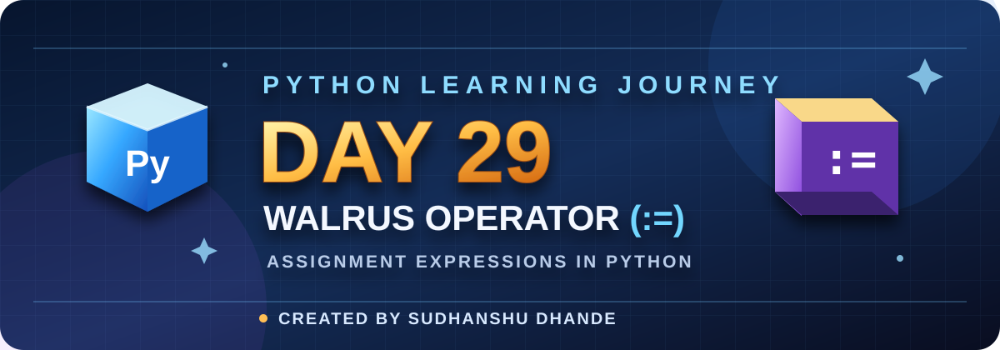

<div align="center">
  
</div>

# 🐍 Day 29 — Walrus Operator (`:=`) in Python

> **Learn → Understand → Practice → Build → Debug → Push**

## 📚 Before You Start — Understand the Topic

### What is the Walrus Operator?

The **Walrus Operator (`:=`)** is an assignment expression operator introduced in **Python 3.8**. It lets you assign a value to a variable **and use that value in the same expression**.

It is called the Walrus Operator because `:=` looks a little like the eyes and tusks of a walrus.

**Easy way to remember:** `=` stores a value. `:=` stores a value *while an expression is being evaluated*.

### 1. Normal assignment (`=`)

Normally, you assign a value first and then use the variable:

```python
number = 10

if number > 5:
    print(number)
```

### 2. Assignment with the Walrus Operator (`:=`)

With `:=`, assignment and use can happen in one expression:

```python
if (number := 10) > 5:
    print(number)
```

- `number := 10` assigns `10` to `number`.
- The expression evaluates to the assigned value (`10`).
- The `if` condition checks whether that value is greater than `5`.

### 3. Difference between `=` and `:=`

| `=` | `:=` |
|---|---|
| Assignment operator | Assignment expression operator |
| Assigns a value to a variable | Assigns a value and evaluates to that value |
| Used for normal assignments | Useful inside expressions, such as conditions |
| Cannot be used as an assignment expression in an `if` condition | Can be used in an `if` condition with correct syntax |

**Remember:** They are not interchangeable everywhere. Use `:=` only when it makes the code clearer.

### 4. Walrus Operator with `if`

```python
numbers = [10, 20, 30]

if (length := len(numbers)) > 2:
    print("List has more than 2 elements")
    print("Length:", length)
```

`len(numbers)` is calculated once, saved in `length`, and then reused inside the block.

### 5. Walrus Operator with `while`

```python
while (number := int(input("Enter a number: "))) != 0:
    print("You entered:", number)

print("Program ended")
```

The input is read and assigned in the loop condition. The loop continues until the user enters `0`.

### 6. Walrus Operator with a list comprehension

```python
numbers = [1, 2, 3, 4, 5, 6]

result = [
    square
    for number in numbers
    if (square := number ** 2) > 10
]

print(result)  # [16, 25, 36]
```

Each number is squared, the result is stored in `square`, and only squares greater than `10` are included.

### 7. Important rules to remember

1. `:=` assigns a value and evaluates to that value.
2. Parentheses are required in some expression contexts and often improve readability.
3. It can be used in `if` and `while` conditions.
4. It can be used in comprehensions, subject to Python's syntax and scope rules.
5. Do not use it unnecessarily.
6. Shorter code is not always clearer code.
7. Assignment expressions cannot be used everywhere; follow Python's syntax and scope rules.

### Quick memory trick

- **`=`** → store a value.
- **`:=`** → store a value and use it in the same expression.
- Use it when it avoids repeating a calculation or input without making the code confusing.

---

## 🎯 Learning Objectives

By completing Day 29, I will be able to:

- Understand the Walrus Operator.
- Understand assignment expressions.
- Differentiate between `=` and `:=`.
- Use the Walrus Operator inside `if` conditions.
- Use it inside `while` loops.
- Use it with list comprehensions.
- Reduce unnecessary repeated calculations.
- Build practical Python programs using `:=`.

---

# 1. Introduction to Walrus Operator

The Walrus Operator (`:=`) was introduced in Python 3.8. It is also known as the **Assignment Expression Operator**. It allows us to assign a value to a variable and use that value inside the same expression.

### Normal Assignment

```python
number = 10

if number > 5:
    print(number)
```

### Using Walrus Operator

```python
if (number := 10) > 5:
    print(number)
```

In this example:

- `number := 10` assigns 10 to the variable.
- The assigned value is used in the condition.
- If the condition is true, the message is displayed.

---

# 2. Difference Between `=` and `:=`

| `=` | `:=` |
|---|---|
| Assignment operator | Assignment expression operator |
| Assigns a value to a variable | Assigns a value and returns it as an expression |
| Used in normal assignments | Used inside expressions |
| Cannot directly be used as an assignment inside an `if` condition | Can be used inside conditions with appropriate parentheses |

```python
# Normal assignment
age = 21

# Walrus operator
if (age := 21) >= 18:
    print("Eligible")
```

**Remember:** `=` and `:=` are not interchangeable everywhere. Use the Walrus Operator when assignment inside an expression makes the code clearer.

---

# 3. Walrus Operator with If Condition

```python
numbers = [10, 20, 30]

if (length := len(numbers)) > 2:
    print("List has more than 2 elements")
    print("Length:", length)
```

Here:

- `len(numbers)` calculates the list length.
- `length :=` stores the result.
- The condition checks the length.
- The same variable can be reused inside the block.

---

# 4. Walrus Operator with While Loop

```python
while (number := int(input("Enter a number: "))) != 0:
    print("You entered:", number)

print("Program ended")
```

Here:

- The user enters a number.
- The entered number is assigned to `number`.
- The loop continues while the number is not zero.
- Entering zero stops the loop.

---

# 5. Walrus Operator with List Comprehension

```python
numbers = [1, 2, 3, 4, 5, 6]

result = [
    square
    for number in numbers
    if (square := number ** 2) > 10
]

print(result)
```

**Expected output:**

```text
[16, 25, 36]
```

Here:

- Each number is squared.
- The square is stored in `square`.
- Only squares greater than 10 are included.

---

# 6. Important Rules

1. `:=` assigns a value and returns that value as an expression.
2. Use parentheses when they improve clarity or are required by the expression context.
3. It can be used in `if` and `while` conditions.
4. It can be used in comprehensions.
5. Do not use it unnecessarily.
6. Avoid making code difficult to read just to reduce lines.
7. Assignment expressions have scope and syntax rules; they cannot be used everywhere.

---

# 7. Practice Questions

Solve all questions independently. Follow the requirements and steps instead of copying code.

## Level 1 — Basic Practice

### Q1. Assign and Display a Number

**Concept:** Basic Walrus Operator

**Requirements:**
- Assign a number using `:=`.
- Store the number in a variable.
- Display the variable.
- Display the result of an expression using that variable.

**Steps to Solve:**
1. Create a variable using the Walrus Operator.
2. Assign an integer value.
3. Print the variable.
4. Use the variable in a mathematical expression.
5. Display the result.

### Q2. Check Voting Eligibility

**Concept:** Walrus Operator with `if`

**Requirements:**
- Assign an age using `:=`.
- Check whether the age is at least 18.
- Display an eligible or not eligible message.

**Steps to Solve:**
1. Use `:=` to assign the age inside an `if` condition.
2. Check whether the age is greater than or equal to 18.
3. Display the appropriate message.

### Q3. Calculate String Length

**Concept:** `len()` with `:=`

**Requirements:**
- Take a string.
- Calculate its length using the Walrus Operator.
- Display the length.
- Check whether the string contains more than 5 characters.

**Steps to Solve:**
1. Create a string variable.
2. Calculate its length using `len()`.
3. Assign the result using `:=`.
4. Check the length.
5. Display the appropriate message.

### Q4. Check List Length

**Concept:** Walrus Operator with `if`

**Requirements:**
- Create a list of numbers.
- Calculate its length.
- Store the length using `:=`.
- Check whether the list contains at least 5 elements.

**Steps to Solve:**
1. Create a list.
2. Use `len()` to calculate its size.
3. Assign the result inside an `if` condition.
4. Display the size.
5. Display the appropriate message.

### Q5. Check Positive Number

**Concept:** Assignment expression

**Requirements:**
- Assign a number using `:=`.
- Check whether it is positive, negative, or zero.
- Display the result.

**Steps to Solve:**
1. Assign a number using the Walrus Operator.
2. Use conditional statements.
3. Check whether the number is greater than zero.
4. Check whether it is less than zero.
5. Handle zero separately.

## Level 2 — Logic Building

### Q6. Input Until Zero

**Concept:** Walrus Operator with `while`

**Requirements:**
- Continuously ask the user for a number.
- Display the entered number.
- Stop when the user enters zero.

**Steps to Solve:**
1. Create a `while` loop.
2. Take input inside the loop condition.
3. Assign the input using `:=`.
4. Continue while the number is not zero.
5. Display a completion message after the loop.

### Q7. Find Long Words

**Concept:** Walrus Operator with list comprehension

**Requirements:**
- Create a list of words.
- Calculate each word's length.
- Store the length using `:=`.
- Select words whose length is greater than 5.

**Steps to Solve:**
1. Create a list of words.
2. Start a list comprehension.
3. Calculate each word's length.
4. Assign the length using `:=`.
5. Add a condition for lengths greater than 5.
6. Display the resulting list.

### Q8. Filter Large Numbers

**Concept:** Assignment expression with list comprehension

**Requirements:**
- Create a list of numbers.
- Calculate the square of each number.
- Store each square using `:=`.
- Select squares greater than 25.

**Steps to Solve:**
1. Create a list of integers.
2. Use a list comprehension.
3. Calculate each square.
4. Store the square using `:=`.
5. Filter values greater than 25.
6. Display the final list.

### Q9. Calculate Total Until Negative Input

**Concept:** Walrus Operator with `while`

**Requirements:**
- Continuously accept numbers from the user.
- Add positive numbers to a total.
- Stop when a negative number is entered.
- Display the total.

**Steps to Solve:**
1. Initialize a total variable.
2. Use a `while` loop.
3. Accept input inside the loop condition.
4. Assign the input using `:=`.
5. Add valid positive numbers to the total.
6. Stop when a negative number is entered.
7. Display the total.

### Q10. Find Numbers Greater Than Average

**Concept:** Walrus Operator with list comprehension

**Requirements:**
- Create a list of numbers.
- Calculate the average.
- Store the average using `:=`.
- Select numbers greater than the average.

**Steps to Solve:**
1. Create a list of numbers.
2. Calculate the sum and length.
3. Calculate the average using an assignment expression.
4. Filter numbers greater than the average.
5. Display the average and selected numbers.

## Level 3 — Practical Problems

### Q11. Student Marks Analyzer

**Concept:** Walrus Operator with conditions

**Requirements:**
- Accept student marks.
- Calculate the result.
- Store the percentage using `:=`.
- Display pass or fail based on the percentage.

**Steps to Solve:**
1. Take marks from the user.
2. Calculate the percentage.
3. Store the percentage using `:=`.
4. Check the passing condition.
5. Display the percentage and result.

### Q12. Login Attempt System

**Concept:** Walrus Operator with `while`

**Requirements:**
- Ask the user to enter a password.
- Allow repeated attempts.
- Stop when the correct password is entered.
- Display an appropriate message.

**Steps to Solve:**
1. Define an expected password for this practice program.
2. Use a `while` loop.
3. Take password input inside the loop condition.
4. Assign the input using `:=`.
5. Continue until the password matches.
6. Display a success message.

---

# 8. Main Challenge — Smart Data Filter

**Project Name:** Smart Data Analyzer

Build a Python program that analyzes and filters a list of numbers using the Walrus Operator.

## Required Features

1. Store a list of numbers.
2. Calculate the total.
3. Calculate the average.
4. Filter numbers greater than the average.
5. Calculate squares.
6. Filter squares greater than a chosen value.
7. Display the final results.

## Requirements

- Use the Walrus Operator.
- Use list comprehensions.
- Use conditions.
- Use functions to organize the program.
- Avoid unnecessary repeated calculations.
- Keep the code readable.
- Handle an empty list safely.

## Expected Output Format

```text
=================================
       SMART DATA ANALYZER
=================================

Original Numbers: [10, 20, 30, 40, 50]

Total: 150
Average: 30

Numbers Greater Than Average:
[40, 50]

Squares:
[100, 400, 900, 1600, 2500]

Squares Greater Than 1000:
[1600, 2500]
```

## Suggested Project Structure

```text
Day29_Walrus_Operator/
│
├── README.md
├── theory.py
├── practice.py
|        ├── Q01.py
|        ├── Q12.py
├──Interview.md
└── project.py
```

---

# 9. Debugging Practice

Find and fix the errors in these examples.

### Debugging Q1

```python
if (number = 10) > 5:
    print(number)
```

**Task:** Identify why normal assignment is invalid in this expression and correct it.

### Debugging Q2

```python
while (number := input("Enter number: ")) != 0:
    print(number)
```

**Task:** Identify the type mismatch and correct the input comparison.

### Debugging Q3

```python
numbers = [1, 2, 3, 4, 5]

result = [number for number in numbers if (square := number ** 2) > 10]

print(square)
```

**Task:** Understand the difference between a variable used in a comprehension and a variable available outside it. Fix the program to display the intended results.

### Debugging Q4

```python
if (length := len("Python")) > 3
    print(length)
```

**Task:** Find the syntax error and correct it.

### Debugging Q5

```python
numbers = [10, 20, 30]

result = [square := number ** 2 for number in numbers]

print(result)
```

**Task:** Understand the assignment-expression rules in comprehensions. Rewrite the expression in a clear and valid form that stores the squared values.

---

# 10. Interview Questions — Short & Easy Answers

### Q1. What is the Walrus Operator in Python?

### Q2. In which Python version was it introduced?

### Q3. What is another name for the Walrus Operator?

### Q4. What is the difference between `=` and `:=`?

### Q5. What is an assignment expression?

### Q6. Can the Walrus Operator be used inside an `if` condition?

### Q7. How can it be used inside a `while` loop?

### Q8. Can it be used with list comprehensions?

### Q9. What are the advantages of the Walrus Operator?

### Q10. When should you avoid using the Walrus Operator?

### Q11. Does the Walrus Operator return the assigned value?

### Q12. Why can parentheses be required when using `:=`?

---

# 11. Day 29 Completion Checklist

- [ ] Understand the Walrus Operator.
- [ ] Understand assignment expressions.
- [ ] Understand `=` vs `:=`.
- [ ] Practice with `if` conditions.
- [ ] Practice with `while` loops.
- [ ] Practice with list comprehensions.
- [ ] Complete 12 practice questions.
- [ ] Solve 5 debugging questions.
- [ ] Complete Smart Data Analyzer.
- [ ] Answer interview questions.
- [ ] Push the work to GitHub.

---

# 12. GitHub Commit

```bash
git add .
git commit -m "Complete Day 29 Python Walrus Operator Practice"
git push
```

---

# 🎯 Final Goal

After completing Day 29, I should be able to understand and use assignment expressions, write cleaner conditions and loops, and apply the Walrus Operator in practical Python programs.

> Write readable code. Do not use the Walrus Operator just to reduce the number of lines.

> Understand the logic before writing the code.

**Day 29 Complete — Walrus Operator in Python.**

---

<div align="center">
  <b>✨ Created with dedication by Sudhanshu Dhande ✨</b>
</div>
