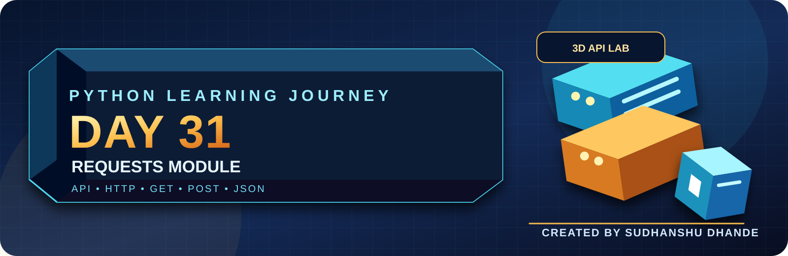

<p align="center">
  
</p>

# 🐍 Day 31 — Requests Module in Python

> **Learn → Understand → Practice → Build → Debug → Push**

## 🎯 Learning Objectives

By completing Day 31, I will be able to:

- Understand the Python Requests module.
- Install and import the `requests` library.
- Understand HTTP requests and responses.
- Send GET and POST requests.
- Fetch data from APIs.
- Read JSON responses.
- Understand HTTP status codes.
- Use query parameters.
- Handle request errors and exceptions.
- Build a practical API-based Python project.

---


# 📘 Day 31 Theory — Requests Module in Python

## 1. What is the Requests Module?
The **Requests** module is a Python library used to communicate with websites and APIs through HTTP.

**Easy definition:** Requests lets Python ask a server for information or send information to it.

Install and import it:
```bash
pip install requests
```
```python
import requests
```

## 2. What is an API?
API means **Application Programming Interface**. It allows two software applications to communicate.

Example: A weather app asks a weather API for the current temperature, and the API sends the information back.

```text
Python Program  →  API / Server
Python Program  ←  JSON Response
```

## 3. What is HTTP?
HTTP means **Hypertext Transfer Protocol**. It is the set of rules used by clients and servers to communicate over the web. A Python program can act as a client and a website/API can act as a server.

## 4. HTTP Methods — Remember Their Jobs

| Method | Simple meaning | Memory tip |
|---|---|---|
| `GET` | Retrieve data | Get information |
| `POST` | Send new data | Post information |
| `PUT` | Replace/update data | Put new version |
| `PATCH` | Partially update data | Patch a part |
| `DELETE` | Delete data | Remove it |

For this lesson, focus mainly on GET and POST.

## 5. GET Request — Ask for Data
GET retrieves information from an API.

```python
import requests

url = "https://jsonplaceholder.typicode.com/posts/1"
response = requests.get(url, timeout=10)

print(response.status_code)
print(response.text)
```

- `requests.get()` sends a GET request.
- `url` is the API endpoint.
- `response` stores the server's reply.
- `timeout=10` prevents waiting forever.

## 6. Understand the Response Object

| Property / Method | Simple meaning |
|---|---|
| `response.status_code` | HTTP status number |
| `response.text` | Response as text |
| `response.json()` | Parses JSON into Python data |
| `response.headers` | Response header information |
| `response.url` | Final requested URL |
| `response.content` | Response content as bytes |

## 7. Common HTTP Status Codes

| Code | Meaning | Easy memory |
|---|---|---|
| `200` | OK | Request successful |
| `201` | Created | Resource created |
| `400` | Bad Request | Request has a problem |
| `401` | Unauthorized | Authentication needed/invalid |
| `403` | Forbidden | Access not allowed |
| `404` | Not Found | Resource not found |
| `500` | Internal Server Error | Server-side problem |
| `503` | Service Unavailable | Server temporarily unavailable |

## 8. What is JSON?
JSON means **JavaScript Object Notation**. It is a common text format for exchanging data between applications.

```python
import requests

response = requests.get(
    "https://jsonplaceholder.typicode.com/posts/1",
    timeout=10
)
data = response.json()

print(data["title"])
print(data["body"])
```

`.json()` parses the response into Python data, commonly a dictionary or list.

## 9. Query Parameters — Send Filters
Query parameters send extra information with a request, such as a user ID.

```python
import requests

url = "https://jsonplaceholder.typicode.com/posts"
params = {"userId": 1}

response = requests.get(url, params=params, timeout=10)
print(response.url)
print(response.json())
```

Requests builds the query string from the `params` dictionary.

## 10. POST Request — Send Data
POST sends data to a server. Use `json=` when sending JSON data.

```python
import requests

url = "https://jsonplaceholder.typicode.com/posts"
data = {
    "title": "Python Learning",
    "body": "Learning Requests Module",
    "userId": 1
}

response = requests.post(url, json=data, timeout=10)
print(response.status_code)
print(response.json())
```

**Remember:** GET asks for data; POST sends data. JSONPlaceholder is a testing API: it simulates creating a post but does not permanently save it.

## 11. Error Handling — Make Requests Safer
Requests can fail because of internet problems, timeouts, invalid URLs, or unsuccessful HTTP responses.

```python
import requests

try:
    response = requests.get(
        "https://jsonplaceholder.typicode.com/posts/1",
        timeout=10
    )
    response.raise_for_status()
    data = response.json()
    print(data)

except requests.exceptions.RequestException as error:
    print("Request failed:", error)
```

- `try` contains code that may fail.
- `except` handles the error.
- `raise_for_status()` raises an HTTP error for unsuccessful status codes.
- `RequestException` is the base class for Requests-related exceptions.

## 12. Difference Between `data` and `json`
- `data=` sends form-style/body data.
- `json=` sends JSON-encoded data and sets the JSON content type.
- For a JSON API, use `json=your_dictionary`.

## 13. Important Safety Rules
1. Always set a timeout.
2. Check the status code before relying on a response.
3. Use `.json()` when the API returns JSON.
4. Use `raise_for_status()` to detect unsuccessful responses.
5. Handle network errors with `try-except`.
6. Never expose API keys or passwords in source code.
7. Avoid unnecessary repeated requests.
8. Read API documentation before using an API.
9. A successful HTTP response does not guarantee that the returned data is correct.

## 14. One-Minute Revision
- **Requests** = Python library for HTTP communication.
- **API** = lets software applications communicate.
- **HTTP** = rules for client-server communication.
- **GET** = receive data.
- **POST** = send data.
- **JSON** = common data exchange format.
- **Status code** = tells the result of a request.
- **`params`** = adds query parameters.
- **`timeout`** = limits waiting time.
- **`raise_for_status()`** = raises an error for unsuccessful HTTP status.
- **`try-except`** = handles request errors.

> **One-line summary:** Requests lets Python send HTTP requests, receive API responses, process JSON data, and handle network errors.

---

# 1. Introduction to Requests Module

The **Requests** module is a Python library used to send HTTP requests and communicate with websites and APIs.

It allows Python programs to:

- Fetch data from websites.
- Retrieve information from APIs.
- Send data to servers.
- Download online resources.
- Communicate with web applications.

### Installation

Open your terminal and install the library:

```bash
pip install requests
```

### Import the Library

```python
import requests
```

---

# 2. What is an API?

API stands for **Application Programming Interface**.

An API allows two software applications to communicate with each other.

For example:

- A weather application gets weather information from a weather API.
- A news application gets news articles from a news API.
- A Python application can get user information from an API.

### Simple API Example

```text
Python Program
      |
      | HTTP Request
      v
     API
      |
      | JSON Response
      v
Python Program
```

---

# 3. What is an HTTP Request?

HTTP stands for **Hypertext Transfer Protocol**.

It is a protocol used for communication between clients and servers.

Common HTTP methods:

| Method | Purpose |
|---|---|
| GET | Retrieve data |
| POST | Send new data |
| PUT | Update existing data |
| PATCH | Partially update data |
| DELETE | Delete data |

For now, focus on GET and POST.

---

# 4. GET Request

The GET method is used to retrieve data from an API.

### Example

```python
import requests

url = "https://jsonplaceholder.typicode.com/posts/1"

response = requests.get(url, timeout=10)

print(response.text)
```

### Explanation

- `requests.get()` sends a GET request.
- `url` contains the API endpoint.
- `response` stores the server response.
- `response.text` displays the response as text.
- `timeout=10` prevents the request from waiting indefinitely.

---

# 5. Understanding Response Properties

A response object provides useful information.

| Property | Purpose |
|---|---|
| `response.status_code` | Returns HTTP status code |
| `response.text` | Returns response as text |
| `response.json()` | Converts JSON response into Python data |
| `response.headers` | Returns response headers |
| `response.url` | Returns the requested URL |
| `response.content` | Returns response content as bytes |

### Common HTTP Status Codes

| Status Code | Meaning |
|---|---|
| 200 | OK — Request successful |
| 201 | Created — Resource created |
| 400 | Bad Request |
| 401 | Unauthorized |
| 403 | Forbidden |
| 404 | Not Found |
| 500 | Internal Server Error |
| 503 | Service Unavailable |

---

# 6. Working with JSON Response

JSON stands for **JavaScript Object Notation**.

APIs commonly return data in JSON format.

### Example

```python
import requests

url = "https://jsonplaceholder.typicode.com/posts/1"

response = requests.get(url, timeout=10)

data = response.json()

print(data)
print(data["title"])
print(data["body"])
```

### Explanation

- `.json()` converts the JSON response into Python data.
- The returned data can be a dictionary or a list.
- Dictionary keys can be used to access individual values.

---

# 7. GET Request with Query Parameters

Query parameters allow us to send additional information with a request.

### Example

```python
import requests

url = "https://jsonplaceholder.typicode.com/posts"

params = {
    "userId": 1
}

response = requests.get(url, params=params, timeout=10)

print(response.url)
print(response.json())
```

Here:

- `params` contains the query parameters.
- Requests automatically adds them to the URL.
- `response.url` displays the final requested URL.

---

# 8. POST Request

The POST method is used to send data to a server.

### Example

```python
import requests

url = "https://jsonplaceholder.typicode.com/posts"

data = {
    "title": "Python Learning",
    "body": "Learning Requests Module",
    "userId": 1
}

response = requests.post(url, json=data, timeout=10)

print(response.status_code)
print(response.json())
```

**Remember:** JSONPlaceholder is a testing API. It simulates creating a post but does not permanently save the data.

---

# 9. Handling Request Errors

Internet requests can fail for different reasons:

- No internet connection.
- Invalid URL.
- Server unavailable.
- Request timeout.
- Invalid response.

We should handle these errors using exception handling.

### Example

```python
import requests

try:
    response = requests.get(
        "https://jsonplaceholder.typicode.com/posts/1",
        timeout=10
    )

    response.raise_for_status()

    data = response.json()
    print(data)

except requests.exceptions.RequestException as error:
    print("Request failed:", error)
```

### Important Concepts

- `try`: Executes code that may generate an error.
- `except`: Handles the error.
- `raise_for_status()`: Raises an exception for unsuccessful HTTP status codes.
- `RequestException`: Base exception for Requests-related errors.

---

# 10. Important Rules

1. Always use a timeout for network requests.
2. Check the status code before processing important responses.
3. Use `.json()` when the API returns JSON.
4. Use `raise_for_status()` to detect unsuccessful HTTP responses.
5. Handle network errors using `try-except`.
6. Do not expose API keys or passwords in source code.
7. Do not send unnecessary repeated requests.
8. Read API documentation before using an API.
9. Remember that a successful HTTP response does not always mean the returned data is correct.

---

# 11. Practice Questions

Solve every question independently. Follow the requirements and steps.

## Level 1 — Basic Practice

### Q1. Install and Import Requests

**Concept:** Installing Python libraries

**Requirements:**

- Install the Requests library.
- Import it into a Python file.
- Display a confirmation message.

**Steps to Solve:**

1. Open the terminal.
2. Install `requests` using pip.
3. Create a Python file.
4. Import the Requests library.
5. Display a message confirming that the library is imported.

### Q2. Send Your First GET Request

**Concept:** `requests.get()`

**Requirements:**

- Send a GET request to JSONPlaceholder.
- Store the response.
- Display the response text.

**Steps to Solve:**

1. Import the Requests library.
2. Store this API URL: `https://jsonplaceholder.typicode.com/posts/1`.
3. Send a GET request.
4. Store the response in a variable.
5. Display the response text.

### Q3. Check HTTP Status Code

**Concept:** `response.status_code`

**Requirements:**

- Send a GET request.
- Display the status code.
- Check whether the request was successful.

**Steps to Solve:**

1. Send a GET request to a valid API endpoint.
2. Access the status code.
3. Check whether it is 200.
4. Display a success or failure message.

### Q4. Display API Response as JSON

**Concept:** `response.json()`

**Requirements:**

- Fetch data from an API.
- Convert the response into Python data.
- Display the returned data.

**Steps to Solve:**

1. Send a GET request.
2. Receive the response.
3. Convert it using `.json()`.
4. Display the result.
5. Identify whether the returned data is a dictionary or list.

### Q5. Extract Specific Information

**Concept:** Dictionary access

**Requirements:**

- Fetch a post from JSONPlaceholder.
- Extract its ID.
- Extract its title.
- Extract its body.

**Steps to Solve:**

1. Send a GET request to the first post endpoint.
2. Convert the response into JSON.
3. Access the `id` key.
4. Access the `title` key.
5. Access the `body` key.
6. Display each value separately.

---

## Level 2 — Logic Building

### Q6. Fetch Multiple Posts

**Concept:** API list response and loops

**Requirements:**

- Fetch multiple posts.
- Display the title of each post.
- Display the total number of posts.

**Steps to Solve:**

1. Send a GET request to `https://jsonplaceholder.typicode.com/posts`.
2. Convert the response into JSON.
3. Check the returned data type.
4. Use a loop to access each post.
5. Display the ID and title.
6. Count the total posts.

### Q7. Find Posts by User ID

**Concept:** Query parameters

**Requirements:**

- Fetch posts belonging to a particular user.
- Use query parameters.
- Display the matching posts.

**Steps to Solve:**

1. Select a user ID.
2. Create a dictionary containing the query parameter.
3. Send a GET request with `params`.
4. Convert the response into JSON.
5. Display the matching post titles.
6. Display the total number of matching posts.

### Q8. Handle Invalid API URL

**Concept:** Exception handling

**Requirements:**

- Send a request to an invalid URL.
- Handle the request error.
- Display a meaningful error message.

**Steps to Solve:**

1. Create an invalid URL for practice.
2. Place the request inside a `try` block.
3. Set a timeout.
4. Handle `RequestException`.
5. Display an appropriate error message.

### Q9. Detect a 404 Error

**Concept:** HTTP status codes and `raise_for_status()`

**Requirements:**

- Send a request to a nonexistent resource.
- Check the status code.
- Handle the HTTP error.

**Steps to Solve:**

1. Use an invalid resource endpoint.
2. Send a GET request.
3. Display its status code.
4. Call `raise_for_status()`.
5. Handle the exception.
6. Display a message explaining that the resource was not found.

### Q10. Send Data Using POST

**Concept:** `requests.post()`

**Requirements:**

- Create a dictionary containing post information.
- Send the data using POST.
- Display the response status and returned JSON.

**Steps to Solve:**

1. Create a dictionary with title, body, and user ID.
2. Send a POST request to the posts endpoint.
3. Pass the dictionary using the `json` parameter.
4. Display the status code.
5. Convert the response into JSON.
6. Display the returned information.

---

## Level 3 — Practical Problems

### Q11. API User Information Finder

**Concept:** API data extraction

**Requirements:**

- Fetch a user from JSONPlaceholder.
- Display the user's name.
- Display username and email.
- Display the user's address.

**Steps to Solve:**

1. Use the endpoint `https://jsonplaceholder.typicode.com/users/1`.
2. Send a GET request.
3. Convert the response into JSON.
4. Extract the name.
5. Extract username and email.
6. Access the nested address information.
7. Display the details in a readable format.

### Q12. API Data Search System

**Concept:** API requests, query parameters, loops, and conditions

**Requirements:**

- Fetch posts from an API.
- Allow the user to enter a user ID.
- Display posts belonging to that user.
- Display a message if no matching posts are found.

**Steps to Solve:**

1. Ask the user to enter a user ID.
2. Send a GET request with the user ID as a query parameter.
3. Convert the response into JSON.
4. Check whether matching posts exist.
5. Use a loop to display each post title.
6. Display the total matching posts.
7. Handle request errors.

---

# 12. Main Challenge — API Data Explorer

**Project Name:** Python API Data Explorer

Build a command-line application that fetches and displays information from JSONPlaceholder.

## Required Features

1. Display a menu.
2. Fetch a single post.
3. Fetch all posts.
4. Search posts by user ID.
5. Fetch user information.
6. Display API status codes.
7. Handle invalid inputs.
8. Handle network errors.
9. Display results in a readable format.

## Requirements

- Use the Requests library.
- Use GET requests.
- Use query parameters.
- Use JSON response handling.
- Use functions to organize the program.
- Use loops and conditional statements.
- Use exception handling.
- Add timeout to network requests.

## Suggested Menu

```text
=====================================
       PYTHON API DATA EXPLORER
=====================================

1. Get Single Post
2. Get All Posts
3. Search Posts by User ID
4. Get User Information
5. Exit

Enter your choice:
```

## Suggested Project Structure

```text
Day31_Requests_Module/
│
├── README.md
├── requirements.txt
├── theory.py
├── practice/
│   ├── Q01.py
│   ├── Q02.py
│   ├── ...
│   └── Q12.py
│
└── project/
    └── api_data_explorer.py
```

### requirements.txt

```text
requests
```

---

# 13. Debugging Practice

Find and fix the errors in these examples.

### Debugging Q1

```python
import requests

response = requests.get(
    "https://jsonplaceholder.typicode.com/posts/1"
)

print(response.json)
```

**Task:** Identify why the JSON response is not being called correctly.

### Debugging Q2

```python
import requests

response = requests.get(
    "https://jsonplaceholder.typicode.com/posts/1",
    timeout=10
)

data = response.json()

print(data["name"])
```

**Task:** Inspect the returned post data and identify the correct key for the information you want to display.

### Debugging Q3

```python
import requests

response = requests.get(
    "https://jsonplaceholder.typicode.com/posts/1",
    timeout=10
)

if response.status_code = 200:
    print("Success")
```

**Task:** Find the condition syntax error and correct it.

### Debugging Q4

```python
import requests

try:
    response = requests.get(
        "https://jsonplaceholder.typicode.com/posts/1",
        timeout=10
    )

    response.raise_for_status()

except requests.exceptions.Timeout:
    print("Request timed out")

except requests.exceptions.ConnectionError:
    print("Connection error")
```

**Task:** Extend this program to handle other Requests-related errors too.

### Debugging Q5

```python
import requests

data = {
    "title": "Python",
    "body": "Learning Requests",
    "userId": 1
}

response = requests.post(
    "https://jsonplaceholder.typicode.com/posts",
    data=data,
    timeout=10
)

print(response.json())
```

**Task:** Understand the difference between sending form data and JSON data. Modify the request to send JSON.

---

# 14. Interview Questions

1. What is the Requests module in Python?
   **Answer:** It is a Python library used to send HTTP requests and communicate with websites and APIs.
2. How do you install Requests?
   **Answer:** Run `pip install requests` in the terminal.
3. What is an API?
   **Answer:** An API is an interface that lets two software applications communicate.
4. What is HTTP?
   **Answer:** HTTP is the protocol used for communication between web clients and servers.
5. What is the difference between GET and POST?
   **Answer:** `GET` retrieves data; `POST` sends data to a server.
6. What does `requests.get()` do?
   **Answer:** It sends an HTTP GET request to retrieve data from a URL.
7. What is a response object?
   **Answer:** It stores the server's reply, including status, headers, and response data.
8. What is the use of `response.status_code`?
   **Answer:** It gives the HTTP status number, such as `200` or `404`.
9. What is the difference between `response.text` and `response.json()`?
   **Answer:** `text` gives the response as text; `json()` parses JSON into Python data.
10. What is JSON?
   **Answer:** JSON is a text format used to exchange data between applications.
11. What are HTTP status codes?
   **Answer:** They are numbers that describe the result of an HTTP request.
12. What is the purpose of query parameters?
   **Answer:** They send extra filtering or search information with a request URL.
13. What is the use of `timeout`?
   **Answer:** It stops a request from waiting indefinitely.
14. What does `raise_for_status()` do?
   **Answer:** It raises an HTTP error when the response status indicates failure (4xx or 5xx).
15. How do you handle Requests exceptions?
   **Answer:** Use `try-except`, commonly catching `requests.exceptions.RequestException`.
16. What is the difference between `data` and `json` in a POST request?
   **Answer:** `data` sends form/body data; `json` sends JSON-encoded data.


---

# 15. Day 31 Completion Checklist

- [ ] Install the Requests library.
- [ ] Import Requests.
- [ ] Understand APIs and HTTP.
- [ ] Practice GET requests.
- [ ] Understand response properties.
- [ ] Convert API responses into JSON.
- [ ] Practice query parameters.
- [ ] Practice POST requests.
- [ ] Understand HTTP status codes.
- [ ] Handle request exceptions.
- [ ] Complete 12 practice questions.
- [ ] Solve 5 debugging questions.
- [ ] Build API Data Explorer.
- [ ] Answer interview questions.
- [ ] Push the work to GitHub.

---

# 16. GitHub Commit

```bash
git add .
git commit -m "Complete Day 31 Python Requests Module Practice"
git push
```

---

# 🎯 Final Goal

After completing Day 31, I should be able to connect Python programs with APIs, fetch online data, process JSON responses, send data using POST requests, and handle common network errors.

> Understand how requests and responses work before building API-based projects.

**Day 31 Complete — Requests Module in Python.**

---

<p align="center">
  **Created by Sudhanshu Dhande**  
  🐍 Keep Learning • Keep Practicing • Keep Building
</p>
