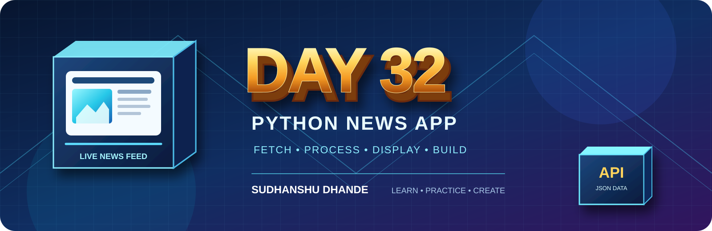

<p align="center">
  
</p>

# 🐍 Day 32 — Exercise 10: Build a News App

> **Learn → Understand → Practice → Build → Debug → Push**

## 🎯 Learning Objectives

By completing Day 32, I will be able to:

- Understand how a News API works.
- Fetch news articles using Python.
- Connect Python applications with external APIs.
- Process JSON responses.
- Extract news headlines and descriptions.
- Work with API parameters.
- Handle API errors and missing data.
- Build a command-line News Application.

---

# 📘 Day 32 — Learn the Topic First: Build a News App

## What is a News App?
A **News App** is a program that gets news from an online news service and shows it in an easy-to-read format. In this project, Python requests news, reads the returned data, and displays headlines, descriptions, sources, dates, and article links.

## What is a News API?
An **API (Application Programming Interface)** is a way for two software programs to communicate. A **News API** is an online service that shares news data with our Python program. We send a request to its endpoint, and it sends back a response.

## Important Terms — Simple Definitions

| Term | Simple meaning |
|---|---|
| API | A bridge that lets two programs communicate. |
| Endpoint | The specific URL/address where we send an API request. |
| HTTP GET | A request method used to ask a server for data. |
| Query parameters | Extra values used to filter or customize a request, such as keyword or category. |
| API key | A secret token that identifies or authorizes an API user. |
| JSON | A text format used to send structured data using objects and arrays. |
| Response | The data and status returned by the server. |
| Status code | A number that tells whether an HTTP request succeeded or failed. |
| Timeout | The maximum time we wait for a response before stopping the request. |
| Exception handling | Code that catches errors so the program can respond safely. |

## How Day 32 Works — Step by Step
1. The user chooses a news option or enters a search keyword.
2. Python sends a GET request to the News API using the Requests library.
3. The API checks the request and sends a JSON response.
4. Python converts the response into dictionaries and lists.
5. The program extracts article details and displays them.
6. If something goes wrong or data is missing, the program handles it safely.

## Libraries and Python Concepts Used
- **Requests:** sends HTTP requests to the News API.
- **JSON processing:** reads the data returned by the API.
- **Dictionaries and lists:** store article information and collections of articles.
- **Loops and conditions:** display, search, and filter articles.
- **Functions:** divide the application into reusable parts.
- **try-except:** handles connection, timeout, and other errors.
- **`.get()` and default values:** safely read fields that may be missing.

## Remember These Points
- `requests.get()` sends a GET request.
- `response.raise_for_status()` raises an error for unsuccessful HTTP status codes.
- `response.json()` converts a JSON response into Python data.
- `data.get("articles", [])` safely gets the articles list, or an empty list if it is missing.
- Never publish a real API key on GitHub; keep it in an environment variable or a local `.env` file excluded by `.gitignore`.

> **Easy memory line:** Request news → receive JSON → extract articles → display news → handle errors.

---

# 1. Introduction to News App

A News App is an application that collects news articles from an online news service and displays them to users.

For example, a user can:

- View the latest headlines.
- Search for news about technology.
- Read news descriptions.
- Open the original news article.
- Filter news by category or country, depending on the API.

### How Does It Work?

```text
       User
        |
        v
    Python News App
        |
        v
     News API
        |
        v
   JSON Response
        |
        v
 Extract News Data
        |
        v
 Display Headlines
```

---

# 2. What is a News API?

A News API is a service that provides news information through API endpoints.

It may provide:

- Article title
- Article description
- Author
- Source name
- Publication date
- Article URL
- Image URL

**Important:** News APIs may require registration, an API key, or a paid subscription. Always check the provider's documentation and current usage limits.

---

# 3. Understand the News API Response

A typical news API response may look like this:

```json
{
    "status": "ok",
    "totalResults": 2,
    "articles": [
        {
            "source": {
                "name": "Example News"
            },
            "author": "John",
            "title": "New Technology Released",
            "description": "A new technology has been announced.",
            "url": "https://example.com/news",
            "publishedAt": "2026-11-22T08:00:00Z"
        },
        {
            "source": {
                "name": "Tech News"
            },
            "author": "Alex",
            "title": "AI Development Update",
            "description": "A new AI development has been reported.",
            "url": "https://example.com/ai",
            "publishedAt": "2026-11-22T09:00:00Z"
        }
    ]
}
```

### Important Fields

| Field | Purpose |
|---|---|
| `status` | Indicates API response status |
| `totalResults` | Total matching articles |
| `articles` | List of news articles |
| `source.name` | News source |
| `author` | Article author |
| `title` | News headline |
| `description` | Short news summary |
| `url` | Original article link |
| `publishedAt` | Publication date and time |

---

# 4. Fetch News Using Requests

You can use the Requests library to connect to a news API.

### Basic Structure

```python
import requests

url = "YOUR_NEWS_API_ENDPOINT"

response = requests.get(
    url,
    timeout=10
)

response.raise_for_status()

data = response.json()

print(data)
```

### Explanation

1. Import the Requests library.
2. Store the API endpoint.
3. Send a GET request.
4. Check for HTTP errors.
5. Convert the response into JSON.
6. Process the returned data.

---

# 5. Extract News Articles

The news articles are commonly returned inside a list.

You can use a loop to access each article.

### Example Response Processing

```python
data = {
    "articles": [
        {
            "title": "Python Programming Update",
            "description": "New Python features explained.",
            "url": "https://example.com/python"
        },
        {
            "title": "Artificial Intelligence News",
            "description": "Latest developments in AI.",
            "url": "https://example.com/ai"
        }
    ]
}
```

### Extract Article Information

```python
articles = data["articles"]

for article in articles:
    print(article["title"])
    print(article["description"])
    print(article["url"])
```

**Understand:** The `articles` key contains a list of dictionaries. Each dictionary represents one news article.

---

# 6. Using API Parameters

Many news APIs allow users to filter articles using query parameters.

Examples:

- Search keyword
- Country
- Category
- Language
- Page size
- Sorting order

### Example Parameter Structure

```python
params = {
    "q": "Artificial Intelligence",
    "pageSize": 10,
    "apiKey": "YOUR_API_KEY"
}
```

Send these parameters using Requests:

```python
response = requests.get(
    url,
    params=params,
    timeout=10
)
```

**Security Rule:** Never upload a real API key to GitHub. Use environment variables or a local `.env` file and keep secrets out of version control.

---

# 7. Handling Missing News Data

Sometimes an API response may contain:

- No articles.
- Missing descriptions.
- Missing authors.
- Missing image URLs.
- Empty results.

Your program should handle these situations safely.

### Example

```python
articles = data.get("articles", [])

if articles:
    for article in articles:
        title = article.get("title") or "Title unavailable"
        description = article.get("description") or "Description unavailable"

        print(title)
        print(description)
else:
    print("No news articles found.")
```

---

# 8. Error Handling

A News App should handle common errors.

| Error | Possible Reason |
|---|---|
| Timeout | Server takes too long |
| Connection Error | Internet or connection problem |
| 401 Unauthorized | Invalid or missing API key |
| 403 Forbidden | API access not permitted |
| 404 Not Found | Invalid endpoint |
| 429 Too Many Requests | API request limit exceeded |
| 500 Server Error | API server problem |

Use `try-except` and `raise_for_status()` to handle request failures.

---

# 9. Practice Questions

Solve each question independently.

## Level 1 — Basic Practice

### Q1. Understand a News JSON Response

**Concept:** Dictionary and list

**Requirements:**

- Create a sample news response dictionary.
- Store two news articles inside the `articles` list.
- Display the total number of articles.

**Steps to Solve:**

1. Create a dictionary containing a key named `articles`.
2. Store two article dictionaries inside it.
3. Add a title and description to each article.
4. Access the articles list.
5. Use `len()` to calculate the number of articles.
6. Display the total.

### Q2. Display News Headlines

**Concept:** Loops and dictionary access

**Requirements:**

- Create at least five sample news articles.
- Display every headline.
- Display the article number.

**Steps to Solve:**

1. Create a list of article dictionaries.
2. Add a title to each dictionary.
3. Use a loop to access the articles.
4. Display the title.
5. Use a counter or `enumerate()` to display article numbers.

### Q3. Display News Descriptions

**Concept:** Dictionary values

**Requirements:**

- Store article titles and descriptions.
- Display both fields.
- Handle missing descriptions.

**Steps to Solve:**

1. Create a list of article dictionaries.
2. Add titles and descriptions.
3. Access each article using a loop.
4. Use `.get()` to retrieve the description.
5. Display a default message if the description is missing.

### Q4. Display News Source and Author

**Concept:** Nested dictionaries

**Requirements:**

- Store news source information.
- Store the author's name.
- Display the source and author.

**Steps to Solve:**

1. Create an article dictionary.
2. Add a nested `source` dictionary.
3. Store the source name.
4. Store the author's name.
5. Access the nested dictionary.
6. Handle missing author or source information.

### Q5. Extract Article URLs

**Concept:** List iteration

**Requirements:**

- Store at least five article URLs.
- Display every URL.
- Display the number of available URLs.

**Steps to Solve:**

1. Create article dictionaries containing URLs.
2. Store them in a list.
3. Use a loop to access each article.
4. Extract the URL.
5. Skip missing or empty URLs.
6. Count the available URLs.

---

## Level 2 — Logic Building

### Q6. Filter News by Keyword

**Concept:** Conditions and string methods

**Requirements:**

- Create a list of news articles.
- Search for a keyword in article titles.
- Display matching articles.

**Steps to Solve:**

1. Create at least five article dictionaries.
2. Ask the user to enter a keyword.
3. Convert the keyword and titles to lowercase.
4. Check whether the keyword exists in each title.
5. Display matching headlines.
6. Display a message if no matches are found.

### Q7. Search News by Category

**Concept:** Filtering data

**Requirements:**

- Create news articles with categories.
- Allow the user to enter a category.
- Display articles belonging to that category.

**Steps to Solve:**

1. Create article dictionaries with title and category.
2. Ask the user to enter a category.
3. Compare the entered category with article categories.
4. Display matching articles.
5. Handle categories with no matching results.

### Q8. Sort News Articles

**Concept:** Sorting and lambda

**Requirements:**

- Create articles with publication dates or timestamps.
- Sort the articles.
- Display the sorted result.

**Steps to Solve:**

1. Create a list of article dictionaries.
2. Add a date field to each article.
3. Understand the date format.
4. Use sorting with an appropriate key.
5. Display articles in chronological or reverse chronological order.

### Q9. Handle Empty News Results

**Concept:** Conditions and error handling

**Requirements:**

- Create an empty articles list.
- Check whether articles are available.
- Display an appropriate message.

**Steps to Solve:**

1. Create an empty list.
2. Check whether the list contains data.
3. Display a message when it is empty.
4. Add sample articles.
5. Test the program again with available data.

### Q10. Create a News Summary

**Concept:** String formatting and loops

**Requirements:**

- Store five news articles.
- Display title, source, and description.
- Format the output clearly.

**Steps to Solve:**

1. Create article dictionaries.
2. Store title, source, and description.
3. Use a loop to process the articles.
4. Format each article using headings or separators.
5. Display all articles in a readable format.

---

## Level 3 — Practical Problems

### Q11. Build a Local News Data Viewer

**Concept:** Functions and data processing

**Requirements:**

- Create a sample news dataset.
- Display all news.
- Search by keyword.
- Filter by category.
- Display total articles.

**Steps to Solve:**

1. Create a list of news dictionaries.
2. Create a function to display all news.
3. Create a function to search by keyword.
4. Create a function to filter by category.
5. Create a function to count articles.
6. Build a menu using loops and conditions.
7. Test each feature.

### Q12. Build an API News Fetcher

**Concept:** Requests, JSON, and exception handling

**Requirements:**

- Connect to a news API.
- Fetch news articles.
- Extract headlines and descriptions.
- Display the original article links.
- Handle API errors.

**Steps to Solve:**

1. Choose a news API and read its documentation.
2. Register for an API key if required.
3. Store the endpoint and API parameters.
4. Keep the API key outside the source code.
5. Send a GET request using Requests.
6. Check the HTTP status.
7. Convert the response into JSON.
8. Extract the articles list.
9. Display title, description, and URL.
10. Handle missing data and request errors.

---

# 10. Main Challenge — Python News Application

**Project Name:** Python News App

Build a command-line application that retrieves news articles from a News API.

## Required Features

1. Display a welcome screen.
2. Fetch top headlines.
3. Search news using a keyword.
4. Filter news by category if supported.
5. Display article titles.
6. Display descriptions.
7. Display news sources.
8. Display publication dates.
9. Display original article URLs.
10. Handle empty results.
11. Handle invalid API keys.
12. Handle connection and timeout errors.

## Suggested Menu

```text
=====================================
          PYTHON NEWS APP
=====================================

1. Top Headlines
2. Search News
3. Technology News
4. Business News
5. Sports News
6. Exit

Enter your choice:
```

## Requirements

- Use the Requests library.
- Use a real News API.
- Use GET requests and query parameters.
- Use JSON response processing.
- Use functions.
- Use loops and conditional statements.
- Use exception handling.
- Use a timeout.
- Keep API keys secure.
- Keep the output readable.

**Note:** API providers have different endpoints, supported categories, free-plan restrictions, and usage limits. Adapt the project to the API you choose. Do not assume every provider supports the same menu options.

## Suggested Project Structure

```text
Day32_Exercise_10_News_App/
│
├── README.md
├── requirements.txt
├── .gitignore
│
├── data/
│   └── sample_news.json
│
├── src/
│   ├── main.py
│   ├── news_api.py
│   └── news_display.py
│
└── tests/
    └── test_news.py
```

### requirements.txt

```text
requests
```

### .gitignore

```text
.env
__pycache__/
*.pyc
```

---

# 12. Interview Questions

1. What is a News API?
2. How does a Python News App work?
3. What is the purpose of the Requests library?
4. What is the difference between an API endpoint and a URL?
5. What is JSON response processing?
6. How do you extract articles from an API response?
7. What is the purpose of query parameters?
8. Why do some APIs require API keys?
9. How do you protect an API key?
10. How do you handle missing article descriptions?
11. What is the purpose of `response.raise_for_status()`?
12. How do you handle API timeout errors?
13. What is the difference between an empty response and a failed request?
14. How can you search news by keyword?
15. How can you filter news by category?

---

# 13. Day 32 Completion Checklist

- [ ] Understand how a News API works.
- [ ] Understand the structure of news JSON data.
- [ ] Extract article titles.
- [ ] Extract descriptions.
- [ ] Extract source and author information.
- [ ] Extract article URLs.
- [ ] Practice keyword searching.
- [ ] Practice category filtering.
- [ ] Understand API parameters.
- [ ] Handle missing data.
- [ ] Complete 12 practice questions.
- [ ] Solve 5 debugging questions.
- [ ] Build Python News App.
- [ ] Secure the API key.
- [ ] Answer interview questions.
- [ ] Push the work to GitHub.

---

# 14. GitHub Commit

```bash
git add .
git commit -m "Complete Day 32 Python News App Practice"
git push
```

---

# 🎯 Final Goal

After completing Day 32, I should be able to build a Python application that connects to a News API, fetches articles, processes JSON data, searches news, and displays useful information.

> First understand the API response structure. Then build the application step by step.

**Day 32 Complete — Exercise 10: News App.**

---

<p align="center">
  **Created with dedication by Sudhanshu Dhande**
</p>
