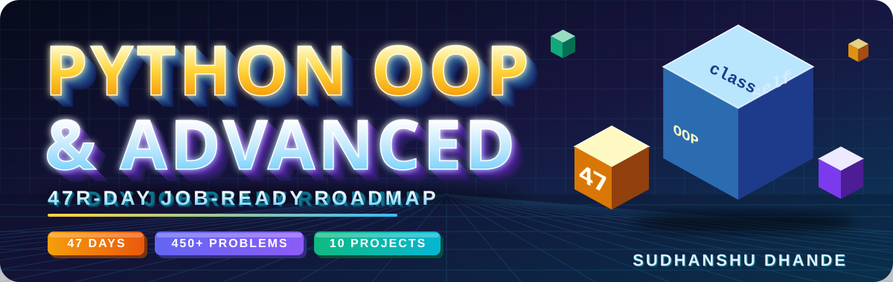
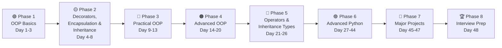

<p align="center">
  
</p>

<p align="center">
  
  
  
  
  
  
</p>

<p align="center">
  <b>Learn → Understand → Practice → Build → Debug → Push → Revise</b>
</p>

This repository contains my **47-Day Python OOP and Advanced Python Learning Journey**, based on the **CodeWithHarry Python course**.

The roadmap covers Python OOP fundamentals, advanced OOP, inheritance, magic methods, advanced Python modules, concurrency, real-world projects, and technical interview preparation.

My goal is not just to watch tutorials. I will write code myself, solve problems, build projects, and maintain my GitHub contributions.

---

## 🎯 Main Goals

- Understand Python OOP from beginner to advanced level.
- Learn advanced Python concepts and modules.
- Solve 10–15 practice problems on learning days.
- Improve logical thinking and debugging skills.
- Build real-world Python projects.
- Prepare for Python technical interviews.
- Write clean, reusable, and maintainable code.
- Understand how OOP can be used in AI/ML projects.

---

## 📚 Learning Source

| | |
| --- | --- |
| **Course** | CodeWithHarry — Python for Beginners (Full Course) |
| **Playlist** | [Watch on YouTube](https://youtube.com/playlist?list=PLu0W_9lII9agwh1XjRt242xIpHhPT2llg) |
| **OOP part** | Roadmap Day 01 – Day 48 |
| **Advanced Python part** | Roadmap Day 27 – Day 44 |
| **Projects + Interview** | Roadmap Day 45 – Day 48 |

---

## 🧭 Roadmap at a Glance



| Phase | Days | Focus | Outcome |
| :-- | :-: | :-- | :-- |
| 🟢 OOP Fundamentals | 01–03 | Classes, objects, constructors, `self` | Can create and use classes |
| 🟡 Decorators, Encapsulation & Inheritance | 04–08 | Decorators, properties, inheritance, access specifiers | Can protect data and reuse code |
| 🔵 Practical OOP | 09–13 | Static methods, variables, mini projects | First real projects |
| 🟠 Advanced OOP | 14–20 | Class methods, `super()`, magic methods, overriding | Writes Pythonic classes |
| 🔴 Operators & Inheritance Types | 21–26 | PDF project, operator overloading, all inheritance types | Understands class hierarchies |
| 🟣 Advanced Python | 27–43 | Time, `shutil`, `requests`, generators, caching, regex, async, threads, processes | Works with Python's powerful modules |
| 🚀 Major Projects | 44–46 | Banking, E-Commerce, Student Management | Portfolio projects |
| 🏆 Interview Prep | 47 | OOP + advanced Python questions, project explanation | Interview ready |

---

## 🗺️ Complete 47-Day Roadmap

## 🟢 Phase 1 — OOP Fundamentals

### Day 01 — Classes & Objects
- Classes
- Objects
- Attributes
- Methods
- `self`
- Multiple objects

**Practice:** 15 problems

### Day 02 — Constructors
- `__init__()`
- Constructor arguments
- Instance variables
- Default values

**Practice:** 15 problems

### Day 03 — Self & Constructor Practice
- Understanding `self`
- Instance data
- Multiple objects
- Constructor-based programs

**Practice:** 15 problems

---

## 🟡 Phase 2 — Decorators, Encapsulation & Inheritance

### Day 04 — Decorators
- Functions as objects
- Nested functions
- Wrapper functions
- Decorators
- `@decorator`

**Practice:** 10–12 problems

### Day 05 — Getters & Setters
- Getter
- Setter
- `@property`
- Encapsulation
- Controlled access to data

**Practice:** 15 problems

### Day 06 — Inheritance
- Parent class
- Child class
- Code reusability
- Inherited methods

**Practice:** 15 problems

### Day 07 — Access Specifiers
- Public
- Protected
- Private
- Name mangling

**Practice:** 12–15 problems

### Day 08 — OOP Revision
- Classes and objects
- Constructors
- Getters and setters
- Inheritance
- Access specifiers

**Practice:** 20 mixed problems

---

## 🔵 Phase 3 — Practical OOP

### Day 09 — Library Management System

Build a mini project using:

**Classes**
- `Book`
- `Library`
- `Student`

**Features**
- Add and remove books
- Search books
- Issue books
- Return books
- Display available books

### Day 10 — Static Methods
- `@staticmethod`
- Static methods
- Instance method vs static method

**Practice:** 12 problems

### Day 11 — Class Variables & Instance Variables
- Instance variables
- Class variables
- Shared data
- Object-specific data
- Overriding class attributes

**Practice:** 15 problems

### Day 12 — OOP Revision
- Class vs object
- Instance vs class variables
- Static methods
- Inheritance
- Encapsulation

**Practice:** 20 mixed problems

### Day 13 — File Organizer Project

**Features**
- Detect file types
- Create folders
- Move files
- Organize files automatically

**Focus:** Using classes to structure a practical program (`pathlib`, `shutil`, error handling).

---

## 🟠 Phase 4 — Advanced OOP

### Day 14 — Class Methods
- `@classmethod`
- `cls`
- Class-level operations

**Practice:** 12 problems

### Day 15 — Alternative Constructors
- Alternative constructors
- `@classmethod`
- Creating objects from different data formats

**Examples**
- `Student.from_string()`
- `Product.from_dict()`
- `Employee.from_csv()`

**Practice:** 10–12 problems

### Day 16 — Object Inspection
- `dir()`
- `__dict__`
- `help()`
- Object attributes
- Class attributes

**Practice:** 10 problems

### Day 17 — `super()`
- Parent constructor
- Parent methods
- `super()`
- Parent-child relationships

**Practice:** 15 problems

### Day 18 — Dunder / Magic Methods
- `__init__()`
- `__str__()`
- `__repr__()`
- `__len__()`
- `__add__()`
- `__eq__()`

**Practice:** 15 problems

### Day 19 — Method Overriding
- Parent methods
- Child methods
- Method overriding
- Runtime behavior

**Practice:** 15 problems

### Day 20 — Complete OOP Revision

**Revise**
- Classes and objects
- Constructors
- Getters and setters
- Inheritance
- `super()`
- Class and instance variables
- Static and class methods
- Method overriding
- Magic methods

**Practice:** 25 mixed problems

---

## 🔴 Phase 5 — Operators & Inheritance Types

### Day 21 — PDF Management Project
Build a PDF Management System.

**Focus**
- Classes and methods
- External libraries (installed with `pip`, for example `pypdf`)
- File handling
- Project structure

### Day 22 — Operator Overloading
- `__add__()`
- `__sub__()`
- `__mul__()`
- `__eq__()`
- `__lt__()`
- `__gt__()`

**Practice examples**
- Money + Money
- Point + Point
- Distance + Distance
- Time + Time
- Student comparison

**Practice:** 15 problems

### Day 23 — Single Inheritance

**Examples**
- Animal → Dog
- Vehicle → Car
- Person → Student
- Employee → Manager

**Practice:** 15 problems

### Day 24 — Multiple Inheritance
- Multiple parent classes
- Multiple inheritance
- Method resolution
- MRO basics

**Practice:** 10–12 problems

### Day 25 — Multilevel Inheritance

**Example**

```text
Animal
   │
Mammal
   │
  Dog
```

**Practice:** 12 problems

### Day 26 — Hierarchical & Hybrid Inheritance
- Hierarchical inheritance
- Hybrid inheritance
- Multiple inheritance combinations
- MRO basics

**Extra interview topics (not covered earlier in the course sequence)**
- Polymorphism (revision)
- Abstraction (`ABC`, `@abstractmethod`)
- Composition vs aggregation (has-a relationship)

**Practice:** 10–15 problems + 5 problems on polymorphism, abstraction and composition

---

## 🟣 Phase 6 — Advanced Python 

This phase covers the advanced Python topics from the second half of the course.

### Day 27 — Time Module

- `time` module
- `time.time()`
- `time.sleep()`
- `time.localtime()`
- Working with time
- Measuring execution time

### Day 28 — Creating Command Line Utility

- Command-line programs
- User input through terminal
- Command-line arguments (`sys.argv`, `argparse`)
- Building a command-line utility
- Handling user choices

### Day 29 — Walrus Operator

- Walrus operator `:=` (Python 3.8+)
- Assignment expressions
- Using expressions in conditions
- Using the operator in loops
- Difference between `=` and `:=`

### Day 30 — Shutil Module

- `shutil` module
- Copy files
- Move files
- Copy folders
- Remove folders
- File and directory operations

### Day 31 — Exercise 9 Solution

- Review the Exercise 9 solution.
- Compare the solution with your own logic.
- Understand mistakes.
- Improve the code.
- Rewrite the complete solution without copying.

**Challenge:** Make your Exercise 9 code cleaner and reusable.

### Day 32 — Requests Module

- `requests` library (install with `pip install requests`)
- HTTP requests
- GET request
- Response status code
- Response text
- JSON response
- Working with APIs

### Day 33 — Exercise 10: News App

- Understand the News App problem.
- Work with the Requests module.
- Understand API responses.
- Read JSON data.
- Display news information.
- Handle possible request errors.

**Challenge:** Build your own News App.

### Day 34 — Generators in Python

- Generators
- `yield`
- `next()`
- Generator functions
- Generator expressions
- Iterator vs generator
- Memory-efficient iteration

### Day 35 — Function Caching

- Function caching
- `functools`
- `lru_cache`
- Cached function results
- Understanding repeated function calls
- Performance improvement

**Practice:** 10–12 problems

### Day 36 — Exercise 10 Solution & Shoutout


- Review the News App solution.
- Understand API integration.
- Compare your implementation.
- Improve error handling.
- Refactor repeated code.
- Rewrite the project independently.

**Challenge:** Complete and document your News App.

### Day 37 — Drink Water Reminder


- Understand reminder logic.
- Work with time intervals.
- Display reminder messages.
- Repeat reminders.
- Use appropriate Python modules.

**Challenge:** Build a Drink Water Reminder application.

### Day 38 — Regular Expressions


- Regular expressions
- `re` module
- `re.search()`
- `re.findall()`
- `re.match()`
- `re.sub()`
- Pattern matching
- Basic email and phone validation

### Day 39 — AsyncIO in Python

- Asynchronous programming
- `async`
- `await`
- `asyncio` module
- Coroutines
- Event loop
- Concurrent asynchronous tasks

### Day 40 — Multithreading in Python

- Threading
- `threading` module
- Creating threads
- Starting threads
- Joining threads
- Concurrent execution
- Basic thread synchronization

### Day 41 — Multiprocessing in Python

- Multiprocessing
- `multiprocessing` module
- Creating processes
- Process execution
- Joining processes
- Parallel execution
- Threading vs multiprocessing

### Day 42 — Exercise 11 Solution: Desktop Notification System

- Understand the Exercise 11 solution.
- Learn desktop notification logic.
- Understand the required notification library (for example `plyer`).
- Display desktop notifications.
- Configure notification title and message.
- Handle notification timing.

**Challenge:** Build your own Desktop Notification System.

### Day 43 — Course Conclusion & Complete Revision

- Revise the complete Python course journey.
- Review OOP concepts.
- Review advanced Python modules.
- Review generators and caching.
- Review regular expressions.
- Review AsyncIO, multithreading, and multiprocessing.
- Identify weak topics.
- Prepare a personal revision list.

**Challenge:** Explain the concepts you learned without looking at notes.

---

## 🚀 Phase 7 — Major Real-World OOP Projects

These projects come after all the learning and practice topics.

### Day 44 — Banking Management System

**Classes**
- `Bank`
- `Account`
- `SavingsAccount`
- `CurrentAccount`
- `Customer`

**Features**
- Create account
- Deposit money
- Withdraw money
- Check balance
- Transfer money
- Display account details
- Validate transactions

**Concepts**
- Classes and objects
- Encapsulation
- Inheritance
- Method overriding
- Class methods
- Exception handling

### Day 45 — E-Commerce Management System

**Classes**
- `Product`
- `Customer`
- `Cart`
- `Order`
- `Payment`

**Features**
- Add product
- Remove product
- Add to cart
- Remove from cart
- Calculate total
- Apply discount
- Place order
- Process payment

**Concepts**
- OOP
- Encapsulation
- Composition
- Inheritance
- Operator overloading
- File handling

### Day 46 — Student Management System

**Classes**
- `Person`
- `Student`
- `Teacher`
- `Course`
- `Result`
- `College`

**Features**
- Add student
- Add teacher
- Add course
- Add marks
- Calculate percentage
- Calculate grade
- Search student
- Display result

**Concepts**
- Complete OOP revision
- Inheritance
- Polymorphism
- Encapsulation
- Class methods
- File handling

---

## 🏆 Phase 8 — Final Interview Preparation

### Day 47 — Complete Python OOP & Advanced Python Interview Preparation

Prepare for technical interviews covering:

**OOP Fundamentals**
- What is OOP?
- Class vs Object
- `self`
- Constructor
- Instance variable vs class variable
- Static method vs class method

**OOP Principles**
- Encapsulation
- Inheritance
- Polymorphism
- Abstraction
- Method overriding
- Method overloading concepts

**Advanced OOP**
- `super()`
- MRO
- Multiple inheritance
- Hybrid inheritance
- Magic methods
- Operator overloading
- Composition vs aggregation
- Decorators
- Properties

**Advanced Python**
- Walrus operator
- Time module
- Shutil module
- Requests module
- Generators
- Function caching
- Regular expressions
- AsyncIO
- Multithreading
- Multiprocessing

**Coding Interview Practice**
- 30+ conceptual questions
- 20+ coding problems
- 5 debugging problems
- 5 OOP design problems
- Project explanation practice

**Final Challenge:** Explain and demonstrate your three major projects without copying code or reading the README.

---

## 📊 Daily Practice Target

| Day Type | Target |
|---|---:|
| Normal learning | 10–15 problems |
| Revision | 20–25 problems |
| Advanced Python | 10–15 problems |
| Project day | 1 working project |
| Interview preparation | 30+ questions |

**Overall target:** approximately **450+ practice problems**, **10 projects**, and a complete set of interview questions in 47 days. The exact total depends on the problems completed each day.

---

## 🛠️ Projects You Will Build

| # | Project | Day | Type |
| :-: | -------- | :-: | ---- |
| 1 | Library Management System | 09 | Mini project |
| 2 | File Organizer | 13 | Mini project |
| 3 | PDF Management System | 21 | Mini project |
| 4 | Command Line Utility | 29 | Mini project |
| 5 | News App | 34 / 37 | Mini project |
| 6 | Drink Water Reminder | 38 | Mini project |
| 7 | Desktop Notification System | 43 | Mini project |
| 8 | Banking Management System | 44 | Major project |
| 9 | E-Commerce Management System | 45 | Major project |
| 10 | Student Management System | 46 | Major project |

---

## 🧠 Problem-Solving Rules

### Rule 1 — Don't Copy Code
Understand the concept and write the code yourself.

### Rule 2 — Try Before Seeing the Solution

```text
Understand the question
        ↓
Think about the logic
        ↓
Write the code
        ↓
Run the program
        ↓
Find and debug errors
        ↓
Improve the code
```

### Rule 3 — If Stuck
1. Read the question again.
2. Write the logic in simple words.
3. Break the problem into small steps.
4. Try the code yourself.
5. Identify the error.
6. Ask for a hint if required.
7. Check the solution only as a last option.
8. Close the solution and rewrite it yourself.

---

## 📁 GitHub Repository Structure

```text
python-oop-practice/
│
├── README.md
├── banner.svg
│
├── Day01_Classes_Objects/
├── Day02_Constructors/
├── Day03_Constructor_Object_Practice/
├── Day04_Decorators/
├── Day05_Getters_Setters/
├── Day06_Inheritance/
├── Day07_Access_Specifiers/
├── Day08_OOP_Revision/
├── Day09_Library_Management_System/
├── Day10_Static_Methods/
├── Day11_Class_and_Instance_Variables/
├── Day12_OOP_Revision/
├── Day13_File_Organizer/
├── Day14_Class_Methods/
├── Day15_Alternative_Constructors/
├── Day16_Object_Inspection/
├── Day17_Super/
├── Day18_Magic_Methods/
├── Day19_Method_Overriding/
├── Day20_OOP_Revision/
├── Day21_PDF_Management/
├── Day22_Operator_Overloading/
├── Day23_Single_Inheritance/
├── Day24_Multiple_Inheritance/
├── Day25_Multilevel_Inheritance/
├── Day26_Hierarchical_Hybrid/
│
├── Day27_Time_Module/
├── Day28_Command_Line_Utility/
├── Day29_Walrus_Operator/
├── Day30_Shutil_Module/
├── Day31_Exercise_9_Solution/
├── Day32_Requests_Module/
├── Day33_Exercise_10_News_App/
├── Day34_Generators/
├── Day35_Function_Caching/
├── Day36_Exercise_10_Solution/
├── Day37_Drink_Water_Reminder/
├── Day38_Regular_Expressions/
├── Day39_AsyncIO/
├── Day40_Multithreading/
├── Day41_Multiprocessing/
├── Day42_Desktop_Notification_System/
├── Day43_Complete_Python_Revision/
│
├── Day44_Banking_Management_System/
├── Day45_Ecommerce_Management_System/
├── Day46_Student_Management_System/
│
└── Day47_OOP_Interview_Preparation/
```

> 📌 Folder names start with a **capital `Day`** and a **two-digit number** (`Day01`, `Day02` … `Day47`) so GitHub shows them in the correct order.

---

## 📝 Daily Folder Format

**For normal learning days (OOP practice):**

```text
Day14_Class_Methods/
│
├── banner.svg
├── README.md
├── Q01.py
├── Q02.py
├── ...
├── Q15.py
└── Q16_Challenge.py
```

**For advanced Python days (modules and topics):**

```text
Day28_Time_Module/
│
├── banner.svg
├── README.md
├── theory.py
├── practice.py
├── challenge.py
└── screenshots/          # optional
```

**For major projects:**

```text
Day45_Banking_Management_System/
│
├── banner.svg
├── README.md
├── main.py
├── models.py
├── services.py
├── data/
├── tests/
└── requirements.txt
```

> Use two-digit file names (`Q01`, `Q02` … `Q15`) so GitHub shows files in the correct order. Add a `requirements.txt` whenever a day uses an external library (`requests`, `pypdf`, `plyer`).

---

## 🔥 GitHub Workflow

After completing each day:

```bash
git add .
git status
git commit -m "Day 01: Classes and Objects practice"
git push
```

**Commit message format**

```text
Day 01: Classes and Objects practice
Day 13: File organizer using Python OOP
Day 28: Time module practice
Day 45: Banking management system
...
Day 47: OOP interview preparation
```

---

## 📈 Progress Tracker

**Overall progress:** Day 24 of 47

```text
██████████░░░░░░░░░░  48%   (23 of 47 days completed)
```

| Day | Topic | Type | Status |
| --: | ----- | :--: | :----: |
| 01 | Classes & Objects | 📘 | ✅ |
| 02 | Constructors | 📘 | ✅ |
| 03 | Self & Constructor Practice | 📘 | ✅ |
| 04 | Decorators | 📘 | ✅ |
| 05 | Getters & Setters | 📘 | ✅ |
| 06 | Inheritance | 📘 | ✅ |
| 07 | Access Specifiers | 📘 | ✅ |
| 08 | OOP Revision | 🔁 | ✅ |
| 09 | Library Management System | 🛠️ | ✅ |
| 10 | Static Methods | 📘 | ✅ |
| 11 | Class & Instance Variables | 📘 | ✅ |
| 12 | OOP Revision | 🔁 | ✅ |
| 13 | File Organizer | 🛠️ | ✅ |
| 14 | Class Methods | 📘 | ✅ |
| 15 | Alternative Constructors | 📘 | ✅ |
| 16 | Object Inspection | 📘 | ✅ |
| 17 | `super()` | 📘 | ✅ |
| 18 | Magic / Dunder Methods | 📘 | ✅ |
| 19 | Method Overriding | 📘 | ✅ |
| 20 | Complete OOP Revision | 🔁 | ✅ |
| 21 | PDF Management Project | 🛠️ | ✅ |
| 22 | Operator Overloading | 📘 | ✅ |
| 23 | Single Inheritance | 📘 | ✅ |
| 24 | Multiple Inheritance | 📘 | 🟡 |
| 25 | Multilevel Inheritance | 📘 | ⬜ |
| 26 | Hierarchical & Hybrid Inheritance | 📘 | ⬜ |
| 27 | Time Module | 📘 | ⬜ |
| 28 | Command Line Utility | 🛠️ | ⬜ |
| 29 | Walrus Operator | 📘 | ⬜ |
| 30 | Shutil Module | 📘 | ⬜ |
| 31 | Exercise 9 Solution | 🔁 | ⬜ |
| 32 | Requests Module | 📘 | ⬜ |
| 33 | Exercise 10 — News App | 🛠️ | ⬜ |
| 34 | Generators | 📘 | ⬜ |
| 35 | Function Caching | 📘 | ⬜ |
| 36 | News App Solution | 🔁 | ⬜ |
| 37 | Drink Water Reminder | 🛠️ | ⬜ |
| 38 | Regular Expressions | 📘 | ⬜ |
| 39 | AsyncIO | 📘 | ⬜ |
| 40 | Multithreading | 📘 | ⬜ |
| 41 | Multiprocessing | 📘 | ⬜ |
| 42 | Desktop Notification System | 🛠️ | ⬜ |
| 43 | Complete Revision | 🔁 | ⬜ |
| 44 | Banking Management System | 🛠️ | ⬜ |
| 45 | E-Commerce Management System | 🛠️ | ⬜ |
| 46 | Student Management System | 🛠️ | ⬜ |
| 47 | OOP & Advanced Python Interview Preparation | 🎤 | ⬜ |

> **Legend:** 📘 Learning · 🔁 Revision · 🛠️ Project · 🎤 Interview  |  ✅ Done · 🟡 In progress · ⬜ Pending

---

## 🎯 Final Goal

After completing this 47-day roadmap, I aim to:

- Understand Python OOP concepts deeply.
- Work confidently with advanced Python modules.
- Build real-world Python applications.
- Understand APIs and HTTP requests.
- Use generators and caching.
- Understand asynchronous and parallel execution.
- Solve OOP-based coding problems independently.
- Explain projects in technical interviews.
- Write clean, reusable, and maintainable Python code.
- Apply OOP concepts in future AI/ML projects.

---

## 🚀 My Python Learning Journey

| | |
| --- | --- |
| **Duration** | 47 Days |
| **Learning Source** | CodeWithHarry Python Course |
| **Main Focus** | Python OOP + Advanced Python |
| **Projects** | 10 (7 mini projects + 3 major projects) |
| **Final Target** | Strong Python foundations, project development, problem-solving, and interview readiness |

> **Consistency > Speed**
>
> **Don't just watch the code. Understand it and write it yourself.**
>
> **Learn → Practice → Build → Debug → Push → Repeat.**

---

<h3 align="center"><b>Sudhanshu Dhande</b></h3>
<p align="center"><i>B.Tech CSE (AI &amp; ML) · BATU, Lonere · Python OOP &amp; Advanced Python Journey</i></p>